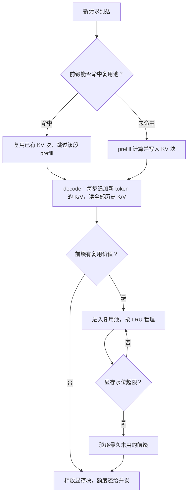
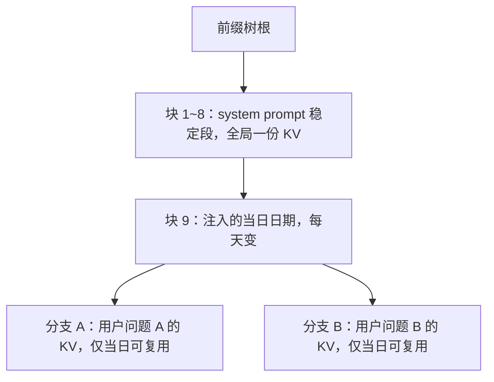

# KV Cache 与推理优化原理：一份中间结果的记账、复用与迁移

> TL;DR：KV Cache 不是引擎里的一个「加速开关」，而是推理系统中要主动记账、复用、驱逐、迁移的核心资产。所有相关优化都在回答四个记账问题：**算一次**（消灭平方级重算，省的是计算）、**存多久**（驻留换命中的 TTFT，驱逐换回并发额度）、**给谁用**（前缀复用与写时复制，命中边界是字节级一致——一个时间戳就能让命中率归零）、**放哪里**（PD 分离下的跨卡迁移，传 KV 还是重算是一道带宽对算力的题）。应用工程师的等价动作只有一条：稳定内容放 prompt 最前、易变内容放最后——API 时代，prompt 排布就是缓存策略。

## 背景

[《LLM 推理为什么贵》](LLM推理为什么贵.md)把 KV cache 当作「代价」引入：它是显存换算力那笔交易里的负债方，显存算式决定并发上限。这个视角讲到「KV 占多少显存」就停了。但真实系统里，一份 KV 写出来之后还要活很久——被同请求的后续几百步反复读、被下一轮对话重读、被相同开场白的陌生请求共享、在 PD 分离的架构里跨卡搬运、在显存吃紧时被驱逐后重算。**怎么管理这份资产的生命周期，是推理服务运营层的核心问题，也是上篇留白的下半场。**

还有两个流传很广的误解需要先拆掉。其一，「KV cache 是引擎内部实现细节，调 API 的应用层不用关心」——prefix caching 普及之后，prompt 里一个字段的位置直接决定服务端命不命中，命中与否直接决定 TTFT 和账单，应用层反而成了命中率的第一责任人。其二，「缓存命中是引擎自动白捡的收益」——错，命中是设计出来的：不稳定的 prompt 结构可以让命中率精确为零，而且监控里看不出任何异常。

与既有内容的分工：为什么 KV cache 省算力的机制证明，见[《KVCache 为什么省算力》](../questions/KVCache为什么省算力.md)；全部优化手段的清单式速览，见[《LLM 推理优化的主要手段》](../questions/LLM推理优化的主要手段.md)；成本视角的推演见上篇。本文专注它们都没展开的那一层——**KV cache 作为资产的记账、复用与迁移**。注意力结构本身（K/V 从哪来、为什么有平方级计算）见[《注意力机制的工程直觉》](../questions/注意力机制的工程直觉.md)，此处不再重复。

## 一、资产视角：写一次、读千百次

### 1.1 读写不对称是资产属性的全部来源

decode 阶段，KV cache 的读写结构是固定的：每步为 batch 里每条请求**追加** 1 个新 token 的 K/V，同时**读取**每条请求的全部历史 K/V 用于注意力打分。写入随时间线性增长，读取随「上下文长度 × batch」乘性增长（机制）：

- 1K 上下文、batch=1：每步读 KV ≈ 1024 × 0.5MB = 0.5GB，对比 14GB 权重读取只占 3.4%，权重主导（算式，7B MHA 口径 0.5MB/token，接上篇 2.2）；
- 1K 上下文、batch=64：每步读 KV ≈ 64 × 1024 × 0.5MB = 32GB，**反超**权重读取（算式，接上篇 1.4）；
- 4K 上下文、batch=64：每步读 KV ≈ 64 × 4096 × 0.5MB = 128GB——decode 彻底被 KV 读取支配，这就是 GQA（砍头数）与 KV 量化（砍位宽）存在的直接理由（机制，接上篇 2.3 与 5.1）。

写出量同口径只有 batch × 0.5MB ≈ 32MB/步。**写读比约 1:1000（算式）**——一份 KV 一旦算出，其价值取决于之后被读多少次。资产的账本由此展开：它值不值得驻留（第三节）、能不能给别人用（第二节）、要不要搬去别处（第四节）。

### 1.2 生命周期：一份 KV 的一生



这张状态机图是本文的地图：第二节讲「命中」分支，第三节讲「复用池 ↔ 驱逐」的循环，第四节讲 KV 离开本机的情形。所有分支共享同一个前提——KV 按固定大小的物理块管理（PagedAttention 的地基，机制见上篇 3.2），**离散的块是复用、共享、驱逐、迁移四种操作的共同单位**；连续预留制下这些操作一个都做不了。

### 1.3 体积下限的另一半：MLA，GQA 之外的路线

上篇把 GQA 定为「模型侧的第一杠杆」，但它只压「头数」这一个维度。DeepSeek 的 MLA（Multi-head Latent Attention）走了另一条路：把每个 token 的 K/V 投影进一个低秩潜向量，注意力计算时再从潜空间还原——KV 体积可压到 MHA 的十分之一以下（论文口径；机制：低秩近似，代价是注意力的部分表达自由度与 kernel 实现复杂度）。MLA 与 GQA 是二选一的架构选择、不可叠加，但 KV 量化仍可与 MLA 叠加、作用在潜向量上（机制判断）。

两条路线放在一起，指向同一个结论：**KV 体积是模型架构写死的，服务侧只能接受**。这也是选型时「不能只看榜单分数」的机制原因——同等质量下 KV 体积差一个数量级的两个模型，在长上下文高并发服务里是两套完全不同的容量规划（机制判断）。服务侧能动的只剩字节宽（KV 量化）与驻留策略，于是第二、三节的复用与驱逐才成为剩下的主要自由度。

## 二、复用：前缀缓存为什么成立，什么时候失效

### 2.1 机制依据：因果性保证了前缀等价

复用成立只依赖一条性质：decoder-only 的因果注意力下，**token i 的 K/V 只由前 i 个 token 决定，与之后的任何内容无关**（机制）。于是：两段请求若前 N 个 token 逐字节相同，则它们前 N 个 token 的 KV 逐块相同，直接复用即可，数学上与重新计算等价。（实现注：批内归约顺序可能带来浮点上的微小数值差，主流引擎默认直接复用，实践中未见由此引发的质量事故——经验判断。）

工程实现把这个性质落成索引：KV 块按内容哈希登记，且**哈希必须连同前缀链一起参与**（父块哈希进入子块哈希），保证「同哈希 ⇒ 同前缀 ⇒ 同 KV」；检索侧把块组织成前缀树——SGLang 的 RadixAttention 是这一形态的代表，vLLM 的 automatic prefix caching 同理（机制，见延伸阅读论文）。命中就是沿树匹配到最深公共前缀，之后从该位置继续 prefill。同一机制还能省批内副本：一个 prompt 采多个回复（parallel sampling）时，分支点之前的块直接共享、分支后才复制——写时复制（机制，与上篇 3.2 同源）。

块粒度本身是个权衡：块大，索引与元数据开销小，但共享起步门槛高、末块内部碎片大；块小，复用粒度细，元数据占比上涨（机制判断，主流引擎取 16~256 token/块量级）。这个参数通常无需应用层关心，但排查「明明共享大段前缀却没命中」时要知道它的存在——**对齐粒度以下的一个 token 差异，就会让那一段整块失效**。

### 2.2 失效语义：从第一个不同字节起，后面全部作废

前缀匹配是字节级的，且**失效向前传播**：前缀某处一个字节不同，该位置之后的所有块都不可复用。最容易踩的坑是「以为只差一个字段」：



日期块之后的整棵子树跨日全部重算——损失不是「一个字段」，是「该字段之后的全部前缀」。典型反模式（机制推演，逐一对应失效位置）：system prompt 里注入时间戳或随机请求 ID（开头即废）、few-shot 示例顺序不固定（中途废）、工具定义列表按请求动态增删（前缀起点就废，多数 API 渲染时工具在最前）、JSON 字段序列化顺序不稳定（随机位置废）。修正动作全部一致：**动态内容挪到消息序列尾部，稳定内容顶到最前**。

### 2.3 经济账：命中省的钱从哪来

自部署侧，命中省的是目标前缀的 prefill：以 4K token 的固定前缀、7B 模型为例，重算 prefill ≈ 2×7×10⁹ × 4096 ÷ (990×10¹² × 50%) ≈ 116ms（算式，MFU 为经验值，与上篇 1.3 同口径）。省的不只是这 116ms 延迟，还有这次 prefill 占用的算力槽——高并发下它还挤占别人的排队时间。

API 侧，命中部分的输入单价通常只有基础输入价的 10%~25%（经验判断，各厂口径不同，以账单 usage 中的缓存命中字段核实），首次写入常见 25% 左右溢价（经验判断）；可缓存前缀通常有数百到 1K token 的最低门槛（经验判断）——低于门槛的前缀不值得登记，管理开销吃掉收益。

多轮对话是最大宗的复用来源，算一笔（算式，假设每轮新增 1K token、共 10 轮、轮间历史逐字一致且未被驱逐）：

- 无复用：第 k 轮 prefill 长度 ≈ k×1K，总量 ≈ 55K token 的 prefill 计算；
- 有复用：每轮只算新增 1K，总量 ≈ 11K；
- **prefill 计算省约 80%（算式）**，且省的集中在 TTFT 最敏感的长历史段。

这与[《LLM 应用成本怎么控》](../questions/LLM应用成本怎么控.md)里「大头在重复发送的上下文」是同一笔账的两面：那篇算的是账单侧，这里算的是计算侧，机制同源——**逐字重发的历史，正是前缀缓存的原材料**。token 计量的口径（历史每轮怎么涨）见[《token 与上下文窗口》](../questions/token与上下文窗口.md)。

### 2.4 复用的适用面：一张表说清

| 场景 | 复用的 KV 单位 | 命中条件 | 收益量级 | 主要失效因素 |
| ---- | ---- | ---- | ---- | ---- |
| 固定 system prompt + few-shot | 整段前缀，跨请求共享 | 字节级一致且未被驱逐 | 免整段 prefill；API 计价约降一个数量级（经验判断） | 前缀混入动态字段 |
| 多轮对话 | 历史轮次前缀，跨轮复用 | 历史逐字重发、服务端未驱逐 | 10 轮会话 prefill 计算省约 80%（算式见 2.3） | 轮间改写历史、被驱逐、被路由到冷副本 |
| RAG 同文档多问题 | 文档块，跨请求共享 | 切片顺序与内容跨请求一致 | 文档越长、被问次数越多越划算 | 每请求重排导致块序变化 |
| 每次全新长输入 | 无可复用前缀 | 不成立 | 零收益 | 前缀天然互不相同 |

最后一行要诚实：前缀复用不是万能的，**每次输入都全新且互不相同的业务（如长文档一次性问答），它一分钱都省不了**——该走的是上下文压缩与结果级缓存（第五节对照）。

### 2.5 命中率怎么度量，什么时候「抖动」

命中率只有一个诚实定义：**命中的输入 token 数 ÷ 总输入 token 数**，而且要按前缀段拆开看——system 段命中率与历史段命中率是两个指标：前者该逼近 100%，后者受会话行为支配。混成一个总数，会把「system 段已拉满、历史段全 miss」读成「整体还行」，掩盖真正的问题（经验判断）。

复用池还有一个经典故障模式：**抖动（thrashing）**。池容量装不下活跃前缀的工作集时，LRU 会把刚命中的前缀驱逐出去，下一请求再重算、再驱逐，命中率骤降、prefill 耗时同步飙升、延迟方差拉大（机制，与操作系统缓存的抖动同构）。识别信号是命中率周期性跳水且与 prefill 耗时曲线同步。处置按优先级：扩池（加显存或加卡）→ 收缩驻留粒度（只驻最高频段）→ 冷热分层——冷前缀落 NVMe、热前缀驻显存，代价是回载走盘：NVMe 数 GB/s 量级的读带宽远低于 HBM，回载一条 4K 前缀（2GB）需数百毫秒量级（算式），所以分层只适合「重算更贵或算力更挤」的池（机制判断）。

## 三、驻留与驱逐：显存账本上的取舍

### 3.1 驻留的收益与机会成本

「前缀有复用价值」的判断，本质是一道机会成本题。收益侧：命中一次省一次 ~116ms prefill（4K 口径，见 2.3）。成本侧：4K 前缀驻留占 2GB 显存（0.5MB/token × 4096，算式），按上篇 2.2 的口径（80GB 卡扣掉权重剩 66GB、4K 请求 2GB/条）**恰好等于一条普通请求的并发准入额度**——多驻一份热门前缀，就少驻一条请求。结论（机制判断）：高频复用的 system prompt、热门文档池值得驻留，访问稀疏的长尾前缀不值得，判据是「预期复用次数 × 重算成本」对「显存机会成本」的比值。

多副本部署还叠加一个路由约束：**同会话必须路由到同一副本才可能命中**，前缀复用把负载均衡从「均匀分发」变成「均匀 + 亲和」的联合问题；亲和过强又会制造热点副本——这个平衡是平台调度层的题（场景化展开见[《LLM 推理服务平台》](../../system-design/questions/ai/LLM推理服务平台.md)）。

会话级驻留还要先算一笔总量账：1000 个并发会话、平均 4K 历史，全量驻留 ≈ 1000 × 4096 × 0.5MB ≈ 2TB 显存（算式）——把「记住每个会话的 KV」当成显式承诺，在容量上不成立。工程上的实际形态更聪明：服务端是**统一的块池**，会话历史与共享前缀进同一棵前缀树、参与同一轮 LRU 竞争——热门前缀靠高频访问自然常驻，冷会话历史自然被逐出，容量自动向高价值方向收敛（机制）。这也回答一个常见疑问：为什么主流 API 不承诺「你的会话 KV 我存在服务端」——逐字重发加尽力缓存，比硬承诺的容量账与隔离成本低得多（机制判断，对照 2.3 的多轮算式）。

### 3.2 驱逐与压缩：三个档位

| 策略 | 显存代价 | 换来什么 | 适用（经验判断） |
| ---- | ---- | ---- | ---- |
| 全量驻留热门前缀 | 4K 前缀 2GB ≈ 一条 4K 请求的准入额度（算式） | 重复请求免 ~116ms prefill 与对应排队 | 高频 system prompt、热门文档池 |
| LRU 驱逐 + 按需重算 | 显存全额还给并发 | 命中时多付一次 prefill | 访问稀疏、显存水位紧 |
| 驻留 + KV FP8 量化 | 驻留体积减半 | 同显存多驻一倍前缀 | 长前缀池，需过精度评测（接上篇 5.2） |

驱逐策略以 LRU 为默认（机制判断：LLM 流量里前缀热度高度头部化，固定 system prompt 的访问频次远高于长尾对话，LRU 的近似够用）。注意与上篇的一个呼应：KV 量化在 5.1 里是省带宽的手段，在这里是省驻留空间的手段——**同一次压缩，在两个账本上各记一笔**，这也是它值得优先做的理由。

## 四、迁移：PD 分离下，KV 去哪

PD 分离（prefill 与 decode 拆到不同实例）的动机上篇已经立住：两阶段瓶颈不同，混部互相拖累。分离的代价随即出现：prefill 实例算完的 KV，必须交给 decode 实例才能开始生成。**这份 KV 是传过去，还是让 decode 实例自己重算？**（机制对比，4K 上下文、7B 口径）

| 路径 | 耗时量级 | 消耗什么 | 结论（机制判断） |
| ---- | ---- | ---- | ---- |
| 节点内 NVLink 传 KV | 2GB ÷ 400GB/s ≈ 5ms；GQA 后 0.5GB ≈ 1ms（算式，H800 NVLink 带宽量级） | 卡间互联带宽 | 稳赚：毫秒级换掉百毫秒级 prefill |
| 跨机网络传 KV | 几十毫秒起（量级估计，取决于网络带宽与距离） | 网络带宽 | GQA 把体积砍 4 倍后常仍优于重算；弱网络下需实测 |
| decode 实例重算 prefill | ~116ms（算式见 2.3） | prefill 算力与该实例吞吐 | 目标实例前缀缓存能命中时反而更省 |

三个变量决定答案：KV 体积（GQA/KV 量化直接降）、互联带宽、目标侧的缓存命中情况。这一节也解释了一个架构事实：**KV cache 的物理形态（块化、可量化、体积公式）决定传输方案的可行域**——离散块让 KV 可以按需增量传输（prefill 流式算、边算边传，进一步压缩等待），这也是新一代 KV 集中式架构（如 Mooncake 把 KV 抽成全局缓存池）的出发点（机制，见延伸阅读）。

与第二节的组合同样重要：PD 分离的 prefill 实例自己也有前缀池——4K 前缀若在 prefill 侧就命中，需要产出并传输的只有新增段，传输量随之骤降。**复用先行、迁移其后**，两笔账要合并算，只算传输会高估分离的代价（机制判断）。

## 五、应用层：prompt 排布就是缓存策略

前面四节都是供给侧视角。需求侧只控制一件事——发出去的 prompt 长什么样——但这件事直接决定 2.2 的命中树长成什么形状。给定 API 渲染顺序（工具定义 → system → 消息序列），可执行的准则只有一条：

**把最稳定的内容放最前，最易变的内容放最后。** 具体排布（机制推演）：工具定义（跨请求不变）→ system prompt（跨请求不变）→ few-shot 示例（跨请求不变，顺序固定）→ 多轮历史（跨轮复用，逐字重发不改写）→ 检索内容（同一文档被多问时按块复用）→ 当轮用户输入（天然最易变）。每一层的复用周期从「永久」到「一次」递减，恰好排成一条命中率递减的链。

一个可对照的排布实例（text 示意，非真实请求）：

```text
反例：易变内容混进前缀开头
  [system]  你是客服。今天是 2026-10-30，工单号 T-82731。   ← 每请求都变，其后全部失效
  [few-shot] 示例 1 / 2 / 3
  [历史 + 当轮问题]

正例：稳定在前，易变在后
  [tools]    工具定义（跨请求不变，渲染在最前）             ← 永久命中
  [system]   只描述稳定规则                                 ← 跨请求整段命中
  [few-shot] 示例 1 / 2 / 3（固定子集、固定顺序）            ← 接续命中
  [历史]     逐字重发，不改写、不摘要                        ← 跨轮命中
  [检索内容] 本轮文档块                                     ← 同文档跨请求命中
  [当轮]     时间戳、工单号等动态字段放这里                  ← 天然一次性的部分
```

三个高频反模式与修正（逐一对应 2.2 的失效位置）：时间戳注入 system prompt——挪到当轮消息或干脆去掉（多数场景模型不需要精确时刻）；随机请求 ID/追踪 ID 进前缀——移到消息尾部元数据字段；few-shot 示例每次随机抽样——改为固定子集，或按前缀分组缓存多套。这些修正的共同点是**零成本**：不动模型、不动架构，改几行拼接代码，换来命中率的成倍差异（机制判断：命中边界是字节级的，所以收益对排布是阶跃函数而非平滑函数）。

最后分层澄清一个易混淆对象：**KV 前缀缓存 vs 语义缓存**。前者按「字节相同」复用中间计算，正确性由因果性保证（2.1）；后者按「语义相似」复用最终答案，省得更彻底但引入错误命中风险——相似的问题不一定有该复用的答案。两层不冲突且常叠加：网关层做语义缓存挡掉重复问题，模型侧做前缀缓存消化语义缓存没挡住的部分。语义缓存的命中/正确性矛盾展开见[《语义缓存》](../../system-design/questions/ai/语义缓存.md)。

一个立场收尾：调 API 的团队如果读不懂 usage 里的缓存命中字段（各家命名不同，语义是「本次命中了多少输入 token」），等于成本治理没开始——命中率是天然可观测的指标，**先看数、再改排布、后谈压缩**（经验判断，观测与归因的框架见[《Token 成本治理》](../../system-design/questions/ai/Token成本治理.md)）。

## 六、收束：四个记账问题的一张总账

| 记账问题 | 代表手段 | 判据 | 第一责任方 |
| ---- | ---- | ---- | ---- |
| 算一次 | KV cache 本身、前缀复用 | 平方级重算变线性（机制）；命中省 prefill（2.3 算式） | 引擎 + 应用排布 |
| 存多久 | 驻留 / LRU 驱逐 / 冷热分层 / KV FP8 | 重算成本 vs 显存机会成本（3.1、3.2） | 服务运营 |
| 给谁用 | 前缀树共享、写时复制、亲和路由 | 字节级前缀一致（2.1）；命中率按段拆分（2.5） | 应用层 + 路由层 |
| 放哪里 | PD 分离、增量传输、KV 集中池 | 传 KV vs 重算（四节表格）；体积 × 带宽 × 命中（机制判断） | 架构层 |

四行账合起来的结论是：**KV cache 的优化从来不是单点技巧，而是同一份资产在四个层面的联合运营**——应用层管前缀稳定性，路由层管亲和，运营层管驻留与驱逐，架构层管分离与传输。任何一层单独发力，都会被其余三层的默认状态封顶：排布不稳定，再大的复用池也是空的；池不运营，再稳的前缀也会被驱逐；迁移不算账，再好的命中也救不回传输的浪费（机制判断）。

## 总结

- **机制主线**：KV cache 的价值由复用决定（写一次、读千百次，算式见 1.1）；复用成立的边界是因果性 + 字节级前缀一致；驻留/驱逐/迁移全是「重算成本 vs 显存/带宽机会成本」的对比题。
- **适用边界一（自部署）**：本文的驻留、驱逐、亲和路由、传 KV 决策都发生在多实例、有复用流量的服务里；单卡单请求的本地推理没有这些决策，有效手段退回上篇的量化与投机解码。
- **适用边界二（调 API）**：供给侧手段全部不可控，唯一自由变量是 prompt 排布与多轮上下文的稳定性——这是零成本、收益阶跃的优化，应该最先做。对每次输入全新且互不相同的业务，前缀复用无收益，需转向语义缓存与上下文压缩。
- **不改变什么**：复用与驻留都**不省显存**——恰恰多占显存（KV cache 吃显存、省计算的方向判断见[《KVCache 为什么省算力》](../questions/KVCache为什么省算力.md)）；投机解码等改变「一次前向产一个 token」的结构级手段不在本文范围（清单见[《LLM 推理优化的主要手段》](../questions/LLM推理优化的主要手段.md)）。卡的供给与显存水位的平台侧权衡，见[《GPU 算力调度平台》](../../system-design/questions/ai/GPU算力调度平台.md)。
- **数字声明**：全文数字均为量级估计与机制推演，沿用上篇结构假设（7B、MHA 0.5MB/token、H800、MFU 50%）并标注口径；API 定价类数字为经验判断，以各厂账单字段核实。换模型结构或流量分布，先重算 1.1 与 2.3 两道算式，定性结论不变。
- 一句话收束：**缓存命中是设计出来的，不是等出来的——前缀稳定性是应用侧唯一的自由变量。**

## 延伸阅读

- 本仓库[《KVCache 为什么省算力》](../questions/KVCache为什么省算力.md)：为什么能复用的机制证明与显存算式，本文的压缩版前提
- 本仓库[《LLM 推理优化的主要手段》](../questions/LLM推理优化的主要手段.md)：手段全景图，含本文未展开的投机解码与 PD 分离速览
- 本仓库 [《LLM 推理为什么贵》](LLM推理为什么贵.md)：上篇——算力账、显存算式与四大基础手段的完整推演
- 本仓库 [LLM 推理服务平台](../../system-design/questions/ai/LLM推理服务平台.md)：驻留与亲和发展成平台调度问题的场景层展开
- 本仓库 [语义缓存](../../system-design/questions/ai/语义缓存.md)：结果级缓存的命中率与正确性矛盾，与本文的计算级缓存分层互补
- 本仓库 [Token 成本治理](../../system-design/questions/ai/Token成本治理.md)：命中率指标怎么进入应用侧的成本账
- 本仓库 [GPU 算力调度平台](../../system-design/questions/ai/GPU算力调度平台.md)：显存水位与卡供给的上游约束
- Kwon et al., *Efficient Memory Management for Large Language Model Serving with PagedAttention*, SOSP 2023（块化管理与前缀共享的地基）
- Zheng et al., *Efficiently Programming Large Language Models using SGLang*（RadixAttention，前缀树复用）, arXiv 2312.07104
- Zhong et al., *DistServe: Disaggregating Prefill and Decoding for Goodput-optimized Large Language Model Serving*, OSDI 2024（PD 分离与好品率目标）
- Qin et al., *Mooncake: A KVCache-centric Disaggregated Architecture for LLM Serving*, arXiv 2407.00079（以 KV cache 为中心的全局缓存池架构）
