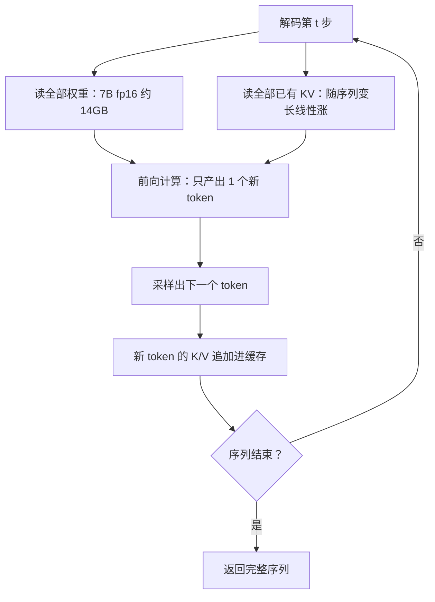
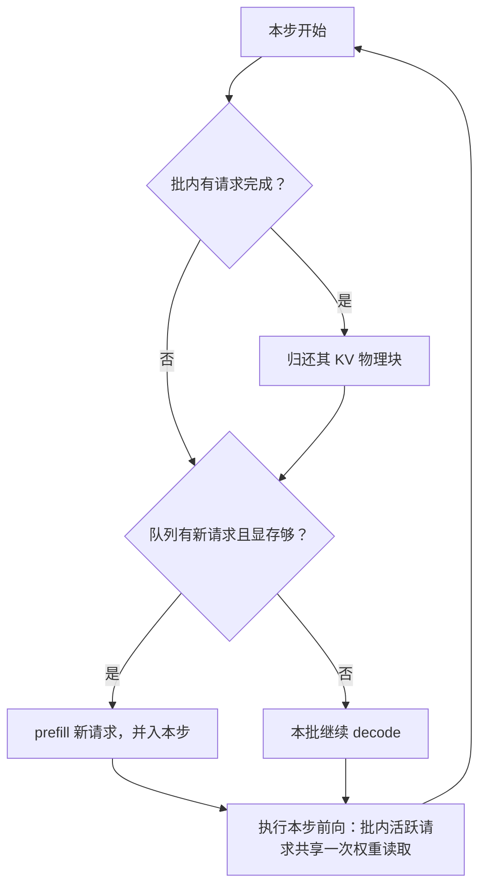
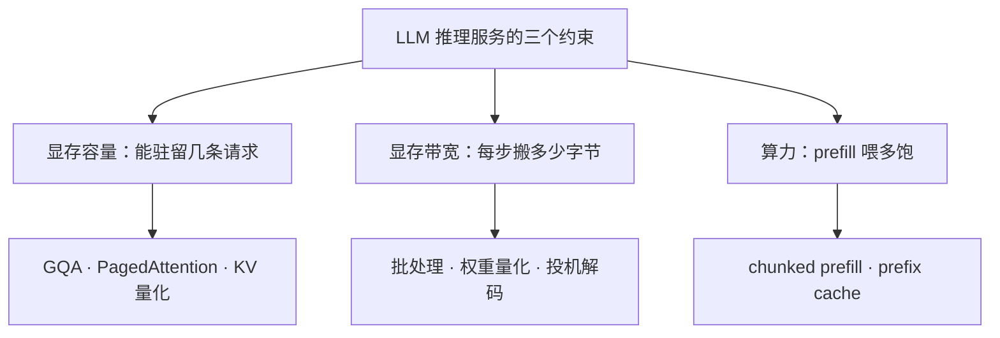

# LLM 推理为什么贵：从算术强度到 KV Cache、PagedAttention 与量化的完整推演

> TL;DR：LLM 推理贵的根源是结构性的：自回归每产出一个 token 都要完整读一遍模型权重，batch=1 时算力单元空转 99% 以上（算式，见 1.2）。围绕这个根因，四大工程手段各管一段：KV Cache 用显存换算力，砍掉平方级重算，代价是显存随上下文线性涨、成为并发上限；PagedAttention 消灭显存浪费，让准入从「按最大长度预留」变成「按实际用量」；continuous batching 消灭时间空转，把调度粒度从「批」降到「迭代」；量化直接砍要搬的字节数——decode 受显存带宽限制，字节减半、单步近似快一倍。判断口诀：decode 是带宽问题，prefill 是算力问题，并发是容量问题。开错药就是白花钱。

## 背景

后端工程师第一次认真为 AI 应用做成本预算时，通常会被两个数吓到：API 按「每百万 token」计价，自部署按「每卡时」计价，折算下来一个 token 的成本比一次 MySQL 行查询高几个数量级。更反直觉的是定价结构——几乎所有模型 API 的输出 token 单价都是输入的 3~4 倍（经验判断）。这个价差不是营销策略，它精确反映了一个机制事实：输入可以整批并行算（prefill），输出只能一个一个吐（decode）。两种计算形态的成本结构完全不同。

市面上的多数解释停在名词层面：KV cache「加速推理」、PagedAttention「提升吞吐」、量化「压缩模型」。名词背得再多，回答不了三个真正的问题：贵在哪个环节？省的是哪笔账？两个手段同时上会不会冲突？

本文按「问题 → 机制 → 工程后果」推一遍。起点是一笔算术强度的账，后面四个优化手段全部是这笔账的推论——理解了 1.2 节那道除法，其余内容都是自然结果。与面试题的分工：压缩版答案见[《KVCache 为什么省算力》](../questions/KVCache为什么省算力.md)与[《LLM 推理优化的主要手段》](../questions/LLM推理优化的主要手段.md)，本文比它们深一层，回答「为什么必然如此」。

## 一、一笔算力账：自回归结构为什么天生贵

### 1.1 每次前向只产出一个 token

训练时一个 batch 里的几百个 token 同时算，GPU 吃得很饱；推理生成时，第 t+1 个 token 依赖第 t 个 token 的输出，时间维度上无法并行——这是自回归的定义，不是实现缺陷。于是每个 token 都要走一遍完整前向，全部参数参与一次计算：

这个循环里藏着成本的第一性原理：**每产出一个 token，代价下限是一次全量权重读取**。

### 1.2 算术强度：1 FLOP/byte 对 300 FLOP/byte

GPU 是吞吐机器，判断一段负载「贵不贵」要看算术强度（每搬一字节能摊多少次浮点运算）与硬件脊点的比值。以 7B 模型 fp16 部署在 H800 上为例（算式，结构假设：约 70 亿参数、bf16/fp16 两字节表示）：

- 权重体积 ≈ 7×10⁹ × 2B = 14GB；每 token 前向计算量 ≈ 2×7×10⁹ = 1.4×10¹⁰ FLOPs → **算术强度 ≈ 1 FLOP/byte**
- H800 脊点 ≈ 990 TFLOPS（bf16 稠密峰值）÷ 3.35TB/s（HBM 带宽）≈ **300 FLOP/byte**

decode 在 batch=1 时算术强度只有 1~2，离脊点两个数量级：算 1 个 token 的计算时间是 1.4×10¹⁰ ÷ 990×10¹² ≈ 14μs，而搬权重的时间是 14GB ÷ 3.35TB/s ≈ 4.2ms——**计算与搬运的时间比约 0.3%，即 batch=1 的 decode 里 GPU 算力单元空转 99% 以上（算式）**。取有效带宽 60%（经验判断，含 kernel 效率与调度间隙），单步 ≈ 7ms，单序列输出 ≈ 140 token/s。

结论先立住：**LLM 推理贵的根源不是「算力不够」，是「一次前向只产一个 token」的串行结构让吞吐机器在干延迟硬件的活**。

### 1.3 prefill 与 decode 的不对称

同一个模型，输入和输出走的是两种物理形态：

- **prefill（处理输入）**：整段输入一次前向，token 间并行，算术强度高，是算力受限负载。1K 输入的 prefill 计算 ≈ 2×7×10⁹×1000 = 1.4×10¹³ FLOPs，取 MFU 50%，在 H800 上 ≈ 28ms（算式，MFU 为经验值）。
- **decode（产出输出）**：如 1.2 所算，带宽受限，算力大量闲置。

这就是输出 token 比 input 贵 3~4 倍的机制根源（结合 1.1 的串行结构）。工程后果：**TTFT（首 token 延迟）优化算力供给，TPOT（每 token 延迟）优化显存带宽，是两个不同的工种**——给 TTFT 加卡和给 TPOT 降精度，是两个方向的动作。

### 1.4 批处理：第一顺序的修法，和它的两堵墙

批处理让 N 条请求分摊一次权重读取，直接改写 1.2 那道除法。算一笔（算式，假设 batch=64、平均上下文 1K、7B MHA 模型）：

- 每步读取 = 权重 14GB + KV 读取 64 × 1024 × 0.5MB ≈ 46GB
- 单步 ≈ 46GB ÷ 2TB/s ≈ 23ms → 吞吐 ≈ 64 ÷ 23ms ≈ **2800 token/s，约为 batch=1 的 20 倍**

但批处理撞两堵墙：

1. **显存容量墙**：64 条请求的 KV 必须同时驻留显存，驻留数就是并发上限——KV 占多少、能驻几条，见第二节的算式。
2. **KV 带宽墙**：注意上面算式里 KV 读取（32GB）已经超过权重（14GB）。批越大 KV 读取线性涨，decode 永远到不了算力受限区——批处理改变的是「每字节换多少 token」，不改变「瓶颈在带宽」这个定性。

所以批处理是第一顺序的修法，但它的收益上限由 KV cache 决定。这就是为什么服务引擎的故事要从 KV cache 讲起。

## 二、KV Cache：一笔显存换算力的交易

### 2.1 没有它会怎样：平方级重算

注意力机制的每个新 token 都要「回看」之前所有 token 的 K/V。如果不缓存，每生成一个 token 就要把整个前缀重新过一遍模型：生成 n 个 token 的总前向计算量随 n² 增长（每步重算全部前缀）；缓存之后每步只算 1 个新 token，总量线性于 n（机制，忽略注意力得分项）。两者相差约 n/2 倍——生成 1000 个 token 就是约 500 倍的计算差（算式）。

所以 KV cache 的本质是**一笔交易：把平方级的计算账，换成线性级的显存账**。算力省下来的每一分，都以显存的形式记在负债表另一侧。

### 2.2 显存占用算式：所有并发规划的起点

每 token 的 KV 显存 = 2（K 和 V）× 层数 × KV 头数 × 头维度 × 每元素字节数。代入真实结构（算式）：

| 模型（结构假设） | 每 token KV | 4K 上下文单请求 | 80GB 卡可同驻请求数 |
| ---- | ---- | ---- | ---- |
| 7B · MHA（32 层 × 32 KV 头 × 128 维） | 0.5MB | 2GB | 66GB 可用 ÷ 2 ≈ 33 条 |
| 7B · GQA（8 个 KV 头） | 0.125MB | 0.5GB | 66GB ÷ 0.5 ≈ 130 条 |
| 70B · GQA（80 层 × 8 KV 头） | 0.32MB | 1.3GB | fp16 权重 140GB，需 2×80GB 张量并行，同驻约 15 条 |

这张表有三个推论，每一个都是一类线上事故的机制来源：

- **推论一（容量挤兑）**：一条 32K 上下文的 7B MHA 请求占 16GB KV，等于几十条普通请求的准入额度被一人吃光。长上下文请求拖垮实例的第一机制在这里。
- **推论二（带宽拖累）**：decode 每步要读全部已有 KV，序列越长单步越慢；高并发下一条长输出的请求持续推高邻居的 TPOT（机制，接 1.4 的 KV 带宽墙）。「一条长请求拖垮一个实例」是容量压并发 + 带宽抬延迟两个机制的叠加，只答出其一说明账没算全。
- **推论三（结构决定下限）**：KV 头数是模型结构写死的，服务侧无法选择——所以 GQA 才成了模型侧的第一杠杆。

### 2.3 第一杠杆：GQA

GQA（分组查询注意力）让多个 query 头共享一组 KV 头：7B 从 32 个 KV 头砍到 8 个，每 token KV 从 0.5MB 降到 0.125MB，4 倍。收益是双份的（算式 + 机制）：

- **容量侧**：同驻请求 33 → 130 条，并发准入翻两番；
- **带宽侧**：decode 每步的 KV 读取同降 4 倍，1.4 的 KV 带宽墙同步松动。

这里给一个立场：对服务化模型而言，GQA 不是「优化项」，是**准入条件**——没有 GQA 的 MHA 模型在长上下文场景下连合理并发都凑不出来。这也解释了为什么近两年的开源模型几乎默认带 GQA/MQA：模型结构的一次改动，等价于服务侧数倍的显存与带宽预算。

## 三、PagedAttention：把操作系统的解法搬进 GPU

### 3.1 问题：按最大长度预留的显存管理

KV cache 有了算式，下一个问题是「怎么分配」。此前的引擎（2023 年之前）沿用最直觉的做法：请求到达时，按最大可能长度（如 4096）**连续预留**一块 KV 空间。三种浪费随之而来（机制）：

- **内部碎片**：预留 4096 个 token 的位置，实际只生成 300 个，剩下 87% 一直空占；
- **外部碎片**：请求结束释放后，显存里留下大小不一的空洞，新请求需要的连续大块可能拼不出来；
- **不可共享**：parallel sampling（一个 prompt 采多个回复）等场景下，相同前缀的 KV 被各复制一份。

浪费到什么程度：vLLM 论文（SOSP 2023）实测，此前系统的 KV 显存只有约 20%~38% 在存有效数据，即 **60%~80% 被浪费**；分页管理后浪费降到 4% 以下（论文实测口径）。注意这不是「跑不满 benchmark」级别的浪费——KV 显存就是并发准入额度（2.2），浪费 70% 等于七成的卡钱在陪跑。

### 3.2 机制：分页 + 块表

PagedAttention 的做法是把操作系统的虚拟内存原样平移过来（机制）：

- KV 按**固定大小的物理块**（如 16 个 token）分配，逻辑上连续、物理上离散；
- 每请求维护一张**块表**（逻辑块号 → 物理块号），注意力计算时按块表寻址；
- 按需增长：生成到哪分配到哪，内部碎片从「整个预留区」缩到一个块以内（<4%，论文口径）；
- **写时复制**：多个输出共享 prompt 前缀的物理块，分支时才复制；
- **前缀共享**：相同 system prompt / few-shot 前缀跨请求共享物理块——这直接成为 prefix caching 的地基。

为什么这个平移如此可靠？因为「按需分页消除内外碎片」正是虚拟内存三十年前解决过的问题，解法经过整个行业验证（机制 + 经验判断）。工程上真正难的不是想出分页，是让注意力 kernel 学会按块表做非连续访存——这是 vLLM 的核心贡献。

### 3.3 工程后果与一个常见混淆

- **准入模型变了**：从「预留制」（按最大长度划走）变「实际用量制」（用多少占多少），同卡可驻请求数立刻翻倍起（机制判断，具体倍数取决于长度分布）。
- **论文口径吞吐 2~4×**（对比当时的 FasterTransformer 与 Orca，同延迟水平，论文实测）。要诚实标注：这是 2023 年的基线，如今各家引擎都实现了分页，静态对比差距已收窄——这项工作的价值在确立了「KV 显存管理 = 服务容量」这个范式，不在今天还能快几倍。
- **一个高频混淆必须拆开**：PagedAttention **不减少 KV 的字节数**，它消灭的是「已分配显存中的浪费」；减少字节数靠 GQA（砍头数）和量化（砍精度）。前者管「分配效率」，后者管「物理体积」——两个杠杆叠加生效，混为一谈会得出「上了 PagedAttention 就不用 GQA」的错误结论。

## 四、Continuous batching：把调度粒度从「批」降到「迭代」

### 4.1 问题：静态批的空转

批处理解决了权重读取的分摊，但最朴素的批处理（静态 batching）有一个结构性缺陷：**批的生命周期绑定最长序列**。凑 32 条一起 decode，谁都要等到最长的那条结束才能整批释放（机制）。LLM 输出长度的方差极大——同一个模型，回答「你好」要 10 个 token，写周报要 2000 个（经验判断）。

空转比例可以估算（算式，假设输出在 1~2000 均匀分布、批 32 条）：批内平均长度 ≈ 1000，最长 ≈ 1900+，空转比例 ≈ 1 − 1000/1900 ≈ **一半算力在给已完成的请求陪跑**。此外静态批还伤 TTFT：新请求必须等上一批整体释放才能进批，排队时间与批生命周期耦合。

### 4.2 机制：迭代级调度

Orca（OSDI 2022）提出的关键转变：把调度原子单位从「批」降到「迭代」（iteration-level scheduling）。每个 decode 步只有几毫秒，每一步都是一个决策点：

三个要点（机制）：

- **完成即退**：请求生成完最后一个 token，下一步就不再参与批，空转消失；
- **即到即入**：新请求随时插入，TTFT 不再等批，只看自己的 prefill；
- **prefill 插缝**：新请求的首步前向（prefill）穿插在 decode 步之间，长输入再切成小块（chunked prefill），避免一条大 prefill 冻结全批 decode。

调度开销不是问题：decode 每步毫秒级，步级检查微秒级，开销占比可忽略（机制判断）。收益巨大、代价趋零，这就是为什么 continuous batching 在所有主流引擎里都是默认行为而非可选项——**它不是「优化开关」，是调度器的正确写法**。

### 4.3 与 PagedAttention 的共生关系

即到即入有个隐含前提：新请求插入时要**立刻**为它分配 KV 空间。预留制下这要求一块足够大的连续空闲区——批被切得越碎，越难凑出连续大块。分页之后，插入 = 分配几个物理块，天然平滑。这就是为什么 vLLM 把两者打包出现：**分页管「空间随时可分配」，迭代调度管「请求随时可进出」，合成一个高水位运转的引擎**。也是从这一代系统开始，引擎的核心复杂度从 kernel 转移到了调度器——准入、抢占、优先级、显存水位，全在这一个循环里（经验判断，见延伸阅读的场景题）。

## 五、量化：直接砍「要搬的字节数」

### 5.1 为什么量化在 decode 上特别灵

1.2 节立了定性：decode 时间 ≈ 搬运字节数 ÷ 带宽。量化直接砍分子。权重从 fp16 降到 int8/int4，7B 的权重体积从 14GB 变 7GB/3.5GB。但加速比不是简单的「字节数之比」，把 KV 读取算进来才诚实（算式，沿用 1.4 的 batch=64、1K 上下文、46GB/步）：

- 加速比 = (W + KV) ÷ (W′ + KV)。只砍权重（W8A8）：46 ÷ (7+32) ≈ **1.2×**；权重和 KV 都砍半：46 ÷ (7+16) ≈ **2×**
- batch=1 时反过来：W 独占读取，只砍权重就有 fp16 的 2×（W8A8）到 4×（W4A16）

这个对比给出一个反直觉的结论：**批越大、上下文越长，KV 量化的价值越接近甚至超过权重量化**——单机玩家砍权重收益最大，规模化服务必须连 KV 一起管。另一个必须诚实标注的边界：W4A16 只压权重、激活仍是 fp16，而 prefill 是算力受限负载，所以它对 TTFT 几乎无益；FP8（W8A8）在 Hopper 上连张量算力峰值都翻倍，prefill 与 decode 两头受益（机制）。

### 5.2 档位与取舍

| 方案 | 压什么 | 7B 体积变化 | 主要收益 | 主要风险 | 建议位置（经验判断） |
| ---- | ---- | ---- | ---- | ---- | ---- |
| W8A8（INT8 / FP8） | 权重 + 激活 | 14GB → 7GB | decode 单步近似减半；FP8 下 prefill 算力也翻倍 | 需校准；精度损失通常小（经验判断） | 生产默认档 |
| W4A16（GPTQ / AWQ） | 仅权重 | 14GB → 3.5GB | 权重读取降 4 倍；省出的显存给 KV，并发上涨 | 对 TTFT 无益；不同模型/任务掉点差异大，需金标评测逐个验证 | 批量 / 离线池，或显存紧张的单机 |
| KV Cache FP8 | KV 数值精度 | 单请求 KV 减半 | 并发近似翻倍 + 每步 KV 带宽减半（接 5.1） | 注意力对数值精度更敏感，长上下文任务需专项评测 | 长上下文池 |

精度风险用一条原则兜底：**量化决策必须过金标评测，不看基准榜单看自家任务集**——W8A8「通常近无损」是行业大量实践后的经验判断，不是定理，每个模型每个任务集都可能翻车。

### 5.3 量化不改变什么

量化改的是「每个字节换多少 FLOPs」，不改变自回归的串行结构：每步依然只产出一个 token，延迟下限依然由「读一遍全部权重 + KV」决定。在结构层面动刀的是另一族手段——投机解码（小模型起草、大模型一次前向验证多个 token，把「一次前向一个 token」的约束撬开）以及 prefill/decode 分离部署。这些属于手段全景图，见[《LLM 推理优化的主要手段》](../questions/LLM推理优化的主要手段.md)，本文不展开。

## 六、拼起来：四个优化，三个约束

回头看，四个手段没有一个是孤立技巧，全部挂在三个硬件约束上：

| 优化 | 它回答的问题 | 机制一句话 | 它不解决什么 |
| ---- | ---- | ---- | ---- |
| KV Cache | 已算过的能不能不算 | 显存存 K/V，平方级重算变线性 | 不省显存，反而吃显存 |
| GQA | KV 太大 | 多 query 头共享 KV 头，字节降 4 倍 | 不改变串行结构 |
| PagedAttention | 显存浪费 | 分页 + 块表，碎片与预留浪费趋零 | 不减少 KV 本身的字节数 |
| continuous batching | 时间空转 | 完成即退、即到即入，批内常满 | 不减少单步耗时 |
| 量化 | 字节太多 | 低精度表示，砍搬运量 | 不改变串行结构，不救 TTFT（W4A16） |

四个手段相互成就：GQA 缩小 KV 体积 → 分页让这些字节零浪费 → 批处理让权重读取被摊薄 → 量化让每步搬运量再降。**一个生产级推理引擎，本质是容量、带宽、算力三个约束的联合调度器**；只优化其中一项，天花板由剩下的约束决定——这也正是推理服务在架构层持续调平衡的原因（场景层展开见[《LLM 推理服务平台》](../../system-design/questions/ai/LLM推理服务平台.md)）。

## 总结

- **本文结论的适用边界**：自部署、多并发、规模化的推理服务。四大手段全是「服务吞吐」的优化，前提是多请求可批。
- **batch=1 场景不适用**：本地部署、端侧推理没有批可调，PagedAttention 与 continuous batching 基本无感；有效手段是量化（压权重进显存）与投机解码（压延迟）。
- **调 API 的应用层不适用**：以上全部是模型供应商的内部账。应用工程师的等价抓手是上下文治理、缓存与路由级联——机制不同，目标同向（见[《Token 成本治理》](../../system-design/questions/ai/Token成本治理.md)与[《多模型路由与降级》](../../system-design/questions/ai/多模型路由与降级.md)）。
- **数字声明**：全文数字均为量级估计与机制推演，标注了结构假设（7B/70B、fp16、H800）与经验判断（有效带宽 60%、MFU 50%、输出长度分布）；换型号、换负载分布，先重算 1.2 和 2.2 的两道算式，结论的定性不变、倍数会变。
- 一句话收束：**decode 是带宽问题，prefill 是算力问题，并发是容量问题——先定位撞的是哪堵墙，再谈优化。**

## 延伸阅读

- 本仓库[《KVCache 为什么省算力》](../questions/KVCache为什么省算力.md)：本文第二节的压缩版答案
- 本仓库[《LLM 推理优化的主要手段》](../questions/LLM推理优化的主要手段.md)：手段全景图，含本文未展开的投机解码、PD 分离、prefix caching
- 本仓库 [LLM 推理服务平台](../../system-design/questions/ai/LLM推理服务平台.md)：把本文的机制推到平台架构层——容量估算、分池调度与成本锚点
- 本仓库 [GPU 算力调度平台](../../system-design/questions/ai/GPU算力调度平台.md)：卡从哪来、利用率指标为什么有欺骗性
- 本仓库 [Token 成本治理](../../system-design/questions/ai/Token成本治理.md)：应用侧的同一笔账——token 怎么变成账单
- Kwon et al., *Efficient Memory Management for Large Language Model Serving with PagedAttention*, SOSP 2023（vLLM，显存分页的原始论文）
- Yu et al., *Orca: A Distributed Serving System for Transformer-Based Generative Models*, OSDI 2022（迭代级调度的原始论文）
