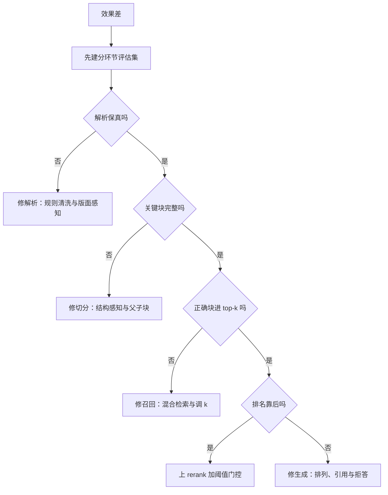

# RAG 全链路每一环丢多少分：从解析到评估的机制推演与优化代价

> TL;DR：RAG 是乘法链路，不是加法堆叠——端到端可用率近似等于各环节保持率的连乘，短板环节决定上限。解析和切分最便宜却最常致命（经验判断：占效果问题一半以上），混合检索和 rerank 决定「搜到的块能不能用」，分环节评估决定一切优化是否可信。排优化的正确顺序：先建分环节评估集，再修数据（解析/切分），再调检索与重排，最后才轮到换 embedding、微调这类贵动作。

## 背景

RAG 效果差时，最常见的第一反应是三件事：换 embedding 模型、改 prompt、加 rerank。这三个动作都落在链路的中下游，而相当一部分问题的根因在链路最上游——解析丢了表格、切分切碎了答案。盲调的典型结果是：评估集上忽好忽坏、无法归因，团队在 prompt 上反复横跳，两周后回滚。

本文把 RAG 拆成六个环节（解析 → 切分 → 检索 → 重排 → 生成 → 评估），逐环推演三件事：机制上它如何影响召回与精度、对端到端效果的量级影响、优化它的手段与代价。定位是论证型推演而非实测报告：所有数字要么给算式与机制依据，要么明确标注经验判断。讨论范围默认是「单库、单轮、问答型 RAG」这一最常见形态，Agent 式多跳场景的差异在总结里单独讨论。面试题（如 [RAG效果差怎么排查](../questions/RAG效果差怎么排查.md)）是压缩版清单，本文是它背后的完整展开。

## 正文

### 1. 链路视角：为什么是乘法

把每个环节抽象成「保持率」：经过这一环，原本可回答的问题还剩多少比例能继续往下走，则端到端可用率 ≈ 各环节保持率的连乘。一个简化算式（机制推演，非实测）：解析保真 0.9 × 切分命中 0.7 × 向量召回 0.8 × 重排保留 0.9 ≈ 0.45。四个环节单看都不算差，连乘后近半的问题已经拿不到正确证据。

乘法结构推出两个结论：

1. **短板决定上限**。0.7 的环节不修，把 0.8 修到 0.95，端到端只从 0.45 涨到 0.53；把 0.7 修到 0.9，直接到 0.58（同一算式）。优化要按「边际收益 ÷ 改动成本」排序，而边际收益最大的往往是最便宜的环节。
2. **环节之间不可替代**。rerank 修不了切分——答案不在候选集里，排序无意义；换 embedding 修不了解析——错误的文本嵌入得再好也是错的。每个环节的优化只在该环节恰是瓶颈时才产生收益。

这也定下了本文的叙述顺序：从上游到下游，每环先讲机制、再讲量级、再讲手段与代价。

### 2. 解析：最便宜的一步，最贵的错误

**机制**。解析不是「把 PDF 转成 txt」，而是版面理解。三类典型损伤：

- **表格线性化**。表格被逐 cell 拼接成文本后，行列对应关系丢失。「Q3 营收是多少」的答案在解析后可能变成一串无结构数字，语义上已不可答。
- **阅读顺序错乱**。双栏 PDF 按左右横切后两栏句子交错；PPT 文本框的顺序只能靠坐标猜测。
- **噪声注入**。页眉、页脚、水印、目录在每页重复出现。这类块字面重复度高，BM25 得分容易虚高，会抢占 top-k 名额——这是解析噪声的第二重伤害：不仅自身不可答，还挤掉可答的块。

**量级影响**。正文型文档（条款、文章）的朴素解析通常可用；表格与多栏密集的文档（财报、工单、报告）是重灾区。经验判断：表格密集语料上不做版面感知处理，表格类问题的可答率可能从「可用」掉到接近零，而这类问题在业务 query 中的占比往往不低。

**手段与代价**：

| 手段 | 机制 | 代价 | 适用 |
| --- | --- | --- | --- |
| 规则清洗（去页眉页脚、去重行） | 消灭字面噪声块 | 几乎为零 | 所有语料，第一步就该做 |
| 版面感知解析器 | 保留表格行列与阅读顺序 | CPU 解析耗时上升，复杂版面仍有错 | 表格/多栏语料 |
| VLM 解析（视觉模型读页） | 把解析变成视觉理解任务 | 经验判断：每页 1~3 秒加模型费用，只能放离线增量管线 | 扫描件、复杂版面、高价值文档 |

**验收标准是立场所在**：解析质量必须抽样量化（例如标注「表格结构保真率」），把它当数据质量指标，而不是管线里默认正确的一步。解析错误进入索引后是静默的——检索不会报错，答案只是悄悄变差。

**成本结构视角**。解析是「一次成本、多次收益」：每份文档解析一次，被成千上万次检索复用。算式（量级假设）：一份 100 页、解析成本 10 元的文档，若被 1000 次 query 命中，摊销后约 0.01 元/query——远低于一次生成的 token 费用。这解释了一个反直觉的结论：链路里最便宜的环节，恰恰值得投入最贵的处理（VLM、人工抽检），因为它的费用按「每 query 摊销」而不是「每页成本」核算。

**增量一致性**。解析还必须是确定性的：同一份文档重解析两次，若产出的文本或块 ID 不一致，增量索引会与全量索引漂移，问题往往隔几周才以「新文档搜不到」的形式暴露。机制上要求解析器版本与切分参数纳入版本管理，块 ID 由「文档指纹 + 解析器版本 + 切分参数」派生（机制解释），改任一参数都意味着全量重刷——这也是切分参数不能随便调的经济原因。

### 3. 切分：决定一块文本能否独立回答问题

**机制**。切分同时决定两件事：检索单元（什么被嵌入、被召回）和生成单元（什么被塞进 prompt），而这两个目标天然冲突：

- **语义完整性**：块要大到能独立回答一个问题。
- **向量区分度**：块要小到只讲一个主题。

冲突的根源是 embedding 的信息瓶颈：模型把任意长度的文本压成单个向量，块内多主题互相干扰，向量向语料均值回归（机制解释）。表现为「一个块跟很多 query 都有点像」，排序失去分辨力。反过来块太小，区分度好了，但块缺上下文，召回回来也答不了。这就是通用经验值落在 256~768 token 区间（经验判断：多数 embedding 模型在此区间召回最稳）而非「越大越好」的机制来源。

还有一个更隐蔽的机制：多数 embedding 模型对超长输入做静默截断（受最大序列长度限制，机制解释）——2000 token 的块只留下前几百 token 的语义，尾部内容进了索引却从未参与向量计算。表现为「这段内容明明在库里，怎么都搜不到」，且没有任何报错。

**重叠（overlap）的双刃剑**。overlap 防止答案恰好被切断在边界上，代价是索引膨胀——膨胀率 ≈ overlap ÷ block_size（算式：20% overlap ≈ 索引多存约 25%）——以及相邻冗余块在 top-k 里互相占位，需要召回后做近重合并。

**结构感知切分与父子块**。按标题、段落、代码块边界切，而不是定长硬切；进阶做法是「小块检索、大块生成」（父子块）：用约 200 token 的小块保证向量区分度，命中后返回所属的约 1000 token 父块保证上下文完整。代价是存储冗余（经验值：25%~50%）与索引管理复杂度。这是「检索单元与生成单元解耦」的核心思想，也是切分优化里性价比最高的一招。

常见切分策略对比：

| 策略 | 机制 | 优点 | 代价 |
| --- | --- | --- | --- |
| 定长切分 | 固定 token 数硬切 | 实现简单、块均匀、可预估索引量 | 切断语义，表格与代码无一幸免 |
| 结构感知切分 | 按标题/段落/代码边界切 | 尊重原文结构，天然完整 | 块长不均，质量依赖上游解析 |
| 父子块 | 小块检索、大块生成 | 区分度与完整性兼得 | 存储冗余，两级索引维护 |
| 语义切分 | 按句向量突变点切 | 边界贴合主题切换 | 每文档多一次 embedding，成本最高 |

**量级影响**：经验判断，切分问题在「答案明明在库里却召回不到」的 case 中占大头；修正切分对 recall@k 的提升常见在 10%~30% 量级，且只改离线管线、推理期零成本。专题推演见 [切分策略怎么影响召回](../questions/切分策略怎么影响召回.md)。

### 4. 检索：向量、关键词与混合

**机制**。向量检索（bi-encoder）把 query 和文档各自独立编码，只在最后一步算余弦相似度。独立编码带来效率（文档向量可离线预计算），也带来精度天花板：query 与文档没有 token 级交互，「错误码 E-4021」这类低频精确词的贡献被上下文稀释——同义改写能命中，精确编号容易 miss。

BM25 相反：词频饱和加逆文档频率加权（机制），对术语、编号、人名极其稳定，但对同义改写零召回——用户说「登不上去了」，文档写「认证失败」，字面零重叠。

两条路的 miss 集近似互补（机制推演）：向量 miss 的多是「字面强相关、语义弱相关」，BM25 miss 的多是「语义相关、字面无关」。所以混合检索（两路并集加融合排序）的召回率显著高于任何单路——这不是调参调出来的提升，是结构性的互补。

| 检索路 | 强项 | 盲区 | 失败样本特征 |
| --- | --- | --- | --- |
| 向量（bi-encoder） | 同义改写、语义泛化 | 精确编号、低频术语、否定词 | 语义相近但答案不同的块排在前面 |
| BM25 | 精确词、编号、术语 | 改写表达、口语化 query | 命中字面重复但答非所问的块 |
| 混合 + RRF | 并集互补，覆盖两类盲区 | 过滤一致性、融合层维护 | 两路同时 miss（往往说明问题在上游） |

最后一行是排查时的诊断线索：**两路都 miss 的 query，问题大概率不在检索层**——先回头查解析和切分，而不是继续调检索参数。

**融合机制**。两路分数量纲不可比（余弦有界、BM25 无上界），直接加权需要逐库调参且脆弱；RRF（倒数排名融合）只用排名不用分数，参数少、稳，是默认选择（经验判断）。

**代价**：

- 双路索引：存储与写入接近翻倍，数据新鲜度要在两套索引上保持一致。
- 数据新鲜度：文档更新不是「追加」而是「删旧块、嵌新块」——块 ID 必须能按文档反查，否则旧版本内容残留在索引里，同一问题会命中新旧两个版本的块并互相打架（机制解释）。这与解析环节的确定性要求是同一件事的两面。
- 过滤一致性：权限、时间等标量过滤必须在两路实现一致，而带过滤的向量检索本身就有性能坑（见 [向量检索服务](../../system-design/questions/ai/向量检索服务.md)；ANN 的加速原理见 [向量检索为什么快](../questions/向量检索为什么快.md)）。
- top-k 的取舍：k 大召回上限高，但 rerank 成本线性增长、噪声块进入 prompt——而且噪声的伤害不只是费用：无关块越多，模型注意力越分散，引用错块的概率上升（经验判断，也是「中部信息利用率低」机制的推论）。经验判断：向量召回 top-50 → 重排 → 取 top-5，是精度与成本的常见性价比点。

### 5. Rerank：把「相关」变成「最有用」

**机制**。cross-encoder 把 query 和候选块拼成一个序列过模型，token 级交叉注意力能看到 bi-encoder 看不到的东西：否定词（「不支持」还是「支持」）、条件从句、指代关系。精度显著高于双塔，但结构上注定只能重排、不能召回：每对 (query, doc) 都要一次完整前向、无法预计算，扫全库是 O(N) 次前向——千万级库 × 10ms/对 ≈ 10 万秒 ≈ 28 小时（算式，量级估计）。所以管线必然是「便宜的召回粗筛加昂贵的重排精选」，这不是工程偷懒，是成本结构的必然。

**边界**。重排的上限是候选集：ground truth 不在 top-50 里，重排神仙难救。所以 rerank 是排序优化，不是召回修复——先修召回（切分、混合检索），再上重排，顺序不能反。

**手段与代价**：

| 方案 | 机制 | 延迟与费用 | 适用 |
| --- | --- | --- | --- |
| 专用 reranker（bge-reranker 类） | cross-encoder，参数小 | 经验判断：每对毫秒级，50 块总延迟百毫秒内 | 绝大多数在线场景 |
| LLM listwise 重排 | 让 LLM 对候选列表整体排序 | 经验判断：贵一个量级以上，延迟更高 | 候选已很少、精度极敏感的场景 |

**一个常被忽略的用法**：rerank 分数本身就是质量信号。最高分低于阈值 → 拒答或转其他通道，而不是硬答。这一步把 rerank 从「排序工具」升级为「幻觉的第一道闸门」，额外成本为零。阈值选点不要拍脑袋：在评估集上画「拒答率 vs 漏答率」的权衡曲线，按业务对「答错」和「不答」的容忍度选工作点（经验判断：客服场景通常宁可多拒答，知识助手场景相反）。

**压缩重排成本的手段**：先按召回分数粗截断再重排（k 从 100 降到 30，费用按比例降）、reranker 量化或蒸馏（经验判断：小模型可保留大部分精度增益）、离线场景异步批量重排。但所有手段的前提都是正确块已在候选集里——候选集外省下的都是无用功。

### 6. 生成：上下文工程，不是 prompt 花活

**机制**。检索已经决定了「模型知道什么」的上限，生成环节的优化空间全在「怎么喂」：

- **排列顺序**。研究报告（Liu et al., 2023，Lost in the Middle）指出长上下文中部的信息利用率显著低于首尾（文献报告）。工程含义：把最相关的块放在开头，而不是按分数顺序平铺。
- **引用溯源**。要求模型输出「结论加引用编号」，一举两得：用户可验证（信任），评估可归因（引用了哪块 → 能区分「检索错」还是「生成错」）。这是连接检索侧与生成侧评估的钩子。
- **上下文预算**。费用 ≈ 请求数 ×（系统提示 + k × 块长 + 输出）（算式）。每多塞一块费用线性涨，而超过「实际相关块数」后继续塞，噪声反而拉低精度（经验判断）。精塞 5 块通常优于平铺 20 块。
- **拒答与幻觉分层**。幻觉分两种：证据没给（该拒答）和证据不足但模型脑补（该说不知道）。前者靠检索质量，后者靠指令与门控——把「未找到相关依据时明确说不知道」写进系统提示，并配合上文 rerank 阈值门控执行。
- **多轮改写**。对话里的「它、那个方案」对检索器是噪声——检索器每次只看一条 query。检索前先做指代消解与改写，把多轮上下文压成自包含 query（机制：检索索引里没有对话历史，只有文档）。代价是每次检索前多一次 LLM 调用；经验判断：改写用小模型即可，收益集中在多轮对话场景，单轮场景不必上。

### 7. 评估：没有分环节指标，优化就是盲调

**机制**。端到端准确率无法归因，必须为每个环节定义可测指标，与环节一一映射：

| 环节 | 指标 | 测法 |
| --- | --- | --- |
| 解析 | 结构保真率（表格行列、阅读顺序） | 抽样人工标注 |
| 切分 | 关键块完整率（答案所在块未被切断） | 标注集统计 |
| 检索 | recall@k / hit rate | 标注「应召回块」，看是否进 top-k |
| 重排 | MRR / nDCG | 同上，看排名位置 |
| 生成 | 忠实度（faithfulness）、答案相关性 | LLM-as-judge 加抽样人工校准 |
| 端到端 | 答案正确率、引用正确率 | 标注集加 LLM-as-judge |

**评估集规模与标注口径**。经验判断：每个问题类型几十到几百条标注即可看清改动方向——目的不是统计显著，而是能区分「这次改动是变好还是变坏」。真 query 必须从线上日志采样，分布不对的评估集会系统性误导所有优化。标注口径上有一个最容易犯的错：用「这题答对没」当召回标注——检索对了但生成错了会被错标成检索问题，归因全乱。召回标注的对象必须是块级的「这个块是否包含回答所需的证据」（机制解释：这是分环节评估能否归因的前提）。

**难例回流**。线上暴露的失败 case（答错、拒答了不该拒的）经人工确认后进入评估集——评估集随失败模式增长，回归门禁才能覆盖历史上真实踩过的坑。机制上这是把线上事故转化为回归用例，与传统测试补 case 是同一件事，只是断言从「输出等于期望」换成了「输出足够好」。

**阈值怎么定**。第一次跑评估集得到的不是「及格线」而是基线；之后看相对变化：改动让 recall@5 相对基线升多少、忠实度掉多少，两边一起看才不会按下葫芦浮起瓢（经验判断：recall 涨 5% 而忠实度跌 10% 的改动应该拒绝）。

**LLM-as-judge 要校准**。便宜、可扩展，但有已知偏差：偏爱长答案、偏爱流畅表述。必须抽样与人工标注对齐，并固定 judge 模型与 prompt 版本，否则评估本身不可回归。再加一条纪律：每次改切分、换 embedding、改 prompt 都要跑同一评估集——RAG 的每次「优化」都是一次可能回退的发布。平台化建设见 [LLM效果评估与回归平台](../../system-design/questions/ai/LLM效果评估与回归平台.md)。

### 8. 优化决策顺序

汇总成一张表：

| 环节 | 典型症状 | 首选优化 | 代价 | 量级影响 |
| --- | --- | --- | --- | --- |
| 解析 | 表格/多栏文档答不出 | 规则清洗 + 版面感知解析 | 离线管线耗时与费用 | 表格类问题可答率从近零到可用（经验判断） |
| 切分 | 块搜不到 / 搜到答不全 | 结构感知切分、父子块 | 索引膨胀 25%~50%（经验值） | recall@k 提升 10%~30%（经验判断） |
| 检索 | 改写 miss 或编号 miss | 混合检索 + RRF | 双索引、过滤一致性维护 | 结构性互补，单路不可达 |
| 重排 | 对的在候选里但排后面 | cross-encoder + 阈值门控 | O(k) 前向，百毫秒级（经验判断） | 精度提升，上限为候选集 |
| 生成 | 检索对但答错/幻觉 | 上下文排列、引用、拒答 | token 费用随块数线性涨 | 降幻觉，不提升召回 |
| 评估 | 改动无法验证、反复回退 | 分环节评估集 + 回归门禁 | 一次性标注 + 每次回归 | 决定其他一切优化的可信度 |

为什么是这个顺序：评估先行，因为没有度量就没有归因；解析、切分先于检索，是因为乘法链路下上游短板锁死下游上限，且二者只动离线管线、推理期零成本；换 embedding 和微调排最后，因为最贵，且只在该环节确为瓶颈时才有收益。

同样重要的是**不要优化什么**：query 量低的长尾文档不必建多级索引；端到端已达标后继续加大 rerank 模型，边际收益趋近于零（经验判断）。优化的终点是评估集上的达标，而不是把每个环节都推到技术上限——每个环节的优化都有代价，超额优化的代价是维护复杂度。

**「换 embedding 模型」为什么排最后**，值得单独展开：它是全链路最贵的一类改动。费用本身不高——算式（量级假设）：1000 万块 × 平均 400 token/块 × 每千 token 0.0005 元（经验值）≈ 2000 元/次全量重刷；真正的代价在时间与一致性：新旧模型的向量不在同一空间、不可混用，必须双索引并行过渡或全量停写重刷，且是否真的变好要靠同一评估集对比才能确认。所以换模型前先回答一个问题：评估集证明了当前 embedding 是瓶颈吗？多数时候，瓶颈在上游的解析和切分。

## 总结

- **乘法链路模型**是简化推演：用于排优化优先级有效，用于精确预测端到端指标无效——环节间存在相关性（评估回流会反修上游），并非严格独立连乘。
- 结论对**知识库型 RAG**（文档相对静态、query 多样、要求可溯源）最成立。对 Agent 式多跳检索，环节边界模糊（检索-推理-再检索循环），评估应以任务成功率而非单轮召回为准。
- 规模小于 10 万块、query 高度集中在精确词的库（如错误码手册），BM25 单路可能就够了，混合检索的维护成本不一定值——按 query 分布决策，不为架构而架构。
- 文中所有「量级」数字是机制推演或经验判断，落地前请用自己的评估集验证——这正是评估环节排在一切优化之前的原因。

## 延伸阅读

- [RAG效果差怎么排查](../questions/RAG效果差怎么排查.md) — 全链路排查的压缩版清单，本文是它的完整推演
- [切分策略怎么影响召回](../questions/切分策略怎么影响召回.md) — 切分环节的专题深挖
- [混合检索为什么必要](../questions/混合检索为什么必要.md) — 检索环节的专题深挖
- [向量检索为什么快](../questions/向量检索为什么快.md) — ANN 加速的机制基础
- [企业知识库问答RAG](../../system-design/questions/ai/企业知识库问答RAG.md) — 本链路在完整系统设计中的落点
- [非结构化数据处理管线](../../system-design/questions/ai/非结构化数据处理管线.md) — 解析与切分的管线工程视角
- [向量检索服务](../../system-design/questions/ai/向量检索服务.md) — 检索层的平台化设计
- [LLM效果评估与回归平台](../../system-design/questions/ai/LLM效果评估与回归平台.md) — 评估环节的平台化设计
