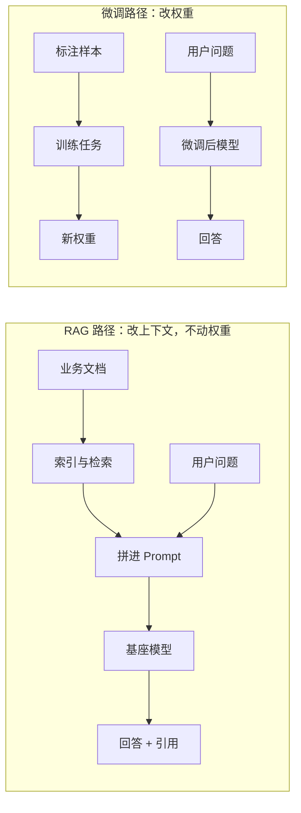
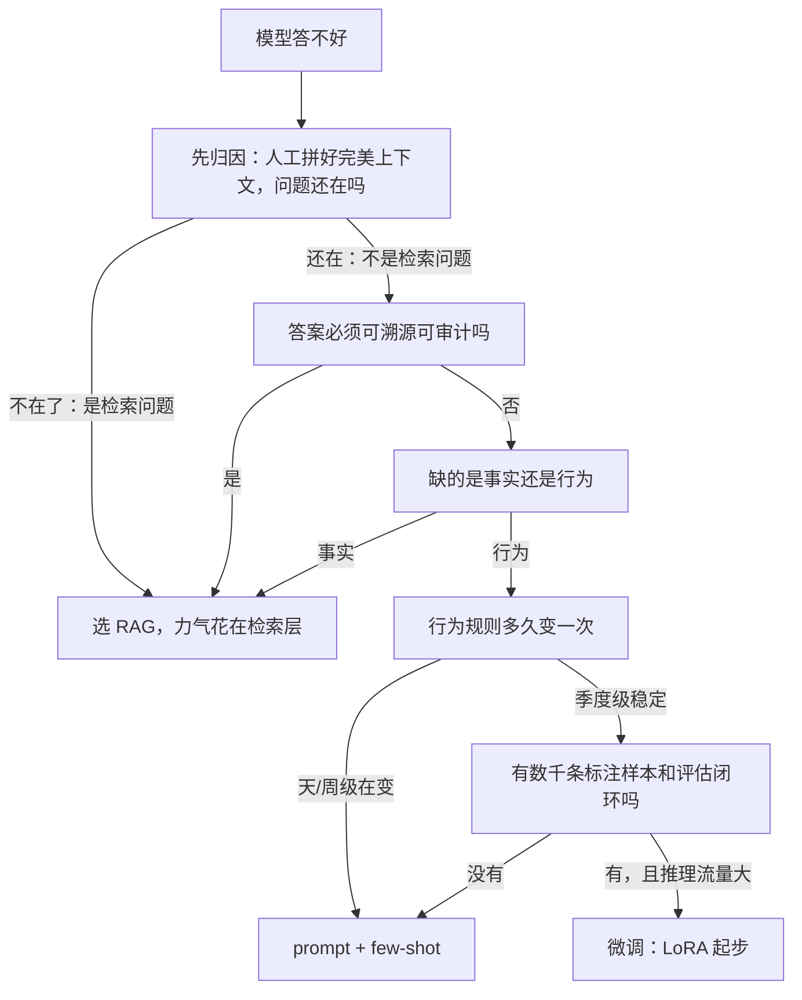
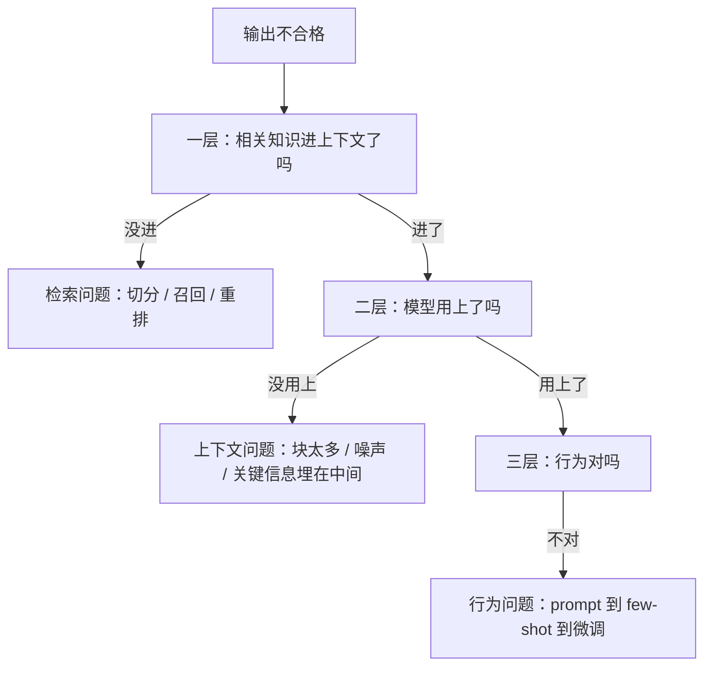

# RAG 还是微调：五个维度的决策树与四种典型误判

> TL;DR：RAG 和微调不是二选一的竞争关系——RAG 改变模型「这次看得见什么」（上下文），微调改变模型「本身是什么」（权重），作用层不同。本文给出五个维度的判据和一棵决策树：**知识更新频繁、要求可溯源、缺的是事实，三者任一成立就选 RAG；缺的是稳定行为（风格/格式/流程）、有数千条标注样本、有评估闭环、流量大到推理账算得过来，四条全满足才轮到微调。** 决策前先做三层归因，文末复盘四种典型误判：用微调注入知识、用检索调优修行为问题、跳过归因直接微调、把两者当互斥。

## 背景

「RAG 和微调怎么选」是 AI 工程面试的第一高频考点（见 [AI 模块知识地图](../README.md)），压缩版答案网上到处都是。但真实项目里选错的团队仍然一抓一把，而且错的模式高度雷同：该建知识库的团队在攒标注数据训模型，该调行为的团队反复调 top-k 调了三周。

原因在于：面试题给的是结论，没人讲清每个判据背后的机制。结论会过期——基座模型每半年变强一截，昨天必须微调才能做到的事今天一段 prompt 就解决了；但机制不会过期，从机制推出来的判据才可复用。本文做的就是这件事：把选型从「听人说的」变成「能推出来的」。

本文的立场先亮出来：**大多数应用团队的第一版应该选 RAG（外加 prompt 工程），微调是多重条件全部满足之后才值得启动的重操作**。这不是保守，后文每一层都有机制依据。压缩版答案见面试题 [RAG 和微调怎么选](../questions/RAG和微调怎么选.md)，本文是它的完整推演，比题深一层。

范围说明：本文讨论应用层选型——基于现成基座模型（API 或开源权重）做业务系统。领域继续预训练、从零训练不在讨论范围，那是数据量以亿 token 计的另一笔账。

## 一、机制差异：RAG 改上下文，微调改权重

先立全文的地基：这两个技术根本不在同一层上竞争。

- **RAG**：知识以文档形式存在系统里，推理时检索相关块拼进上下文。模型权重一个字节没动，变的是「这一次推理时模型看得见什么」
- **微调**：用梯度下降更新模型权重，知识或行为被「压」进参数里。变的是「模型本身是什么」

一个够用的类比：RAG 是开卷考试，微调是重新塑造一个考生。（机制解释：这就是非参数化知识与参数化知识的区别——RAG 论文里被增强的是生成时的上下文，LoRA 类方法更新的是权重，两者操作对象不同，谈不上替代。）

由此推出全文第一个结论（机制推演）：**凡是「知识」性质的需求，天然偏向 RAG**。依据是两种载体的维护成本结构完全不同：

1. **更新成本**。上下文里的知识，更新成本 = 文档切分 + 嵌入 + 索引重建，分钟级、按量付费。量级估算：1 万篇文档变更，按批量嵌入 100 块/秒（经验判断），十几分钟跑完；[企业知识库问答 RAG](../../system-design/questions/ai/企业知识库问答RAG.md) 的容量推演里，「每天 1% 文档变更」的再嵌入同样在分钟级。权重里的知识，更新成本 = 数据清洗 + 训练 + 评估回归 + 灰度发布，天级流程（算力与流程账见 [模型训练微调平台](../../system-design/questions/ai/模型训练微调平台.md)）
2. **可撤销性**。发现某条知识错了，删掉文档即刻生效；写进权重的错误知识没有「定点删除」的工程手段——精确移除特定事实的机器遗忘至今不是可靠技术（机制解释：梯度更新不区分「新知识」和「旧能力」，反向操作同样做不到定点）
3. **代价结构**。上下文里的知识每次推理都要重付 token 钱，权重里的知识不占上下文。这是微调唯一的结构性优势，也是维度四的来源

所以选型不是「哪个先进」，而是五个维度各判一次再加权。下面逐个拆。

## 二、五个维度的判据

### 维度一：知识更新频率——判据「知识多久变一次」

- 天/周级更新 → RAG。机制依据就是上一节的成本结构：索引重建分钟级，重训天级
- 季度以上不变 → 此维度不构成区分，看其他维度
- 反转条件：无。这个维度上微调没有翻盘机制——知识不变时选微调的理由只可能来自别的维度，而不是「更新省事」

一个要先排除的假象（经验判断）：很多团队说「我们的知识不变」，实际指的是「产品文档不变」，但用户问法、业务口径、政策解读天天在变。判据要落在「模型答对问题需要知道的全部信息」上，不是「文档库多久改版」上。

### 维度二：事实 vs 行为——判据「缺的是知道，还是会」

这是最容易被跳过、也最该先问的一个维度。

- **缺事实**（新产品参数、新政策、内部数据）→ RAG。机制解释：SFT 的训练目标是 next-token prediction，模型从样本里学到的是「这类问题 → 这类回答」的条件分布，不是「把这条事实存进记忆」。用几百上千条样本注入事实，要么过拟合到表面措辞，要么和预训练里的旧知识打架，产出似是而非的混血答案
- **缺行为**（输出格式、口吻、多步流程、拒答边界）→ 先 prompt/few-shot，不够再微调。机制解释：行为是「给定输入怎么输出」的映射，由权重决定；上下文里的 few-shot 例子只能让模型临时「演」出来，例子少时演得像，规则一多就丢
- 分界线的实用判法（经验判断）：把要求写进系统 prompt + 5 个例子，稳定达标就不需要微调；例子堆到上下文装不下或延迟超标，才进入微调候选。few-shot 的 token 经济账在误判二里算

### 维度三：可溯源要求——判据「答案要不要给出处、能不能审计」

- 要 → RAG，近乎一票否决。机制依据：RAG 的引用来自检索到的原文块，天然带出处；权重里的知识没有对应的「原文」，无法回答「这句话依据是哪份文档」
- 金融、医疗、法务、面向员工的制度问答，这一条直接终结讨论（溯源与权限的完整推演见 [企业知识库问答 RAG](../../system-design/questions/ai/企业知识库问答RAG.md)）
- 反转条件：无。可溯源是机制差异（出处只存在于「可指向的原文」），不是工程努力能补的

### 维度四：数据量与成本——判据「两笔账分开算」

**训练账**：LoRA 微调 7B 模型、5000 条样本 × 平均 1000 token ≈ 500 万训练 token，按训练 FLOPs ≈ 6 × 参数量 × token 数 ≈ 6 × 7×10⁹ × 5×10⁶ ≈ 2×10¹⁷（算式，假设如前），单卡按有效 300 TFLOPS（经验判断：消费级集群上 LoRA 的常见有效算力量级）约 10 分钟量级。结论（机制推演）：**微调的瓶颈成本不在 GPU，在构造数千到数万条高质量标注样本的人力，以及训完之后的评估回归**。样本凑不满量级（经验判断：稳定改变行为通常数千条有效样本起步），微调就是烧人力换噪音。

**推理账**：RAG 每请求多付检索块的 token。算式（假设）：日 10 万请求、每请求 2000 token 检索上下文、输入价 ¥0.06/千 token，检索部分 = 10⁵ × 2 × 10³ / 10³ × 0.06 ≈ ¥12000/天。若微调小模型自部署能省掉这笔，一年约 400 万，确实覆盖得了数据人力——但日请求掉到 5000，这笔账变成每天省 600 元，覆盖不了半个数据工程师。反转条件由流量线性决定：**推理成本维度的权重与日请求量成正比，小流量场景这个维度不构成微调理由**。

### 维度五：团队能力——判据「评估闭环在哪边、离哪条路近」

- 微调没有评估集就是盲调：数据配比、学习率、epoch 全是变量，改完没有任何客观判据说哪个版本更好。经验判断：**没有可回归评估集的团队不要启动微调**——等于把质量押注在「一次训练顺利」上
- RAG 的排查是链路分段（切分 → 召回 → 重排 → 生成），每段都能用工程手段观测和归因，传统后端团队的技能离这条路更近。评估基建怎么建见 [LLM 效果评估与回归平台](../../system-design/questions/ai/LLM效果评估与回归平台.md)，检索链路怎么分段排查见 [向量检索服务](../../system-design/questions/ai/向量检索服务.md)

### 两个不该进决策树的伪判据

- **「数据敏感不能出域」**：这是部署方式问题（自部署基座 + 内网检索），不是 RAG vs 微调的判据——RAG 完全可以跑在自部署基座上，微调同样可能要把数据交给外部训练服务。机制解释：两条路线对部署方式的约束是同构的，把合规压力错挂在选型维度上，会推出「所以该微调」的错误结论
- **「想让模型整体变聪明」**：这是基座选型问题，两条路线都解决不了——RAG 加不了推理能力，几千条样本的微调也加不了泛化能力（经验判断：泛化能力由预训练决定，应用层手段改不动它）。先按 [模型选型与级联](../../system-design/questions/ai/模型选型与级联.md) 换基座，再回到这棵树

伪判据的危害在于占用决策带宽：五个真维度还没判完，讨论已经被拉进这两条死胡同。

### 五维汇总

| 维度 | 判据问题 | 指向 RAG | 指向微调 |
| ---- | ---- | ---- | ---- |
| 知识更新频率 | 知识多久变一次 | 天/周级更新 | 无翻盘机制 |
| 事实 vs 行为 | 缺的是知道还是会 | 缺事实 | 缺稳定行为 |
| 可溯源要求 | 要不要出处与审计 | 要求高（一票通过） | 无此要求 |
| 数据量与成本 | 训练账与推理账 | 无标注数据、有文档 | 数千条样本 + 大流量 |
| 团队能力 | 评估闭环在哪边 | 工程链路分段能力 | 训练 + 评估 + 发布闭环 |

## 三、决策树：硬约束在前，优化项在后

五个维度不是并列打分，而是分层：**机制上不可行的（一票否决）放前面，经济上不划算的（优化项）放后面**。决策树的顺序本身就是结论的一部分——把「数据够不够」放在「可溯源」前面，是这类选型最常见的结构性错误。

三个使用说明：

1. **第一层是归因不是选型**。五维判据全对着「行为问题」走完，最后发现原始问题是检索不到相关内容——这是最大的浪费，归因方法见下一节
2. **走到「微调」格子的条件最苛刻**：行为问题、规则稳定、有数据、有评估、流量大，缺一个就滑向 prompt 或 RAG。重操作应该由多重条件触发，这不是保守
3. **「prompt + few-shot」是经常被跳过的正解**。基座模型的指令遵循能力已经覆盖大量行为需求，先穷尽 prompt 层再谈改权重，成本永远更低

**两次走查示例**，验证树是可操作的：

- 场景 A：「企业内部制度问答，答案必须标注出处，制度每月更新」。归因层——当前是裸基座，人工拼上文档后能答对，不是行为问题；可溯源——必须 → **RAG**，全程没走到微调格子，决策结束
- 场景 B：「客服回复必须用公司统一口吻和固定三段式格式，规则半年未变，日请求 20 万」。归因——拼上标准示例后仍不达标，不是检索问题；可溯源——否；事实 vs 行为——行为；更新频率——季度级稳定；数据与评估——有 3 万条人工确认过的合规回复可作标注样本，评估闭环在位；流量——20 万/日，few-shot 的 token 账每月上百万元级（算式，延续维度四假设）→ **微调成立**（训练账见维度四：数千条样本 LoRA 在单卡小时级）

同一个框架，两条路线，每一格都有判据出处——这就是「可操作」的含义。

## 四、四种典型误判

### 误判一：该 RAG 却去微调——「让模型学会我们的产品知识」

症状：客服或知识问答场景，团队拿几千条工单、文档做 SFT，指望模型「记住」业务知识。

为什么是误判：三条机制叠加——SFT 学条件分布不存事实（维度二），知识一变就要重训（维度一），答错无法溯源（维度三）。每一维都指向 RAG，却选择了与三维全部相悖的路线，根源是把「模型不知道」等同于「训练它」。

还有一个更隐蔽的失败模式：**离线评估分数不错，上线翻车**。机制：评估集和训练数据同源（都来自工单），模型学到的是「工单该怎么答」的答题风格，评估集测出来的正是风格吻合度；上线遇到训练分布外的新问题，事实错误立刻暴露。这是「评估测了什么」和「业务要什么」的错位，不是微调没调好——换一次训练数据重跑，结局一样。

识别信号（经验判断）：团队在讨论「训练多少个 epoch」「学习率多少」，却说不清评估集怎么防泄漏、知识更新走什么流程——讨论的重心已经暴露了误判。

### 误判二：该改行为却死磕 RAG——「检索调优填不上行为缺陷」

症状：输出格式总不合规、口吻不像本公司、多步流程总漏步。团队连续几周调 chunk 大小、top-k、rerank，指标纹丝不动。

为什么是误判（机制解释）：检索层决定「相关事实有没有进上下文」，不决定「进了上下文之后模型怎么用」。格式、口吻、流程由权重或 prompt 决定，检索再准也传不过去。这属于维度二的「缺行为」被误诊成「缺事实」。

判别实验（可操作）：人工把完美上下文拼进 prompt 再测一遍。问题消失 → 检索问题，继续调 RAG；问题仍在 → 行为问题，出路按成本升序：改 prompt → few-shot → 微调。

few-shot 的经济账决定了微调的正名场景（算式，假设）：塞 10 个例子、每例 500 token = 每请求 5000 token；按维度四同样的价差假设，日 10 万请求 ≈ 5 亿 token/天 ≈ ¥30000/天。**例子堆到这个量级，微调的一次性人力成本开始低于持续的 token 开销**——这就是「稳定风格 × 大流量」时微调真正的主场，而不是知识注入。

识别信号（经验判断）：badcase 逐条看，没有一条是「事实检索不到」，全是格式、口吻、漏步骤——而团队还在讨论 chunk 大小和 rerank 模型。错位的证据就躺在 badcase 列表里。

### 误判三：跳过归因，把「效果不好」直接当成「该微调」

三层归因，逐层排除（机制推演）：

只有第三层才轮到微调，而实践中大量「直接上微调」的决策发生在第一、二层。二层尤其隐蔽：把 20 个块一股脑塞进上下文，关键信息被稀释或埋在中间——长上下文的有效利用率随长度下降是普遍观察（经验判断），此时微调「让模型更专注」是无的放矢，该做的是检索精排和控制塞几块。

归因的顺手工具：让模型输出时先复述「依据哪些块作答」，一层问题和二层问题会立刻现形——复述不出内容是检索问题，复述了却不用是注意力/行为问题（经验判断：这是成本最低的分流手段）。

### 误判四：把两者当互斥——漏掉混合形态

成熟形态是分工而非站队（经验判断：头部客服、搜索类系统普遍如此）：

1. **微调管行为，RAG 管事实**：微调后的模型负责口吻、格式、拒答边界，事实全部走检索、带引用
2. **微调小模型学会「用好检索结果」**：让 7B 级模型在给定检索块时接近旗舰模型的 grounded QA 水平，再用「RAG + 小模型」组合打推理成本——这是「为推理成本而微调」的正当用法，与 [模型选型与级联](../../system-design/questions/ai/模型选型与级联.md) 的级联思路同构
3. **微调 RAG 系统内部的模型**：embedding 模型、rerank 模型的领域适配本质是对检索层做微调，是让 RAG 更强，而不是和 RAG 竞争

把「RAG vs 微调」问成单选题的那一刻，选项就已经漏了。面试里被追问「两者能不能结合」时，上面三条就是答案的骨架。

## 总结

收束成三句可执行的话：

- **选 RAG 的充分条件**（任一成立即可）：知识天/周级更新；答案要可溯源；缺的是事实
- **选微调的必要条件**（必须全部成立）：缺的是稳定行为；规则季度级稳定；有数千条标注样本与评估闭环；流量大到推理账算得过来。必要条件的意思是：不满足就别选，满足了也未必选——先穷尽 prompt 和 few-shot
- **决策前先归因**：三层归因（检索 → 上下文利用 → 行为）走完之前，不讨论 RAG 还是微调

落地前的 30 秒自检清单：

1. 评估集防泄漏了吗——别让评估测「答题风格」而业务要「事实正确」（误判一）
2. 三层归因做了吗，还是从「效果不好」直接跳到了方案（误判三）
3. 「人工完美上下文」对照实验做了吗——一行实验分清检索问题和行为问题（误判二）
4. prompt + few-shot 穷尽了吗（决策树说明第 3 条）
5. 「如果明天知识全换一遍，方案要动哪些环节」答得上来吗——RAG 的答案是重建索引，微调的答案是重训，成本差一个量级（机制推演）。答不上来，说明还没想清自己的知识载体是什么

适用边界：本框架适用于基于现成基座模型的应用层选型；领域继续预训练、亿级 token 的领域适配不在此框架内。框架的结论随基座能力漂移——基座变强后，原本需要微调的行为问题可能被一段 prompt 解决，这棵树要定期重跑而不是一次定终身（持续选型的工程化见 [模型选型与级联](../../system-design/questions/ai/模型选型与级联.md)）。RAG 路线的数据侧工程量容易被低估，立项前先看 [非结构化数据处理管线](../../system-design/questions/ai/非结构化数据处理管线.md)。

## 延伸阅读

- 本仓库面试题 [RAG 和微调怎么选](../questions/RAG和微调怎么选.md)：本文的压缩版答案与常见追问
- 场景题 [企业知识库问答 RAG](../../system-design/questions/ai/企业知识库问答RAG.md)：RAG 路线的完整容量与架构推演
- 场景题 [模型训练微调平台](../../system-design/questions/ai/模型训练微调平台.md)：微调路线的算力账与工程复现
- 场景题 [LLM 效果评估与回归平台](../../system-design/questions/ai/LLM效果评估与回归平台.md)：没有评估，两个选项都无从谈起
- 场景题 [非结构化数据处理管线](../../system-design/questions/ai/非结构化数据处理管线.md)：RAG 的数据侧成本主要在这里
- 论文：Lewis et al., 2020《Retrieval-Augmented Generation for Knowledge-Intensive NLP Tasks》；Hu et al., 2021《LoRA: Low-Rank Adaptation of Large Language Models》
