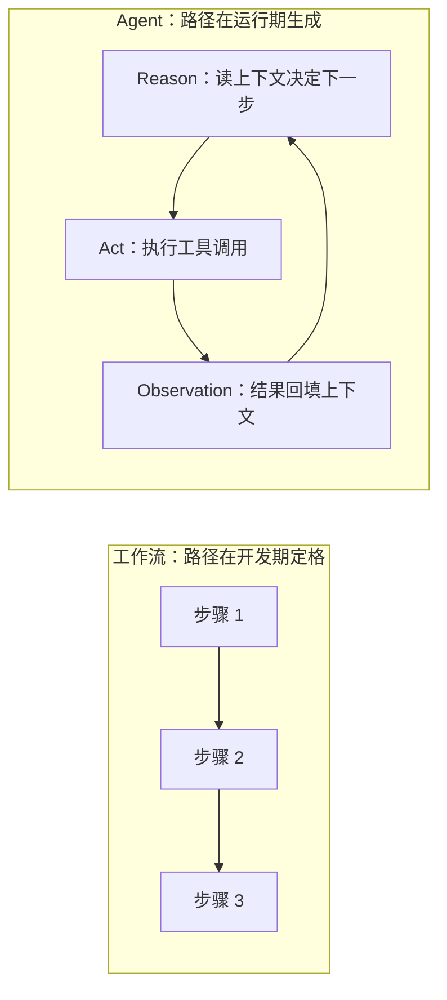

# Agent 和普通工作流的区别是什么？

> 分类：Agent ｜ 难度：★★★（高频）

## 一句话结论

区别在**控制流归谁决定**：工作流的执行路径是开发期写死的确定性流程，Agent 的执行路径由 LLM 在运行时根据每一步的观察现场决定——调什么工具、调几次、何时结束都是模型决策。

选择判据一行版：**步骤可以预先枚举就用工作流（在分叉点嵌入 LLM 节点），只有「下一步取决于上一步结果、且分支无法预先枚举」的环节才交给 Agent**。默认信工作流，Agent 是用确定性和可预算的成本换灵活性——这个交换只在路径真的不可预知时才划算。

## 机制原理

### 1. 控制流的位置不同，失败模式与工程方法就完全不同

工作流的错误是「某一步错了」：步骤固定，能逐步单测、定位到行、失败重试——质量保障方法和测普通代码一样。Agent 的错误是「决策序列错了」：多调了不该调的工具、陷入循环、提前宣布完成。机制根源是 LLM 输出非确定：同样输入不保证同样的动作序列，工程方法随之分叉：

- 测试：工作流用单元测试逐步覆盖；Agent 用评测集回归 + 运行时护栏兜底
- 护栏：工作流不需要终止器；Agent 必须有步数 / token 预算、工具白名单
- 归因：工作流按步骤定位；Agent 按完整轨迹回放定位

不区分范式就会用错质量保障体系——拿单元测试去测 Agent，测不住非确定性的决策序列。

### 2. Agent 的最小机制是 ReAct 循环：决策与状态都活在循环里

ReAct（Reasoning + Acting）的关键不是「模型会推理」，而是**观察回填**：工具返回结果写回上下文，下一步决策基于真实反馈而非纯脑补，同时模型获得了训练数据之外的实时信息。工作流的「下一步」是代码写死的；Agent 的「下一步」是每一轮重新生成的。

右侧循环转几圈、何时退出，没有代码预先规定——终止条件是模型判断「任务完成」。工程含义：非确定性输出不能当终止条件，生产 Agent 的终止必须由系统代码保证，这也是场景题 [Agent任务执行平台](../../system-design/questions/ai/Agent任务执行平台.md) 把预算当护栏设计的原因。

同一个循环还有个隐含推论：**Agent 的运行状态只存在于上下文里**。工作流的中间状态在代码变量和数据库里，进程重启可恢复、可断点调试；Agent 的中间状态就是消息列表本身——丢上下文等于丢状态。所以上下文管理（裁剪、压缩、持久化）不是锦上添花，而是 Agent 的「状态管理」本身，这正是 [Agent记忆怎么分层](Agent记忆怎么分层.md) 讨论的问题由来。

### 3. 二者是光谱不是二值：判断标准是「路径是否可能在运行时变化」

大量生产系统是混合体：固定步骤中某个路由节点让 LLM 决策（意图分类后走不同分支），其余全是确定性代码——这算「工作流 + LLM 节点」，不算 Agent，它继承工作流的全部工程性质（可测、可控、成本恒定）。

反过来，套了 Agent 框架、每轮动作仍由固定规则触发的代码，也不算真 Agent。经验判断：把自己系统每个环节标注「确定 / 模型决定」，是判断 Agent 化程度、也是改造前最有价值的一张图——标注完你会发现，多数系统里真正需要模型决定路径的环节只有一两个。

### 4. 成本账：工作流是加法，Agent 是带尾部的乘法

量级估计：设 5 步固定流程，每步输入 2k token，恒定 1 万 token，延迟可预算。同任务交给 Agent，步数由模型决定（3 步到 15 步都可能），且每步上下文随观察累积变长，按平均 8 步 × 3k ≈ 2.4 万 token——均值翻倍不止，且**尾部无上限**：不设步数上限时循环不保证收敛。

| 维度 | 工作流 | Agent |
| --- | --- | --- |
| 执行路径 | 开发期写死 | 运行期模型决定 |
| 可测试性 | 单元测试逐步覆盖 | 评测集回归 + 运行时护栏 |
| 典型失败 | 某步逻辑错，可定位 | 决策序列错：循环 / 早停 / 幻觉调用 |
| 状态存放 | 变量与数据库 | 上下文窗口 |
| 成本 | 恒定可预算 | 均值更高且有尾部风险 |
| 适合任务 | 步骤可枚举 | 路径依赖中间结果 |

这解释了两件事：为什么生产 Agent 必须挂预算护栏而工作流不需要；为什么「Agent 更智能」的直觉不能直接换算成「Agent 更划算」。

## 典型错误答案

1. **「工作流里接个大模型，就是 Agent 了。」**
   机制：加 LLM 节点不改变控制流的归属——每步是否执行、按什么顺序仍是代码决定，这只是工作流 + LLM 节点。混淆的工程后果很实际：拿工作流的测试方法（单元测试）去测 Agent，测不住非确定性的决策序列；两者的质量保障体系完全不同。自查问题：这个系统的执行路径，换一批输入会不会变？
2. **「Agent 更高级，能用 Agent 就别用工作流。」**
   机制：控制权交给模型，收益是灵活性，代价是决策可能错 + 成本不可预算。路径固定时，模型的「自由发挥」只引入波动不产生价值——决策权只有在路径无法预知时才是资产，否则是纯风险。什么时候该上更复杂的形态，见 [多Agent什么时候需要](多Agent什么时候需要.md)。
3. **「Agent 会自己规划，所以不用设计流程了。」**
   机制：模型规划能力有边界，复杂任务端到端丢给 Agent 自由发挥，成功率低且错了难归因。工程实践（经验判断）是分层给自主权：能用代码固定的环节固定，只在真正的分叉点让模型决策——自主权是稀缺资源，按需分配，不是越多越好。

## 追问

1. **ReAct 为什么比纯思维链（CoT）有效？**
   思路：CoT 是纯脑内推演，推理链再长也拿不到上下文之外的信息；ReAct 每步 Act 的观察回填上下文，后续推理基于真实世界反馈——既纠错了脑补，也补上了实时数据。能讲出「用外部观察修正内部信念」这层机制，就超过背定义的考生了。
2. **生产系统怎么防止 Agent 乱跑？**
   思路：方向是「模型决定路径，系统约束边界」——步数与 token 预算提供终止器、工具白名单与分级权限限制破坏半径、有副作用的动作（发邮件、下订单）强制人工确认。机制依据：非确定性决策不能当终止条件，终止必须由系统代码保证。
3. **这个区别对监控和可观测有什么影响？**
   思路：工作流按步骤埋点即可，路径可预期；Agent 必须记录完整轨迹（每步决策理由 + 工具返回值）——同一输入可能走出不同路径，回放与归因完全依赖轨迹数据。答出「轨迹是 Agent 时代替代日志定位的基建」，说明真的理解了路径动态化带来的运维变化。
4. **你项目里哪些部分该 Agent 化？**
   思路：别答「都试试」。给出可执行判断：找出「下一步取决于上一步结果、且分支无法预先枚举」的环节，那才是 Agent 决策权的落点，其余保持代码确定。能画出自己系统的「确定 / 模型决定」标注图，比背概念有说服力得多。

---
[返回 AI 知识地图](../README.md)
