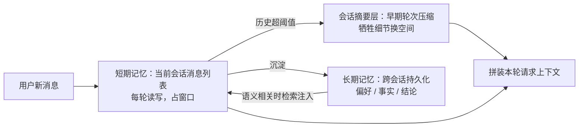

# Agent 的记忆是怎么分层的？

> 分类：Agent ｜ 难度：★★（常考）

## 一句话结论

默认两层起步：**短期记忆 = 上下文窗口里的对话历史（工作记忆），长期记忆 = 窗口外的持久化存储、按需检索注入（外存）**；只有当历史长到窗口装不下、或注意力被稀释时，才在两者之间加「会话内压缩摘要」这一层。

一句话判断：上下文装得下就别建记忆系统。分层的本质不是「让 Agent 记得更多」，而是对有限窗口做内存分级——什么留在内存、什么换出到磁盘、什么时候换回来；判断分叉：跨会话要记住的东西，再大的窗口也替代不了长期记忆。

## 机制原理

### 1. 为什么要分层：窗口又贵又会被稀释

机制链有两条：

- 成本：上下文按 token 计费，每轮重发全部历史时，n 轮对话累计输入 ≈ 每轮增量 × n(n+1)/2——量级估计：每轮新增 2k token、30 轮对话，累计约 2k × 465 ≈ 93 万 token，只发增量仅 6 万，差 15 倍（保守口径，未计前缀缓存折扣）。
- 注意力：注意力权重分布在整个窗口上，长上下文中部的内容容易被忽略——用户在第 3 轮定下的约束，到第 40 轮可能已经被「淹没」。

「信息全」和「模型听得进」在注意力机制下是对抗的——分层的根本原因不是存不下，是存下了也读不进。

### 2. 分层后的读写时机各不相同

| 层 | 存什么 | 读写时机 | 保真度 | 代价 |
| --- | --- | --- | --- | --- |
| 短期记忆 | 当前会话消息列表 | 每轮读写 | 全量保真 | 占窗口，成本随轮数涨 |
| 会话摘要 | 早期轮次的压缩摘要 | 超阈值时写，之后每轮作前缀读 | 丢过程细节 | 摘要歪了会带偏后续 |
| 长期记忆 | 偏好 / 事实 / 结论 | 有沉淀价值时写，语义相关时读 | 结构化保真 | 检索错配会污染上下文 |

层与层的差别本质是**读写时机与保真度的交换**：越靠外的层越省窗口，但找回要靠检索——检索错了比不存还糟。短期记忆的载体就是 [Agent和普通工作流的区别](Agent和普通工作流的区别.md) 里 ReAct 循环每轮读写的那个上下文，它是 Agent 唯一的工作记忆。

### 3. 写入策略是被最多人忽略的难点

什么值得写进长期记忆，比用什么库存更关键。写入信号（经验判断）：

- 值得写：用户明确表达的偏好、模型被用户纠正的事实、任务的最终结论
- 不值得写：寒暄、过程性尝试、单次任务的中间细节

机制：长期记忆的质量决定检索质量——全量入库的日志式记忆，检索时召回大量低价值片段污染上下文，垃圾进垃圾出。还要处理冲突：用户改主意时，新记忆要带时间戳覆盖旧记忆；否则检索召回两条矛盾的「偏好」，模型采信哪条全看注意力运气。

### 4. 长期记忆与 RAG 机制同构，但数据流向相反

都是「外部存储 + 检索 + 注入上下文」，检索侧可以复用 RAG 的全部工程（混合检索、rerank）。差异在写入主体与生命周期：

- RAG：语料人工整理、离线写入、相对静态——问题集中在「检索质量」
- 长期记忆：系统在交互中在线自写、动态增长——多出一整类问题：写什么、何时写、冲突怎么办

场景题 [企业知识库问答RAG](../../system-design/questions/ai/企业知识库问答RAG.md) 讲的是检索侧的完整设计；记忆题的独有难点在写入侧。

## 典型错误答案

1. **「把所有历史都塞进上下文，记忆就不丢了。」**
   机制：三道墙——窗口有限、成本随轮数二次方涨、注意力被稀释。塞满窗口的代价不只是贵：早期约束被淹没后，模型会「忘」掉自己 30 轮前答应的规则，这是注意力机制决定的，不是存储问题。把「存得下」当成「记得住」，是混淆了存储与有效读取。
2. **「长期记忆就是建个向量库，把对话记录全存进去。」**
   机制：跳过了写入策略这一步。原始对话是过程数据不是知识——全量入库后检索召回的是对话碎片，注入后污染上下文。记忆要结构化沉淀（事实、偏好、结论 + 时间戳），检索质量由写入质量决定，选型只是末端环节。
3. **「记忆系统越强越好，上来就做三层架构。」**
   机制：每一层都有检索错配风险——召回一条不相关的旧记忆会把当前任务带偏，层越多这种「错误提醒」的入口越多。上下文装得下的场景做记忆系统是纯增复杂度。经验判断：先证明窗口不够用（轮数逼近上限、约束频繁被忘），再逐层加。

## 追问

1. **上下文压缩成摘要，丢了关键信息怎么办？**
   思路：先分清压缩丢什么——丢过程性内容是设计目标，丢决策、约束、事实是事故。应对方向：硬信息（用户明确要求、已确认决定）用「钉住」机制常驻窗口，不指望摘要替你保留。能说出「压缩是分层策略，不是无损转码」就到位了。
2. **多 Agent 协作时，记忆怎么共享？**
   思路：Agent 之间交接的是结构化产物（结论、依据、置信度），不是各自的会话记忆——整体共享会话记录会把噪声和错误一起放大。要不要拆多 Agent 见 [多Agent什么时候需要](多Agent什么时候需要.md)，交接契约的设计见场景题 [多Agent协作系统](../../system-design/questions/ai/多Agent协作系统.md)。
3. **怎么评估记忆系统做得好不好？**
   思路：别答「存了多少条」，看行为指标：跨会话偏好遵循率（上次说的偏好这次用上没）、记忆召回相关率（注入的记忆有多少真被引用）、记忆冲突处理正确率（用户改主意后听新的）。与 LLM 应用评测一脉相承：测行为，不测库存。
4. **上下文窗口到百万 token 了，还需要记忆分层吗？**
   思路：大窗口改变的是阈值，不是机制——成本随长度线性涨、注意力稀释仍存在，只是触发分层的轮数推后了。跨会话持久化与窗口大小无关，长窗口永远替代不了长期记忆。答「窗口大了就不需要了」，等于把记忆当成了存储问题。
5. **长期记忆会不会成为新的注入攻击面？**
   思路：会——记忆是持久化数据，一旦被写入恶意内容（如「该用户要求忽略安全规则」），每次会话检索注入都会生效，比单次 Prompt 注入更持久。应对：写入走内容过滤与来源校验、敏感记忆标记人工复核。这与场景题 [Prompt注入防御](../../system-design/questions/ai/Prompt注入防御.md) 讨论的是同一类风险在不同持久层的形态。

---
[返回 AI 知识地图](../README.md)
