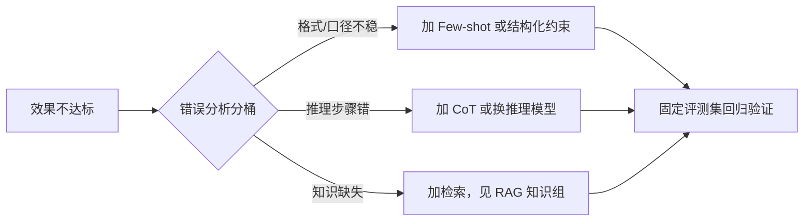

# Few-shot 和思维链（CoT）什么时候用？

> 分类：Prompt 工程 ｜ 难度：★★（常考）

## 一句话结论

两者解决不同问题，正交可叠加：CoT 解决「多步推理算不动」，Few-shot 解决「格式与口径对不齐」。默认顺序是先写清晰的零样本指令；输出格式不稳定才加 few-shot，推理过程出错才加 CoT——顺序反了就是在用错工具。

## 机制原理

**1. CoT 为什么对推理任务有效：把「一步算完」摊开成「逐步生成」。**

Transformer 单次前向的计算深度是固定的，让模型一步生成最终答案，等价于要求它在固定网络深度内完成多步计算，推理链一长就超出容量。CoT 让模型先输出中间步骤，而自回归模型每一步的输出会成为下一步生成的输入条件：中间结论进入上下文后，后续生成可以直接「读取」它，不必在权重里「重算」它。机制链完整：逐步生成 → 中间结果落在上下文 → 每步只需一次局部推理 → 总体计算被摊到多个解码步。

这也解释了 CoT 的边界：对记忆类问答、单步分类这类任务，没有「多步计算」可摊，逐步化不增加有效计算量，只有额外 token 开销；甚至引入错误传播——中间一步描述错，最终答案跟着错。

**2. Few-shot 为什么对格式任务有效：模式补全，不是学习。**

Few-shot 不更新任何权重。示例的作用是把任务的「输入→输出」映射钉进上下文，让后续生成对齐示例呈现的格式、粒度和口径——比如「什么算一条有效地址」「日期写成什么格式」「拒答的边界在哪」。所以它对「模型已有能力、但表述不稳定」的任务有效；对「模型本身不会的知识」无效，因为示例提供不了模型权重里没有的信息。这是 in-context learning 与微调的本质区别。

**3. 两者的成本代价不同，且都按 token 计费。**

Few-shot 的代价在输入：示例每次请求全量重发。假设每个示例 300 token、放 3 个示例，每次请求固定多花约 900 输入 token（量级估计）；日调用 10 万次就是每天约 9000 万 token 的固定开销。CoT 的代价在输出：中间步骤让输出 token 成倍增长（假设从 100 涨到 800），而输出单价通常是输入的 3-5 倍（量级估计，参考主流 API 定价体系），且逐 token 生成意味着延迟同步变长。

| 维度 | Few-shot | CoT |
| ---- | ---- | ---- |
| 解决什么 | 格式、口径、歧义边界 | 多步推理、组合计算 |
| 无效场景 | 模型没有的知识 | 记忆类、单步分类任务 |
| 代价 | 输入 token 固定膨胀 | 输出 token 成倍增长、延迟变长 |
| 失效模式 | 示例偏差被过度模仿 | 中间一步错则后续全错 |

**4. 旗舰模型稀释了 CoT 的收益，但没稀释 few-shot。**

经验判断：对当前旗舰模型，一般难度推理任务零样本已接近有 CoT 的水平，CoT 的边际收益集中在复杂多步任务和小模型上；而「按我团队的定义输出」这件事模型没法从预训练分布里知道，格式、口径对齐仍大量依赖 few-shot 或结构化输出约束。所以「CoT 过时了」和「CoT 万能」都不对，它是随任务和模型浮动的变量。

## 典型错误答案

1. 「示例越多越好，CoT 反正没坏处，全都加上最稳。」

   机制上不成立：示例会锚定输出分布，坏示例或示例里的偶然模式会被过度模仿——示例里恰好有个错别字、一种带偏向的措辞，输出就会被带偏；示例堆多了还稀释指令权重、吃满上下文。CoT 对非推理任务是纯开销，还会诱发「事后合理化」：模型为了凑出推理链而编造中间依据，长思维链反而增加跑偏概率。

2. 「加一句 Let's think step by step，任何任务都会变准。」

   零样本 CoT 的收益来自把答案生成变成逐步条件生成，只在「需要多步计算」的任务上有机制增益。分类、抽取这类一次前向就能完成的任务，逐步化不增加计算量，反而引入错误传播链——中间描述错了，最终答案跟着错，还多花一倍输出 token。

3. 「Few-shot 就是轻量级微调，示例给够模型就学会这个任务了。」

   In-context learning 不改权重，上下文清空就「忘」；它是对当前这一次生成的条件约束，不是能力获取。这也正好解释了为什么 few-shot 效果对示例选取和顺序高度敏感、换个措辞就波动——它是模式补全的统计现象，不是训练，拿微调的心智去用 few-shot 会得出一系列错误预期。

## 追问

1. 示例怎么选、放几个？

   按覆盖「决策边界」选而不是随机选：典型样本加容易混淆的边界样本各一两个。经验判断是 3-5 个往往够，继续加边际收益快速递减；示例顺序会影响输出分布，动态检索与当前输入最相似的示例（思路类似 RAG）通常比固定示例更稳。

2. CoT 的推理过程要不要给用户看？

   内部推理与最终答案要分离：结构化输出里拆成 reasoning 与 answer 字段，面向用户的只有 answer。推理文本可能夹带 prompt 片段或中间敏感结论，直接透出是信息泄露面；保留 reasoning 字段则方便离线做错误分析。

3. 效果差时，怎么判断该加 CoT 还是该换模型？

   先做错误分析而不是先换手段：把 bad case 分桶——推理步骤错考虑 CoT 或换推理模型，知识缺失加检索，格式口径不稳加 few-shot 或结构化约束。手段要跟错误类型对齐，改完用固定评测集验证，而不是靠几条 case 的体感循环调 prompt。

4. 长多轮对话里，few-shot 示例放头上会不会越聊越失效？

   会。上下文逼近窗口上限触发截断时，若截断策略把示例截掉，输出格式会立刻漂移。长会话里示例要么在压缩历史时保持重新注入，要么改用结构化输出约束来保格式——格式约束靠机制兜底，比靠示例撑更抗截断。

同组相关：[Prompt 怎么做版本管理和评测？](Prompt的版本管理与评测.md)（任何 prompt 手段的收益都要在评测集上验证，而不是体感）。

---
[返回 AI 知识地图](../README.md)
