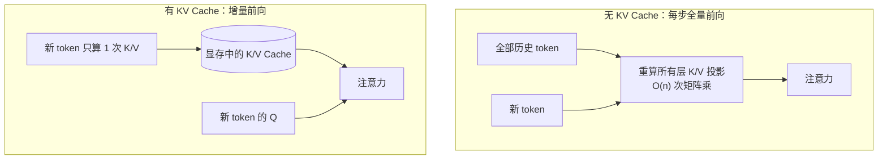

# KV Cache 为什么省算力？

> 分类：模型推理与微调 ｜ 难度：★★★（高频）

## 一句话结论

KV Cache 省的是自回归解码里最浪费的那部分计算：每生成一个新 token，都把全部历史 token 的 K/V 重新投影一遍。它把每步的「重复计算」变成「增量计算」，总计算量从 O(n²) 降到 O(n)；代价是显存——它是显存消费大户，不是省显存的。

## 机制原理

**1. 没有 Cache 时，解码在反复算已经算过的东西。**

Transformer 生成第 t 个 token 时，注意力需要全部 t 个 token 的 K 和 V。朴素实现下每一步都对整个序列做一次完整前向，历史 token 的 K/V 投影（每层一次矩阵乘）被重复计算。以 7B 模型（fp16）为例，前向每 token 约 2×7×10⁹ = 1.4×10¹⁰ FLOPs（量级估计）：生成 1000 个 token，无 Cache 时总计算量 ≈ Σt × 1.4×10¹⁰ ≈ 5×10⁵ × 1.4×10¹⁰ ≈ 7×10¹⁵ FLOPs。

**2. 有 Cache 后，K/V 只算一次，每步只算增量。**

每个 token 的 K/V 首次算出后写入显存，之后每步只算新 token 的 Q 和它自己的 K/V，注意力变成「新 Q 查历史 K/V」。同样生成 1000 个 token：prefill 1000 + decode 1000 ≈ 2×10³ 个 token 等效前向 × 1.4×10¹⁰ ≈ 2.8×10¹³ FLOPs。两者相差约 250 倍（量级估计，忽略注意力打分部分的差异）。

两种模式的整体对比（n 为序列长度，数字沿用上面的 7B 假设）：

| | 无 KV Cache | 有 KV Cache |
| --- | --- | --- |
| 每步计算内容 | 全序列完整前向，历史 K/V 全部重算 | 只算新 token 的 QKV + 注意力查表 |
| 第 t 步的 K/V 投影 | 重算全部 t 个 token 的 | 只算第 t 个 token 的 |
| 生成 n 个 token 总计算量 | O(n²) | O(n) |
| 显存占用 | 只有权重 | 权重 + 线性增长的 KV（约 0.5MB/token） |
| 每步耗时随 n | 随 n 线性涨，常数大 | 随 n 线性涨，常数小得多 |
| 典型实现 | 教科书式朴素循环 | 所有主流推理框架的标配 |

**3. 代价是显存，而且随上下文线性涨。**

每 token 的 KV 体积 = 2 × 层数 × KV 头数 × head_dim × 每元素字节数。7B（32 层、32 头、128 维、fp16、无 GQA）：2×32×32×128×2B = 0.5MB/token，4K 上下文单请求就是 2GB——80GB 的卡扣掉 14GB 权重，剩不下几条长请求的并发位。所以 KV Cache 不是免费加速器，而是「用显存换计算」的交易；长上下文场景它是并发容量的第一约束，并发与显存的账见场景题 [LLM 推理服务平台](../../system-design/questions/ai/LLM推理服务平台.md)。

**4. 反直觉点：decode 的下一个瓶颈其实是显存带宽，不是算力。**

batch=1 时每步 decode 都要把全部权重从显存读一遍：14GB ÷ 3.35TB/s ≈ 4ms（量级估计，按 H800 理论带宽），对应单序列上限约 240 token/s；此时实际用到的算力只有 1.4×10¹⁰ × 240 ≈ 3.4 TFLOPS，不到 H800 峰值的 1%。KV Cache 省掉了重复计算，但 decode 立刻撞上「权重搬运」这条新瓶颈——这正是批处理、量化存在的理由，见 [LLM推理优化的主要手段](LLM推理优化的主要手段.md)。

## 典型错误答案

1. 「KV Cache 就是把模型权重缓存起来，省得每次重新加载。」
   ——缓存对象说反了。权重本来就常驻显存，不存在「重新加载」。KV Cache 存的是每个 token 在每一层的 K/V 投影结果（中间激活），用途是给后续每步的注意力复用。这个对象搞错，后面的显存估算、GQA、PagedAttention 全都接不上。

2. 「KV Cache 又省算力又省显存，是双赢优化。」
   ——方向反了：它省的是重复计算，代价恰恰是显存。每 token 0.5MB 量级的 KV 体积（7B 无 GQA），4K 请求就占 2GB，长上下文直接吃掉并发容量。把「省显存」说出口，说明没做过容量估算。

3. 「有了 KV Cache，推理速度就和上下文长度无关了。」
   ——每步注意力仍要用新 Q 和全部历史 K/V 做打分与加权求和，读 KV、算分数都随上下文线性涨。KV Cache 只是砍掉了「重算历史 K/V 投影」，把每步从全量前向降为增量前向，长上下文每步仍然变慢，只是增长的不是二次方项。

## 追问

1. **KV Cache 显存占用怎么估算？**
   - 思路：直接给公式 2 × 层数 × KV 头数 × head_dim × 序列长 × batch × 每元素字节数，代入 7B 算出 0.5MB/token、4K 请求 2GB。面试官考的是你会不会拿这个数去推并发容量——这是推理服务容量估算的核心输入。
   - 反向也要会用：80GB 卡扣掉 14GB 权重剩 66GB，÷2GB/请求 ≈ 30 条并发（无 GQA、4K 上下文）——这就是为什么 GQA 在长上下文场景不是可选项，而是并发准入条件。

2. **KV Cache 这么占显存，工程上怎么压？**
   - 思路：沿公式逐项找杠杆——GQA/MQA 降 KV 头数（32→8，体积 ÷4）、KV 量化降字节宽、PagedAttention 不减体积但消除碎片提利用率、滑窗/驱逐减有效序列长。点到机制即可，不用展开成设计方案。
   - 常见追问是「这些对 prefill 有没有用」：体积类手段不碰 prefill 的计算量，prefill 的解法在 prefix caching 和 PD 分离，两阶段瓶颈不同。

3. **为什么 prefill 可以一次算完，decode 必须一步一步来？**
   - 思路：prefill 的输入全部已知，能拼成大矩阵并行算，瓶颈在算力；decode 每步依赖上一步的输出，只能串行小矩阵，瓶颈在带宽。这个不对称是 prefix caching、PD 分离等设计的机制起点。

4. **GQA 为什么能省显存，代价是什么？**
   - 思路：MHA 里每个 query 头都配一组自己的 K/V 头，KV 体积正比于 KV 头数；GQA 让多个 query 头共享一组 KV 头（如 32→8），KV 体积直接 ÷4。代价是注意力的表达自由度下降，主流开源模型把它做成标配说明损失通常可接受（经验判断），关键业务仍需评测确认。

---
[返回 AI 知识地图](../README.md)
