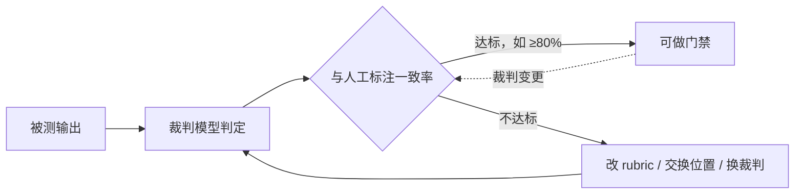

# 用 LLM 当裁判（LLM as Judge）可靠吗？

> 分类：LLM 应用开发 ｜ 难度：★★（常考）

## 一句话结论

可用，但要把它当成「有系统误差的标注员」而不是「真值」：裁判比规则判分覆盖面广、比人工标注便宜得多（量级估计低两个数量级），但存在位置、长度、自我偏好三类机制性偏差。默认用法：裁判做相对比较与粗筛，做发布门禁前必须先与人工标注校准一致率；一致率不够就改 rubric 或换裁判，而不是直接用分数。

## 机制原理

**1. 为什么裁判有用：它把「语义判断」变成了条件生成。**

规则只能匹配字面模式，而开放式输出的「好」是语义属性——相关性、完整性、语气是否得体。裁判模型把判断也交给一个 LLM：把题面、评分标准（rubric）、被测输出放进上下文，生成一个判定，因此能理解语义等价与隐含标准，覆盖规则判分到不了的大部分区间。

但同一机制决定了它的局限：判定也是采样自一个概率分布——换个措辞、换个顺序、换个温度，分数会漂移，「查询真值」这回事不存在。

**2. 三类偏差都有明确机制，不会因为模型变强而消失。**

位置偏差：对比两个答案时倾向偏好固定一侧（经验判断：文献与实测中常见偏向前者），机制与注意力对上下文前部权重更高、以及比较基准先入为主有关。长度偏差：更长的回答在逐项 rubric 上天然覆盖更多得分点，裁判很难扣除冗余分，于是系统性奖励啰嗦。自我偏好：裁判对自己（或同族模型）惯用的表述分布似然更高，「熟悉的风格」被误判为「更好的风格」——拿某模型评它自己参与的输出，这个偏差被最大化。

| 偏差 | 机制 | 典型后果 | 缓解 |
| ---- | ---- | ---- | ---- |
| 位置偏差 | 注意力前部权重高 + 先入为主的比较基准 | A/B 结果随展示顺序翻转 | 交换顺序评两次，不一致判弃权 |
| 长度偏差 | 逐项 rubric 上长文覆盖更多得分点 | 奖励冗长、压分精炼回答 | rubric 显式含简洁项，或截齐长度再比 |
| 自我偏好 | 对自身表述分布似然更高 | 同族模型评测虚高 | 跨家族裁判、多裁判投票 |

**3. 校准是「用测量校准测量工具」，不做校准的分数不能用。**

裁判可信与否不是信仰问题，是可测量的：留一批人工标注样本，计算裁判与人工的一致率（一致率或加权 kappa）。经验判断：一致率低于约 80% 就不要直接做发布门禁，先改 rubric（把模糊项拆成可判定子项）、加位置交换重评、或换裁判模型。裁判本身也是被评测对象——它每次变更（换模型、改评分 prompt）同样要走回归，这是多数团队漏掉的一层。

**4. 输出空间越小越稳：判定形式的选择有机制依据。**

「对/错/不确定」三分类远比 1-10 打分稳定：输出空间小，采样噪声占比低；且 1-10 的分数间不存在稳定等距关系（7 分和 8 分差多少？没有锚点定义就是噪声）。经验判断：需要程度差异时用有锚点的枚举档位（优/良/差，每档附明确判定描述），需要更稳时多次采样取众数，而不是把希望寄托在「换更强的裁判」上。

## 典型错误答案

1. 「裁判用的是最强的模型，它的打分就是标准答案。」

   再强的裁判也是概率采样，位置、长度、自我偏好是机制性偏差，模型变强只是让偏差变小，不会归零。把有固定系统误差的分数当真值做门禁，等于让一位有固定偏好的评委决定所有晋升——单次判断再准，系统结论也是歪的，而且误差方向恒定、无法靠量抵消。

2. 「让裁判打 1-10 分，越高越好，跨版本直接比分数。」

   1-10 没有锚点定义，什么叫 7 分取决于裁判当时的上下文和措辞，分数不可跨版本比较；且打分空间越大、采样噪声占比越高，同一输出重评两次可能差 3 分。可比较的做法是枚举档位 + 每档明确判定描述 + 多次采样取众数。

3. 「用我们的主力模型评它自己的输出，它最懂这个任务。」

   这恰好是自我偏好偏差的最大化条件：它会把「像自己的输出」判为好，评测退化为同义反复。跨家族模型互评或多个裁判投票能稀释偏差，但投票只是平均了偏差、不是消除，关键决策仍要人工抽检兜底。

## 追问

1. 具体怎么校准一个裁判？

   从评测集里冻结一块人工标注子集（覆盖好/中/坏分布），换任何裁判 prompt 或模型都重算与人工的一致率；一致率就是裁判的「元评测分数」。裁判的变更也要版本化，否则评出来的业务分数失去纵向可比性——这一点和业务 prompt 管理是同一套逻辑。

2. 裁判给我们自己的应用打分总是偏高，怎么办？

   把 rubric 从印象分改成可判定项（是否包含 X、是否引用了 Y、是否超长），压缩自由发挥空间；对比式判定（A/B 谁好）比绝对打分对偏差更鲁棒，但必须配合位置交换；再不行就换家族的裁判模型交叉验证，偏差方向不同才能互相暴露。

3. 什么时候不该用 LLM 裁判？

   有精确断言的一律程序判：格式、字段、必含元素、可执行验证（跑代码、查库），零成本零偏差。裁判只留给「语义属性且人工太贵」的区间，并且先用规则把能机器判的过滤掉——评测的 token 成本大头往往就这样省下来。

4. 一致率之外，校准还要看什么？

   只看整体一致率会漏掉系统性翻车：要分维度看——位置交换后判定是否翻转（位置偏差）、长短答案的分差（长度偏差）、同族输出是否虚高（自我偏好）。整体一致率高但某一类系统性失真，说明误差集中在特定分布上，门禁要在那个分布上收紧或补人工。

同组相关：[Prompt 怎么做版本管理和评测？](Prompt的版本管理与评测.md)（裁判所在的整体流程）、[幻觉的工程缓解](幻觉的工程缓解.md)（裁判的另一用途：引用支持性校验）。

场景侧「这套怎么落成系统」：见 [LLM 效果评估与回归平台](../../system-design/questions/ai/LLM效果评估与回归平台.md)。

---
[返回 AI 知识地图](../README.md)
