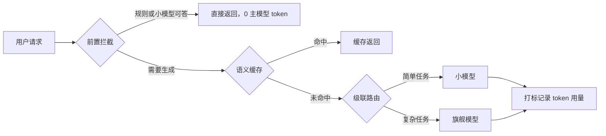

# LLM 应用的成本怎么控制？

> 分类：LLM 应用开发 ｜ 难度：★★★（高频）

## 一句话结论

成本公式只有一条：总成本 = 调用次数 ×（输入 token × 输入单价 + 输出 token × 输出单价），所以所有手段只有三个方向——减 token（上下文压缩、输出限长）、减次数（缓存、前置拦截）、降单价（小模型级联、批处理）。先建归因监控再动手优化：不知道钱花在哪的降本就是盲砍。

## 机制原理

**1. 先算清成本结构：大头永远在「重复发送的上下文」。**

单次成本 = 输入 token × 输入单价 + 输出 token × 输出单价，而输出单价通常是输入的 3-5 倍（量级估计，参考主流 API 定价体系），且输出逐 token 生成、延迟随输出长度线性增长。算一笔账：假设系统提示词 2k token、多轮累计历史 6k、检索上下文 2k——每轮请求都全量重发这 10k 输入，哪怕用户当轮新增只有 200 token。一个 10 轮会话实际发送约 10 万输入 token（量级估计：每轮平均 10k × 10 轮），新增内容占比不到 2%。机制结论：多轮应用的优化重点不是「这轮说了什么」，而是「每轮被迫重复带了什么」。

**2. 三个方向的手段，各自机制不同。**

减少输入：历史做摘要或滑窗截断、检索上下文 rerank 后只留 top-k、系统提示词瘦身。机制是计费与注意力计算都随输入长度增长，压缩同时降成本和延迟；但压缩丢信息会伤质量，所以压缩策略本身也要过评测。

减少调用次数：语义缓存命中相近问题直接返回，成本从一次生成降为一次向量检索（量级估计低两个数量级）；前置拦截用规则或小分类模型判断「这个问题值不值得进大模型」，闲聊、无效请求、可确定性回答的不消耗主模型 token；非实时任务走批处理接口，量级估计主流厂商批处理价约为实时价的五折。

降低单价：模型级联按难度分流，机制依据是任务难度呈长尾分布，大部分请求（格式化、抽取、改写）不需要旗舰模型的全部能力。假设 70% 流量小模型可胜任、小模型单价约为旗舰的 1/10（量级估计），整体成本变为 0.7×0.1 + 0.3×1 = 0.37，约六成降幅——前提是分流带质量门禁，否则省下的 token 钱会变成返工和客诉。

| 方向 | 手段 | 机制 | 主要风险 |
| ---- | ---- | ---- | ---- |
| 减 token | 历史摘要、top-k、提示词瘦身 | 计费与计算随长度增长 | 压缩丢关键约束 |
| 减次数 | 语义缓存、前置拦截、批处理 | 命中即绕过生成 | 缓存错误复用、拦截误杀 |
| 降单价 | 级联路由、批处理接口 | 长尾任务不需要满配模型 | 小模型质量回退 |

**3. 归因是一切优化的前提，顺序不能反。**

每次调用打标（业务、功能、场景、模型、是否缓存命中），在网关或 SDK 层统一记录 token 用量，再按 tag 聚合出账单维度。机制上，任何降本动作的 ROI 都等于「该 tag 的 token 份额 × 动作降幅 × 实施成本」——没有归因，你会把优化精力花在只占 5% 成本的链路上，而真正的大头纹丝不动。经验判断：先做出「按业务 × 功能 × 模型的 token 报表」，再谈任何优化。

## 典型错误答案

1. 「max_tokens 调小、temperature 调低，不就省钱了。」

   max_tokens 是硬截断：被截断的输出是残缺的，业务上等于把成本换成质量事故（用户看到半句话、JSON 缺右括号）。temperature 与 token 数量、价格完全无关，它只影响采样分布。真正控制输出成本的方式是结构化输出——让模型只产生业务需要的字段，让「短」成为结果的属性，而不是截断的属性。

2. 「成本太高，全量切到便宜的小模型。」

   一刀切换小模型，复杂任务错误率上升，而错误的下游代价（人工复核、重试、客诉、返工）通常远超省下的 token 钱，这是用体验换账单。正确路径是归因 → 识别小模型可胜任的流量段 → 带评测门禁地灰度分流：按任务分流，而不是按账单情绪分流。

3. 「上了语义缓存，成本问题基本解决。」

   语义缓存的命中条件是「问题相似」，但问题相似不等于答案可复用：带个性化上下文、时效性数据（库存、价格、账户状态）或多轮依赖的请求，缓存命中就是错误答案。命中率由业务问法分布决定——经验判断：FAQ 客服类命中率可观，开放式创作与强个性化场景接近零。缓存是特定场景的高杠杆，不是通用解。

## 追问

1. 成本数据怎么归因到业务和功能级？

   调用层统一带 tag（业务、功能、场景、模型、是否命中缓存），网关层记录 token 用量后按 tag 聚合报表。归因粒度决定优化粒度：只到业务级，就只能整块砍；到功能级，才能发现「某个功能占一半成本却只贡献百分之几的价值」这类真正可下手的点。

2. 预算超了怎么兜底，熔断会不会伤业务？

   分层处置：接近阈值告警，超阈值降级（切小模型、降频控），极端时熔断非核心链路，核心链路走白名单。熔断的本质是用可用性换账单上限，所以熔断对象必须提前按业务等级排好序，而不是超预算那天临时挑——临时挑的一定挑错。

3. 自部署模型和调 API 怎么比成本？

   API 无固定成本、按量付费，适合波动流量；自部署固定成本高但边际成本低，还要叠加运维与闲置成本。粗算式：稳定 QPS × 单卡吞吐折算的等效单价低于 API 单价时自部署才划算，且数据隐私、可控性是账外权重。经验判断：流量稳定、量大、对数据出域敏感的团队才值得自部署。

4. 提示词瘦身和多轮历史摘要，先做哪个？

   先看归因报表里输入 token 的构成再定：系统提示词是常量、每次请求固定重发，改一次全局生效，通常是首刀；多轮摘要是变量，收益取决于会话长度分布——短会话为主的业务做摘要，工程成本可能大于收益。经验判断：常量永远优先于变量。

同组相关：[用 LLM 当裁判可靠吗？](LLMasJudge可靠吗.md)（评测本身也是一笔要管的成本）。

场景侧「这套怎么落成系统」：见 [Token 成本治理](../../system-design/questions/ai/Token成本治理.md)、[语义缓存](../../system-design/questions/ai/语义缓存.md)、[模型选型与级联](../../system-design/questions/ai/模型选型与级联.md)。

---
[返回 AI 知识地图](../README.md)
