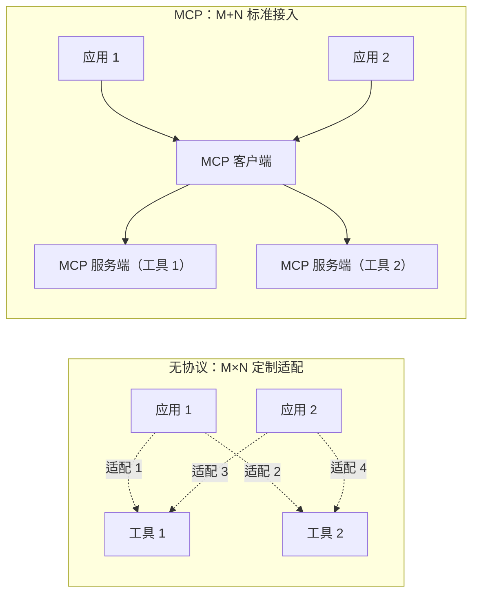

# MCP 解决了什么问题？

> 分类：Agent ｜ 难度：★★（常考）

## 一句话结论

MCP（Model Context Protocol）解决的是工具接入的 **M×N 集成问题**：M 个 AI 应用要接 N 个工具/数据源，直连要写 M×N 套定制适配（鉴权、schema、传输各不相同）；MCP 把它变成 **M+N**——应用实现一次客户端，工具实现一次服务端。

一句话判断：它是工具生态的「USB-C 接口标准」，解决的是**接入与复用**，不提升模型能力。判断分叉：自用工具一两个时不必上 MCP；要接入现成的第三方工具、或工具需要跨应用复用时，标准化的价值才兑现——复用方越多，加法相对乘法省得越多。

## 机制原理

### 1. M×N 到 M+N：协议把集成成本从乘法降为加法

量级估计：3 个应用 × 8 个工具，直连 24 套适配；MCP 后 3 个客户端 + 8 个服务端 = 11 个实现，且此后每新增一个应用或工具只加 1 个实现，不再相乘。机制：MCP 把「工具如何声明、如何被发现、如何被调用、结果如何返回」固化成协议消息，宿主应用动态发现工具列表，不必为每个工具手写胶水代码。

### 2. Function Calling 与 MCP 是分层关系，不是竞争

模型调用工具靠的是 Function Calling——模型被训练出「输出结构化调用意图」的能力，这一层在模型侧；MCP 在应用与工具之间，管工具的分发、发现与执行。完整链路：

- MCP 服务端声明工具（协议侧定义「工具是什么」）
- 宿主把工具定义翻译成模型的 function 列表
- 模型输出 function call（模型侧表达「我要调」）
- 宿主路由给对应服务端执行，结果回填 Agent 决策循环（循环本身见 [Agent和普通工作流的区别](Agent和普通工作流的区别.md)）

| 层 | 职责 | 位置 |
| --- | --- | --- |
| Function Calling | 表达「我要调用某工具」的结构化输出 | 模型与模型 API |
| MCP | 工具的声明、发现、执行协议 | 应用与工具之间 |
| 工具实现 | 真正执行动作、管鉴权 | 各服务端内部 |

混淆「模型能力」与「生态协议」的后果：架构图画错（把 MCP 画进模型里），选型误判（以为用了 MCP 模型调工具就更准——调用准确率取决于工具描述质量和模型能力，与是否走 MCP 无关）。

### 3. 三类原语 + 两种传输，覆盖「给模型什么、让模型做什么」

原语三件套：Tools（模型可调用的动作）、Resources（可读取的上下文数据）、Prompts（预置提示模板）——对应动作、数据、提示三种集成形态。传输两种：stdio（本地子进程，个人桌面场景）与 Streamable HTTP（远程服务，企业部署场景）。机制理解：给模型上下文、让模型执行动作就这两条通道，MCP 用三类原语把它们标准化，所以能当工具生态的通用底座。

### 4. MCP 把安全问题集中了，但没有消灭

- 收益侧：工具的鉴权、升级、审计收敛到服务端一处，宿主统一做白名单与权限控制——散落问题集中化，才可能统一治理。
- 代价侧：多一跳部署（独立进程/服务）与协议维护成本。
- 新风险面：工具描述文本会进入模型上下文（可被注入恶意指令）、第三方服务端不可信、权限声明过宽。

机制：MCP 是开放协议，接入门槛低，意味着治理必须自己做——它给的是治理的「抓手」，不是治理本身。平台化的治理设计见场景题 [工具网关与MCP平台](../../system-design/questions/ai/工具网关与MCP平台.md)。

## 典型错误答案

1. **「MCP 让模型能调用工具了。」**
   机制：模型调工具的能力来自 Function Calling（训练 + API 机制），MCP 出现之前模型就能调工具。MCP 解决的是工具侧「如何被所有应用标准化接入」。这个混淆会直接导致架构图画错——把 MCP 画进模型里，而不是画在应用与工具之间。
2. **「有了 MCP 就不用管权限和安全了，协议自带。」**
   机制：开放协议谁都能实现服务端，工具描述可携带注入内容，执行权限永远在宿主手里。MCP 的贡献是把安全治理的接触面集中（统一鉴权、审计、白名单有了落点），治理本身仍要建——「协议自带安全」误解了协议的角色。
3. **「所有工具都应该包成 MCP 服务端。」**
   机制：服务端是独立进程/服务，有部署、通信、版本管理成本。只有一个消费方的内部工具，直接函数调用更简单。经验判断：标准化的价值 ≈ 复用方数量 × 工具变更频率，两个都低时是在为想象中的生态付集成税。

## 追问

1. **MCP 和 Function Calling 到底什么关系？**
   思路：分层答——Function Calling 是模型表达「我要调工具」的机制，MCP 是工具被「发现与执行」的协议标准；MCP 工具最终仍以 function 定义暴露给模型。答出「谁在哪一层」，比背协议全称有价值得多。
2. **接入第三方 MCP 服务端有什么风险？**
   思路：三类——工具描述注入（外部文本进入模型上下文）、数据外泄（调用参数带着应用上下文的数据发出去）、权限过宽（工具申请的能力超出任务需要）。应对方向是最小权限、调用审计、敏感动作人工确认，注入防御与场景题 [Prompt注入防御](../../system-design/questions/ai/Prompt注入防御.md) 同源。
3. **MCP 服务端和传统 API 网关是什么关系？**
   思路：面向的对象不同——MCP 面向模型语义（工具描述、发现、协议消息），网关面向通用流量（鉴权、限流、审计）。企业落地时两者互补：MCP 管「模型怎么调」，网关管「调用合规地到达」，不是二选一。
4. **我们公司内部要不要建 MCP 服务端？**
   思路：用消费方数量判断——多个 AI 应用共享同一批内部数据/工具、且工具团队希望独立迭代时收益成立；单一应用自用先用函数调用，等复用需求出现再协议化。能给出「乘法变加法在什么条件下才划算」的算式，比直接站队有说服力。
5. **工具描述怎么写，调用准确率高？**
   思路：工具描述是模型决策的依据——说清「做什么、参数含义、什么时候不该用」，比堆关键词有效；工具多了要靠分组与路由控制单次可见数量。可以补一句：描述质量问题在 Function Calling 时代就存在，MCP 只是把它标准化了，并没有改变它。

---
[返回 AI 知识地图](../README.md)
