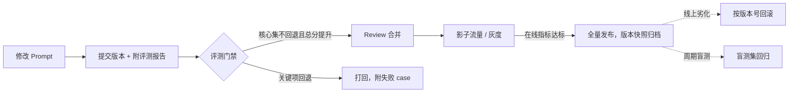

# Prompt 怎么做版本管理和评测？

> 分类：Prompt 工程 ｜ 难度：★★（常考）

## 一句话结论

把 Prompt 当代码管：进版本库、走 review、过评测门禁再上线。可判断的标准是——任何一次 prompt 改动都能回答三问：改了什么、在哪个评测集上分数从多少变到多少、谁批准的。答不出这三问的团队，prompt 质量只能靠玄学。

## 机制原理

**1. 为什么必须评测门禁：prompt 变更的影响是全局且不可目测的。**

Prompt 是 LLM 应用的「行为定义」，一处措辞改动会改变所有输入的输出分布，而不像改一行代码那样影响面可推断。机制链：输出非确定 → 单个 case 看一眼不构成证据 → 人的 review 只能判断「写得更通顺」，判断不了「效果更好」→ 唯一的回归手段是固定评测集上的分数对比。

这也是 prompt 与普通配置的本质区别：配置改了行为可推理，prompt 改了行为只能测——「测」是唯一证据来源，所以评测门禁不是流程负担，是这个前提下的唯一解。

**2. 版本化的最小单元不是 prompt 文本，是四件套。**

Prompt 文本、变量模板（输入槽位）、模型与参数（模型名、temperature、max_tokens）、该版本的评测结果快照，四者绑定同一个版本号。为什么参数必须一起版本化：temperature 改变采样分布，同一 prompt 在不同温度下输出稳定性完全不同；只版本化文本，历史结果不可复现，版本也就失去可比性。评测快照绑定版本，才能回答「这个版本当初凭什么上线」。

**3. 评测分三层，按可判定性递减、成本递增排序。**

规则断言（格式、必含字段、长度边界）程序可判、零成本，能覆盖的绝不交给后面的层。

语义质量交给 LLM as Judge（固定裁判 prompt + 评分 rubric）批量打分，覆盖规则判分到不了的相关性、完整性等语义属性。

发布级变更最后过线上影子流量或 A/B——离线评测集永远只是线上分布的近似，分布偏移只能在线上发现。三层是漏斗关系：上层能判定的绝不流到下层，否则评测成本失控。

**4. 成本量级：门禁评测很便宜，代价被普遍高估。**

假设核心评测集 200 条，被测每条约 3k token、裁判每条约 4k token，单次全量约 200×7k=140 万 token（量级估计），按主流 API 定价折算约为个位数到十几美元（量级估计）。而一次未测的 prompt 回归流到线上，损害的是全部流量的质量与信任。所以日常改动跑核心集、发布前跑全集，经济上完全成立——不做的理由从来不是成本，是没有流程。

## 典型错误答案

1. 「Prompt 就是代码里的一个字符串，改完直接发，上线看两眼就知道行不行。」

   「看两眼」在非确定输出下是单点抽样，不构成对分布的判断；更致命的是 prompt 影响是全局的——你看到的两个 case 变好了，另外二十类 case 可能静默变差，没有评测集你永远不会知道。等客诉发现时，损害已经发生，且无法定位到是哪次改动引入的。

2. 「我们把历史 prompt 都存数据库，想切哪个切哪个。」

   存了文本不等于有版本管理：没绑定评测结果，就无法回答「切回上个版本是切回一个什么水平的版本」；没绑定模型参数，就无法复现当时的行为；没有 diff 和 review 流程，数据库只是备份不是管理。版本管理的核心是「可比较、可复现、可追责」，这三样数据库都不提供。

3. 「评测集就是十几条手写 case，改完人工看看输出。」

   十几条覆盖不了真实输入分布，而改 prompt 天然会向这几条 case 过拟合——分数涨了，线上没变化甚至更差。人工「看看」没有 rubric 就不可比较：同一个人对同一输出两次判断都可能不同，这种评测既不能做门禁，也不能跨版本对比，等于没有评测。

## 追问

1. 评测集怎么建、怎么防止被「污染」？

   从线上真实流量采样打底，人工补边界 case（超长输入、对抗输入、空输入）。污染指评测 case 通过示例或历史优化被「记住」，导致分数虚高：要定期轮换部分 case，并保留一小块从不参与优化的盲测集，发布前单独跑，盲测集分数才是接近线上的估计。

2. Prompt 变更怎么和代码发布解耦？

   把 prompt 外置成资源（文件、配置中心或专门的 prompt 存储），应用按版本引用，prompt 变更走独立发布流程、支持快速回滚。但要防住「绕过评测热改」的口子：外置带来的便利必须以门禁为前提。经验判断：小团队先把 prompt 从代码里拆出来进 Git，比一上来就建平台收益大。

3. 离线分数涨了、上线效果反而差，怎么回事？

   优先怀疑两件事：分布偏移（评测集不再代表线上流量构成）和过拟合评测集（改动是针对那几百条 case 特化的）。处理思路是看线上影子流量的分桶表现、按流量构成重采样评测集，并把「评测集长期不更新」当成和「评测集天天改」同级的风险来管。

4. Prompt 回滚和代码回滚有什么不一样？

   Prompt 回滚应该是切回一个已归档的旧版本号（文本、参数、评测快照一体），配置生效、无需发版。和代码回滚的区别在于：prompt 版本间的行为差异没有 diff 可推理，只能信任当初的门禁分数——所以快照不全的版本，回滚了也不敢用。

同组相关：[用 LLM 当裁判可靠吗？](LLMasJudge可靠吗.md)（裁判这一层的校准）、[Few-shot 和 CoT 什么时候用？](FewShot和CoT什么时候用.md)（prompt 改动的典型来源）。

场景侧「这套怎么落成系统」：见 [LLM 效果评估与回归平台](../../system-design/questions/ai/LLM效果评估与回归平台.md)。

---
[返回 AI 知识地图](../README.md)
