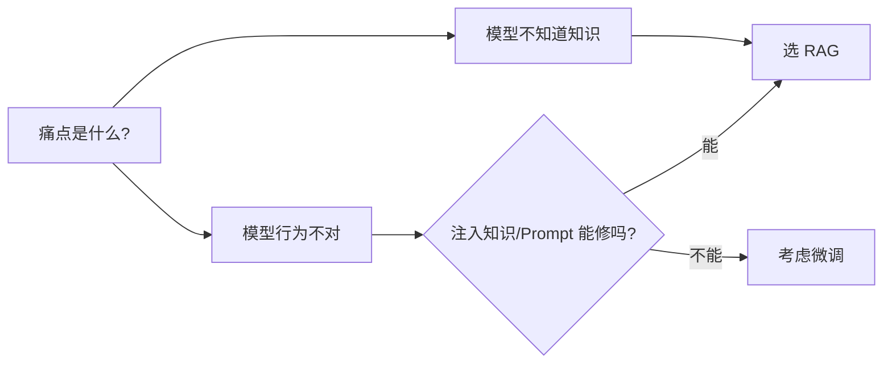

# RAG 和微调怎么选？

> 分类：模型推理与微调 ｜ 难度：★★★（高频）

## 一句话结论

默认 RAG：只要痛点是「模型不知道某类知识」——内部文档、时效信息、需要溯源——RAG 都是首选；只有当痛点是「模型的行为不对」，输出格式、领域语气、固定流程，而注入知识修不动时，才考虑微调。两者不互斥，成熟方案常是 RAG 打底、微调修行为。

## 机制原理

**1. 知识问题与行为问题，修复位置不同**

RAG 把知识作为 token 放进上下文，靠注意力机制在推理时实时读取，不改权重，知识更新只需重建索引（分钟级）。微调用梯度下降改权重，把「行为模式」写进参数。位置不同决定适用面不同：

- 让模型「知道」1000 篇内部文档：RAG 注入即可。微调要反复喂样本才可能记住，且改权重波及已有能力（灾难性遗忘），事实还不带出处。
- 让模型「稳定输出」JSON、用客服话术说话：这是输出分布问题，检索再多文档也改变不了行为；微调（SFT/LoRA）用几百到几千条样本即可对齐（经验判断）。

**2. 可溯源是 RAG 的独占能力，不是加分项**

RAG 生成时上下文带着来源块，引用溯源可以做到「答案每句话对应哪个文档哪个块」；微调进权重里的知识没有出处，无法验证、无法审计。企业知识库场景这经常是一票否决项——出了错答案，你要能回答「依据是哪份文档」。

**3. 成本结构不同：RAG 是持续运营成本，微调是项目制成本**

- RAG：一次性索引构建 + 每次查询附加一次检索（几十到几百毫秒）+ 上下文多付的 token。知识随时更新。
- 微调：标注数据集（千条级起步较稳，经验判断）+ 训练算力 + 每次知识变更重训并重新评估发布，周期以天计。

给个算例：假设 10 万篇文档、平均 2000 字，按 512 token/块切，量级估算约 40 万块（10 万 × 2000 ÷ 500 ≈ 4×10⁵，中文 1 字 ≈ 1 token 量级估计）；embedding 是一次性批处理。同样的知识用微调「灌进去」，样本量和重训次数远不止一次投入。

| 维度 | RAG | 微调（SFT/LoRA） |
| ---- | ---- | ---- |
| 解决的问题 | 模型不知道（知识） | 模型不会做（行为） |
| 知识更新 | 重建索引，分钟级 | 重训 + 评估 + 发布，天级 |
| 溯源 | 支持（上下文带来源） | 不支持 |
| 数据要求 | 文档原文即可 | 需标注指令-输出对 |
| 主要风险 | 检索不准则全链路失效 | 遗忘、幻觉、过拟合 |

**4. 判断顺序应从便宜到贵**

先修检索（确认知识能被召回），再看行为（必要时微调）。反过来先微调，会把检索问题掩盖成「模型还是不会」，白花训练钱：

检索侧修到什么程度算「修好」，排查方法见 [RAG效果差怎么排查](RAG效果差怎么排查.md)。

## 典型错误答案

1. 「现在长上下文窗口这么大，把文档全塞进去就行了，不用 RAG。」
   上下文成本随 token 线性增长：假设每次塞 10 万 token，而检索后只需 3000 token，单请求成本差 30 倍以上（量级估计）；且长上下文有注意力稀释（lost in the middle），中部内容利用率下降。
   还无法给引用出处；全塞是用钱换检索质量，文档超过一定量级后连「塞得下」都做不到。

2. 「用我们公司的内部文档微调一下，模型就知道我们的产品了。」
   SFT 学的是输入-输出的行为分布，不是事实存储。靠微调注入事实需要海量重复样本，仍可能编造。
   文档一更新就得重训；事实类知识放在可检索、可替换、可溯源的上下文里，才是它该在的位置。

3. 「先把基座微调好，检索质量就不用管了。」
   微调改不了检索。正确块没进上下文时，模型只能基于无关内容编造。
   先看检索命中率再谈模型侧优化——检索链路的排查展开见 [RAG效果差怎么排查](RAG效果差怎么排查.md)。

## 追问

1. **RAG 和微调能结合吗？**
   思路：能，且各修各的。常见两类微调数据：用 RAG 链路的输出教模型「如何利用检索内容并标注引用」，或训练领域 query 改写。
   前者是让 RAG 更稳，不是替代它。微调工程化（数据、训练、评估）见场景题 [模型训练微调平台](../../system-design/questions/ai/模型训练微调平台.md)。

2. **长上下文和 RAG 是替代关系吗？**
   思路：不是。文档总量小（几十页内）且不需要溯源时，直接塞上下文更简单；超量级后成本与定位精度都会恶化。
   RAG 本质是「先定位再读」，和数据库「先索引再查询」同一个思想。

3. **微调能缓解幻觉吗？**
   思路：多数情况下不能。幻觉的主因是「不知道却硬答」，微调只会让答案语气更自信、编得更流畅。
   机制上的缓解手段是 RAG 提供证据 + Prompt 强制引用 + 检索不到就拒答；微调只在「领域术语用错」这类行为问题上有效。

4. **什么信号说明该微调了？**
   思路：评估发现正确内容已在上下文里，模型输出仍不符要求——格式漂移、语气不对、流程走错，即「给它答案它也不会用」。
   这是行为问题，检索和 Prompt 修不动，微调才轮到出场。

---
[返回 AI 知识地图](../README.md)
