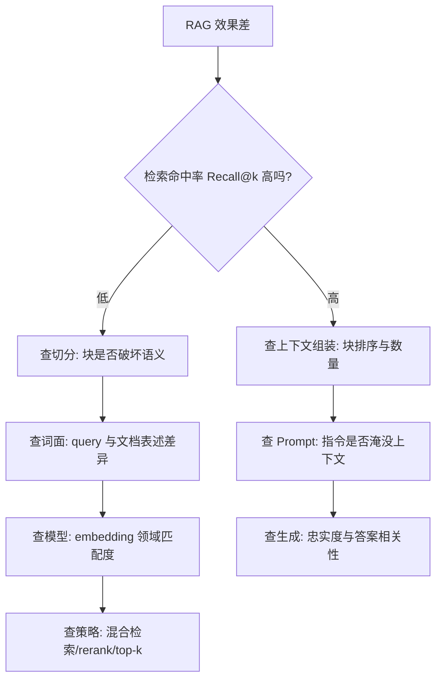

# RAG 效果差，从哪些环节排查？

> 分类：RAG（检索增强生成） ｜ 难度：★★★（高频）

## 一句话结论

先二分定位：用一批标注了相关块的测试 query，分别算「检索命中率」（正确内容有没有进上下文）和「回答质量」（进了上下文模型有没有用对）。命中率低查检索链路，命中率高质量差查生成链路。经验判断：实际项目里大多数 RAG 效果差死在切分和词面不匹配上，最后才轮到换模型。

## 机制原理

**1. RAG 是五段串联链路，任何一段丢信息都表现为「效果差」**

加载切分 → embedding → 检索（混合/重排）→ 组装 Prompt → 生成。串联链路的总质量由最弱一段决定：切分把表格切断，embedding 再准也没用；检索没召回正确块，模型再强也只能编。

- 排查的本质是给每段装仪表盘：哪段指标塌了修哪段，避免「哪里都改一点」的盲调。
- 每段只对自己下游负责，所以修复顺序也要沿链路从上游往下游走，上游不修下游白修。

**2. 没有标注集，就没有「排查」二字**

排查的前提是把「效果差」拆成可算的指标。最小可用做法：从真实日志取 50~100 条业务 query，人工标出每条的相关文档块，作为 golden set（经验判断：够算 Recall@k 的最小规模）。

- 检索侧：Recall@k（正确块出现在 top-k 的比例）、MRR（正确块排名越靠前分越高）。
- 生成侧：忠实度（答案的论断是否被上下文支持，防幻觉）、答案相关性（是否回答了所问）。
- 此后每个优化动作都在这个集合上回归，避免「改好一处、改坏三处」。

**3. 检索侧常见根因，按出现频率排（经验判断排序）**

- **切分破坏语义**：表格缺表头、代码被拦腰截断，召回的是「半个事实」，机制见 [切分策略怎么影响召回](切分策略怎么影响召回.md)。
- **query 与文档表述不一致**：用户问「钱退回来了没」，文档写「退款到账状态」。同义改写向量检索尚可应对，但产品型号、错误码这类词面精确匹配场景会漂移，需要 BM25 补位，见 [混合检索为什么必要](混合检索为什么必要.md)。
- **embedding 模型与领域不匹配**：通用模型对强领域语料（医疗、法律）的相似度区分度不足。
- **top-k 与噪声**：k 太小漏召回；k 太大则无关块稀释模型注意力，成本也随块数线性上涨。
- **数据侧问题**：扫描件解析失败产出空块乱码、索引里是过期版本文档——检索越「准」答案错得越自信，这类问题必须回溯到数据管线。

**4. 生成侧常见根因**

命中率不低但答案仍错时，按发生机制看三处：

- **上下文组装**：关键内容应放头尾，中部利用率低（lost in the middle）；无关块过多会稀释注意力。
- **Prompt 约束**：是否明确「只基于上下文回答」——否则模型用参数知识抢答产生幻觉。
- **引用缺失**：没有引用约束就无法定位「哪一块喂错了」，坏例分析失去抓手。

## 典型错误答案

1. 「效果差？换个更强的模型就好了。」
   机制上不成立：检索是入口，正确块没进上下文时模型只能编——不是「答得差」而是「必然错」。
   先用 Recall@k 验证检索侧，命中率没问题才轮到换模型；证据缺失时旗舰模型只是编得更流畅。

2. 「把 top-k 调到 20，多给点上下文总没错。」
   用数量掩盖定位缺失。无关块占位会稀释注意力（关键块被挤到中部）、推高每请求 token 成本。
   还可能诱导模型把多个无关内容缝合出错误答案；k 应由评估集扫出，不是拍脑袋。

3. 「靠人工试用发现 bad case，一个一个修。」
   没有量化指标的「修」无法归因：不知道这次改动是否真修好、有没有改坏别处。
   golden set + 回归评估才是排查的基础设施，系统化建设见场景题 [LLM 效果评估与回归平台](../../system-design/questions/ai/LLM效果评估与回归平台.md)。

## 追问

1. **没有标注数据，冷启动怎么办？**
   思路：从线上日志取真实 query（不要自造问题），人工快速标注相关块。
   先不求全，50 条够定位主要矛盾；标注成本远低于盲目优化的试错成本。

2. **检索命中率不错，答案还是错，怎么看？**
   思路：进生成侧。先人工看坏例的上下文——正确块在不在、排在第几位；再看忠实度——答案是否真来自上下文。
   这两处覆盖绝大多数「检索对、答案错」的案例。

3. **怎么证明一次优化真有效？**
   思路：同一 golden set 上跑改前改后两组指标，差异要超过评估本身的波动幅度，并保留不动的对照组。
   机制是生成侧指标有随机性，没有对照就分不清「有效」和「正常波动」。

4. **离线指标变好了，线上体感没变化，为什么？**
   思路：大概率是分布漂移——评估集的 query 类型和线上真实 query 不一致，优化只在评估集覆盖的类型上生效。
   解法是定期从线上日志采样补充评估集，让评估分布跟上业务分布（经验判断：按 query 聚类抽样，别随机抽）。

---
[返回 AI 知识地图](../README.md)
