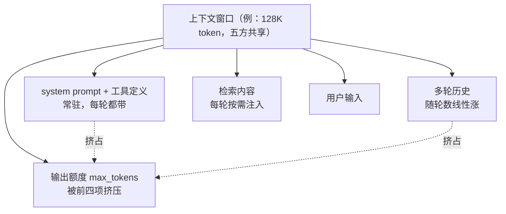

# 什么是 Token 和上下文窗口？温度等参数怎么调？

> 分类：LLM 应用开发 ｜ 难度：★★★（高频）

## 一句话结论

上下文窗口不是「能读多长的文档」，而是输入侧（system prompt、工具定义、多轮历史、检索内容）与模型输出共享的 token 总池——经验起点是给输出预留 10-25% 的额度；token 数同时决定成本、延迟与是否超限，是 LLM 应用第一个该进监控的指标。温度只重塑输出分布的形状、不改变事实性，「调低温度防幻觉」在机制上不成立。

## 机制原理

### 1. Token：BPE 子词，不是词也不是字

分词器把文本切成子词单元：高频序列合并进词表，低频的拆成更小片段。量级数字（各家 tokenizer 有差异，属量级估计）：英文 1 token ≈ 4 字符 ≈ 0.75 个单词；中文因词表以英文语料为主，一个汉字常占 1-2 token。

三条工程后果全挂在这个单位上：成本按 token 计价，同样语义中文可能贵 1.5~2 倍（量级估计）；截断发生在 token 边界，按字符数估余量会系统性偏差。

第三条后果最反直觉：模型的世界里只有 token id、没有字符——「数不清 strawberry 里有几个 r」的机制根源是：拼写任务需要字符级视角，而模型输入里根本没有字符这一层。

### 2. 上下文窗口：一个五方共享的池子

窗口构成：system prompt + 工具定义 + 多轮历史 + 检索内容 + 用户输入 + 输出额度 ≤ 窗口。假设 + 算式：128K 窗口的客服 Agent，system 与工具定义占 3K，RAG 检索内容 20K，30 轮历史每轮均值 1.5K 占 45K，用户输入 1K——输入侧合计 69K；历史按全量携带持续增长逼近上限时，输出额度被挤到所剩无几，长回答被截断或请求直接报错（行为取决于各家 API 实现）。

多轮全量携带的累计成本是平方级：第 r 轮携带 ≈ r×1.5K 历史，第 30 轮携带的历史已是第 1 轮的 30 倍。把历史增量逐轮加总，1.5K × (1+2+…+30) ≈ 70 万 token（假设 + 等差求和；仅历史部分）；固定部分（system+工具+RAG+输入 ≈ 24K）每轮重复支付，30 轮合计 ≈ 72 万。全口径的 30 轮累计输入 ≈ 140 万 token，是不带历史基线（30 × 24K ≈ 72 万）的约 2 倍——多出来的正是那份随轮数按平方增长的历史开销，这就是「会话成本失控」的机制，也是历史截断/压缩策略存在的理由，成本侧的展开见 [Token 成本治理](../../system-design/questions/ai/Token成本治理.md)。

窗口的挤压关系画出来是这样：

### 3. 温度：softmax 前的一次缩放，改变「怎么挑」，不改变「有哪些候选」

采样概率 = softmax(logits / T)。T < 1 放大 logits 差距、分布变尖（更确定）；T > 1 拉平分布（更多样）；T → 0 等价于贪心解码，每步取最高概率 token。要害区分：温度改变「模型从候选里怎么挑」，不改变「哪些候选概率高」；而幻觉的机制是「高概率续写 ≠ 事实」，所以调温度防不了幻觉。经验判断：抽取/分类/工具调用用 0~0.3（参数要准），创意生成 0.7~1.0。

### 4. 核心参数速查

| 参数 | 作用机制 | 经验取值 | 工程注意 |
| ---- | ---- | ---- | ---- |
| temperature | logits 除以 T 再 softmax：T 小变尖、T 大拉平 | 抽取/工具 0~0.3；创意 0.7~1.0 | 与 top_p 二选一调，别同时动 |
| top_p | 只在累积概率前 p 的候选内采样 | 0.9~1 | 与 temperature 叠加互相干扰、难归因 |
| max_tokens | 输出额度，从窗口池里预扣 | 历史输出 P95 × 1.5 | 设太低截断答案，设太高破坏成本预算 |
| stop sequences | 生成命中即停 | 按输出格式定 | 零成本控制手段，常被忽略 |
| penalty 系列 | 对已出现 token 降权 | 默认 0 | 会惩罚 JSON 里的重复结构 token，结构化输出慎用 |

一句话收束：这些参数都只改变采样行为，没有一个能弥补「上下文里没有的信息」——缺事实去检索，缺格式去约束解码（机制见 [FunctionCalling与结构化输出](FunctionCalling与结构化输出.md)）。

## 典型错误答案

1. **「窗口 128K，我们文档才 100K，直接全文塞进去。」**
   为什么不行：窗口是共享池——100K 文档加上 system 与历史后，输出额度只剩零头，回答被截断；且无缓存时每次提问都要重付一遍 100K 输入的钱（按混合单价 ¥8/M token 的假设估，单次 ≈ ¥0.8，千万次调用就是 ¥800 万量级）；研究上还观察到长上下文中部内容利用率偏低（lost in the middle，研究观察而非普适结论）。工程默认是检索相关段落注入而非全文塞入，完整设计见场景题 [企业知识库问答 RAG](../../system-design/questions/ai/企业知识库问答RAG.md)。

2. **「温度调到 0，输出就完全确定，也不会幻觉了。」**
   为什么不行：T=0 是贪心解码，接近可复现，但工程上不保证逐位确定——并行归约的浮点求和顺序、批处理调度都可能让输出抖动（经验判断，这也是 seed 参数不总有效的原因）。更根本的：温度只重塑分布形状，幻觉的机制是「概率最高的续写 ≠ 事实」，T=0 时模型照样选概率最高但错的那个。降幻觉的抓手是给事实（检索、引用）与加校验，不是调温度。

3. **「token 不就是个单词，我按字数估算就行。」**
   为什么不行：BPE 是子词切分，中英文密度差异大（一个汉字 1-2 token，4 个英文字符才 1 token），数字、代码、生僻词切得更碎；按字符估会系统性低估，成本预算与窗口余量双双失真。正确姿势：精确计数用 tokenizer 库或 API 返回的 usage 字段，字符估算只配做容量规划。

## 追问

1. **为什么中文普遍比英文费 token？**

   思路：词表主要由英文语料训出，汉字覆盖少，常见汉字常被拆成字节级片段，同样语义中文 token 数更多。机制推论：中文为主的业务，tokenizer 的中文效率是真实的成本变量——不同模型对同段中文的 token 数可差几十个百分点（量级估计，需拿自家语料实测），选型时不该忽略。

2. **top_p 和 temperature 有什么区别？能一起调吗？**

   思路：都在收敛采样分布但机制不同——temperature 对全部 logits 做指数缩放、重塑整个分布；top_p 是截断，只在累积概率前 p 的候选里采样。同时调会互相覆盖、效果无法归因；工程经验判断是固定一个、只调另一个，多数团队固定 top_p 接近 1、只调 temperature。

3. **多轮对话历史快超窗口了怎么办？**

   思路：按成本递增三档：滑动窗口截断（只留最近 K 轮，最便宜，丢早期信息）、历史摘要压缩（小模型把旧轮压成摘要，多一次调用）、外部记忆（结构化存关键事实，按需注入）。选型变量是「早期信息对当前回答的边际价值」——早期常有关键事实（工单号、用户约束）时纯截断会丢。落地设计见场景题 [AI 客服系统](../../system-design/questions/ai/AI客服系统.md)。

4. **上下文窗口是不是越大越好？**

   思路：不是。窗口越大，KV Cache 显存与注意力计算越贵（机制见 [注意力机制的工程直觉](注意力机制的工程直觉.md)），单请求成本越高，而且「塞得下」不等于「用得上」（lost in the middle）。窗口解决容量，检索解决相关性——正确用法是窗口装「当前任务必须的信息」，装不下、不必装的交给检索。

---

[返回 AI 知识地图](../README.md)
