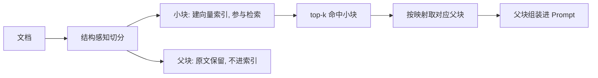

# 文档切分策略怎么影响召回效果？

> 分类：RAG（检索增强生成） ｜ 难度：★★（常考）

## 一句话结论

切分同时决定了「检索单元」和「生成单元」的大小，而两者的最优值是矛盾的：块太大语义被稀释、检索区分度下降；块太小单块信息不完整、召回回来也答不全。默认按结构边界（标题/段落）切 + 适度重叠即可；只有评估集证明默认切分不达标时，才上父子块、语义切分这类复杂策略。

## 机制原理

**1. 块越大，向量越「平均」，检索区分度越低**

embedding 对整块文本池化得到一个向量：块内主题越杂，向量越接近「多个主题的平均」，与任何具体 query 的相似度都被摊薄。这是信噪比问题——假设 1024 token 的块里只有 200 token 与 query 相关，向量里约 4/5 的成分是噪声（量级估算，实际取决于池化方式）；同样 200 token 独立成块，向量几乎全部由相关内容构成。

- 检索侧表现：大块方案下，「最相关的块」与「沾边的块」得分拉不开差距，排序失去意义。
- 生成侧表现：块太小时指代、定义、表头被切断，召回的块「每个字都对、拼起来不能用」。

**2. 一个算例看粒度的权衡**

假设 10 万字知识库（中文按 1 字 ≈ 1 token，量级估计）：512 token/块 → 约 200 块；128 token/块 → 约 800 块。块数翻 4 倍，但每块语义更纯。

- 索引成本：块数翻 4 倍，向量存储与检索候选同比例膨胀。
- 召回概率：top-k 固定时，小块让「正确内容出现在 top-k」的概率上升，代价是单块信息量下降——正确块进了 top-k，模型却可能拼不出完整答案。

**3. 重叠（overlap）是给边界语义买保险，不解决结构截断**

硬切会在任意位置截断跨边界的句子和指代。重叠让边界附近内容在相邻两块各完整出现一次，只要其中一块被召回，语义就是完整的。

- 怎么选：10%~20% 重叠带来同比例索引膨胀（量级估计，具体值在评估集上验证）。
- 救不了什么：重叠只是平移窗口，表格缺表头这类结构性截断救不回来，要靠结构感知切分。

| 策略 | 原理 | 优点 | 失败模式 |
| ---- | ---- | ---- | ---- |
| 固定长度 | 按 token 数硬切 | 实现简单 | 切点随机落在句子/表格中间 |
| 递归字符 | 按段落 → 句子分隔符递归切 | 尽量保住自然边界 | 对表格/代码无感知 |
| 结构感知 | 按 Markdown 标题/表格/代码块边界切 | 尊重文档语义结构 | 单标题下内容过短或过长 |
| 父子块 | 小块建索引，命中后返回父块 | 检索纯度与生成完整性兼得 | 需维护两层映射，取父块有开销 |
| 语义切分 | 相邻句向量相似度骤降处切 | 切在主题变化处 | 多一次 embedding 成本，收益依赖语料（经验判断） |

**4. 结构感知与父子块：解耦「检索粒度」和「生成粒度」**

表格切开后每一半都失去表头，召回回来模型读不懂——所以表格、代码块应整体成块，超长再内部特殊处理。父子块（small-to-big）是另一方向：用小块做检索单元保证向量纯度，命中后返回父块做生成单元保证信息完整。

切分策略的本质，是分别回答「用什么单元算相似度」和「把什么喂给模型」这两个问题；切分在整条数据管线里的位置见场景题 [非结构化数据处理管线](../../system-design/questions/ai/非结构化数据处理管线.md)。

## 典型错误答案

1. 「chunk 越大越好，信息全，模型看得多。」
   向量被多主题平均化后，检索阶段就区分不出哪个块与 query 更相关；即便召回了，无关内容也稀释模型注意力。
   「信息全」和「相关性高」在机制上冲突：前者优化的是生成单元，后者优化的是检索单元，不是同一件事。

2. 「按 512 字符固定切一刀就够，大家都这么设。」
   对连续散文勉强成立，但真实文档有标题、表格、代码：固定切分的切点随机落在语义结构中间，表格失去表头、代码失去上下文，召回的块本身不可用。
   参数应跟随文档结构，而不是跟随框架默认值；默认值只能当评估集上的第一个基线。

3. 「切分差点没关系，后面有 rerank 兜底。」
   rerank 只能对已进入候选集的块重排。切分把语义切碎后，正确内容可能根本进不了 top-n 候选——重排器面对的候选里没有正确答案，排什么都不可能对。
   链路是串联的，上游缺失无法靠下游修复；排查时要先确认切分没截断关键内容，见 [RAG效果差怎么排查](RAG效果差怎么排查.md)。

## 追问

1. **chunk size 到底怎么定？**
   思路：不拍脑袋，在评估集上扫几个档位（如 256/512/1024）看 Recall@k，选拐点。
   FAQ 型语料和长篇报告的最优值差别很大，别人的经验值只能当起点（经验判断）。

2. **父子块检索的代价是什么？**
   思路：索引要同时维护小块向量、父块原文和两层映射，命中后多一次取父块的开销。
   父块过大又回到注意力稀释问题，所以父块也有上限（经验判断：2048 token 量级起步）。

3. **表格和代码应该怎么切？**
   思路：表格整体成块，并把标题路径（所属章节）拼进块文本，补上表头之外的语境；代码按函数/类等语法边界切。
   共同机制是：别让结构化内容在切分时丢失理解它所需的上下文。

4. **切分策略改动后怎么验证没有退化？**
   思路：重建索引后在同一 golden set 上回归 Recall@k 和端到端指标。
   切分一动全库索引都要重建，是 RAG 里影响面最大的改动，必须有回归兜底；没有评估集就先停手建集。

---
[返回 AI 知识地图](../README.md)
