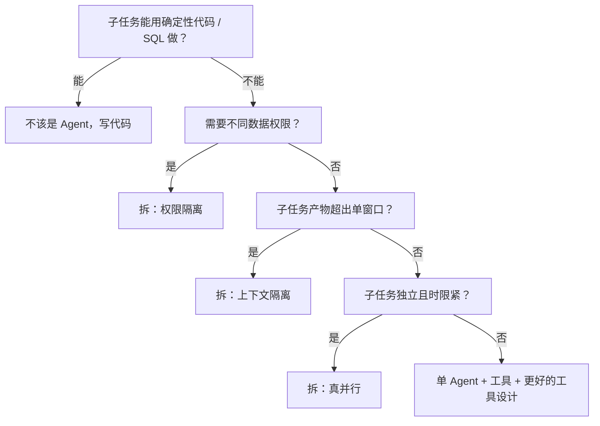

# 什么时候需要多 Agent？

> 分类：Agent ｜ 难度：★★★（高频）

## 一句话结论

**默认单 Agent + 工具；只有出现架构性约束时才拆多 Agent**。三个合法理由：子任务需要不同的数据权限（权限隔离）、子任务产物大到单窗口装不下（上下文隔离）、子任务相互独立且墙钟时间受限（真并行）。

「任务复杂」本身不是理由：复杂度用更好的工具和更清晰的流程去解，不用加角色。经验判断 + 明确判据：拆分动机必须落到三个机制之一，落不上的拆分是纯负资产——每加一个角色，都是在三本乘法账上多记一行。

## 机制原理

### 1. 多 Agent 的真实增益只有三个机制，没有第四个

「人多力量大」不是机制。逐个看为什么这三件事必须用「独立 Agent」实现、不能在单 Agent 里用工具实现：

- 权限隔离：数据权限绑定在调用身份上，同一个上下文无法对某些步骤开、某些步骤关；涉及敏感数据（薪酬、病历）时这是合规准入条件，不是优化项。
- 上下文隔离：单个工具结果过大（全量检索结果、整份长文档）装不进窗口时，把「执行子任务」整体外包给子 Agent，主上下文只收结论。
- 真并行：独立子任务同时跑，墙钟时间除以并发度；单 Agent 的 ReAct 循环天然串行。

三个之外的拆分动机（「分工专业」「模拟团队」）都提不出机制，属于把组织直觉错当技术判断。

### 2. 代价是三本乘法账

量级估计（示意，用于说明机制）：一个 6 角色协作任务，每角色 5-10 步，全任务约 40-60 次 LLM 调用，每次携带角色上下文与交接内容约 8k token：

- token 账：全任务 40-50 万 token，同任务单 Agent 约 5 万——**协作税 8-10 倍**。
- 误差账：交接保真度是相乘不是相加——设结构化交接 0.9、摘要交接 0.7（量级示意），两跳之后 0.9² ≈ 81% vs 0.7² ≈ 49%。
- 时间账：墙钟由关键路径决定——6 角色 × 5 步全串行约 10-15 分钟，按依赖图并发 3 才压到 2-3 分钟。

| 维度 | 单 Agent + 工具 | 多 Agent |
| --- | --- | --- |
| token | 基线 | 8-10 倍（量级估计） |
| 正确性 | 幻觉无背书，用户一眼可疑 | 错误被下游引用，获得信任增强 |
| 延迟 | 串行循环 | 关键路径决定，可并行压缩 |
| 可调试性 | 单上下文，轨迹即全部 | 归因依赖交接记录 |
| 权限 | 单一身份，无法按步骤隔离 | 按角色授予，天然边界 |

三本账共同指向：没有架构收益时，拆分在 token、正确性、延迟三个维度同时变差。

### 3. 多 Agent 特有的风险：错误获得信任增强

单 Agent 幻觉，上下文里没有别的东西为它背书，用户一眼可疑。多 Agent 里，检索 Agent 幻觉出的数字被计算 Agent 引用、再被写作 Agent 引用——每被引用一次，错误就多一层「既有结论」的外衣。机制：上下文中已存在的陈述会被模型系统性提高采信度，下游越「认真」地基于上下文工作，错误传播越深。所以多 Agent 的错误**更难被发现**而不是更可靠——这也是「互审保质量」不成立的核心原因。

### 4. 判断流程：先淘汰，再对号

第一道淘汰门最值钱（经验判断）：实际系统里相当一部分「规划 / 汇总角色」用一段代码或一条 SQL 就能替代，省下的每个 LLM 决策点都是确定性与成本的净收益。单 Agent 循环的边界在哪里，见 [Agent和普通工作流的区别](Agent和普通工作流的区别.md)；拆定之后的完整协作设计，见场景题 [多Agent协作系统](../../system-design/questions/ai/多Agent协作系统.md)。

## 典型错误答案

1. **「任务太复杂，一个 Agent 处理不过来，拆成多个吧。」**
   机制：「复杂」不等于需要多角色。先查三件事：工具是否够好、步骤是否清晰、模型能力是否达标——都受限且受限点恰好是权限 / 窗口 / 并行之一，才轮到拆。没有机制对应的拆分，三本乘法账全是净损失。
2. **「多个 Agent 互相讨论、互相检查，结果更可靠。」**
   机制：LLM 审 LLM 共享知识盲区，抓得住格式与流畅度问题，抓不住事实错误——审稿模型会连上下文里的错误结论一并采信。且「讨论」没有外部终止器，轮次与成本无上限。可靠性来自确定性校验器（代码复算、引用核对）与结构化交接，不来自「多商量几轮」。
3. **「按公司组织架构给 Agent 分角色：PM、开发、测试，协作一定好。」**
   机制：组织隐喻不是技术机制。角色数量的增益边际递减，交接契约的质量才是增益来源——角色从 3 加到 6，收益增幅有限；交接从摘要升级到结构化契约，每个下游都受益。落不到三个机制上的角色，只是新增了一个错误源。

## 追问

1. **多 Agent 之间怎么传递信息？**
   思路：交接结构化产物（结论 / 依据 / 置信度），不是聊天记录——全量共享把噪声和错误一起放大，摘要传递丢机制细节。能讲出「信息保真与注意力是对抗的，结构化是折中」就算到位。
2. **编排用中心调度，还是让 Agent 自由协作？**
   思路：生产默认中心调度——失败单点可归因、可终止、可回放；自由协作的失败形态是不收敛（无外部终止器）加错误信任增强。快速判据：看「终止条件」写在谁的代码里——写在系统里是中心调度，写在参与者的自我感觉里，迟早出成本事故。
3. **单 Agent 上下文快满了，是不是就该拆多 Agent？**
   思路：先做轻的——裁剪历史、会话压缩、记忆外置（见 [Agent记忆怎么分层](Agent记忆怎么分层.md)），这些便宜且可逆。只有「单步产物本身就装不下」时才值得拆，那时拆的是上下文隔离，不是容量焦虑。
4. **怎么判断现有系统该不该拆？**
   思路：找三个信号——上下文频繁逼近上限、靠裁剪历史续命（窗口信号）；子任务需要主流程没有的数据权限（权限信号）；子任务有明显独立分支而时限紧（并行信号）。一个都没有就不拆；有多个，先拆收益最大的那个。
5. **拆完之后最该盯什么？**
   思路：盯交接，不盯角色。误差相乘发生在交接处，交接层指标（产物 schema 符合率、依据可核验率）是端到端质量的先行指标；角色数量的收益递减，交接质量的收益全员共享。这也是多 Agent 评测必须分层的机制原因。

---
[返回 AI 知识地图](../README.md)
