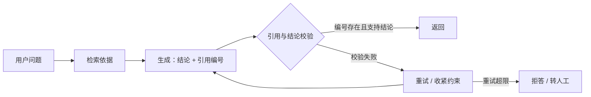

# 大模型幻觉是什么，工程上怎么缓解？

> 分类：LLM 应用开发 ｜ 难度：★★★（高频）

## 一句话结论

幻觉的根因是模型在做「最大化似然的文本补全」而不是「查询事实」，所以 prompt 里写「不要编造」基本无效；工程上要做的是把「生成」约束在「可验证的依据」上——默认组合：RAG 给依据 + 引用溯源强制对齐 + 结构化输出限定边界 + 关键结论程序校验，校验不过就重试或拒答。

## 机制原理

**1. 为什么会幻觉：训练目标里没有「真值」这个变量。**

模型的训练目标是「给定前文，预测下一个最可能的 token」，它学到的是文本的统计分布，不是「陈述是否为真」的函数。当问题触及训练数据里稀疏的内容（长尾事实、私有数据、知识截止之后），采样仍会给出一个「格式上最像答案」的序列——「答案该长什么样」的分布它学到了，「这个答案是否为真」从来不在损失函数里。再叠加对齐训练带来的「乐于回答」倾向和解码随机性，产出就是「语气自信、格式完美、内容错误」。

这同时解释了两个经验规律：问得越具体越容易编（具体问题强制模型补全细节），以及模型不知道自己不知道（它没有「知道/不知道」的内部信号，只有 token 概率分布）。

**2. RAG 为什么是第一手段：改变条件概率，而不是改变指令。**

RAG 把生成条件从 P(答案|问题) 变成 P(答案|问题, 检索到的文档)：每一步生成的依据从「权重里的模糊记忆」换成「上下文里的明确文本」，偏离依据的成本变高。但它只解决「依据内的问题」，有两个残余失效：检索没召回（依据就错，答案跟着错），以及模型不忠实于上下文（依据明明在，仍然自由发挥）。所以 RAG 之后必须接两件事：检索质量监控（召回不足先优化检索），和引用溯源（每个结论标注出处，出处可程序校验是否存在、是否支持结论）。

**3. 工程闭环：把幻觉从「语言问题」变成「可判定问题」。**

幻觉难治理，很大程度因为它不可判定；工程手段的核心是制造可判定性。结构化输出把回答拆成「结论 + 引用编号」，引用可以程序校验，数值与计算类结论可交给代码执行或查库复核，语义支持性可交给裁判模型逐句判「这句话有没有依据支持」。校验不过的动作是确定的：重试、收紧约束、或拒答转人工——「不通过」从此有出口，而不是靠用户发现。

| 幻觉类型 | 机制 | 主缓解手段 | 残余风险 |
| ---- | ---- | ---- | ---- |
| 事实性（编造事实） | 长尾知识在分布外，仍按「最像答案」补全 | RAG + 引用溯源 | 检索错误则答案错误 |
| 忠实性（无视给定依据） | 生成条件对上下文锚定不足 | 结构化输出 + 引用强校验 | 依据过长时锚定变弱 |
| 推理性（依据对、推论错） | 多步组合超出单次前向容量 | CoT / 程序计算 / 自洽性采样 | 换推理路径仍有漂移 |

**4. 度量与代价：拒答率和幻觉率是一对必须联动的指标。**

经验判断：RAG + 引用校验能消掉大部分事实性幻觉，但到不了零，工程目标是「可检测、可追溯、可拦截」。收紧校验必然推高拒答率——拒答率过高通常说明检索质量或阈值有问题，而不是「模型太谨慎」；只考核幻觉率会诱导系统大量拒答，只考核拒答率会放回幻觉，两个指标必须一起看。

## 典型错误答案

1. 「在 system prompt 里写『不知道就说不知道，禁止编造』就能解决。」

   这句指令改变的是输出风格，不是知识来源。模型对「自己是否知道」没有内部信号，它只会继续生成最可能的文本；当答案真在上下文里时这句指令略有边际作用（抑制自由发挥），对「上下文里没有答案」的场景几乎无效。有效版本是把约束机制化：强制引用编号、程序校验、无依据即拒答，让「不知道」成为系统的确定性行为而不是模型的觉悟。

2. 「换最新的旗舰模型，幻觉就没了。」

   换模型降低的是幻觉率基线，机制没变：生成目标仍是文本补全，知识截止、长尾事实、私有数据三类问题换任何模型都存在。经验判断：模型升级值得做，但它买不到「可验证」——企业场景真正值钱的是引用可查、结论可校验，这只能靠工程手段。

3. 「幻觉无法根除，所以不用专门治理，用户自己会判断。」

   不同场景的容错成本差几个数量级：闲聊里幻觉是体验问题，医疗、法律、金融场景是事故。正确做法是按场景定容错等级——低风险场景放过，高风险场景强制引用与校验、宁可拒答——而不是用「无法根除」推掉治理责任；「可拦截」本身就是工程价值。

## 追问

1. RAG 上线后仍有幻觉，怎么区分是检索的问题还是生成的问题？

   把 bad case 分三类核对：检索没召回（top-k 里根本没有答案）→ 优化切分与检索；召回了但模型没用上 → 收紧指令、加引用强校验；引用的依据本身就错 → 治理知识库。跳过分类直接调 prompt，是这类排查里最常见的浪费。

2. 幻觉率怎么度量，总不能全靠人工标？

   人工标注做金标小集合，规模化用裁判模型按「每个结论是否有依据支持」逐句判，裁判本身要定期用金标集复核一致率。注意幻觉率和拒答率联动，单独报一个指标会被另一个吃掉。

3. temperature 调到 0 是不是就不幻觉了？

   不是。温度影响采样随机性，不影响正确性：贪心解码一样会选出「最可能但错误」的 token，事实性幻觉在 temperature=0 下依然存在。降温的价值是输出可复现（评测时有用），但它不是幻觉缓解手段。

4. 模型会不会「凑引用」——随便标个编号应付校验？

   会，这正是引用必须程序校验的原因：编号要真实存在，引文内容还要对结论做支持性判定（裁判模型或 NLI 都可），凑出来的引用在校验环节被拦下。把「标引用」当硬约束而非风格要求，是「真 RAG 治幻觉」和「看起来像 RAG」的分界线。

同组相关：[用 LLM 当裁判可靠吗？](LLMasJudge可靠吗.md)（引用校验里的裁判环节）、[LLM 应用的成本怎么控制？](LLM应用成本怎么控.md)（RAG 与校验环节的成本账）。

场景侧「这套怎么落成系统」：见 [企业知识库问答 RAG](../../system-design/questions/ai/企业知识库问答RAG.md)。

---
[返回 AI 知识地图](../README.md)
