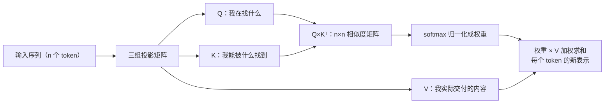

# 注意力机制是什么？为什么 Transformer 离不开它？

> 分类：LLM 应用开发 ｜ 难度：★★（常考）

## 一句话结论

注意力是「每个 token 按内容相关性，从其他所有 token 动态取信息」的加权求和——权重不是训练后固定的参数，而是每次前向传播从当前输入现场算出来的。工程上不需要会推导，但必须理解它的三个后果：计算量随上下文长度平方增长（长上下文贵和慢的机制根源）、KV Cache 之所以能省算力正是注意力结构决定的、上下文窗口因此是硬件约束而不是软件开关。

## 机制原理

### 1. Q/K/V：一次「查询-匹配-取值」，要害在权重是函数不是参数

每个 token 被三个可学习矩阵投影成 Q（我在找什么）、K（我能被什么找到）、V（被找到后实际交付的内容）。每个 token 用自己的 Q 与全部 K 做点积得到相似度，softmax 归一化成权重，再对全部 V 加权求和，得到融合了全上下文的新表示。

机制链的要害是：**权重是输入的函数，不是模型的参数**。CNN 的卷积核、RNN 的权重矩阵训练完就固定，对所有输入一视同仁；注意力的权重每次前向传播现场计算——同一个「他」，在这句话里聚合「张三」的信息，在另一句里聚合「李四」的信息，因为它的 Query 变了。Transformer 表达力超过前代结构，机制根源就在这里：信息怎么流动由当前内容决定，不由固定线路决定。

### 2. O(n²)：长上下文「贵、慢、装不下」的数学根源

n 个 token 各自与 n 个 token 算相似度，计算量 n²。假设 + 算式（量级估计）：4K 上下文 ≈ 4096² ≈ 1600 万次相似度计算；128K 上下文 ≈ 131072² ≈ 172 亿次，是 4K 的 1024 倍——上下文长度翻 32 倍，注意力计算量翻 1024 倍。

由此读出两条工程规律：API 对长上下文分层计价、推理平台对超长请求单独限流，机制依据就是这条平方曲线；「把一切塞进上下文」从来不是免费方案——RAG 用 O(k) 的检索换掉 O(n²) 的全量注意力，本质是算力上的套利。

### 3. 多头：把表示空间切几份，并行问几个不同的问题

把表示向量切成 h 份，每份独立做一遍注意力再拼接。机制目的：一次注意力只能表达一种「按什么相关性取信息」的模式，多头让同一层并行表达多种。具体哪个头学到什么（指代、语法、邻近）随训练而变，属研究观察而非保证；确定的是显存含义——KV Cache 大小与 KV 头数成正比，这正是 MQA/GQA 减头数省显存的动机（见追问 4）。

### 4. KV Cache：为什么生成越久、显存越满

自回归生成逐 token 进行：生成第 t 个 token 只需要它的 Q 是新的，前 t-1 个 token 的 K/V 已算过且不会再变（它们只被查询，不主动改变）。缓存历史 K/V，每步只算新 token 的注意力——KV Cache 成立的全部机制就在这。

两条推论：省的是重复计算，付出的是显存，缓存规模随上下文长度线性涨，这就是长请求挤占显存与并发的直接原因；prompt caching（命中前缀不重复计费/计算）能成立，同样因为前缀的 K/V 不会变。窗口与 token 的关系见 [token与上下文窗口](token与上下文窗口.md)。

三种结构放在一起对比，机制差异一目了然：

| 结构 | 权重从哪来 | 远距离信息路径 | 工程后果 |
| ---- | ---- | ---- | ---- |
| RNN | 训练后固定的参数 | 逐时间步传递，路径长 O(n) | 长依赖难训、无法并行 |
| CNN | 训练后固定的卷积核 | 逐层扩大感受野 | 局部偏置强、全局弱 |
| 注意力 | 每次前向传播由输入算出 | 任意两 token 一步直连 | 并行友好，但 O(n²) 计算 + 线性涨的 KV 显存 |

## 典型错误答案

1. **「注意力就是给重要的词更高的权重，让模型关注重点。」**
   为什么不行：把权重说成了静态属性。机制上权重是每次前向传播由当前输入算出来的（Q×K 相似度 + softmax），同一个词在不同上下文里拿到的权重完全不同；更要害的是「谁决定权重」——CNN/RNN 的权重是训练后固定的参数，注意力的权重是输入的函数。说出这个区别，才证明理解了注意力为什么表达力强，而不是背过一句科普。

2. **「有了注意力，模型就能处理无限长的文本了。」**
   为什么不行：注意力恰恰是 O(n²) 的那一环，KV Cache 让显存随上下文线性涨——长上下文是实打实的硬件压力，注意力是让长文本「贵」的原因，不是「变容易」的原因。正因为如此，工程上才发展出 RAG（检索替代全量塞入）、滑动窗口注意力、KV Cache 压缩这一整族技术。

3. **「注意力模仿了人脑的注意力焦点，所以模型像人一样挑重点看。」**
   为什么不行：机制上它就是矩阵乘法、softmax、加权求和三步，没有任何认知过程；拟人化描述不提供任何可检验的机制，追问一句「具体怎么实现的」就露底。拟人类比可以用来开场，但必须立刻落到 Q/K/V 的运算上。

## 追问

1. **为什么用点积算相似度？除以 √d 是干什么？**

   思路：点积可以整体写成矩阵乘法 Q×Kᵀ，GPU 最擅长的就是大矩阵乘——这是工程选择而不只是数学选择（早期加性注意力也能算相似度，但慢）。除以 √d 是数值稳定：维度 d 越大点积方差越大，分数一陡，softmax 饱和成接近 one-hot，梯度接近零、训不动。答出「要的是能矩阵化的相似度」比背公式加分。

2. **注意力 O(n²)，长上下文在工程上怎么处理？**

   思路：分层答，别只背一个名词。推理引擎层：FlashAttention 重排计算减少显存读写、GQA 减少 KV 头；模型层：滑动窗口/稀疏注意力，部分模型原生支持；应用层：RAG——不塞长文档，检索 top-k 段落注入。三层分别落在推理平台、模型选型、应用架构上，推理平台视角见场景题 [LLM 推理服务平台](../../system-design/questions/ai/LLM推理服务平台.md)。

3. **KV Cache 到底省了什么、多占了什么？**

   思路：省的是重复计算（历史 K/V 不随生成变化，不必重算），多占的是显存。量级估计：32 层、KV 头 8、头维度 128、FP16 的模型，每 1K token 的 KV Cache ≈ 2×32×8×128×1024×2B ≈ 128MB，128K 上下文就是 16GB 量级，单卡显存的大头——这就是长请求挤占并发、推理平台对长上下文敏感的机制解释。

4. **MHA、MQA、GQA 的区别？**

   思路：MHA 每个 Q 头配独立 K/V；MQA 所有 Q 头共享一套 K/V（KV Cache 缩为 1/h）；GQA 分组共享，是折中。动机统一指向 KV Cache——它是推理显存与带宽的大头，减 KV 头数直接减缓存。主流新模型多用 GQA：纯 MQA 掉点、MHA 显存贵（业界经验共识）。知道动机比记住缩写重要。

---

[返回 AI 知识地图](../README.md)
