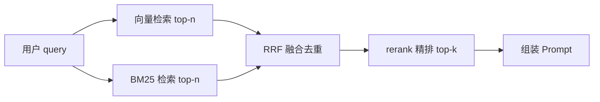

# 为什么 RAG 常用混合检索（BM25 + 向量）？

> 分类：RAG（检索增强生成） ｜ 难度：★★（常考）

## 一句话结论

因为两路检索的失败模式几乎不重叠：向量检索管「语义等价」（同义改写、跨语言），BM25 管「词面精确」（专有名词、产品型号、错误码）。生产 RAG 的默认形态是「向量 + BM25 双路召回 → RRF 融合 → rerank 精排」，只用单路等于主动放弃另一类 query 的召回。

## 机制原理

**1. 向量检索的短板来自定长向量的信息瓶颈**

embedding 把任意长度文本压缩成一个固定维度向量（如 1024 维），这是有损压缩：稀有 token 的信号会被语料的整体语义淹没。具体失败模式：

- 专有名词、型号、缩写若不在 embedding 模型的训练分布里，在语义空间中就是「未定义概念」，近邻结果基本靠猜。
- 错误码、订单号、代码标识符语义上几乎不可区分：「ERR_1042」和「ERR_1043」常出现在相似上下文里，向量可能非常接近，但业务上一个是答案一个是错案。
- 长尾领域术语的相似度区分度不足。

**2. BM25 的机制恰好补位，但短板同样明确**

BM25 基于倒排索引做词面打分，标准公式为（教科书形式）：

score(q,d) = Σ IDF(qᵢ) · tf · (k₁+1) / (tf + k₁·(1−b+b·|d|/avgdl))

- IDF 项：词在越少的文档中出现权重越高。「ERR_1042」这类稀有词天然高分，正好命中向量的盲区。
- tf 饱和与长度归一化项：控制「词出现越多分越高」的边际递减，以及长文档的偏向。
- BM25 完全不懂语义：「退款」匹配不到「退货退钱」，跨语言更不可能。

它的强项（词面）与向量的强项（语义）互补，弱项也互补——这是「混合」的机制依据：

| query 类型 | 向量检索 | BM25 | 混合 |
| ---- | ---- | ---- | ---- |
| 同义改写（口语 → 书面） | 强 | 弱 | 强 |
| 专有名词/型号/错误码 | 弱 | 强 | 强 |
| 数字与代码标识符 | 弱 | 强 | 强 |
| 跨语言检索 | 强 | 无能为力 | 强 |
| 长文档主题匹配 | 强 | 一般 | 强 |

**3. 双路结果靠 RRF 融合，而不是简单拼接**

两路分数量纲不可比（余弦相似度有界，BM25 分值无上界），直接加权要先做分数归一化，且每次换 embedding 模型分布就变、权重作废。RRF（倒数排名融合）只用排名：score(d) = Σ 1/(k + rankᵢ(d))，k 常取 60（原论文推荐值，实践常用默认）。

- 排名天然可比较，无需校准，对分数分布零假设。
- 一块内容在两路都靠前时分数被明显抬高——这正是「两路都认为相关」的强信号。

**4. 混合负责「召回补全」，rerank 负责「精度修正」**

融合后的排序仍是粗排：两路都是单塔/词面打分，没有建模 query 与文档的深层交互，也叠加了向量检索自身的近似误差（原理见 [向量检索为什么快](向量检索为什么快.md)）。所以工程默认在融合后加一层 cross-encoder rerank：双路保证「对的块进候选」，rerank 保证「对的块排前面」。整条检索链路放进系统里如何设计，见场景题 [企业知识库问答 RAG](../../system-design/questions/ai/企业知识库问答RAG.md)。

## 典型错误答案

1. 「现在的 embedding 模型这么强，不需要 BM25 了。」
   再强的模型也绕不开定长向量的信息瓶颈：训练分布外的型号、错误码在语义空间里没有可靠位置。
   这不是模型能力问题，是「一段文本压成一个向量」这种表示方式的机制约束。

2. 「混合检索就是把两路结果各取一半拼在一起。」
   拼接没有全局排序，同一块内容还可能重复占位；「两路都相关」的强信号也被抹掉。
   融合（RRF 或归一化加权）解决的是排序与信号合并问题，不是去重问题。

3. 「BM25 太老了，中文分词不准，不适合我们。」
   分词不理想可以用字级或 n-gram 建倒排，词面精确匹配能力仍在。
   要不要 BM25 由 query 里有没有精确词面需求决定，不是由技术年代决定（经验判断）。

## 追问

1. **RRF 里的 k=60 起什么作用？**
   思路：k 越大，排名靠后内容的分数衰减越平缓，各路贡献越均衡；k 越小越偏向各路头部。
   它调节的是「头部主导程度」，不是精度参数，一般不调。

2. **什么时候可以只用向量检索？**
   思路：query 以自然语言描述为主、专名密度低（如开放域闲聊问答）时，BM25 增量贡献小，砍掉可省一路索引（经验判断）。
   判断依据仍是评估集上混合相对单路的 Recall@k 增益，不是感觉。

3. **混合检索的双路延迟怎么控制？**
   思路：两路并行执行，端到端延迟取 max 而不是 sum；BM25 倒排查询本身就是毫秒级。
   真正的延迟大头通常在 rerank，所以融合候选数（top-n）要收敛，别把几百条塞给重排器。

4. **rerank 为什么放在融合之后而不是之前？**
   思路：cross-encoder 逐对计算 query-doc 交互，算力贵，只能处理几十个候选。
   先用融合把候选收敛到 top-n（如 50），再精排到 top-k（如 5），是把贵的模型花在少的候选上。

---
[返回 AI 知识地图](../README.md)
