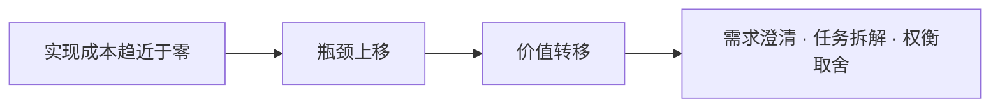

# AI 编码时代，场景设计题还有必要吗？

> TL;DR：有必要，而且比以前更重要——但值钱的部分变了。代码越便宜，设计越贵：AI 把「实现」的成本压到接近零，价值向需求澄清、任务拆解、权衡取舍转移。背诵标准方案在贬值，现场推演在升值。相应的备考方式是：别背答案，练推演，并且学会批判 AI 的方案。

## 背景

AI 编码工具普及之后，面试社区常有同一类焦虑：以前备考要背半年的秒杀方案，现在 AI 十秒钟就能画出一套更完整的架构图。于是疑问来了——场景设计题是不是也快过时了？

我自己也有这个疑问。这篇文章是一次认真的自我推演：把「还有必要吗」拆成「贬值的是什么、升值的是什么、面试会怎么变、我该怎么练」。结论在最后，论证过程铺在前面，欢迎拿反例来砸——本仓库的用法就是如此。

范围说明：本文只讨论场景/系统设计题及其背后的设计能力，不讨论算法手撕题。

## 一、先承认：有些东西确实在贬值

不用回避，AI 时代最先贬值的就是这些：

- **背诵型方案**。限流、缓存、削峰、防超卖……这些「标准四板斧」AI 随口就能给出，而且给得更全
- **画图模板与名词轰炸**。上来就画六层架构、报一堆组件名，这类表演在面试官面前越来越不值钱，因为 AI 也能表演
- **实现型技能**。纯 CRUD、配置搬运、胶水代码

但注意一个关键区分：上面三条贬值的其实是「设计知识的复述」，而不是「设计能力」。复述贬值，不等于设计贬值。这个区分是全文的地基。

## 二、为什么设计能力在升值

### 论点一：实现变便宜，决策变稀缺

经济学里有个朴素的规律：当一种东西变得充裕，与它互补的东西会更值钱。AI 是「实现」的替代品，却是「设计决策」的互补品。

以前团队的瓶颈经常是「写不出来」，一个功能讨论半天怎么实现。现在实现接近零成本，瓶颈整体上移——变成「要不要做、做成什么、放哪里、怎么拆」。一个佐证是：现在技术方案讨论会上，越来越少的句子是「这个怎么实现」，越来越多的句子是「这个边界在哪、失败怎么办、和 X 方案比我们为什么选这个」。

### 论点二：AI 放大了烂设计的破坏半径

以前烂设计有一道天然闸门：**实现的痛苦**。你按一个烂设计写代码，写到一半就会因为「太别扭写不动」而被迫回头重新设计。人被实现成本逼着修正设计——这其实是工业时代留下的一个隐性保护机制。

AI 没有这道闸门。你给它一个烂设计，它不痛苦，它飞快地给你生产出完整的烂代码。更糟的是，因为生成没有阻力，你会生成更多版本——烂设计曾经带来三个版本的烂代码，现在带来三十个。

所以 AI 时代的真相是：**AI 让烂设计烂得更快，也让好设计的稀缺性更刺眼**。设计错误的惩罚变重，对设计判断力的需求随之变高，而不是变低。

### 论点三：指挥 AI 的技能，恰好是设计题考的技能

把 AI 编码工具用得好的人，每天都在做什么？把模糊需求澄清成明确边界，把大任务拆成可验证的小任务，定义验收标准，在多个方案之间做取舍。

把这四件事念一遍，再看系统设计面试考什么：考的是澄清（你会不会先问 QPS 和数据量）、拆解（能不能从一道题里拆出发号、存储、跳转、统计）、权衡（推还是拉？强一致还是最终一致？）。

能力族完全重合。这意味着设计题的地位变化不是「取消」，而是**下沉**：以前它是高级岗位的加分题，现在它是每个用 AI 干活的人的基础题——因为小型设计决策已经渗透到每个人的日常里。

## 三、设计题会怎么变：从考背诵到考推演

顺着上面三个论点，可以推演面试形态的变化：

1. **追问链权重上升**。面试官不再满足于「标准答案」，而是追问「为什么不用 X」「QPS 涨十倍你的方案哪里先塌」。背诵在追问链面前无处遁形，推演才能走完全程
2. **可能允许使用 AI**。就像开卷考试，考察点变成：你给 AI 的约束和上下文够不够准、你能不能批判 AI 方案里的漏洞。出题人考的正是「指挥与验收」
3. **约束与估算的权重上升**。没有数据量前提的设计是空谈——这一条本来就该是设计题的常识，AI 时代更加如此

一个判断标准：当一种能力可以整体外包给 AI，面试就会转向考核「如何指挥与验收外包」。设计题正是这样的考场。

## 四、给学习者的对比练习法

最后给一个可以立刻上手的练习，它同时训练设计推演和「指挥 AI」两件事：

1. 选一道经典题（短链、秒杀、Feed 流都行）
2. 合上 AI，自己推演 20 分钟：需求澄清 → 容量估算 → 核心流程 → 明确写出取舍
3. 再让 AI 出一份完整方案
4. 对比时只问三个问题：
   - 它想到而我没想到的，是什么？（知识盲区）
   - 我想到而它没提的，是什么？（你的判断力价值所在）
   - 它方案里我认为有问题的是哪里？（批判练习，要求给出理由）
5. 把差异记进个人错题本，下次推演前先翻一遍

本仓库 system-design 模块里的经典题清单可以直接当题库用。

## 总结

回到最初的问题：AI 编码时代，场景设计题还有必要吗？

- **有必要，而且更基础了**：设计题考的能力族（澄清、拆解、估算、权衡）正是 AI 时代最稀缺的互补能力
- **但值钱的部分变了**：背诵贬值，推演升值；面试形态会从「复述答案」转向「追问链与现场权衡」
- **结论的边界**：如果你背的是方案结论而不是推演过程，那确实白背了；「设计能力升值」指的也是判断与权衡，不包括名词储备

一句话收束：**代码越便宜，设计越贵。**

这是我目前给自己的答案。论证有漏洞、反例想补充，欢迎提 PR——这本就是这个仓库的用法。

## 延伸阅读

- 本仓库 [system-design 模块导读](../README.md)：解题方法论与经典题清单
- 本仓库 [AI 场景设计题地图](../questions/ai/README.md)：28 道 AI 场景题，一题一文件
- Martin Kleppmann《数据密集型应用系统设计》（DDIA）：设计与权衡的经典教材
