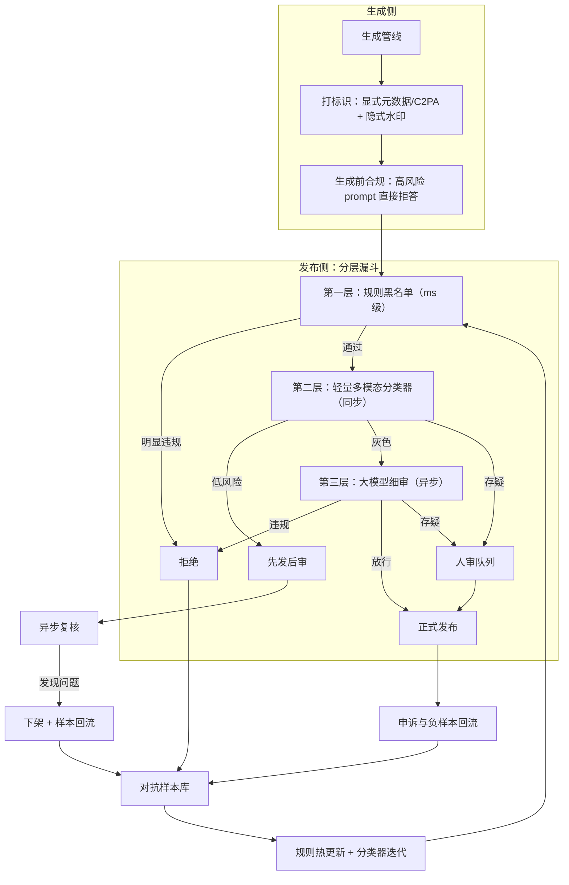

# AIGC 内容合规审核

> 层级：贯穿 · 安全与合规 ｜ 贯穿矛盾：安全 · 质量

## 场景

平台上 AI 生成内容（文案、图片、数字人视频）对外发布，要满足监管要求（AIGC 标识、有害内容过滤）并保护版权。

## 核心矛盾

**审核准确率 vs 发布效率**——误杀伤创作者生态，漏放是监管事故；而且对手（对抗样本）和规则（法规）都在动。

## 追问链

- AIGC 标识（水印/元数据）在生成链路哪一环打？被二次剪辑抹除了怎么办？
- 图文混排、视频多帧的多模态审核，和纯文本审核差在哪？上下文组合出的「隐性违规」怎么抓？
- 模型生成的内容出了问题，责任怎么界定：平台、模型方、还是创作者？产品上怎么体现？
- 审核模型的对抗样本怎么收集？红队演练和线上对抗回流怎么组织？

## 推演

### 容量估算（先问这几个数）

- **假设 1：发布量。** 平台 100 万创作者，10% 日活发布，人均每天 3 条 → 30 万条/日；构成假设为文本 60%、图片 30%、视频 10%（3 万条视频，平均 30 秒 30fps ≈ 900 帧，抽帧按 1fps 审核关键帧 → 每视频 30 帧）。
- **假设 2：峰值提交率。** 30 万条/日 ≈ 3.5 QPS 均值，发布集中在晚间，峰值按 10 倍 ≈ 35 QPS。同步审核窗口只有发布瞬间的几百毫秒，这决定了「同步只做轻量判定、重审核异步」的基本形态。
- **假设 3：审核算力。** 假设轻量多模态分类器单卡吞吐：文本 20 QPS、图片 5 QPS、视频 1 QPS（30 帧批量）。峰值需求：文本 21 QPS → 2 卡，图片 10.5 QPS → 3 卡，视频 3.5 QPS → 4 卡，加 1.5 倍冗余 ≈ 15~20 卡的审核集群。数字随模型与硬件变，**方法不变：按模态分开算，按峰值配冗余**。
- **假设 4：错误代价不对称。** 假设一次漏放监管事故（通报、整改、下架）代价 100 万元级；一次误杀的平均成本（投诉处理 + 创作者流失）100 元级——**代价比 1 万倍**。这个数字决定阈值必须向「宁可多拦几档」倾斜，再用申诉通道兜误杀，而不是调一个「平衡」的中间阈值。
- **假设 5：对抗运营成本。** 假设每周新增 100~500 条对抗变体，每条标注验证 10 分钟 → 每周 17~83 小时标注人力。这是持续性运营成本——审核系统建成只是买了车，对抗运营才是油钱。

量级结论：审核的工程难点不是吞吐（15~20 卡就能扛住峰值），而是错误的不对称结构——1 万倍的代价比决定了整套系统的阈值策略、发布时序和申诉设计，全部向漏放一侧倾斜。

### 架构推演（从朴素方案开始塌）

**朴素方案 1：全量人工审核。**

塌在发布效率：30 万条/日按人均日审 2000 条算需要 150 人团队起步，发布延迟从秒级变小时级，创作者生态直接受损；人工对隐性违规（图文组合、跨帧语义）判定一致性差、标准随团队漂移。核心矛盾的「效率」端第一个塌，而且是用钱塌。

**朴素方案 2：单一多模态大模型，一次调用给结论。**

塌三点。成本与时延：全量 30 万条/日 × 每条一次多模态调用，token 成本随量线性涨，审核还在发布链路上加秒级延迟。可解释性：监管检查要的是「按什么规则、依据什么证据判定」，黑盒单点结论过不了检查——这是本题「质量」侧特有的要求，传统风控不需要向监管解释模型内部。单点对抗：一个模型被打穿等于全部打穿，对抗样本在模型间有迁移性。

塌完之后，正确形态浮出来：审核不是一道关卡，是一条**从生成源头到发布后**的流水线，漏斗每层只处理上一层解决不了的残余：

1. **生成侧前置。** AIGC 标识在生成管线内打（位置论证见决策三）；高风险 prompt 在生成前直接拒答——不生成就不用审，这是全链路成本最低的拦截点；生成完成即同步跑轻量合规分类器。
   - 拒答边界要谨慎：拒答过宽等于变相审查创作自由，误拒同样伤创作者生态——拒答阈值与审核阈值分开调
2. **发布侧分层漏斗。**
   - 第一层：规则黑名单，毫秒级，明显违规直接拒，规则库支持热更新
   - 第二层：轻量多模态分类器，同步、百毫秒级，处理绝大多数内容
   - 第三层：灰色地带送大模型细审（异步），最低置信区间送人审
   - 发布时序分级：低风险先发后审 + 异步复核，高风险先审后发
   - 大模型细审的输出要求结构化：违规类别 + 依据片段 + 置信度——直接转人审队列也接得上
3. **组合语义层。** 单模态各自过审之后，加一层「组合判定」：图文一致性、跨帧时序、图文拼合语义——专门抓每个单模态都合规、合起来违规的内容。
4. **标识与溯源。** 发布前跑水印提取作为检查项；二次传播场景靠 C2PA 凭证链 + 残留水印提取兜底。
5. **运营闭环。** 漏放被发现的样本、申诉反转的误杀样本、红队产出全部回流；法规变更触发规则热更新与回归。

看图三个要点：**拒答在源头**（PRE）是成本最低的拦截，因为不生成就没有后续一切成本；**先发后审**（FAST → RC）只在低风险分支上开放，把发布效率还给 95% 的正常内容；**三个回流口**（REJ、TKD、FB2）汇入同一个样本库——漏放、误杀、对抗是同一个运营闭环的三种输入，不是三套系统。

人审队列的路由也有讲究：按内容品类和历史违规率分路由，高风险品类直接加权进队列，低风险品类只在分类器置信度跌破阈值时进；队列按 SLA 排序（高流量内容、举报内容优先）。人审不是兜垃圾桶，是置信区间最窄的那一圈——它的每一个判定都应该回流为训练样本，让这一圈逐年变窄。

**判定证据链是审核架构里最不像技术、最不能省的部分：** 每条内容的每次判定都要留存——使用的模型与版本、命中的规则与版本、置信度、依据的文本片段或帧、处置动作与操作人。监管检查问「为什么这条放行了」，申诉复核问「为什么这条被拦了」，两个问题的答案都必须在证据链里。证据链缺失的审核系统，准确率再高也无法证明自己尽责。

发布效率还有一层容易被误解：异步复核（先发后审）不是「不审核」，而是把审核从发布关键路径上摘下来——复核发现违规后的下架时间窗就是风险敞口，窗口长度由复核队列吞吐决定。所以复核队列要有独立的容量监控与 SLA，把它当发布链路的一部分运营，而不是后台批任务。

### 关键决策论证

| 决策点 | 选项 A | 选项 B | 判据 | 结论 | 何时反转 |
| ---- | ---- | ---- | ---- | ---- | ---- |
| 发布时序 | 全量先审后发 | 分级：低风险先发后审，高风险先审后发 | 内容风险分布极不均匀（假设 95% 以上低风险），全量先审让 95% 的人陪葬延迟 | B | 强监管品类（新闻、医疗、金融）不分级，一律先审后发；或监管明确全量先审义务 |
| 审核主体 | 单一多模态大模型全量判 | 分层漏斗：规则 + 小模型 + 大模型 + 人审 | 单位风险的边际成本：全量大模型的调用量是「灰色地带才走大模型」的约 20 倍（假设 1 算式），且单点被打穿即全穿 | B：漏斗分层 | 内容量 <1 万条/日且违规模式多变 → 维护多层链路的固定成本可能不划算，一个强模型 + 人审即可 |
| 标识技术 | 只打显式元数据 或 只打隐式水印 | 两者都打，分工明确 | 元数据可一条命令剥离但可信可验证（适合链路溯源定责）；水印抗二次传播但有提取误判（适合内容存证）——失效模式互补 | 都打：元数据管链路溯源，水印管内容存证 | 无——两者成本都摊在生成链路里可忽略，单押任何一个是自废一门 |
| 误杀治理 | 阈值调松 | 阈值保持紧 + 高效申诉通道 | 阈值是全局的，误杀是局部的；漏放代价比误杀高 4 个数量级（假设 4），全局调松不可接受 | 阈值紧 + 申诉承诺时效（如 30 分钟人审复核），申诉样本回流为负样本 | 误报率突破量级（如 >2%，即日数千申诉）压垮人审 → 说明是分类器质量问题，修模型而非调阈值 |
| 对抗运营 | 只做线上回流 | 回流 + 按法规节奏的红队 | 线上回流只覆盖「已发现的」；新规上线是黑产的探测窗口，被动等漏放 = 拿监管事故当探测器 | B：新规/新功能上线前红队先内部打一轮 | 平台规模小到不是攻击目标（万级以下创作者）→ 回流即可 |

表格里最锋利的是假设 4 那个 1 万倍的代价比：它解释了这张表里几乎所有「紧」的选择——阈值紧、标识双打、高危品类先审后发。误杀的代价由申诉通道和人审兜底，漏放的代价没有人兜底——不对称的代价结构，就要用不对称的架构去配。

水印提取的误判要当一等公民治理：提取服务输出「水印存在/不存在/不确定」三态，只有高置信缺失才拦发布——把提取误判直接当侵权证据会制造大量申诉事故。这也是生成行为日志作为第三锚点的原因：内容锚点（水印）不确定时，行为锚点（这条内容是否由本平台生成）仍然确定。

顺带回应一个高频变体：「能不能用生成模型自己审核自己？」不能当主体——自己审自己有系统性盲区，模型的偏好盲区会同时存在于生成端与审核端；生成模型的自我审查（对齐后的拒答）可以当内部第一道滤网，外层必须有独立训练的审核模型，两者的对抗样本空间不重合才有防御纵深。

### 追问应答

**1. AIGC 标识（水印/元数据）在生成链路哪一环打？被二次剪辑抹除了怎么办？**

隐式水印在渲染/编码环节打进像素或频域：太早（训练/推理中间态）会被后续处理洗掉，太晚（导出后）就轮不到你打了；显式标识（元数据 + C2PA 凭证）在文件封装环节写入。二次剪辑的对抗靠纵深：C2PA 凭证链记录剪辑事件并支持重签名、频域水印按抗压缩抗裁剪设计、发布前水印提取作为兜底检查。机制上不存在不可抹除的水印，目标是「抹除成本高于收益」加「部分残留仍可提取」，再用发布者侧的生成行为日志做不依赖内容本身的第三重锚点。

**2. 图文混排、视频多帧的多模态审核，和纯文本审核差在哪？上下文组合出的「隐性违规」怎么抓？**

差在违规单位从「条」变成了「组合」：正常图配引导文字、A 帧正常 B 帧违规、拼图产生新语义——每个单模态单独看都合规，单模态分类器结构上抓不到。抓法是在单模态过审之后加组合判定层：跨模态一致性模型 + 把全文全帧整体喂给多模态大模型做整体语义判定，输入是「画面 + 文字 + 发布者上下文（历史行为、话题标签）」三元组。经验判断：隐性违规是黑产主攻方向，因为单模态防线最成熟、组合防线最薄弱——攻方永远打你最薄的那层板。

**3. 模型生成的内容出了问题，责任怎么界定：平台、模型方、还是创作者？产品上怎么体现？**

责任沿控制力分配：模型方对生成能力的安全对齐负责（不该生成的要拒绝），平台对发布链路的审核义务负责（标识、过滤、处置、记录），创作者对使用意图负责（恶意绕过审核的责任在创作者）。产品体现对应三件事：生成时明示禁止事项与标识规则（履行告知义务）、发布时自动打 AIGC 标识（履行标识义务）、违规处置与创作者信用分（保留处置证据）。关键在最后一点：平台的「已尽责」要靠审核判定记录可回溯来证明——这正是审核架构必须留存每条判定证据的原因，黑盒结论在监管检查面前一文不值。

**4. 审核模型的对抗样本怎么收集？红队演练和线上对抗回流怎么组织？**

三个来源：线上回流（漏放被投诉或监管发现的样本、绕过水印的样本，自动入库）、申诉反转（误杀样本，回流为负样本）、主动红队（内部团队加外部众测，按新规和新功能节奏在上线前打一轮）。组织上样本统一进标注队列，验证后分层入库：规则库立即热更、模型训练进周/月迭代、回归集防复现。衡量指标是对抗样本「发现到生效」的周期——这个周期就是黑产的窗口期，经验判断要压到天级；红队产出进回归集，保证打过的招第二次失效。

### 常见误区

**误区一：「接一个内容安全 API 就合规了。」**

AIGC 合规是三件事：标识、过滤、溯源留证。内容过滤 API 只覆盖第二件；监管检查要的是全链路证据——生成标识记录、每条内容的审核判定依据、处置记录，第三方 API 的一个判定结论不构成平台自己的尽责证明。把合规外包给一个 API，出事时监管问「你们的审核标准是什么、依据什么判的」，答案不能是「问供应商」。

**误区二：「审核准确率 99% 就够好了。」**

错误在基数和不对称：30 万条/日 × 1% = 3000 条/日错误，且错误分两个方向各算各的账——1% 漏放是每天 3000 次监管风险敞口，1% 误杀是每天 3000 个被伤害的创作者。准确率是一个标量，把它当唯一指标等于把两种代价差 4 个数量级的错误混在一起报账。必须分报漏放率与误杀率，且各配各的治理手段：紧阈值管漏放，申诉通道管误杀。

**误区三：「水印打了就万事大吉。」**

显式元数据一条命令即可剥离；隐式水印对重度二创（裁剪、录屏、再压缩）的提取率显著衰减（经验判断）。把溯源押在单一技术上，被绕过时整个标识体系失效。正确做法是多锚点：隐式水印 + C2PA 凭证链 + 平台侧生成行为日志（不依赖内容本身的记录），三个锚点的失效模式互不相关，黑产要同时抹掉三个才能脱责。

**误区四：「先上线，审核后补。」**

漏放不是技术债而是即时事故：内容一旦传播，删除也收不回已发生的转发与截图，事后治理成本远高于事前拦截。更硬的是标识义务有时点性：AIGC 标识是生成时的义务，生成时没打标，事后补标在合规意义上不构成标识——「后补」在审计里等于「没有」。发布链路上审核可以分级、可以异步，但生成侧的标识与拒答不能欠账。

---

[返回 AI 场景题地图](README.md)
