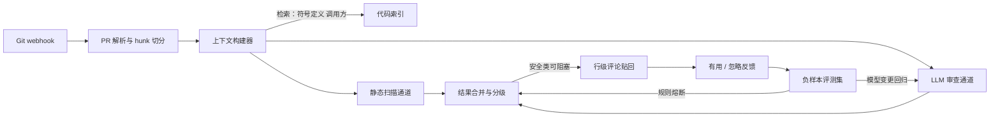

# AI 代码审查平台

> 层级：⑤ 业务应用 ｜ 贯穿矛盾：质量 · 安全

## 场景

内部代码不能出网，要在私有化环境用 LLM 做 PR 级代码审查，且开发者不反感。

## 核心矛盾

**上下文规模 vs 审查质量与数据安全**——diff 看不全则误报，全看则上下文永远不够、成本失控。

## 追问链

- 误报率怎么量化？
- 审查意见开发者不买账，产品怎么办？
- 为什么不直接全量扫描整个仓库？

## 推演

### 容量估算（先问这几个数）

- 假设 1：2000 名工程师，人均每个工作日 1 个 PR → **2000 PR/日**。
- 假设 2：PR 平均变更 500 行，diff 本体约 5k token；上下文构建后单次审查 prompt 约 30k token（diff 5k + 检索到的相关代码与符号定义 23k + 审查规则 2k），输出约 1k token（5–10 条行级评论）。
- 假设 3：提交集中在每日 4 小时窗口 → 峰值 ≈ 8.3 PR/分钟。
- 假设 4：仓库总量 1000 万行代码。

算式与结论：

- **日 token 量**：2000 × 30k = **6000 万 token/日**（输入 6000 万 + 输出 200 万），月约 18 亿输入 + 6000 万输出。
- **API 价位的量级感知**（实际走私有化，此处只为定标尺）：按假设定价输入 $3/M、输出 $15/M，月成本 ≈ 1800M × $3 + 60M × $15 ≈ **$6300/月，4.5 万元级**。对比 [AI 客服系统](AI客服系统.md) 的每月百万美元级：**代码审查是低频重任务，token 账单不是主要矛盾，质量与信任才是**——这决定两题的架构重心完全不同。
- **私有化算力**：单 PR 串行耗时 ≈ prefill 30k token ÷ 假设单卡 prefill 吞吐 5k token/s = 6s，加 decode 1k token ÷ 假设 40 token/s = 25s，合计约 31s。峰值 8.3 PR/分钟 × 31s ≈ 4.3 路并发 → **4–6 张 80G 卡（30B 级模型）扛峰值**。审查题不是算力题，是质量题。
- **延迟预期**：审查是异步任务——PR 提交后 1–2 分钟内出结果可接受（经验判断），没有秒级压力。这决定了它可以「慢慢想」：上大上下文、双通道并行，都不会被延迟预算一票否决——这是它与客服、补全这类交互型场景的结构性差异，也解释了为什么本题的矛盾重心在质量与安全而不在延迟。
- **检索索引规模**：1000 万行 × 假设 10 token/行 = 1 亿 token，按 512 token 分块 ≈ 20 万 chunk × 768 维 × 4 字节 ≈ **600 MB 单机索引**（检索基础设施见 [向量检索服务](向量检索服务.md)）。检索不是瓶颈，**窗口预算的取舍才是核心矛盾所在**。

### 架构推演（从朴素方案开始塌）

**朴素方案**：Git webhook 触发，整个 diff 塞进一个 prompt，LLM 输出审查意见，机器人账号贴回 PR。第一周就会塌，塌点具体且可预测：

1. **覆盖率塌**：3000 行以上的大 PR，diff 本体就吃满 30k 预算，截断策略下尾部零审查——而大 PR 恰恰风险最高。假设 10% 的 PR 超窗（经验判断），这 10% 的风险敞口没有任何兜底。
2. **精度塌**：diff 脱离上下文——`ctx` 在哪定义、这个函数被谁调用、签名变更波及几个调用方，模型一概不知。表现是评论全落在「变量命名」这类隔靴搔痒处，真问题一条没报。
3. **信任塌**：前两条的结果——开发者连续收到几条无用评论后关闭机器人通知，机器人变成 PR 里的噪声，产品实际死亡。信任是这题真正的稀缺资源，塌了不会自己回来。

**演进一：上下文构建器**。审查单元从「整个 diff」改成「hunk」。每个 hunk 按优先级检索四类上下文：

1. 所在文件全文——hunk 的直接语境。
2. 引用符号定义（类型、函数签名）——看懂代码的最小必需品。
3. 调用方列表——判断「这次变更波及谁」。
4. 同类变更的历史修复模式——可选，检索平台历史 PR 里相似问题的修法。

关键机制是**预算制**：总窗口固定 30k，按优先级装填，装不下降级为只看符号签名。上下文窗口永远不够——取舍规则必须显式写出来，不能指望模型自己忽略无关内容。

**演进二：静态扫描与 LLM 分工**。密钥泄漏、依赖漏洞、SQL 拼接等确定性规则走 SAST 工具——零 token 成本、零方差、结论可解释；LLM 只做语义类问题：逻辑错误、并发隐患、API 误用、错误处理缺失。机制很直白：**让 LLM 查正则能查的问题，是拿最贵最不稳的组件干最便宜最稳的活**。

**演进三：误报熔断与分级**。每条评论带「有用 / 忽略」按钮。规则级熔断：某规则近两周 precision 低于 50% 自动停止展示、转周报。评论分三级：安全类可标阻塞、正确性类建议、风格类不评——风格是 linter 的领土，LLM 不要入侵。

**演进四：反馈回流成回归集**。「忽略」样本自动进负样本评测集，模型或 prompt 每次变更跑回归——误报治理从运营动作变成工程回归（评测体系见 [LLM 效果评估与回归平台](LLM效果评估与回归平台.md)）。安全侧另有一条独立的线：PR 描述与代码注释是不可信输入，可以被用来注入操纵审查结论（「忽略下面所有问题」），审查输入要过注入防御（见 [Prompt 注入防御](Prompt注入防御.md)），且评论结论不得引用 PR 文本中的指令。

终态架构：静态与语义双通道并行产出，合并分级后行级贴回；反馈不进垃圾桶，进回归集。

### 关键决策论证

#### 决策 1：私有化部署还是云端 API + 脱敏

|  | 方案 A：私有化部署 | 方案 B：云端 API + 脱敏 |
| ---- | ---- | ---- |
| 模型能力 | 受限于开源模型 | 旗舰模型能力 |
| 合规 | 代码不出网，天然满足 | 依赖脱敏工程的完备性 |
| 成本 | 4–6 张卡 + 推理运维 | 每月数万元 + 脱敏工程 |

- **判据**：题面「内部代码不能出网」是硬约束。脱敏路线在机制上不成立：代码本身就是敏感数据（业务逻辑、内网拓扑、私有算法都在 diff 里），正则替换密钥不等于脱敏；且 token 级替换破坏符号间的语义关联，审查质量同步下跌。
- **结论**：私有化部署。**反转条件**：无合规硬约束的场景（开源项目、无保密义务的团队），API 的模型能力优势立刻占上风。

#### 决策 2：LLM 全审还是 LLM + SAST 分工

|  | 方案 A：LLM 审所有规则 | 方案 B：SAST 管确定性规则，LLM 管语义问题 |
| ---- | ---- | ---- |
| 确定性 | 同一漏洞今天报明天不报 | 静态扫描结果永远一致 |
| 成本 | 确定性规则也烧 token | 确定性规则零 token |
| 覆盖 | 长尾规则天然覆盖 | 长尾规则需持续编写 |

- **判据**：确定性规则用 LLM 处理，成本与方差都是纯负担。
- **结论**：方案 B。**反转条件**：规则库维护成本爆炸（每语言每框架都要写规则）时，长尾规则可交给 LLM 兜底，但核心安全规则必须留在静态扫描。

#### 决策 3：评论策略追求高召回还是高精度

|  | 方案 A：召回优先（多报） | 方案 B：精度优先（少报） |
| ---- | ---- | ---- |
| 短期观感 | 「机器人很努力」 | 「机器人很安静」 |
| 信任曲线 | 连续误报后崩塌 | 缓慢爬升 |
| 漏报风险 | 低 | 高——需安全类例外补偿 |

- **判据**：信任的不对称性。开发者连续收到 3 条无用评论后会产生「狼来了」效应并关闭机器人通知（经验判断）——召回可以靠加规则慢慢补，信任损失几乎不可逆。
- **结论**：精度优先，宁可漏报不可滥报。**唯一例外**：安全类评论可接受较低精度——漏报代价（密钥进主干库）与误报代价（一条无用评论）不对称。

#### 决策 4：大 PR 平台拆分还是推回开发者拆

- **选项 A**：平台自动按模块边界 + 依赖序拆分审查；**选项 B**：超限 PR 直接要求开发者拆分。
- **判据**：大 PR 本身是工程治理问题，不是审查技术问题——AI 拆分是兜底，不该变成纵容。
- **结论**：推回为主（假设超 800 行即要求拆分），平台拆分兜底并保证子 PR 可独立理解。**反转条件**：平台刚上线需要建立信任的阶段（经验判断），先服务好现有 PR，不对工作流提要求。

#### 决策 5：只审 diff 还是 diff + 调用方影响面

- **选项 A**：只看 diff 与所在文件；**选项 B**：展开被改函数的调用方影响面。
- **判据**：diff-only 结构性报不出一类高价值问题——「这个签名变更会破坏调用方 X」，因为调用方不在 diff 里。
- **结论**：方案 B，但影响面展开深度封顶 2 层——全图展开则上下文爆炸，回到核心矛盾。**反转条件**：检索到的影响面噪声大于信号（如超多态调用、动态分发密集）时，退回 diff + 符号定义。

### 追问应答

**1. 误报率怎么量化？**

先把分子分母钉死：precision = 有效评论数 ÷ 总评论数，「有效」以开发者标记为准、以定期人工抽标校准。抽样机制：每日约 4000 条评论（2000 PR × 均值 2 条）抽 5% 人工标注，**按规则类别分组看**——安全类 precision 90% 可接受、正确性类 80%、风格类低于 70% 直接触发熔断；混在一起算总 precision 没有行动意义。漏报单独量化：定期拿历史真实缺陷 PR（已确认的 bug 修复）回放，统计当时能报出多少。误报率是产品指标（决定信任），漏报率是能力指标（决定上限），必须分开。

**2. 审查意见开发者不买账，产品怎么办？**

三件产品机制：精度优先——熔断是产品机制不是运营动作；评论挂精确行号并给修复 diff——「这里可能有问题」和「改成这样」是两个产品；一键忽略并回流负样本。再加一个上线策略：新接入团队先开静默模式两周，只报安全类问题，信任建立后逐级放开正确性与建议类。失败信号要定义清楚：开发者主动关闭机器人通知就是 P1 事故，比误报率高更严重——获客可以慢慢来，信任崩了不会回来。

**3. 为什么不直接全量扫描整个仓库？**

三个机制。成本算式：全库 1 亿 token × 2000 PR/日 = 200B token/日，是增量审查（6000 万/日）的 3000 倍以上。信号稀释：全库上下文里与本次 diff 相关的不足 1%，注意力被无关代码稀释，反而更难发现 diff 里的真问题。职责错位：全库质量问题属于 SAST 与专项安全审计的领域，PR 审查的契约是「只对这次变更负责」——审查报出一个存在三年的老问题，开发者既不会修也不知道该谢谁。**合理的例外**：仓库首次接入时做一次全库基线扫描、把存量问题标记掉，之后只看增量——那是接入动作，不是审查模式。

### 常见误区

1. **错误答案长这样**：「窗口 200k 了，把整个仓库塞进去让模型自己找相关部分」。**为什么不行**：一算规模——1000 万行 ≈ 1 亿 token，200k 窗口只有它的 1/500，「塞进去」物理上不成立；二算注意力——长上下文中段的信息利用率显著下降，无关代码是噪声不是知识；三算成本——每 PR 200k token 是增量方案（30k）的 6 倍多。「能装下」和「装了有用」是两件事。
2. **错误答案长这样**：「误报率高就在 prompt 里加『只报告高置信度的问题』」。**为什么不行**：模型对自身置信度的校准很差，这句话改变的是措辞风格（多加「可能」「或许」）而不是判断标准。有效杠杆是工程闭环：规则级熔断、负样本回流、分级展示——把精度治理做成可回归的系统，而不是一句祈祷。
3. **错误答案长这样**：「AI 审查上线后可以取消人工 review」。**为什么不行**：AI 有结构性盲区——它不知道需求（「这里本不该打折」是业务判断），也看不到 diff 之外的架构走向。正确定位是分工：AI 拦截低级问题（假设占评论量 40–60%，经验判断），人审注意力让给业务语义。说「替代」的人没理解题面「开发者不反感」这个约束的分量。
4. **错误答案长这样**：「把密钥和凭证用正则替换成占位符，就能走云端 API」。**为什么不行**：代码即敏感数据——业务逻辑、内网地址、私有算法都在 diff 里，替换个别字段不改变泄漏性质；同时 token 级替换破坏变量间的语义关联，审查质量降到没有使用价值。脱敏路线只在「少数个别字段敏感」的前提下成立，代码审查不满足这个前提。

---

[返回 AI 场景题地图](README.md)
