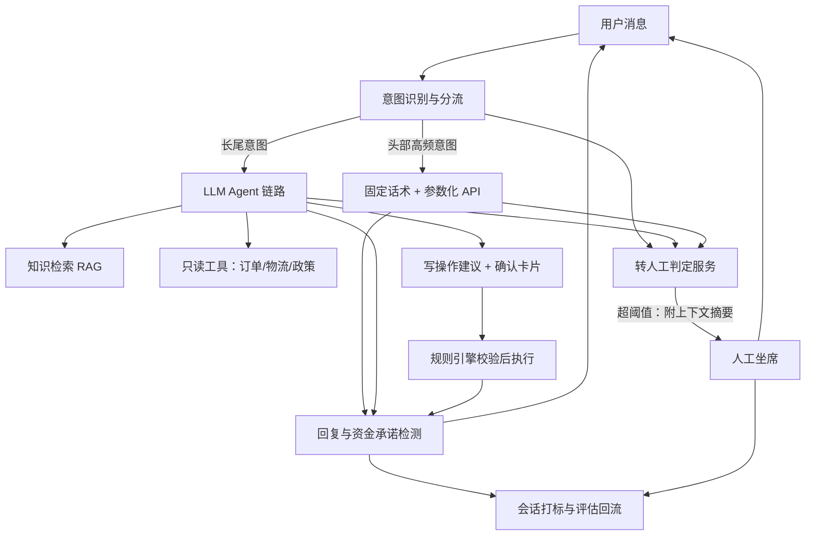

# AI 客服系统

> 层级：⑤ 业务应用 ｜ 贯穿矛盾：质量 · 成本

## 场景

电商平台用 AI 客服承接售前咨询与售后工单，要求体验接近人工且不出事故。

## 核心矛盾

**自主应答准确率 vs 人工兜底成本**——转人工判定是这题的灵魂：太松出事故，太紧人工爆量。

## 追问链

- 怎么防止 AI 乱承诺「给您退款」？
- 转人工判定太敏感导致人工爆量怎么办？
- AI 客服的「事故」怎么定义和复盘？

## 推演

### 容量估算（先问这几个数）

先立假设，把量级算出来再谈架构：

- 假设 1：日均客服会话 50 万次——量级类比：500 万日订单的电商平台，约 10% 订单产生客服触点，叠加售前咨询。
- 假设 2：每会话平均 6 轮；每轮用户输入约 100 token、回复约 200 token；每次 LLM 调用 prompt 含检索片段与工具结果约 3000 token。
- 假设 3：会话集中在 12 小时内，峰值系数 5。
- 假设 4：人工坐席单会话平均 8 分钟，一人同时服务 2 个会话，坐席综合月成本 8000 元。

算式与结论：

- **日 token 量**：50 万 × 6 轮 = 300 万轮/日 × 3200 token ≈ **96 亿 token/日**（输入 90 亿 + 输出 6 亿）。这是全题的第一性数字，后面每个决策都在跟它讨价还价。
- **API 路线的账单**：按旗舰级 API 假设定价（输入 $3/M、输出 $15/M），月成本 ≈ 270B × $3 + 18B × $15 ≈ **每月百万美元级**。任何「全量走最强模型」的方案先过这道账。
- **自建路线的算力**：峰值 350 轮/s（300 万轮 ÷ 12h ÷ 3600s ≈ 70 轮/s × 5），对应峰值输出吞吐 350 × 200 = 7 万 token/s；假设 14B 模型单卡批处理输出吞吐 2k token/s → **约 35 张卡，含冗余 40–50 张**，月成本数万美元加推理团队。
- **人工兜底的账**：假设 AI 自主解决率 70%，15 万会话/日转人工 = 15 万 × 8 分钟 ÷ 2 并发 ≈ 1 万人时/日 ≈ **1250 班次/日 ≈ 1700 人坐席团队**。转人工率每降 1 个百分点 ≈ 少 57 名坐席 ≈ **年省 500 万元量级**。结论：兜底不是「失败后的补充」，是成本主体——自主解决率优化 1 个点的价值大于大多数推理优化。
- **知识库规模**：5 万篇文档 × 8 chunk × 768 维 × 4 字节 ≈ 1.2 GB 向量索引，单机可扛。**这题的工程重心不在检索规模，在判定与边界。**

### 架构推演（从朴素方案开始塌）

**朴素方案**：一个系统提示词 + 全量对话历史 + 知识库 top-k 检索，所有会话交给旗舰 LLM 自由回答，答不了就让它道歉。它按可预测的顺序塌在三处：

1. **先塌在资金事故**。LLM 在没有执行任何退款操作的情况下生成「您的退款已处理」——自由生成的自然语言里，「承诺」与「执行」之间没有任何机制约束。量级演示：假设资金相关会话占 15%、承诺错误率仅 0.1%，也是每天 7.5 起资金事故，一起登上热搜就够下线整个系统。
2. **再塌在成本曲线**。全量旗舰 API 每月百万美元级且随业务量线性上涨——这题的贯穿矛盾是成本，朴素方案把成本斜率拉到最大。
3. **最后塌在兜底缺位**。没有转人工通道，模型答不了就开始编，编不了的沉默失败直接变成投诉。

**演进一：意图分流**。小模型 + 规则做意图识别，头部意图（物流查询、退款政策、发票开具——假设 top 200 类意图覆盖 60% 会话量）走固定话术模板 + 参数化 API：「查物流」直接调物流接口渲染模板，LLM 不参与决策。这类问题的需求是确定性，不是生成式智能。这一层拿走 60% 流量的成本与事故风险。在此之上可以再挂一层语义缓存（见 [语义缓存](语义缓存.md)）——但客服场景要记住它题库里的告诫：相似问题未必相似答案，缓存命中层必须带用户与订单上下文校验，宁可低命中不可错命中。剩余塌点：长尾 40% 靠模板维护不过来——引出演进二。

**演进二：长尾走 Agent，工具分两权**。长尾会话走「LLM + RAG + 工具调用」链路（检索侧的完整论证见 [企业知识库问答 RAG](企业知识库问答RAG.md)），但工具权限分两级：

- 只读工具（查订单、查物流、查政策）：AI 自主调用，错了顶多多一轮澄清。
- 写操作工具（退款、改价、补发）：AI 只产出操作建议，必须经用户显式确认 + 规则引擎校验（金额上限、订单状态机、风控黑名单）后才真正执行。

回复侧再加承诺检测：输出命中「已退款/已赔偿」类模式但系统无对应执行记录 → 拦截重写。**乱承诺从模型行为问题变成系统权限问题**——这是本题主线的第一性转换。

**多轮上下文管理**：会话超过 8 轮后，早期轮次摘要压缩进系统段——3000 token 的 prompt 预算经不起全量历史线性增长；摘要由同链路小模型在轮间异步生成，不占用户等待时间。多轮压缩必须保留资金相关语句的原文：摘要丢一句「用户要求全额退款」就是新的事故源。

**演进三：转人工判定独立成服务**。判定不能放在 prompt 里让模型自己说「我搞不定」——机制：生成式训练目标奖励流畅作答而非承认失败，模型对自身能力的自评校准差。独立判定服务消费多路信号：资金相关意图（强触发）、检索得分与工具结果置信度、用户情绪分类、同问题重复次数、会话轮数。信号加权超阈值即转，转时附完整上下文摘要，人工不用从头问一遍。

**终态：评估闭环**。每通会话打标（解决 / 转人工 / 投诉），转人工会话按周抽样归因「AI 本可解决吗」，新长尾问题回流为模板候选或评测集样本（回归机制见 [LLM 效果评估与回归平台](LLM效果评估与回归平台.md)）。三个指标必须配对看：自主解决率、转人工率、投诉率——单看任何一个都能被 gaming。

终态架构图：

### 关键决策论证

#### 决策 1：高频问题走固定话术还是全走 LLM

|  | 方案 A：全走 LLM | 方案 B：意图分流 + 固定话术 |
| ---- | ---- | ---- |
| 成本 | 96 亿 token/日全量计费 | 头部 60% 流量零 token 成本 |
| 确定性 | 每次回复都是新的一次生成 | 话术与接口结果完全确定 |
| 维护 | 无模板库 | 需要团队持续维护 top 意图 |

- **判据**：头部意图集中度 + 事故代价。「查物流」的回复自由度价值为零，确定性价值满分。
- **结论**：方案 B。**反转条件**：意图极度长尾（top 意图覆盖低于 20%）时模板维护成本反噬，退回全 LLM + 强输出校验。

#### 决策 2：写操作 AI 直接执行还是确认制

|  | 方案 A：直接执行 + 事后审计 | 方案 B：建议制 + 显式确认 |
| ---- | ---- | ---- |
| 体验 | 秒级完成，无打扰 | 多一步确认点击 |
| 风险 | 错误执行的资损不可预估、不可秒级回滚 | 无未经授权的执行 |

- **判据**：单次错误执行的可逆性与金额上限。
- **结论**：资金类一律确认制；仅「错误可秒级回滚且资损有上限」的操作（如 10 元以内优惠券补发）可白名单自动化。**反转条件几乎不存在**——售后资金操作天然不满足秒级回滚。

#### 决策 3：转人工判定放 prompt 里还是独立服务

- **选项 A**：系统提示词写「无法解决时建议转人工」；**选项 B**：独立判定服务消费多路信号。
- **判据**：校准性。模型对「我解决不了」的自我报告校准差，且 prompt 规则可被会话内容间接带偏（用户一句「你之前答应过的」就可能诱导模型硬答）。
- **结论**：方案 B。**唯一让步**：冷启动没有情绪分类等信号时，可先用「置信度低 + 资金意图」两条规则占位，架构上预留信号扩展位。

#### 决策 4：旗舰 API 还是自建中小模型

- **选项 A**：旗舰 API；**选项 B**：自建 7–14B 模型私有化推理。
- **判据**：容量估算的账——本题假设量级（月 90 亿 token）下旗舰 API 每月百万美元级 vs 自建 40–50 张卡月成本数万美元加团队。
- **结论**：这个量级自建已明显划算；业务量低于月千万 token 时，API 的迭代速度优势压过成本差。**反转条件**：业务量小，或应答强依赖旗舰模型能力（复杂多轮协商）。降档的前提是先建好评估集，否则降档后的质量无从验证。

#### 决策 5：知识进模型（微调）还是进检索（RAG）

- **选项 A**：把政策与商品知识微调进模型；**选项 B**：知识全部走检索，模型只负责理解与表达。
- **判据**：知识变更频率。电商退款政策周级变更——微调的知识更新以「次重训」为单位，检索以文档发布的分钟级为单位。
- **结论**：RAG 承载全部业务知识；微调只用于话术风格与输出格式稳定，且需要 10 万级真实会话标注才有意义。**反转条件**：知识极稳定且语料涉密不便建索引的场景。

### 追问应答

**1. 怎么防止 AI 乱承诺「给您退款」？**

机制上把「承诺」从 LLM 的能力范围里拿走，而不是指望它自律。三层防线：执行层——写操作走「建议 + 用户确认 + 规则校验」，LLM 的自然语言输出没有任何执行权限；输出层——资金承诺检测，回复含承诺模式但系统无对应执行记录就拦截重写；审计层——每日抽样资金相关会话，比对「说了什么」与「做了什么」。前两层分别防「说了没做」和「做了不该做的」，第三层兜住前两层漏掉的。

**2. 转人工判定太敏感导致人工爆量怎么办？**

先归因再调参：把转人工会话按触发信号分桶（置信度低 / 情绪 / 资金 / 重复提问），爆量通常来自一两个信号权重过高。然后只用「AI 本可解决」的样本做负样本回流——人工接手 5 分钟内解决、无情绪升级、无资金操作，就是判得过严的证据。阈值调整必须灰度：一次只动一档，观察一周配对指标。同时警惕反向 gaming：压转人工率最省力的办法是把难题答得更自信，所以转人工率必须与投诉率、事故率绑定考核。

**3. AI 客服的「事故」怎么定义和复盘？**

定义四类并分级：P0 执行层事故（资金被错误操作）、P1 承诺层事故（说了没做）、P1 数据事故（A 用户拿到 B 用户订单信息）、P2 话术层事故（监管敏感表述）。复盘依赖三件事：全量会话留存、规则自动识别候选事故（承诺检测的副产品）、每周人工评审确认。确认的事故样本进回归评测集——任何模型或 prompt 变更上线前必须先过全部历史事故样本。事故率用「起/万会话」度量并与上线版本对齐，让每次发布对质量的扰动可见。

### 常见误区

1. **错误答案长这样**：「在系统提示词里写『无法解决时建议用户转人工』，兜底就完成了」。**为什么不行**：转人工是系统判定不是对话话术——模型自我报告校准差，情绪中的用户不会配合说「给我转人工」，prompt 规则还会被会话内容间接绕过。兜底必须独立于生成过程，有独立信号源和阈值。
2. **错误答案长这样**：「用『模型说不知道的比率』监控幻觉」。**为什么不行**：真正的事故样本是自信的编造——「您的订单已发出」配上根本不存在的物流记录，模型不会主动标记不确定。有效监控只能来自外部事实比对：回答中的事实断言与工具查询结果做一致性校验，不一致才计数，模型自评不计数。
3. **错误答案长这样**：「转人工率是核心 KPI，定季度环比下降目标」。**为什么不行**：单独优化转人工率的最优解是让 AI 在边界问题上更自信，事故率随之上升——两个指标是配对约束。正确表述是「投诉率不升高的前提下提升自主解决率」，并按月人工抽检转人工样本中「AI 本可解决」的比例。
4. **错误答案长这样**：「把全部历史对话和检索结果都塞进上下文，越全越准」。**为什么不行**：10 轮会话 × 3000 token 检索让单次调用破万 token，成本与延迟翻数倍，而模型对长上下文远端信息的利用效率是递减的。多轮历史应做摘要压缩、检索片段按得分截断——上下文是预算制，不是多多益善。

---

[返回 AI 场景题地图](README.md)
