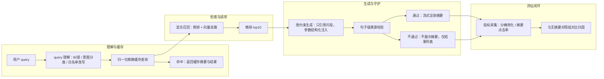

# AI 搜索

> 层级：⑤ 业务应用 ｜ 贯穿矛盾：质量 · 延迟

## 场景

电商/站内搜索从关键词匹配升级为语义理解加生成式摘要（AI Overview 式体验）：既要点得准，还要一段可读的总结。

## 核心矛盾

**语义召回的泛化 vs 精确匹配的确定**——理解了意图却可能丢掉用户明确要买的那件东西；生成的摘要一旦幻觉，直接误导购买决策。

## 追问链

- query 理解（改写、意图分类）和检索排序怎么分工？哪一步最容易把好结果改坏？
- 语义召回上线后，长尾 query 效果涨了、头部 query 反而掉了，为什么？
- AI 摘要引用了错误的商品参数，责任链路怎么设计：溯源到检索结果还是截断生成？
- 端到端延迟预算有限，在理解/召回/重排/生成四段之间怎么分配？

## 推演

### 容量估算（先问这几个数）

先定流量与成本盘子，每个数都是假设，量级对了结论就稳。

- **假设 1（流量）**：DAU 1000 万的电商站，人均每天 3 次搜索 → 3000 万 query/天。搜索时长高度集中（晚间大促），峰值系数取 5：3000 万 / 86400 ≈ 350 QPS 均值，峰值 ≈ 1750 QPS。这是召回与精排层要扛的量。
- **假设 2（摘要量与并发）**：只有 30% 的 query 值得生成摘要（精确型号、导航型 query 不生成）→ 峰值 ≈ 500 次/秒的 LLM 调用。每次摘要输入约 1k token（top 5 商品片段）+ 输出约 200 token，单次流式生成约 2s → 峰值在途流式连接 ≈ 500 × 2 = 1000 路。**LLM 服务层按 1000 路并发规划容量，而不是按 500 QPS**——生成式请求的成本单位是并发连接 × 时长，不是请求数。
- **假设 3（成本）**：3000 万 × 30% = 900 万次摘要/天 × 1.2k token ≈ 1.1 亿 token/天，混合单价假设 ¥4/M → 约 ¥450/天 ≈ **¥1.4 万/月**，且随用量线性涨。对比：检索层是一批固定机器的折旧，摘要层是持续烧现金——这道题的成本重心在 token 账单上。
- **假设 4（query 集中度）**：假设 top 10% 的 query 承载 60% 的搜索量（电商搜索头部集中 + 长尾，经验判断）。这个数决定缓存的收益上限：摘要缓存的理论命中率天花板就是 60%，做不到的部分是纯长尾。
- **假设 5（向量索引）**：1 亿 SKU × 1024 维 × float32 = 4KB/向量 → 纯向量 400GB，加 HNSW 图结构约 ×1.5 → 600GB。按 8 分片 × 2 副本 = 16 份 → 总内存约 10TB，这是向量检索层的硬件底盘（详见 [向量检索服务](向量检索服务.md)）。
- **假设 5b（出口带宽）**：结果列表页按 50KB 动态数据算，峰值 1750 QPS × 50KB ≈ 87MB/s ≈ 700Mbps 出口（静态图走 CDN 不计）——接入层按 Gbps 级规划；这条决定了「摘要流式推送」必须复用结果页已有的长连接通道（SSE/WebSocket），而不是每条摘要单独建连。
- **假设 6（灰度与评估流量）**：语义召回与摘要上线都要分桶 A/B（为什么分桶见追问第 2 条），假设 10% 影子流量跑双路对比两周 → 峰值 175 QPS 影子检索 + 50 QPS 影子摘要调用；对照组与实验组命中同一份缓存，评估期额外 token 成本每天数千元。结论：**评估流量要一开始算进容量盘子，且上线后永远保留一路不生成摘要的对照组**——否则摘要的增量价值永远无法归因。
- **延迟预算**：端到端 800ms（P90），其中摘要的首 token 预算 500ms 且**不阻塞结果列表**（拆账见追问第 4 条）。注意 P90 和 P50 要分开看：摘要是流式长尾分布，P50 首 token 300ms 不代表 P90 不超 2s，容量按 P90 配。

这六个量级合起来的结论：检索与精排层是「传统系统」——按 QPS 与内存规划，一次性投入折旧；理解与摘要层是「AI 系统」——按并发流与 token 规划，随用量持续烧现金。**同一道题里两套容量逻辑并存**，用任何一套去算另一半都会错一个量级。

### 架构推演（从朴素方案开始塌）

**朴素方案**：query → embedding → 向量库 topK → 检索结果拼接喂 LLM → 一次返回「摘要 + 排序后的商品列表」。

它在三个地方依次塌掉：

1. **先塌精确匹配（质量塌，塌在最值钱的流量上）**。用户搜「iPhone 15 256G 黑色」，向量召回按语义相似拉来一堆手机壳、iPhone 14、黑色连衣裙——在 embedding 空间里这些确实近。而头部精确 query 恰是转化率最高的流量（假设 top 20% query 承载 60% 流量），这路一塌，假设头部 query 点击率掉 10%，乘以流量占比，GMV 损失当天就出现在 A/B 里，且大概率吃光语义召回在长尾上的全部收益。机制：embedding 度量的是「语义相似」，用户打型号要的是「恰好这一个」，两个目标在检索空间里就不是同一个度量。
2. **再塌成本**。每个搜索都生成摘要 ≈ ¥1.4 万/月起，其中按假设 4 约 60% 是重复 query 的重复生成——纯烧钱，没有缓存等于给同一个问题付 60 万次/月。
3. **最后塌延迟与幻觉**。摘要整段生成 2-3s，若阻塞结果页渲染，用户白屏 3 秒走人；若不阻塞但无约束生成，摘要里出现「官方指导价 ¥999」这类编造参数——摘要直接作用于购买决策，一次客诉事故就够下线整改。

三个塌点指向同一个结构性结论：把搜索拆成**确定性检索主链**（倒排、精排、结构化字段——输出可断言）与**概率性生成旁路**（向量召回的泛化部分、LLM 摘要——输出只能评估），两条链各用各的质量标准、延迟预算和降级策略。核心矛盾不是在两者里选一个，而是划清它们的边界——下面每一步演进都在做这件事。

**演进五步**：

1. **双路混合召回**：倒排（BM25 + 字段匹配）与向量两路并行，query 理解先做意图分类——精确型号/品牌+SKU 类 query 倒排为主，探索型 query（「送女朋友的礼物」）向量为主。倒排永远保留，不是过渡方案。
2. **归一化精确缓存**：query 去空格、纠错、大小写归一后查缓存（摘要与结果列表一起缓存，TTL 挂价格变更事件失效）。按集中度假设命中 50%+，LLM 成本近乎减半。注意**不用语义缓存**：搜索 query 短、意图密度高，跨意图相似命中会直接错答案（机制见 [语义缓存](语义缓存.md)）。
3. **受约束生成**：摘要只允许引用精排 top 5 的片段；价格、参数、库存一律从商品库结构化字段注入（占位符替换），模型只负责把事实串成通顺的话。输入 token 从 2k 压到 1k，成本再降一半；幻觉面从「模型的全部商品知识」收缩到「给定片段内的改写错误」。
4. **溯源与降级**：生成时要求模型输出句子到片段的 attribution，渲染前做句子级校验（NLI 或规则比对），不过的句子不渲染，整个摘要不可溯源则不展示。摘要是锦上添花，**永远可牺牲——降级路径是功能的一部分，不是异常处理**。
5. **分桶评估闭环**：头部/腰部/长尾分桶的转化 A/B 是长期设施而非一次性实验——语义召回的每次调参（embedding 模型升级、双路权重调整）都过同一套分桶对比；摘要侧看点击率（用户真的在读吗）与下游转化（读完买了吗）。没有这套设施，决策 2 的「双路并行」就没有归因依据，会退化成信仰之争。
6. **一致性窗口**：摘要说「现货速发」、列表里该商品已售罄——摘要缓存的 TTL 必须挂库存与价格变更事件，缓存窗口越长，摘要撒谎的面越大。宁可缩短缓存命中时长，不可让摘要和列表各说各话：用户不读你的架构文档，只看两处是否矛盾。

**终态架构**：

图里没画但缺一不可的两件基础设施：**归因日志**——每次摘要渲染记录所用片段与三个版本号（模型、prompt、商品数据），事故复盘时才能回答「当时模型看到的是什么」；**无摘要对照组**——决策 1 的反转条件、追问 2 的分桶结论，全都依赖永远在线的对照流量，砍掉它省钱等于砍掉视力。

### 关键决策论证

五个决策点的判据全部来自前面的算式与机制——这道题里没有「看团队喜好」的空间，数字会自己投票。

**决策 1：摘要生成范围——全量 query 都生成 vs 按意图选择性生成。**

| | 选项 A：全量生成 | 选项 B：按意图选择性生成 |
|---|---|---|
| 成本 | ¥1.4 万/月起步（算式见假设 2/3） | ≈ A 的 30-40% |
| 收益 | 导航型 query 的摘要几乎无人看 | 摘要集中在探索型 query，边际收益高 |
| 风险 | 幻觉暴露面 ×3 | 意图分类错 → 该有的摘要没出（可观测、可修） |

**结论：B，按意图选择性生成。** 判据是边际收益：导航型 query（「我的订单」）用户 0.5 秒内就走完了，摘要没有阅读时间。**反转条件**：自部署小模型把单条摘要成本压低一个数量级，且摘要点击率证明普遍有效时，扩到全量才划算。

**决策 2：语义召回上线方式——直接替换倒排 vs 双路并行长期共存。**

**结论：双路并行，倒排永久保留。** 判据：语义召回的收益（长尾泛化）与损失（头部精确）发生在不同 query 桶里，只有双路灰度分桶对比才能归因；且头部流量的价值密度最高（假设 4），为长尾收益冒头部风险期望值为负。**反转条件**：几乎不反转——除非业务里「搜索」的语义主体是内容发现而非商品定位（如资讯站），那题目已经不是这道题了。

**决策 3：摘要中的事实——模型自由生成 vs 结构化占位符注入。**

**结论：混合，但数字零自由**——叙述性文字由模型生成，价格/参数/库存等数字一律从商品库字段填充，模型只组装不计算。机制：LLM 输出数字是从 token 分布采样的，不是从上下文复制——检索片段给了正确价格，模型仍可能写出别的数；占位符把「生成」变成「填充」，错误来源从「模型 + 数据」收敛到「数据」单一项，而数据侧有对账可查。**反转条件**：无。这是安全底线，弹性只存在于允许模型改写句式。

**决策 4：缓存策略——语义缓存 vs 归一化精确缓存。**

**结论：搜索场景用归一化精确缓存，不做跨意图语义命中。** 判据：query 中位长度短（假设 10 字级），embedding 距离在短文本上区分度差——阈值 0.95 下「苹果手机」与「苹果醋」也可能过线；搜索的容错成本又特别高（错摘要 = 错购买建议）。语义缓存适合长句问答场景，那里输入长、意图密度低、阈值有区分度（详见 [语义缓存](语义缓存.md)）。**反转条件**：若站点 query 以长句自然语言为主（语音搜索占比高），可对「摘要部分」开启高阈值语义缓存、结果列表永不缓存命中。

**决策 5：摘要模型——强模型在线生成 vs 小模型/自部署。**

**结论：质量敏感主路径用强模型，靠缓存摊薄单价；类目页等模板化摘要用自部署小模型。** 判据：单条摘要成本 × 日请求量——主路径 900 万次/天里复用率低，强模型 + 缓存是最优解；类目页摘要是固定结构、 million 级复用，小模型微调后质量够且边际成本趋近电费。**反转条件**：强模型价格再降 5-10 倍时，分级失去意义，统一强模型。

### 追问应答

**1. query 理解和检索排序怎么分工？哪一步最容易把好结果改坏？**

分工原则：理解层只做「不改变语义的规整」和「路由决策」——纠错、同义词归一、意图分类（决定双路权重与是否生成摘要）；商业目标与个性化全部留在排序层。最容易改坏的是**改写**：它处于全链路最上游，改错一个词，召回、精排、摘要全部跟着错，且下游看到的是「已污染的候选」无从自救；排序错了只影响展示顺序，用户还有翻页兜底。所以改写必须保守——只走人工审核过的同义词白名单，或原 query 与改写 query 双路召回后合并去重，宁可漏改、不可错改。

**2. 语义召回上线后长尾涨、头部掉，为什么？**

两个机制叠加。第一，embedding 对精确 token 是灾难：型号、SKU 编号这类 token 在语义空间被平滑成「一般相似」，倒排能一击命中的，向量反而混入近似品。第二，评估盲区：离线评估集通常按 query 均匀采样，长尾 query 数量多、每条权重相同，头部 query 样本稀少——离线指标涨、线上头部转化跌，根源是**评估分布和流量分布不一致**。解法不是调阈值，是分桶看指标：头部/腰部/长尾分别 A/B，任何全量平均指标都会把头部损失平均掉。

**3. AI 摘要引用了错误的商品参数，责任链路怎么设计？**

溯源和截断都要，但角色不同。生成侧先自证：每个参数断言必须带 attribution（映射到具体检索片段），生成后做句子级校验，不通过不上线——这把「模型自由发挥」类错误在出口拦截。校验通过但参数仍错，说明错在片段本身（商品库脏数据），溯源定位到商品字段回流数据治理。只截断生成（如摘要禁出现数字）会把摘要降级成空话，等于砍功能；只溯源不拦截等于拿用户当测试环境。结论：**attribution + 出口拦截是功能，溯源是运营工具**，两者是纵深不是二选一。

**4. 端到端延迟预算在理解/召回/重排/生成四段之间怎么分配？**

总预算 800ms（P90）：理解 50ms（规则 + 小模型，且 query 理解结果本身可按 query 缓存）；召回 50ms（HNSW topK=500，P99 < 50ms 是向量检索层的硬指标）；精排 100-150ms（重排模型对 top500 batch 打分）；**生成不占结果页预算**——摘要流式异步加载，首 token 500ms 内出现即可，用户先浏览列表再读摘要，两件事在时间上天然重叠。核心原则：前三段是结果列表的关键路径，第四段是可降级的旁路，**不能共用同一个超时预算**——摘要超时就降级为不展示，绝不让它阻塞列表。

### 常见误区

**误区 1：「语义召回上线，搜索指标整体提升」。** 典型样子：用人工标注的语义 query 集验证召回率 +20% 就全量上线。不行机制：流量分布 vs 评估分布错位——按假设 4，头部 query 承载 60% 流量，头部掉 10% 转化的绝对损失大于长尾涨 20% 的收益；而离线召回率根本测不到「向量把精确型号召回偏」这类错误。

**误区 2：摘要 prompt 写「基于以下商品信息生成一段吸引人的推荐语」。** 典型样子：无引用约束、无溯源要求，靠模型自觉。不行机制：「吸引人」是开放式目标，模型为完成它倾向于补上下文里没有的卖点——幻觉不是 bug，是这个目标函数的最优解。约束必须是负向白名单（只准引用给定片段、数字只准来自结构化注入），正向鼓励（「要有说服力」）只会加剧编造。

**误区 3：摘要缓存按语义相似命中。** 典型样子：query embedding 相似度 > 0.95 直接返回缓存摘要。不行机制：短 query 上 embedding 区分度差（见决策 4），跨意图命中返回的是错答案，错在购买建议链路上不可逆；正解是归一化精确缓存 + 精确失效事件。

**误区 4：把摘要预生成成商品维度的通用文案。** 典型样子：离线批量给 1 亿 SKU 各生成一段「通用卖点摘要」，搜索时按命中商品拼进去。不行机制：搜索摘要是 **query 相关的**——同一件羽绒服在「东北过冬」和「轻薄通勤」两个 query 下该讲的卖点不同，预生成的通用文案把摘要退化成详情页复读；且 1 亿 × 1.2k token ≈ 1200 亿 token 的一次性烧钱（按假设 3 单价 ≈ ¥48 万），外加每次价格变更的失效重算——成本结构比「实时生成 + 归一化缓存」更差，效果还更弱。

---

[返回 AI 场景题地图](README.md)
