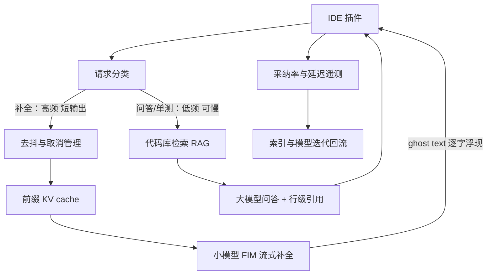

# AI 编程助手

> 层级：⑤ 业务应用 ｜ 贯穿矛盾：延迟 · 质量 · 安全

## 场景

给全公司开发者做 IDE 里的编程助手：行内补全、代码问答、单测生成，代码不能出网。

## 核心矛盾

**补全延迟 vs 生成质量**——补全要在几百毫秒内出现，强模型和大上下文恰好都做不到这么快；问答可以慢慢想，补全慢了用户就关掉了。

## 追问链

- 补全和问答走不同模型、不同链路，怎么统一成一个产品体验？
- 补全的上下文怎么选：当前文件、打开的 tab、还是引用链？上下文多了反而慢——怎么取舍？
- 用户在打字，上一发补全还没回来——取消、去抖、缓存怎么设计？
- 采纳率为什么是北极星指标？它和「代码质量」会不会互相矛盾？

## 推演

### 容量估算（先问这几个数）

- 假设 1：2000 名开发者，人均每天触发 2000 次补全请求（键入停顿触发）→ **400 万次/日**；问答（含单测生成）人均 10 次/日 → 2 万次/日。
- 假设 2：补全单请求 prompt 约 2k token（光标邻域 + 前缀）、输出约 100 token；问答 prompt 约 10k token（检索代码库片段）、输出 1k token。
- 假设 3：工作时段 10 小时，峰值系数 3。
- 假设 4：补全延迟预算 P50 < 400ms、P90 < 800ms（经验判断：补全到达时用户还在原语境里才有意义，人类连续打字节奏约 200–300ms/字符）。

算式与结论：

- **流量对比**：补全 400 万次/日 vs 问答 2 万次/日——**流量差 200 倍**；token 对比：补全 400 万 × 2.1k ≈ **84 亿 token/日** vs 问答 2 万 × 11k ≈ 2.2 亿 token/日——**token 差 40 倍**。两组数字共同证明：这两条链路在预算、SLA、模型选型上必须是两个系统，「统一」只能统一在产品层。
- **延迟拆解（塌陷演示）**：若补全用 30B 级模型，单流 decode 假设 40 token/s，输出 100 token 要 2.5 秒——超 P90 预算 3 倍。decode 逐 token 串行，batching 只摊成本、不缩单流延迟，加机器无解。**结论是被算出来的：补全模型必须收缩到 1–3B 级**（假设单流 200+ token/s），配合 speculative decoding（经验值 2–3 倍加速，推理侧机制见 [LLM 推理服务平台](LLM推理服务平台.md)）与输出上限（FIM 补全截断在 100 token 内）。
- **压线验证**：decode 100 token ÷ 300 token/s ≈ 330ms + prefill 2k token ÷ 30k token/s ≈ 70ms + 网络 50ms ≈ 450ms——P50 预算 400ms 依然压线。这解释了为什么前缀缓存（省 60% prefill，见下）和输出截断不是优化项，是及格线；也是补全必须流式渲染的原因。
- **GPU 张数**：峰值 350 QPS × 2k token = 70 万 token/s prefill 吞吐，假设 3B 模型单卡 prefill 5 万 token/s → 14 张卡；decode 峰值 350 × 100 = 3.5 万 token/s，批处理下单卡 2 万 token/s（假设）→ 2 张卡。合计约 16 张，加冗余与灰度 **约 20 张**。
- **问答侧算力**：峰值约 2 QPS × 10k token prefill = 2 万 token/s，假设 30B 模型单卡 prefill 2 万 token/s → **2–4 张卡**即可，与补全的 20 张分开核算——两条链路的容量画像完全不同，再次印证「两个系统」的判断。
- **缓存的容量地位**：同一行内连续触发的补全请求，前缀重叠率假设 60%——前缀 KV cache 命中直接免掉这部分 prefill，GPU 需求降约四成。缓存不是锦上添花，是容量假设的一部分。
- **若补全走外部 API 的账**：84 亿 token/日按假设定价（输入 $0.25/M、输出 $1/M）≈ 240B × $0.25 + 12B × $1 ≈ **$72k/月**，且公网往返吃掉延迟预算——补全链路从经济和延迟两个方向都被判出局。

### 架构推演（从朴素方案开始塌）

**朴素方案**：一个最强模型统一服务补全和问答，IDE 插件把当前文件全文发过去。塌法非常具体：

1. **补全先塌在延迟**：如上拆解，强模型单流 decode 到不了 400ms。用户在 2.5 秒里已经打下去十几个字符，补全到达时基于的是过期前缀——展示出来是错误位置的幽灵文本，比没有补全更糟。采纳率归零，产品死亡。
2. **再塌在成本与容量**：400 万次/日全走最强模型，月账单七万美元级起步且延迟更差——钱花了，体验没换来。
3. **问答侧塌在上下文**：不发代码则模型不知道内部框架；发全文件则 prompt 巨大且慢。问答的解法在检索，不在窗口。

**演进一：链路分叉**。两个模型、两个集群、两套预算，但在产品层统一：

- **补全链路**：小模型（1–3B）+ FIM 训练目标 + 前缀缓存 + 流式输出 + 100 token 截断，SLA 是 P90 800ms。
- **问答链路**：大模型（30B+）+ 代码库 RAG + 引用展示，SLA 是 P90 5s 可接受——用户显式发起、有等待预期，转圈不致命。单测生成归这条链路：低频、可慢、需要检索被测函数的依赖与既有测试风格。
- **共享底座**：代码索引、权限与不出网边界、遥测回流——这是「统一」的真正含义，答案在追问 1 展开。

**演进二：补全请求生命周期管理**。这是补全链路独有的工程，四件套：

- **触发去抖**：键入停顿 150ms 才发请求（经验值），过滤连续键入——只在意「停顿点」。
- **立即取消**：光标变更或新键入即 abort 在途请求。省的不只是体验，是 decode 算力：不取消则 GPU 跑满用户根本不会看的补全，峰值吞吐塌方。取消必须传播到推理层（请求级取消）——只在网关断开、GPU 继续算完，是白烧钱。
- **前缀 KV cache**：打字是渐进的，每次触发与上次共享长前缀，命中即免 prefill。
- **结果缓存**：按「文件路径 + 光标前缀 hash」短 TTL 复用，覆盖回退光标、撤销重打的场景。

**演进三：上下文预算器**。固定总预算（2k token），按信息密度装填：光标邻域（前 1.5k + 后 0.5k，必选）> 引用符号定义（静态分析精确跳转，只拉签名，几百 token 高密度）> 同语言打开 tab 的头部（可选）> 相似片段（embedding 召回，最次）。取舍判据是「每 1k token 的 prefill 代价（约 30ms）对应的边际采纳率增益」——增益靠 A/B 实验度量，不靠直觉。

**演进四：安全与遥测分层**。代码不出网的落地：推理集群私有化 + IDE 插件网络白名单。遥测与代码内容分级：采纳事件、延迟分布这类聚合指标不含代码文本，必须采集——否则产品无法迭代；prompt 原文与补全内容按敏感级留存（脱敏、限期限、限权限）。分级策略的完整论证见 [企业数据防泄漏](企业数据防泄漏.md)。不出网约束的对象是代码文本，不是「一切数据」。

终态架构：

### 关键决策论证

#### 决策 1：补全模型自建专用小模型还是通用 API

|  | 方案 A：自托管专用小模型 | 方案 B：通用小模型 API |
| ---- | ---- | ---- |
| 延迟 | 内网往返，可控在 400ms 内 | 公网往返加抖动，预算大头被吃掉 |
| 成本 | 约 20 张卡固定成本 | $72k/月且随规模线性涨 |
| 数据 | 采纳/拒绝信号留在内部 | 信号在外部，飞轮断裂 |

- **判据**：延迟预算、成本算式、数据飞轮三票。
- **结论**：自托管（开源底座 + 内部代码继续训练）。**反转条件**：开发者少于 100 人、无推理运维能力——API 加容忍较高延迟是唯一务实解。

#### 决策 2：补全上下文当前文件 only 还是多文件召回

- **选项 A**：只用当前文件光标邻域；**选项 B**：多文件召回（引用链、打开 tab、相似片段）。
- **判据**：边际采纳率增益 ÷ 边际 prefill 延迟。先验排序：光标邻域 > 引用链签名 > 打开 tab > 相似片段——补全本质是预测局部延续，远距离信息对它的增益有限（经验判断）。
- **结论**：不是二选一，是预算制分层装填（演进三），每层去留由 A/B 实验的采纳率增量决定。**反转条件**：强私有 DSL / 内部框架代码库——局部模式不足以推断 API 用法，跨文件签名上下文的增益显著上升，预算向引用链倾斜。

#### 决策 3：补全输出整段返回还是流式

|  | 方案 A：整段返回 | 方案 B：流式 + 100 token 上限 |
| ---- | ---- | ---- |
| 尾延迟 | 长输出拖长 P90 | 输出上限直接砍掉长尾 |
| 等待感知 | 全程空白 | 逐字浮现即「正在工作」信号 |
| 交互风险 | 一次性大块插入打断心流 | 用户可随时继续打字取消 |

- **判据**：decode 尾延迟。100 token 上限直接砍掉长尾（最后 50 token 常是低价值部分）；流式把等待切成「正在工作」的信号，P50 不变但主观延迟下降（经验判断）。
- **结论**：方案 B。**反转条件**：几乎没有——块级生成（整个函数体）用户预期整段出现，但那已经是问答链路的交互模式，不叫补全。

#### 决策 4：北极星用采纳率还是代码质量指标

- **选项 A**：采纳率（被采纳补全数 / 展示数）；**选项 B**：代码质量指标（bug 密度、返工率）。
- **判据**：样本量与反馈周期。采纳率 400 万样本/日、毫秒级反馈、自带人类否决权；质量指标归因困难且滞后数月。
- **结论**：采纳率为北极星，配「被采纳代码 30 天存活率」为护栏（防讨好型补全，见追问 4）。**反转条件**：产品目标从「提效」切换为「防错」时（如金融核心系统），质量指标升为主指标——但归因周期以季度计，要有这个心理预期。

#### 决策 5：问答走 RAG 还是全库索引进上下文

- **选项 A**：代码库 RAG 检索 + 引用；**选项 B**：仓库全量直接进窗口。
- **判据**：与代码审查题同构——窗口装不下、注意力稀释、成本。机制差异：问答还需要「引用可信度」这个产品机制，RAG 天然带行级引用，开发者点开验证，验证通过一次信任 +1。
- **结论**：RAG。**反转条件**：仓库 2 万行以内（约 200k token）全库可进窗口时，省掉索引基建是合理简化。

### 追问应答

**1. 补全和问答走不同模型、不同链路，怎么统一成一个产品体验？**

不统一在模型层，统一在产品层：同一个插件、同一套快捷键与交互语言、同一权限与不出网边界、同一遥测体系。两个交互范式本来就不同——补全是无感服务（用户没请求就出现，错了必须 invisible），问答是显式对话（用户发起，等待可接受）。强行用一个模型同时满足 400ms 延迟和 10k 检索上下文，数学上两头都塌。底座真正共享的只有三样：代码索引、权限层、遥测回流。

**2. 补全的上下文怎么选：当前文件、打开的 tab、还是引用链？怎么取舍？**

判据是「边际采纳率增益 ÷ 边际 prefill 延迟」，每类上下文的系数用 A/B 实验测定，不靠直觉。先验排序：光标邻域（信息密度最高）> 引用链定义（静态分析精确拉签名，几百 token 高密度）> 打开的 tab（相关性方差大）> 相似片段（最次）。固定 2k 总预算、优先级装填、装不下降级。关键机制：上下文变多不仅慢还会稀释——补全是局部延续预测，对远距离知识敏感度天然低，这和问答「需要理解全局」的上下文需求方向相反。

**3. 用户在打字，上一发补全还没回来——取消、去抖、缓存怎么设计？**

四件套各管一段：去抖 150ms 过滤连续键入，只在意停顿点；光标变更或新键入立即 abort 在途请求——既防 stale 补全展示在错误位置，也把 decode 算力还给活请求；前缀 KV cache 吃掉打字过程约 60% 的重复 prefill；结果按前缀 hash 短 TTL 缓存，覆盖回退光标、撤销重打场景。设计红线：取消必须传播到推理层的请求级取消，只在网关断开而 GPU 继续算完，等于白烧钱。

**4. 采纳率为什么是北极星指标？它和「代码质量」会不会互相矛盾？**

采纳率不可替代：400 万样本/日、毫秒级反馈、自带人类否决权——用户不采纳即否决，错误代码进不了代码库，所以「直接矛盾」不成立。间接矛盾存在：模型可能学会讨好——保守、重复、低信息量的补全更容易被采纳。护栏是「被采纳代码 30 天存活率」与「补全代码后续被改写率」：采纳率涨而存活率跌，说明在讨好不在帮忙。两个指标必须配对发布，任何一端单独优化都会跑偏。

### 常见误区

1. **错误答案长这样**：「选最强模型保证补全质量，延迟交给推理团队优化」。**为什么不行**：decode 逐 token 串行，batching 摊成本但不缩单流延迟——40 token/s 的单流速度对 400ms 预算是数学无解，加多少机器都没用。这不是算力投入问题，是模型尺寸选择问题，必须在选型阶段就否决。
2. **错误答案长这样**：「上下文越多补全越准，把打开的 tab 全塞进去」。**为什么不行**：prefill 时间随 token 线性涨（每多 1k 约 +30ms，按假设算）；长上下文中段注意力利用率显著下降；补全任务对远距离信息敏感度天然低（经验判断）。结果是延迟变差、采纳率不涨——双输。
3. **错误答案长这样**：「采纳率是唯一 KPI，环比必须涨」。**为什么不行**：没有护栏指标的采纳率会奖励讨好型补全——保守、重复、低信息量。三个月后采纳率从 25% 涨到 32%，但被采纳代码的 30 天存活率从 85% 跌到 70%，产品在指标上赢、在价值上输。
4. **错误答案长这样**：「代码不出网 = 不采集任何遥测」。**为什么不行**：把遥测全关，三个月后没有任何数据判断模型该不该升级、上下文策略有没有效。不出网约束的对象是代码文本；采纳事件、延迟分布是聚合指标，不含代码内容。正确做法是数据分级（遥测 / prompt 原文 / 补全内容）分别定采集与留存策略——否则合规成本变成产品停迭代的代价。

---

[返回 AI 场景题地图](README.md)
