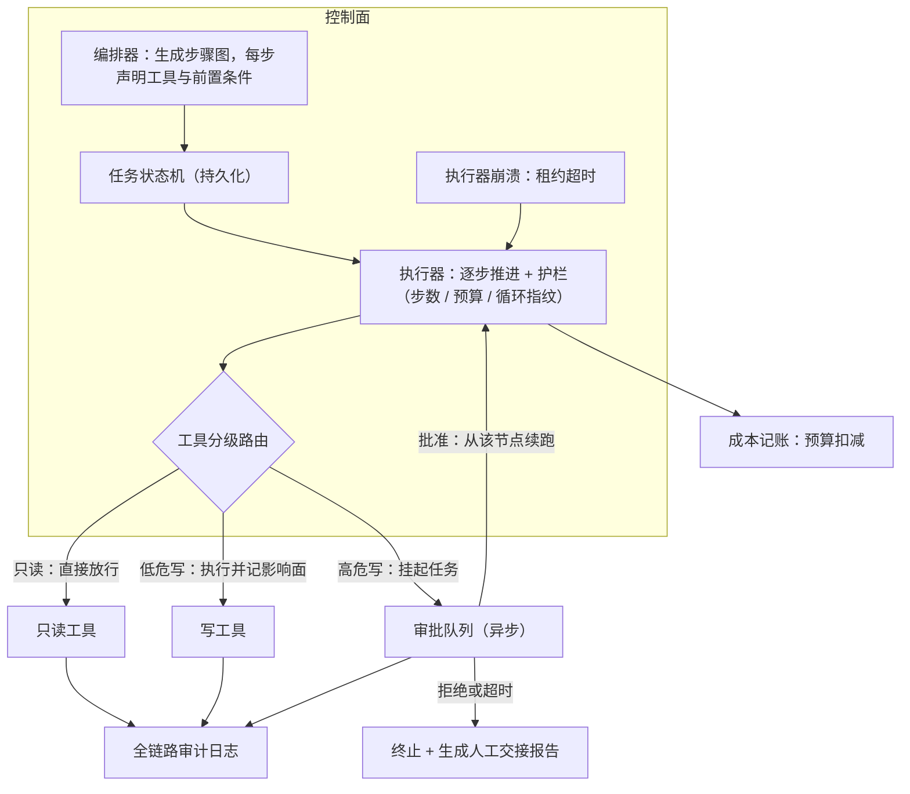

# Agent 任务执行平台

> 层级：④ Agent 与工具 ｜ 贯穿矛盾：安全 · 质量

## 场景

内部运维/数据分析 Agent，能执行多步任务：查监控、跑 SQL、发报告，甚至重启服务。

## 核心矛盾

**自主性 vs 可控性**——管得越死越没价值，放得越开越像定时炸弹；控制粒度的设计是整道题的题眼。

## 追问链

- Agent 无限循环怎么防？
- 哪些操作永远不允许 Agent 自主执行？
- 审批节点会不会把自动化拖回人工？

## 推演

### 容量估算（先问这几个数）

先把量级摆出来——你会发现这道题的数字都不大，它考的不是规模，是控制面的正确性。这个判断决定了后面所有设计往「状态与权限」倾斜，而不是往「性能」倾斜。

顺带回答常被追问的 GPU 数：这类平台通常不自持推理，规划调用走公司统一的 [LLM 推理服务平台](LLM推理服务平台.md)，GPU 张数是上游的变量——本题按「单任务 token 预算 + 步级延迟 SLO」对上游提需求即可。

- 假设一（任务量）：1000 名内部用户、日活 200、人均发起 3 个任务 → 600 任务/天，平均 0.007 QPS，按 50 倍峰值系数 ≈ 0.35 QPS。结论：任务吞吐对任何队列和数据库都是零压力。
- 假设二（token 成本）：每任务平均 8 步，每步一次规划调用（输入 4k + 输出 0.5k token）加一次工具结果回填（约 0.5k）→ 单任务约 4 万 token。600 任务/天 ≈ 2400 万 token/天，按混合单价 $3/1M ≈ **$72/天**。结论：钱是小头，成本治理不是这题的主矛盾，但预算上限是护栏的输入（见追问一）。
- 假设三（并发与时长）：8 步 ×（规划 5s + 工具执行 10s）≈ 2 分钟/任务；工作时间内峰值并发按 10 个任务估 → 10 个执行器槽位即可。结论：复杂度不随任务量走，随「单任务步骤数」走——步骤数才是状态机的规模变量。
- 假设四（状态存储）：每步结构化状态约 2KB + 工具产物摘要 10KB → 单任务 <100KB，600 任务/天 ≈ 60MB/天，一年约 22GB。结论：任何数据库都扛得住，选型依据是「按任务查步骤、按步骤取产物」的查询模式，不是容量。
- 假设五（审计）：每步 1 条审计事件约 1KB → 4800 条/天，写入可忽略；但合规要求保留 1 年以上且不可篡改。结论：审计是合规与检索问题，不是性能问题。

五个数合起来的结论：**吞吐、存储、成本全在「一台机器 + 一个队列」的量级**——所以这道题不需要分布式炫技，评分点全在控制面的正确性：状态机、护栏、审批、审计。面试里若把容量答成「需要 K8s 集群 + 分库分表」，方向就错了。

### 架构推演（从朴素方案开始塌）

朴素方案一句话：一个进程内 while 循环——LLM 规划下一步、调工具、看结果、再规划，直到模型自己说「做完了」。

**第一塌：塌在无限循环，指标是单任务成本与资源占用。** 模型说「再试一次」的概率永远不是零（经验判断：长尾任务里 5% 的循环概率并不夸张）。一个循环 2000 轮的任务：2000 × 5k token = 1000 万 token ≈ $30，单任务成本从 $0.1 涨 300 倍，同时占死一个并发槽 10 小时级。塌的机制：循环的终止条件是「模型自认为做完了」，而非确定性输出不能充当终止条件。

**第二塌：塌在重跑副作用，指标是事故数。** 循环体跑在进程内存里，进程一挂（发版、OOM、机器迁移）状态全丢，只能从头重跑——已发的报告再发一遍、已重启的服务再重启一遍。注意塌的形态不是「慢」而是「重复副作用」：重跑的前提是每步幂等，而发报告、重启服务天然不幂等。把执行历史放内存里，是结构性错误，不是容错可以补救的。

**第三塌：塌在权限不分层，指标是爆炸半径。** 循环里模型直接持有全部工具，包括「重启服务」这种高危写操作——模型的每一次「下一步」都拥有全部权限，一次规划失误就是一次真实生产操作。权限没有按副作用分级，意味着风险上限等于权限总和。

三次塌逼出终态，演进步骤如下：

1. **护栏进代码，不进 prompt**：步数硬上限（如 50 步）、任务级 token/费用预算（超限熔断）、循环指纹检测（对「工具 + 规范化参数」取指纹，连续 N 次重复判为循环）。三者全是确定性代码逻辑，模型无法绕过。
2. **任务 = 步骤图 + 状态机**：规划阶段产出步骤图，每个节点声明要用的工具、前置条件、预期产物；执行器逐节点推进，每步落库，状态在 pending / running / succeeded / failed / awaiting_approval 之间迁移，工具产物存对象存储指针。断点恢复 = 从最后一个 succeeded 节点续跑，已产生副作用的节点标记完成、不重放。步骤的幂等与超时要显式设计：每个执行请求带幂等键（task_id + step_index + attempt），工具侧据此去重；每步有自己的超时预算（规划 30s、工具调用 60s 量级），超时按工具失败处理，避免单步挂住整个任务。
3. **工具按副作用分级 + 审批节点**：只读放行；低危写（建工单、改非生产配置）自动执行并记录影响面；高危写（重启、删数据、对外发送）把任务挂起为 awaiting_approval，人批准后从该节点续跑。审批的对象是步骤图里声明的高危节点，不是每一次函数调用。
4. **失败分两类**：工具失败（超时、5xx）在执行器层指数退避重试 ≤3 次；规划失败（结果与预期不符）回规划层重新生成计划，且必须携带失败上下文——否则同样的错计划会原样重演。
5. **长任务的生命周期管理**：执行器对任务持租约（lease）并心跳续期；执行器崩溃后租约超时，任务可被其他执行器接管（从断点续跑）。awaiting_approval 的任务不占执行器槽位——挂起的是任务，不是资源。
6. **全链路审计 + 成本记账**：每步记录发起者、任务 ID、工具、参数、结果摘要、token 消耗，与 trace id 关联，成本按任务归集。

规划本身也有护栏：步骤图节点数设上限（如 30 个），规划调用同样有超时与重试；模型产出的步骤图必须通过 schema 校验（每节点有工具声明与前置条件）才能进入执行——schema 不合规直接打回重新规划，而不是让执行器在缺字段的状态下猜。

另外，执行平面（工具实际跑在哪）是另一道题：工具在宿主进程内执行还是沙箱内执行、代码类工具怎么隔离，见 [Agent沙箱与代码执行](Agent沙箱与代码执行.md)——本题的控制面（状态机、护栏、审批）与那题的数据面（隔离、限额、回传）拼起来才是完整的执行架构。

终态架构的落地自查清单（每一项都能对应到上面的一次「塌」）：

- 任何一次工具调用，能否仅凭审计日志重建「谁、代表谁、干了什么」？
- 挂起任务（awaiting_approval）是否零资源占用——不占执行器槽位、不占连接？
- 进程级崩溃后重放，是否跳过所有已产生副作用的节点？
- 护栏（步数、预算、循环）是否全部存在于代码层，prompt 里一句都没有？
- 断点续跑烧的 token 是否只花在失败步骤之后，而不是从头再来？

### 关键决策论证

#### 决策 1：控制流放在 prompt 里，还是放在编排器代码里？

| | 选项 A：prompt 约定 | 选项 B：代码强制 |
| --- | --- | --- |
| 机制 | 模型「可能遵守」，遵守率随任务变长、上下文变脏而衰减 | 确定性执行，模型无法绕过 |
| 失败形态 | 偶发失控、难复现、难归因 | 限制自由度，动态任务需要动态结构 |
| 落地形态 | 一段 system prompt | 步骤图 schema + 执行器推进 |

**结论：B，具体是「LLM 动态生成步骤图、代码推进执行」的折中**——LLM 保留规划自由度，代码垄断控制权。反转条件：任务结构高度动态、连步骤图都难以预定义 schema 时，才退回自由循环，同时把护栏（预算、步数）收紧一档作为补偿。

#### 决策 2：断点恢复存什么——对话全量，还是结构化步骤状态？

| | 选项 A：存对话全量 | 选项 B：存结构化步骤状态 + 产物指针 |
| --- | --- | --- |
| 恢复依据 | 从长对话里「读出」进度，恢复慢且连带恢复错误上下文 | 直接读状态机：哪些节点 succeeded、产物在哪 |
| 存储成本 | 单任务对话可达数百 KB 且含冗余 | 单任务 <100KB（见容量假设四） |
| 重跑成本 | 从头重放全部步骤 | 只执行失败步骤之后的部分 |

**结论：B**。断点恢复需要的是「哪些步骤完成、产物在哪」，不是完整对话；全量恢复还会把失败前那轮的错误上下文一起带回来。产物指针（对象存储引用）还有一层成本意义：重跑烧的是失败步骤的钱，不是全部步骤的钱。反转条件：几乎没有——对话全量只作为调试回放的附录保留。

#### 决策 3：审批做成同步阻塞，还是异步挂起？

**结论：异步挂起 + 通知，任务状态机驱动**。判据是审批的时长分布：人工审批是分钟到小时级事件，同步实现意味着 HTTP 长连接/长事务挂到人点完为止，超时、重试、连接池全部被放大成事故。异步方案在资源模型上的决定性优势：挂起期间任务不占执行器槽位、连接不占服务端资源。反转条件：审批预期稳定在 30s 以内的内部场景，可以用同步长轮询换取实现简单。

#### 决策 4：失败处理——一律重试，还是先分类？

**结论：先分类**。判据是重试对两类失败的有效性不对称：工具失败（超时、5xx）重试有效，因为失败原因在工具侧且与计划无关；规划失败（结果与预期不符）重试无效，因为失败原因在计划本身，重试只是把同一个错跑三遍、token 照烧。「携带失败上下文」的最小实现：把失败步骤的实际输出与预期的差异一并放进重新规划的 prompt——规划失败的修复信息就在失败现场。反转条件：工具全部幂等且失败率 <1% 的系统，可简化为统一重试以降低实现复杂度。

#### 决策 5：防循环靠 prompt 请求，还是靠机制检测？

**结论：机制检测为主（步数上限、预算熔断、循环指纹），prompt 只做辅助**。判据与决策 1 同根：非确定性输出不能当控制机制。这条单独列出来，是因为实践中它最常被忽略——很多人觉得「我提醒过它了」。循环指纹的实现要点：参数规范化（键排序、剔除时间戳类噪声字段）后再哈希，否则参数里一个变的时间戳就能让指纹永不重复，检测形同虚设（经验判断的实现坑）。反转条件：无。

### 追问应答

**1. Agent 无限循环怎么防？**

三层确定性护栏，全部实现在编排器代码里：硬步数上限（超过即终止）；任务级花费预算（token 计数累加超阈值即熔断）；循环指纹检测（对「工具 + 规范化参数」取指纹，连续 N 次重复判为循环）。预算的量级从容量估算倒推：单任务正常消耗约 4 万 token，预算设 2-3 倍（8-12 万）能容纳正常的重试与回溯，又不给循环留空间。关键在终止之后不是丢弃：保留状态、输出「卡在第 X 步、已尝试过什么、花了多少 token」的报告让人接手——护栏的价值在「止损 + 可接手」，不在「假装任务成功」。

**2. 哪些操作永远不允许 Agent 自主执行？**

判据是「错了能不能撤销、错了波及谁」，与操作是否复杂无关（经验判断）：不可逆且影响面超出本任务边界的操作——删数据、资金流动、对外发送（邮件/公告）、生产 schema 变更、权限授予——一律人工审批，且审批人 ≠ 发起人（防止 Agent 诱导发起人自批，这条常被漏掉）。反过来，可逆且影响面小的操作（建工单、改草稿）应当放行，否则「管得越死越没价值」，这道题的自动化价值就归零了。

**3. 审批节点会不会把自动化拖回人工？**

先用数字回答：600 任务/天、假设 10% 含高危写 = 60 次审批/天，摊到 5 个审批人是 12 次/人/天，完全可接受。真正压垮人的是「每次工具调用都弹窗」的粒度——所以设计上审「计划」不审「执行」：人批的是步骤图中声明的高危节点集合，一次批一批，人工量与高危节点数成正比而不是与总步数成正比。反过来还要防另一种失败：审批长期无人处理导致任务腐烂——审批队列要有超时升级（如 24h 未审批升级到上级并通知发起人），挂起不等于遗忘。长期看高危清单应随信任收缩，但工具分级的放宽必须绑定该类操作的事故率与返工率指标，而不是拍脑袋放松。

### 常见误区

- **误区一：「system prompt 里写一句『不要循环』就够了。」** 错误答案的样子：护栏只有一句 prompt，代码里没有任何终止逻辑。机制：模型输出非确定，承诺零约束力；5% 的循环概率 × 600 任务/天 = 每天约 30 个失控任务。护栏必须是确定性代码。
- **误区二：「断点恢复就是重新执行整个任务。」** 机制：重跑的前提是步骤幂等，而发报告、重启服务天然不幂等，重跑直接变成重复副作用事故。正确形态是步骤状态持久化 + 已完成副作用节点不重放——「是否重放」的判据是该节点是否已产生对外可见的变更，而不只是它有没有标记成功。
- **误区三：「审批就是每个工具调用前人工确认一下。」** 机制：人工量随总步数线性增长，8 步 × 600 任务/天 = 每天 4800 次确认，自动化价值归零。正确粒度是审批步骤图中声明的高危节点集合，一次批一批；同步等待审批的实现还会把连接与重试机制一起拖垮。
- **误区四：「失败就重试，重试是最通用的容错。」** 机制：把规划失败当工具失败重试，同一个错误计划烧三遍 token，结果照样错——重试只对「失败原因在工具侧」的故障有效。失败必须先分类：可重试的工具失败 vs 需回溯改计划的规划失败。

---

[返回 AI 场景题地图](README.md)
