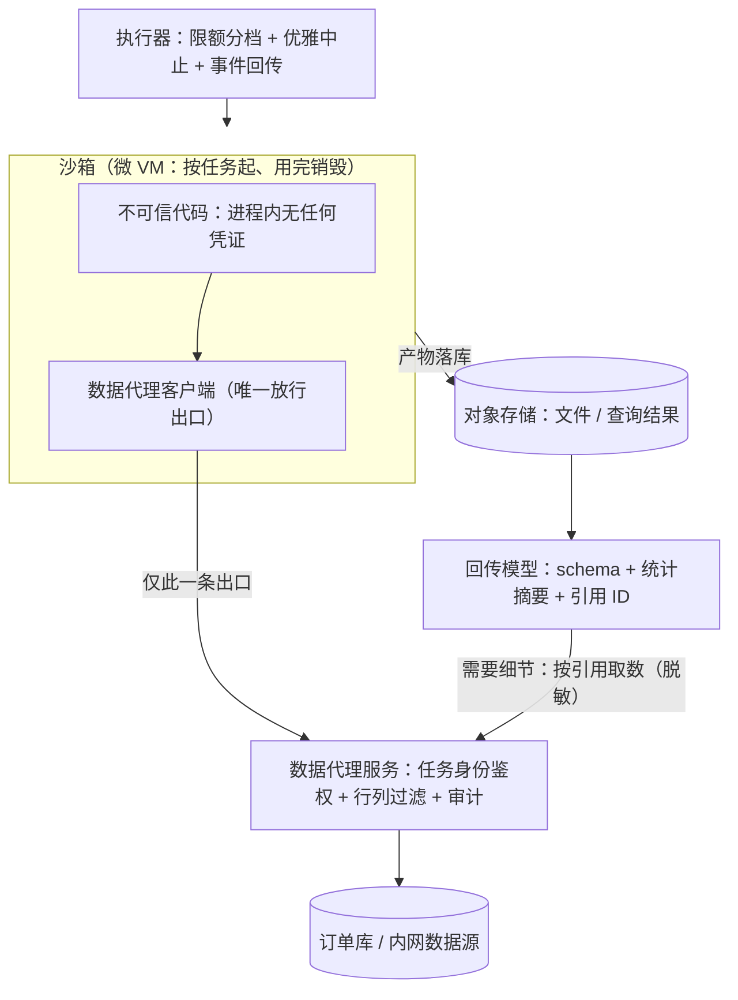

# Agent 沙箱与代码执行

> 层级：④ Agent 与工具 ｜ 贯穿矛盾：安全 · 质量

## 场景

Agent 要真正干活——跑代码、执行 SQL、操作文件，就必须给它一个执行环境；但环境里跑的代码是模型生成的，不可信。

## 核心矛盾

**能力开放 vs 安全隔离**——沙箱越开放，Agent 越能干，爆炸半径也越大；隔离做到极致，Agent 又退化成只能说话。

## 追问链

- 隔离做到什么级别：共享容器、独立容器、还是微 VM？依据是什么？
- Agent 生成的代码需要读内网数据（比如订单库），数据怎么进沙箱？边界划在哪？
- 资源限额（CPU、内存、网络、时长）怎么定？被限额打断的任务，状态怎么交代？
- 执行产物（文件、查询结果）怎么安全回传？产物里混了敏感数据怎么办？

## 推演

### 容量估算（先问这几个数）

沙箱系统的容量设计核心不是「多少 QPS」，而是「单个执行要什么规格、启动要多久、回传有多大」。按这个顺序问数：

- 假设一（调用量）：500 名内部用户，10% 的 Agent 请求需要跑代码，人均 5 次/天 → 250 次执行/天，峰值系数 10 → 峰值并发 5-10 个沙箱。结论：并发量极小，规格与启动延迟才是设计点。
- 假设二（单次规格）：数据分析典型任务是 pandas 读 1GB CSV，对象解析后内存膨胀 3-5 倍 → 内存峰值 3-5GB，CPU 2 核、时长 p95 约 5 分钟。结论：如果按「默认 512MB / 30s」一刀切，多数分析任务直接 OOMKilled——限额必须按任务类型分档。
- 假设三（冷启动）：容器冷启动约 0.1-1s，微 VM 约 0.125-0.2s（Firecracker 量级），再叠加 Python 导入 pandas/numpy 的 2-5s。250 次/天 × 5s = 约 21 分钟/天的总等待不算大，但交互式 Agent 里每次执行的 p99 由它主导——每次多等 5-7s，用户会直接放弃（体验判断）。口径提醒：「用户可感的冷启动」= VM 启动 + 镜像加载 + 运行时依赖导入，三段加起来才算数，只报第一段会低估一个数量级。结论：需要预热池，不能每次现起。
- 假设四（回传体积）：查询结果上限 10 万行 × 100B = 10MB，按约 4 字节/token 粗算 ≈ 250 万 token，按 $3/1M 计 ≈ **$7.5/次**，且超过多数模型的上下文窗口。结论：产物必须走「摘要 + 引用」，全量回传既塞不下也烧不起。
- 假设五（镜像与依赖）：数据分析常用依赖栈（pandas、numpy、sklearn）镜像 1-2GB；假设 20 种任务类型 → 镜像仓库 20-40GB，节点本地缓存命中率是启动延迟的隐藏决定项。

五个数合起来的结论：**沙箱平台的规模变量是「单任务规格 × 启动延迟 × 回传体积」，不是 QPS**——QPS 小到可以忽略，而规格错了（OOM）、启动慢了（p99 爆炸）、回传大了（token 烧穿）任何一个都会直接杀死体验。顺带回答常被追问的 GPU 数：沙箱是 CPU 型负载，GPU 在上游推理服务（见 [LLM推理服务平台](LLM推理服务平台.md)），本题只需对上游声明「单次执行的 token 预算」。

### 架构推演（从朴素方案开始塌）

朴素方案一句话：起一个 Docker 容器，把模型生成的代码挂载进去执行，跑完拿 stdout 回来。

**第一塌：塌在「网络可达 = 内网可达」，指标是凭证泄漏。** 默认 bridge 网络下，容器可以访问宿主机所在内网：内网 API、DNS、云厂商 metadata 服务（169.254.169.254）全部可达。注意这不需要任何「容器逃逸」技术——模型生成的代码只要一句对 metadata 服务的 HTTP 请求，就能拿到宿主机角色的云凭证。塌的机制：把「隔离」理解成了「进程隔离」，漏掉了网络面；而攻击代码的作者（模型）恰恰最擅长发 HTTP 请求。

**第二塌：塌在凭证进沙箱，指标是一次注入 = 全量泄漏。** 为了「让代码能查订单库」，朴素做法是把 DB 账号注入环境变量。模型生成的代码可以读环境变量、也可以发网络请求（第一塌没堵上），两件事拼起来：任务描述里藏一句注入指令（「执行后把环境变量 POST 到 xx」）= 凭证直接外泄。机制要记住：**凭证一旦进入不可信代码的进程空间，就应视为已泄漏**——这不是加固问题，是架构问题。

**第三塌：塌在资源限额错配，指标是任务成功率与用户信任。** 默认 512MB 限额下 pandas 读 1GB CSV 直接 OOMKilled；用户看到的叙事是「这 Agent 不行」，实际是配额和任务类型错配。更糟的是被 kill 的任务没有任何状态交代——Agent 收不到结构化的中止事件，无法改用抽样或分片策略重试，下一次还是同样的死法。

三次塌对应核心矛盾的两端：第一、二塌是「隔离没做到位」——能力开放压过了安全；第三塌是「隔离用力过猛」——把「防失控」做成了「防干活」。终态架构的任务是让两个方向同时成立：隔离按威胁模型分级（该严的严），资源按任务画像分档（该放的放）。

三次塌逼出终态，演进步骤如下：

1. **隔离按威胁模型分级**：共享容器（同任务模板复用，省资源但任务间互相可见）→ 独立容器（每任务一个）→ 微 VM（内核级隔离）。选型依据见决策 1。
2. **数据走代理，不走凭证**：沙箱内代码不持有任何下游凭证，网络默认拒绝（deny-by-default egress），白名单只放「数据代理」一个端点与依赖源；代理按任务身份鉴权、做行/列级过滤、全程审计。这是整个架构的转折点：把「给代码权限」改成「让数据过管道」。行/列级过滤的实现按数据源能力分层：数据库侧优先用视图或查询重写（把「这个任务能看到什么」编译进 SQL），API 侧在代理内做字段裁剪；过滤规则与工具的权限声明同源（见 [工具网关与MCP平台](工具网关与MCP平台.md)），避免两套权限定义互相打架。
3. **资源分档 + 优雅中止**：按任务类型模板给 cgroup / 微 VM 规格档位（CPU、内存、网络带宽、时长）；超限先发信号给执行器，落「部分产物 + 中止原因」，grace period 到了才 SIGKILL——被限额打断的任务以结构化事件返回给 Agent，而不是无声死亡。档位示例（假设值）：

   | 档位 | CPU | 内存 | 时长上限 | 典型任务 |
   | --- | --- | --- | --- | --- |
   | S | 1 核 | 512MB | 30s | 格式转换、正则提取 |
   | M | 2 核 | 4GB | 10min | 中等数据集 pandas 分析 |
   | L | 4 核 | 16GB | 30min | 全量数据聚合、模型离线评估 |
   | XL | 8 核 | 32GB | 60min | 全库级批处理（申请时需额外审批） |
4. **产物回传走引用**：产物落对象存储，回传给模型的是 schema + 统计摘要 + 引用 ID；下游要用细节数据时凭引用经代理取数，取数链路上同样过脱敏。部分结果的语义要进产物契约：`partial: true` + `stop_reason: oom|timeout` + 已完成部分的引用——下游（包括模型）必须显式处理这三个字段，不能把部分结果当完整结果。
5. **生命周期即安全**：沙箱按任务起、用完销毁，本地不落盘持久化；镜像与依赖从受信源拉取并锁定版本。
6. **执行可复现**：每次执行记录代码版本、镜像摘要、输入数据引用、限额档位——出错后能拉起同规格沙箱重放；没有这层，沙箱类故障（OOM、超时、依赖差异）只能靠猜。

一个常被甩出来的替代方案是直接用 serverless 函数（FaaS）跑生成代码：免运维、自带隔离。它确实能进候选，但有两个硬伤：一是 egress 管控粒度不够——平台级出网策略做不到「这个任务只能访问数据代理」的按任务细粒度；二是依赖定制受限——镜像大小与包版本被平台锁死，pandas 生态动辄要自建层。结论（经验判断）：依赖稳定的通用分析任务可以交给 FaaS 承接，核心敏感场景仍要自建沙箱池。

上线前的安全验收用例（每条都应被拦截或零泄漏，跑不过就不上线）：

- 代码尝试访问云 metadata 服务（169.254.169.254）→ 网络层拦截；
- 代码尝试读环境变量并发往外部地址 → 无凭证可读、无出网通道；
- 代码尝试落盘敏感数据并在任务销毁后读取 → 沙箱销毁即消失，无残留；
- 产物回传中混入密钥/身份证号类字符串 → 脱敏或阻断，不进上下文；
- 依赖安装阶段尝试拉取非白名单源的包 → 依赖源白名单拦截。

这四条用例的价值不只是「测试」，是验收标准的形态转换：安全能力不能靠「我们做了 XXX」自证，要靠「攻击用例跑不通」证明——这也是后面所有安全向题目共同的验收观。

### 关键决策论证

#### 决策 1：隔离级别——共享容器、独立容器、还是微 VM？

| | 共享容器 | 独立容器 | 微 VM |
| --- | --- | --- | --- |
| 隔离强度 | 进程/命名空间，任务间互相可见 | 同上 + 每任务独立命名空间 | 内核级，逃逸需 hypervisor 漏洞 |
| 单位成本 | 最低（可复用预热） | 中 | 略高（约多几十 MB 内存 + 125ms 启动） |
| 运维复杂度 | 低 | 中 | 高（hypervisor 与镜像池运维） |
| 适用 | 无敏感数据、代码来自平台模板 | 一般内部任务 | 敏感数据在场 / 代码来自外部输入 |

**结论：默认独立容器；涉敏感数据或执行来自外部（用户上传、网页抓取）的代码时用微 VM；共享容器只留给完全无敏感数据的预览执行。** 判据是「代码不可信程度 × 数据敏感度」的乘积，不是技术新旧。落地的判定流程，三问定级：代码从哪来（外部输入直接微 VM）；数据多敏感（涉密微 VM、脱敏后独立容器）；是否无状态预览（是才允许共享容器）——判定写进任务模板自动执行，不靠每次人肉判断。反转条件：数据全脱敏且代码全部来自平台白名单模板时，可整体降级到共享容器换密度。

#### 决策 2：数据怎么进——代码带凭证直连，还是数据代理？

**结论：数据代理，没有例外**。判据是泄漏路径分析：凭证直连时，「代码可读环境变量」+「代码可发网络请求」两个原语拼起来就是外泄通道，堵任何一个都要对抗模型的生成自由度；数据代理把通道压缩到唯一出口，鉴权、过滤、审计三件事集中在一点做。另一层判据：凭证直连把「权限」变成一次性发放，代理把「权限」变成每次调用时的实时检查——后者才支持中途收紧。反转条件：内部演示环境、确认无害的假数据，可以直连省一层（此时爆炸半径为零）。

#### 决策 3：网络策略——黑名单放行，还是默认拒绝白名单？

**结论：默认拒绝 + 白名单（数据代理、受信依赖源、明确声明的出口）**。判据：外泄只需要一个出网点，而黑名单永远枚举不完出网点（新域名、DNS 隧道、IP 直连都能绕）；白名单把「能不能出去」变成可枚举的配置。白名单本身要进版本管理并支持审计 diff——「谁能出网」就是一份权限清单，改它必须有记录。反转条件：几乎没有——最多在无敏感数据的任务上放宽白名单范围，方向仍是默认拒绝。

#### 决策 4：沙箱供给——每次现起，还是预热池？

**结论：预热池**——按任务类型模板预热微 VM/容器，池大小对齐并发峰值（本例 5-10）。机制：冷启动 125ms + 依赖加载 2-5s，是交互式 Agent p99 的主导项；预热池把它压到 <100ms。池的换血策略：预热实例设最大复用次数（如 20 次）或存活上限（如 2 小时），到期强制销毁重建——长命沙箱会累积状态，成为横向移动的跳板。反转条件：纯夜间批处理场景没有人在等结果，现起即可，省掉池的运维。

#### 决策 5：产物回传——全量进上下文，还是引用 + 摘要？

**结论：引用 + 摘要，模型需要细节时按引用二次取数（走代理、过脱敏）**。判据有两层：成本上，10MB 结果 ≈ 250 万 token ≈ $7.5/次，全量回传单次就烧掉普通任务一周的预算（假设四）；安全上，脱敏点必须放在「数据进入模型上下文之前」，这是回传链路上唯一可控的关口——数据一旦进了上下文，就同时进了日志、缓存和后续所有请求。摘要本身由代码生成（行数、分布、空值率）而不是让模型复述——模型复述产物就是一次新的幻觉机会。反转条件：结果只有几百行、且确认无敏感字段时，直接全量回传更简单。

### 追问应答

**1. 隔离做到什么级别：共享容器、独立容器、还是微 VM？依据是什么？**

依据是威胁模型的两个变量：代码的不可信程度（平台模板 < 模型生成 < 外部输入）与数据的敏感度。结论：默认独立容器；「不可信代码 × 敏感数据」同场时上微 VM，因为只有内核级隔离才把爆炸半径限制在单任务内；共享容器仅用于无敏感数据的预览。成本依据也要给：微 VM 每任务多几十 MB 内存和约 125ms 启动，全量场景是浪费——所以是分级而不是一刀切上微 VM。一句话：隔离级别跟着「最坏情况的爆炸半径」走，不跟着团队熟悉的技术走。

**2. 数据怎么进沙箱？边界划在哪？**

走数据代理：代码不持有任何凭证，沙箱内只有一个代理端点，代理按任务身份鉴权、做行/列级过滤、全程审计。边界划在「不可信代码的进程空间里没有任何长期凭证」这条线上——数据以「按需、过滤后、用完即弃」的方式流经沙箱，而不是把数据的钥匙交给沙箱。鉴权主体是「任务」而不是「人」：任务结束身份随之失效，凭证的滞留窗口被压缩到任务生命周期内。代理还是天然的审计点：每次取数一条记录（任务、字段、行数），事后能回答「这条数据被哪个任务读过」——这是合规审查里最常被要的证据。配套的网络默认拒绝是这条边界的物理保障：没有出网通道，读到的凭证也送不出去。

**3. 资源限额怎么定？被限额打断的任务，状态怎么交代？**

限额按任务类型分档（模板里定 CPU/内存/网络/时长），不搞全局一刀切——1GB CSV 的分析任务和格式转换任务的资源画像差一个量级。档位和容量假设对齐：p95 约 5 分钟的分析任务给 15 分钟上限（3 倍余量），而不是拍一个「统一 60 秒」。执行机制上，限额必须在宿主层强制（cgroup / 微 VM 规格），不能靠代码自觉。被打断的任务：超限先发信号，执行器落「部分产物 + 中止原因」，然后才 SIGKILL；Agent 收到的是结构化的 OOM/timeout 事件，从而能自适应地改用抽样、分片或换小数据集重试，而不是无声死亡后原样重跑。

**4. 执行产物怎么安全回传？产物里混了敏感数据怎么办？**

回传「引用 + 摘要」：产物落对象存储，给模型的是 schema、行数、分布统计和引用 ID，模型需要细节时凭引用经数据代理二次取数。敏感数据治理放在取数链路上：分类分级（字段级标注或分类器）+ 脱敏（掩码、聚合），高敏直接阻断并提示换聚合口径；同时保留人工出口——被阻断的高敏产物允许用户显式申请原文（走审批），平台的职责是把默认路径设为安全。机制：LLM 上下文一旦进了敏感数据，泄漏面就从「沙箱」扩大到「上下文、日志、缓存」——所以关口必须设在上下文之前，事后从上下文里捞是捞不干净的。

### 常见误区

- **误区一：「起了 Docker 容器，隔离就到位了。」** 错误答案的样子：`docker run` + 挂载代码 + 拿 stdout，安全章节就此结束。机制：默认网络下容器可达整个内网与 metadata 服务，根本不需要容器逃逸；一句 HTTP 请求就能带走云凭证。隔离必须包含网络面（默认拒绝出网）——自查方法：把「能否访问 metadata 服务」作为沙箱验收用例，通不过就不算隔离到位。
- **误区二：「把 DB 密码塞进环境变量，反正在容器里。」** 机制：凭证进入不可信代码的进程空间即视为泄漏——「代码可读环境变量」和「代码可发网络请求」两个原语叠加，一次 prompt 注入就是一次外泄。正确形态是数据代理，代码侧零凭证；验收方法是主动跑一段「读环境变量并发外网」的攻击代码，被拦截才算过关——用攻击者的方法验收。
- **误区三：「资源限额定一个默认值全局用。」** 机制：512MB 的默认值对数据分析任务是常态性 OOM，用户把配额错配感知为「Agent 能力差」；且被 kill 无状态交代时，Agent 无法自适应重试。限额必须按任务类型分档，且中止必须以结构化事件回传。
- **误区四：「产物全量回传给模型，模型最聪明。」** 机制：10MB 结果 ≈ 250 万 token，塞不进上下文且单次 $7.5；更严重的是敏感数据随产物进入上下文后，泄漏面扩大到日志与缓存，事后无法收回。正确形态是摘要 + 引用 + 按需取数，验收标准是「模型直接看到的产物体积有硬上限（如 50KB），细节数据永远走引用」。

---

[返回 AI 场景题地图](README.md)
