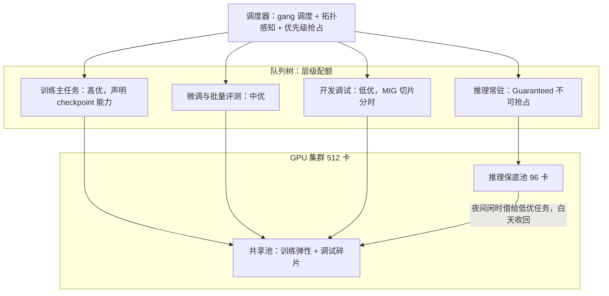

# GPU 算力调度平台

> 层级：① 推理与算力 ｜ 贯穿矛盾：成本

## 场景

训练、微调、推理、开发调试共用一个 GPU 集群，卡永远不够用，需要一个调度平台把稀缺算力分配出去。

## 核心矛盾

**资源利用率 vs 公平与确定性**——训练任务要长时间独占，推理服务要低延迟常驻，调试是碎片化突发；三种负载对「好」的定义互相冲突。

## 追问链

- 训练任务和推理服务混部，怎么保证互不干扰？什么情况下宁可分开建集群？
- 任务被抢占后训练进度怎么办？（提示：checkpoint 与断点续训的调度配合）
- 多租户配额怎么定？按卡时、按优先级还是按队列排队？
- 为什么 GPU 的「利用率」指标具有欺骗性——利用率高了为什么成本未必降了？

## 推演

### 容量估算（先问这几个数）

- **假设 1：集群与单价。**
  - 512 张 H800；单卡全成本假设 9 元/卡时（采购 25 万 ÷ 4 年 ÷ 8760h ≈ 7 元，加电力运维 2 元）。
  - 全集群年成本 ≈ 512 × 9 × 8760 ≈ 4000 万元。
  - **利用率每提升 15 个百分点 ≈ 每年多出 512 × 8760 × 0.15 ≈ 67 万卡时 ≈ 600 万元等效产出——这是调度平台存在的财务理由。**

- **假设 2：三类负载画像。**
  - 训练：2 个主力任务 × 128 卡 × 平均 2 周；推理：常驻 96 卡（规模推导见 [LLM推理服务平台](LLM推理服务平台.md)）；调试：200 次/天 × 平均 2 卡 × 0.5h = 200 卡时/天。
  - 需求合计 ≈ 256 + 96 + 8 ≈ 360 卡，账面上够用。
  - 但训练任务交接期（结束到下个任务排队启动，人力驱动是小时级）与调试集中在工作时间的峰谷错配，会让静态分区实测利用率只有 40%~50%（经验判断）。按 45% 计，空转成本 = 512 × 8760 × 55% ≈ 247 万卡时 × 9 元 ≈ 2200 万元/年。

- **假设 3：checkpoint 体量。**
  - 13B 全量微调的完整恢复点：fp16 权重 26GB + AdamW 状态（fp32 一阶/二阶矩 + 主权重，16B/参数）208GB ≈ 235GB。
  - 假设共享存储聚合带宽 100GB/s，纯写盘 2.4s；计入同步 barrier 与 fsync，实际一次 1~2 分钟。
  - 每 30 分钟存一次，开销占比 <5%，可接受；每 5 分钟一次就必须异步化，否则 checkpoint 本身成为拖慢训练的元凶。

- **假设 4：拓扑约束。**
  - 训练要求卡落在最小 RDMA 域内（如同一 spine 下 256 卡），跨域分配会让 allreduce 带宽减半、训练时长 ×1.5~2（经验判断）。
  - 推论：「集群还有 80 张空卡」不等于「能跑一个 128 卡任务」——调度必须拓扑感知，碎片卡对训练是伪供给。

- **结论：**
  - 卡永远不够是结构性的（峰谷错配 + 拓扑约束），不是加卡能解决的。
  - 调度平台的价值 = 消灭错配空转（600 万/年级别）− 自身运维成本；且拓扑约束决定了它必须懂训练负载，不是通用资源池。

### 架构推演（从朴素方案开始塌）

**朴素方案：静态分区 + 人工审批。** 训练组 384 卡、推理组 96 卡、调试组 32 卡，Excel 记录谁占着哪台机器。

- 塌点一：训练任务结束到下个任务启动之间整组空转，交接以小时计。
- 塌点二：调试需求排不上审批，用户开始私自从训练池「借」卡，账目崩坏。
- 塌点三：推理固定 96 卡，晚高峰不够、白天闲置。
- 算总账：512 卡 × 45% 利用率 = 230 张卡在产出，其余 282 张全年空转 = 512 × 8760 × 55% × 9 元 ≈ 2200 万元/年被空转吞掉（与假设 2 同一口径：利用率 45%、空转 55%）。

**演进一：统一队列 + gang scheduling（all-or-nothing）。**

- 128 卡的 PodGroup 必须原子分配：要么 128 张全给，要么一张不给。
- 这解决部分分配死锁——逐 pod 调度会把 64 张卡发给一个等另外 64 张的任务，卡被占着但任务不跑，别人也用不了。
- 新塌点：优先级未定义。「先来先服务」让 8 卡的调试任务排在 128 卡任务后面等一整天，碎片卡没人敢动；两个大任务互相等待，饥饿出现。

**演进二：优先级 + 抢占 + 层级配额。**

- 推理 = Guaranteed 不可抢占（延迟敏感，机制见上题）；训练 = 高优，可抢占调试；调试 = 最低优先级，用 MIG 把一张卡切成 4 份给 4 个调试用户。
- 配额用层级公平共享：部门配额保底，闲时借出、忙时收回。
- 新塌点：抢占把训练任务 kill 掉之后，如果没有 checkpoint，进度从零重算——两周训练一夜归零。按假设 2 的画像，128 卡 × 336h ≈ 4.3 万卡时 × 9 元 ≈ 39 万元一次——抢占从「回收资源」变成了「销毁资产」。

**演进三：抢占协议化 + 弹性伸缩。**

- 抢占不再是调度器的单方面动作，而是一条协议：任务提交时必须声明 checkpoint 频率与恢复能力，「可恢复」是进入可抢占区的门票。
- 驱逐流程 = SIGTERM → 宽限期内写 checkpoint → 回队列并优先恢复原拓扑位置。
- 弹性训练：任务运行中可缩容让卡、也可扩容捡漏，配合支持动态重组的训练框架。
- 拓扑感知装箱：RDMA 域内的卡组作为调度单元，而不是单卡。

**终态架构：**

- 终态的关键不是组件清单，而是三条不变式：推理池的确定性不可交易；抢占必须先过 checkpoint 协议；配额是层级树而不是平面配比。
- 调度平台本质上是在「训练要吞吐、推理要确定、调试要即来即用」三种契约之间做仲裁。
- 仲裁规则一旦含糊，用户就会绕过平台自行抢卡，平台名存实亡——所以规则要写进提交接口（声明式），不能靠文档里的君子协定。

### 关键决策论证

| # | 决策点 | 选项 A | 选项 B | 判据 | 结论 | 反转条件 |
|---|--------|--------|--------|------|------|----------|
| 1 | 混部还是分集群 | 同集群分池混部 | 训练/推理分开建 | 利用率差 vs 隔离需求 | **同集群分池（推理 Guaranteed + 训练弹性吃剩余）**。静态分区利用率 40%~50%，混部可到 60%+（经验判断），差值约 600 万/年 | 训练 allreduce 流量冲击推理网络路径、数据合规要求物理隔离、或训练规模大到需要独立拓扑 |
| 2 | 配额模型 | 按卡时预算 | 按优先级 / 按队列 | 抢占序、公平性、碎片处理各有缺口 | **三件套组合**：硬配额保底（确定性）+ 层级公平共享（默认分配）+ 优先级（只定抢占顺序）。任何单一维度都塌，见下方论证展开 | 单团队自用、负载单一的小集群（几十卡以内）：没有多方博弈，三件套退化为单一队列 + 简单优先级，硬配额与层级共享都是过度设计（与决策 4 的反转条件同一场景） |
| 3 | 抢占粒度 | 直接 kill + 重跑 | checkpoint 驱动驱逐 / 弹性缩容 | 框架是否声明可恢复能力 | **有 elastic 能力用缩容（无损让卡），有 checkpoint 用驱逐（分钟级损失），两者都没有的任务禁入可抢占区**。kill 一个未存 checkpoint 的 128 卡两周任务 ≈ 39 万元/次的销毁（336h × 128 卡 × 9 元） | 任务短到重跑成本低于 checkpoint 开销（如调试任务），直接 kill 反而干净 |
| 4 | 调度器选型 | K8s 原生 + 队列 | Volcano/Yunikorn 类批调度（或 Slurm） | 是否有训练负载 | **有训练就上批调度器**。kube-scheduler 逐 pod 分配，没有 gang 语义，天然不适配 128 卡原子任务；Volcano 的 PodGroup + 队列 + 抢占是训练刚需 | 只跑推理服务（不跑训练）时，kube-scheduler + 合理的 requests/limits 够用 |

论证展开：

- 决策 2 的三个单一方案失效模式：纯卡时预算——用户囤卡不释放，抢占无序，调度器没有裁决依据；纯优先级——大团队的低优任务永远压过小团队的高优任务，公平性崩坏，小团队用脚投票；纯排队——128 卡任务排在一个碎片化窗口前永远轮不到，高优推理流量一来还得插队。三者失效域互补，所以只能组合。
- 决策 4 的补充：纯 HPC 背景、以 Slurm 为主的团队不必强迁 K8s——调度器的价值在 gang 与抢占语义，不在框架名头；选型的真实判据是存量运维体系与团队技能。
- 决策 1 的隐含前提：推理池「借出」必须可秒级收回。借出协议若做不到随时收回，Guaranteed 就名存实亡，宁可少借。

### 追问应答

1. **训练和推理混部怎么互不干扰？什么情况宁可分开建集群？**
   - 三层隔离：资源层，推理 Guaranteed 独占保底池、不可抢占，训练只允许进共享池；网络层，训练 allreduce 大流量与推理的存储/请求流量打不同优先级队列，避免互相打满交换机；故障层，坏卡隔离标记，推理实例自动剔除重拉。
   - 宁可分开建集群的信号：训练规模大到需要独立 fat-tree 拓扑、训练与推理合规等级不同（数据物理隔离）、或两边负载都小到混部运维复杂度超过利用率收益。
   - 判断顺序：先算利用率差值多少钱（假设 1 的算式），再算隔离改造成本，数字说话。
2. **任务被抢占后训练进度怎么办？**
   - 机制是「checkpoint 协议 + 调度配合」：提交时声明 checkpoint 频率与恢复能力作为可抢占资格；驱逐时给宽限期写完 checkpoint 再走；恢复时优先回到原拓扑位置（避免跨域重组）。
   - 按假设 3 的账：30 分钟频率下故障平均损失 15 分钟 × 128 卡 ≈ 32 卡时，占 2 周任务不到 0.1%。
   - 损失可控的前提是 checkpoint 开销已异步化，否则频率加不上去，协议就是空话——存储带宽是这套协议的物理下限。
3. **多租户配额怎么定？**
   - 三件套：硬配额（Guaranteed，买了就一定有，用于推理和核心训练）+ 层级公平共享（部门树，闲时借出忙时收回，解决「平均分谁都用不满」的碎片问题）+ 优先级（只决定抢占顺序，不决定日常分配）。
   - 按卡时单独计费适合做成本核算与回收，但不适合做分配机制——分配看「此刻谁的边际产出高」，计费看「月底谁花了多少」，两套账不能混。
   - 判据：任何配额方案先推演「大团队压小团队」和「囤卡不还」两种博弈，推不动再加约束。
4. **为什么 GPU「利用率」指标有欺骗性？**
   - nvidia-smi 的 util 统计「采样周期内有 kernel 执行」的时间占比，无法区分「kernel 在做有效计算」和「kernel 在等显存数据」。
   - decode 型推理 util 90%+ 但单请求产出极低；更显性的作弊是跑一个死循环 kernel 让 util 恒为 100%。
   - 正确的考核链是：分配率（卡是否被任务占着）× 有效产出（goodput：每 GPU 小时的有效 token/样本数）。util 高而 goodput 不动，成本一分没降——这就是欺骗性的机制。

### 常见误区

1. **「K8s 原生调度器加个队列就够了」。**
   - kube-scheduler 逐 pod 分配，128 卡任务可能拿到 64 张卡后死锁：占着卡等剩余 64 张，别人也用不了这 64 张。
   - 没有 gang 语义的调度器在训练场景必然制造这种「占而不做」的死锁，必须换 PodGroup 式批调度。
2. **「利用率考核就用 SM util」。**
   - 见追问 4 的机制：指标会被游戏化（空转 kernel 刷满 util），成本纹丝不动。
   - 考核什么就得到什么——考核 util 得到的是 util，不是钱；考核 goodput 才是考核产出。
3. **「抢占就是 kill 掉重跑」。**
   - 对未声明 checkpoint 能力的任务执行驱逐，等于一次销毁两周进度：4.3 万卡时（128 卡 × 336h），按 9 元/卡时 ≈ 39 万元。
   - 发生两三次，训练团队就不再信任平台，回归手工占卡。抢占必须与 checkpoint 协议绑定为一条流程，而不是调度器的一个开关。
4. **「公平就是按人数平均分卡」。**
   - 50 人团队人均 10 卡，但一个实验需要 8 卡的连续拓扑域：平均分配后谁都凑不齐 8 张对的卡，谁也跑不了像样的实验。
   - 公平的工程含义是层级配额下的容量份额 + 弹性借用，不是静态切分——静态切分同时制造了浪费和匮乏。

---

[返回 AI 场景题地图](README.md)
