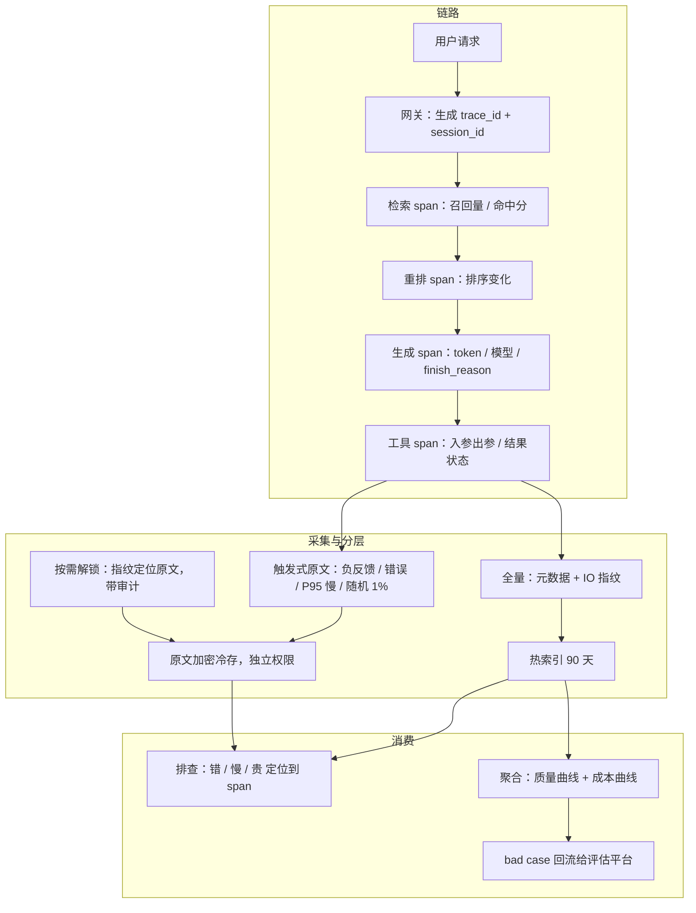

# LLM 可观测与 Tracing

> 层级：贯穿 · 质量与评估 ｜ 贯穿矛盾：质量 · 成本 · 安全

## 场景

一个 LLM 应用的链路很长：检索 → 重排 → 生成 → 工具调用。效果差、慢、贵的时候，都要能定位到具体环节——这是 AI 版的 APM。

## 核心矛盾

**全链路采集的信息量 vs 成本与隐私**——记录越全越好排查，但完整 prompt 全落库，存储成本和敏感数据风险都极大。

## 追问链

- trace 的根以什么为单位：单次请求还是整个会话？多轮、多 Agent 的嵌套怎么建模？
- 每次调用的完整 prompt 落库，存储成本和合规问题怎么办？脱敏到什么粒度？
- 「效果差」的可观测信号是什么？它不像错误率那么直接——你准备看什么曲线？
- 采样采集省成本，但坏 case 往往是长尾——怎么保证出事的那条请求恰好被记下来了？

## 推演

先校准类比。「AI 版 APM」一半成立：span 树、trace id、P95 这些骨架照搬。另一半必须重造：传统 APM 的排查对象是「错误」和「慢」，两者都有硬信号（状态码、耗时）；LLM 应用多了一个排查对象「差」——输出语义不合格但没有任何异常，HTTP 200、回复通顺、用户点踩。所以可观测系统要同时回答四个问题：**错没错**（传统）、**慢在哪**（传统）、**贵在哪**（新增，token 维度）、**差在哪**（新增，质量维度）。而核心矛盾宣告：不可能把回答四个问题所需的全部信息都全量落库。整道题的推演就是在这条约束下，决定「什么全量、什么升级、什么永远不采」。

### 容量估算（先问这几个数）

- **假设 1（流量与 span 数）：** 日请求 500 万，平均链路 6 个 span（网关、路由、检索、重排、生成、工具/后处理）→ 3000 万 span/天。
- **假设 2（span 体积）：** 基础元数据（trace/span id、时间戳、耗时、状态、token 数、模型名、finish_reason、成本估算）约 1KB/span；完整 IO（prompt + 输出原文）平均 8KB/span。
- **结论一（存储量级）：** 全量元数据 30GB/天；全量原文 240GB/天，年化约 88TB。「存不下」本身是伪命题——冷存不贵。真正贵的是把原文塞进热检索系统：ES 类系统对长文本有 2-3 倍索引膨胀，且热存单价高一个量级。对比：全量原文进热索引保留 90 天 ≈ 240GB × 90 天 × 2.5 膨胀 ≈ 54TB 热数据，按 $0.1/GB·月约 $5,400/月；分层方案（元数据全量热索引 + 原文触发式冷存，触发面约 5%）热数据只有约 6.75TB，约 $675/月。**成本差约 8 倍，而可排查能力几乎不损失**——这是后面整个分层架构的经济账。
- **结论二（敏感面才是全量落库的真正否决理由）：** 假设 5% 的请求含 PII 或商业敏感内容 → 全量落库意味着每天 25 万条敏感记录进入一个「有权限即可全文搜索」的系统；日志类系统的权限模型是粗粒度的，一次权限配置事故的泄漏面就是全量历史（与 [企业数据防泄漏](企业数据防泄漏.md) 的边界呼应）。所以问题的正确形式不是「能不能全量存」，是「默认不全量、按需升级、原文加密分存」。
- **假设 3（查询负载）：** 排查是低频深查询——日活工程师 50 人 × 每天 20 次 trace 查询 = 1000 次/天，每次命中 1-100 条 trace。结论三：读负载极低，写入吞吐才是设计点。存储架构应为「写多读少 + 偶发深挖」优化：热索引只放元数据，原文走冷存按需取。
- **假设 4（写入吞吐）：** 3000 万 span/天 ≈ 均值 350 span/s，发布日按 10 倍突发算 → 峰值 3500 span/s。采集管道按 5k span/s 设计，Kafka 类缓冲 + 批处理即可，吞吐不是难点；难点在热索引写入放大——元数据进 ES 的实际写入是 2-3 倍，这才是容量规划的主战场，也是分层策略省钱的另一半来源。

### 架构推演（从朴素方案开始塌）

**v0：没有可观测。** 靠用户截图和客服反馈，靠猜。所有 LLM 团队都从这里起步；问题暴露极快——第一次供应商超时事故（假设影响 20% 请求）要 4 小时才定位，因为连「哪个环节失败」都要靠人肉复现。

**v1 朴素方案：完整 prompt 全打日志（ELK）。** 最直觉的方案：每次调用把 prompt 和输出完整打进日志系统，出事就搜。

它在三个地方依次塌：

1. **先塌在成本结构。** 240GB/天原文进热索引，2-3 倍膨胀，日志集群成本翻数倍；SRE 的应对是把保留期砍到 3 天——排查窗口没了，等于没有可观测。机制：日志系统为全文检索优化，而 trace 原文约 95% 从不被检索——为 5% 的偶发查询让 100% 的数据走热索引，成本结构从根上倒挂。
2. **再塌在隐私与删除权。** 用户把身份证号、内部代码、合同片段贴进 prompt，全量落库后任何有日志读权限的人（通常远超业务方想象的范围）可全文搜索；合规审计直接不过。更深一层：日志系统的删除是弱承诺——副本、索引分词、备份都留痕，用户行使删除权时做不到（对应追问 2）。
3. **然后塌在不可关联。** 检索、生成、工具各自打日志，没有统一 trace id 串成树；「检索慢还是生成慢」——这是效果差时第一个要问的问题——答不出来，排查靠跨服务人肉对时间戳。
4. **还塌在不可聚合。** 纯文本日志没法按「模型版本 × 应用 × 问题桶」group by 出成本与质量曲线——「这版生成成本比上版高多少」要人肉抽样估。「贵在哪」的归因永远停留在个案，上升不到趋势；而成本治理（见 [Token成本治理](Token成本治理.md)）恰恰是靠趋势驱动的。

**演进到终态，每一步修复一个塌点：**

**v2 结构化 tracing：LLM 语义的一等公民。** OpenTelemetry 式 span 树：trace 根 = 一次用户请求（网关生成 trace_id，session_id 作为跨请求的父维度）。LLM 调用 span 带 LLM 专属字段：模型名/版本、prompt token 数、completion token 数、finish_reason（length 截断？工具调用？）、成本估算、重试次数；检索 span 带召回量与命中分；工具 span 带入参出参与结果状态。「慢、贵、差」三个问题分别消费这些字段——缺了 token 数与 finish_reason，「贵在哪」「差在哪」根本无从归因。

span 模型之外还要定「span 间协议」：跨服务传递用标准 trace 头（如 W3C traceparent），Agent 框架与自研服务统一挂到同一个 tracer 上。可观测性最贵的故障不是丢数据，是一半链路用 A 体系的 id、另一半用 B 体系的 id，树接不起来——这恰恰是 v0→v1 最常见的死法，协议要在一开始就统一。

**v3 分层存储 + 按需升级。** 三层数据策略：第一层，元数据 + IO 指纹（原文 hash、长度、首 200 字符摘要）全量，热索引保留 90 天，足以回答错/慢/贵的归因；第二层，原文触发式采集——负反馈请求 100%、错误与超时 100%、P95 慢请求 100%、随机 1%——加密落冷存，独立密钥与权限，保留 30 天；第三层，按需解锁：任何一条 trace 凭指纹发起原文查询，有权限者显式解锁并留审计日志。随机 1% 那份有独立职责：发现「没人举报但有问题」的静默劣化，并校准触发器本身有没有漏（详见追问 4）。

解锁流程要有三个属性：有理由（申请时必须填排查单号）、有期限（解锁有效期 24 小时，到期收回）、有审计（谁在何时解锁了哪条原文，季度复核）。权限模型上，解锁权限必须窄于查询权限——绝大多数排查止步于元数据层，能碰原文的应该是少数人、少数场景。

**v4 质量信号层。** 在 tracing 数据之上聚合质量曲线：按应用/模型版本/会话桶的负反馈率、复问率、转人工率、检索命中率、抽样裁判分。「差」从此是一条曲线而不是一次投诉——与 [LLM效果评估与回归平台](LLM效果评估与回归平台.md) 共享裁判与真值集，但分工不同：那边服务发布前回归，这边服务线上监控；线上抓到的坏 trace 按指纹回流，成为评估平台的 bad case 来源。

收拢一句：v2 修「结构」，v3 修「分层」，v4 修「质量维度」——三个修复合起来回答核心矛盾：信息量与成本/隐私的平衡点不在于「采多少」，在于把**排查所需的最小充分信息**做成默认（元数据 + 指纹），把**原文**做成需要理由、有代价、留痕迹的升级。这样信息量没有少，只是把它放到了正确的层。

### 关键决策论证

**决策 1：trace 根单位——单请求 vs 会话。**

选项 A：trace = 单次请求，会话是查询维度；选项 B：trace = 整个会话。**结论：trace = 单次请求。** 机制：延迟与错误的因果分析天然发生在单请求内——「这次慢是检索慢」在单请求树里一眼可判；会话粒度会把多轮请求的耗时混进一棵树，P95 直接失真。而会话级诉求（多轮上下文、复问行为）用 session_id 贯穿 + 聚合查询实现，不需要改变树结构。反转条件：多 Agent 长任务——一次「任务」由几十次请求组成、中间共享状态，此时在会话之上再加「任务级」聚合视图，而不是把 trace 根改成任务。

**决策 2：原文采集——全量 vs 元数据全量 + 触发式升级。**

**结论：元数据 + IO 指纹全量，原文触发式采集。** 判据不是存储成本（容量估算已算清冷存不贵），是敏感面与信噪比：95% 的原文无人回看，却 100% 承担隐私风险；触发式采集用约 5% 的采集面承担了几乎全部排查需求。

| 触发条件 | 采集比例 | 职责 |
| --- | --- | --- |
| 用户负反馈 | 100% | 排查个案的现场保全 |
| 错误 / 超时 | 100% | 故障定位 |
| P95 慢请求 | 100% | 性能长尾归因 |
| 随机抽样 | 1% | 静默劣化发现 + 触发器自校准 |

反转条件有两个：冷启动调试期（新应用上线前两周临时全量，稳定后降档）；强留痕监管行业（金融对话记录是合规要求）——此时全量，但走加密归档而非热索引，把「必须存」和「可被随便搜」拆开。

**决策 3：自建 vs 采购——Langfuse/LangSmith 类产品 vs 自研平台。**

**结论：开源自托管产品起步（Langfuse 类），自建推迟到三个触发条件之一。** 理由：tracing 的数据模型已经收敛（OTel GenAI 语义约定 + 主流产品高度同质），自建在这一层的边际价值低；而「跑起来」的速度决定团队多快获得排查能力，这是冷启动期最值钱的东西。三个自建触发条件：规模到产品架构上限（日 span 十亿级）、存储策略有强定制需求（原文分存、区域驻留）、需要与内部权限审计体系深度耦合。对「我们链路特殊所以产品套不上」的回应：特殊链路用自定义 span 属性表达，不改树结构——这句话通常是没做语义映射的借口。

**决策 4：脱敏位置——入库后清洗 vs 入库前。**

**结论：入库前。** 机制：入库后再脱敏兑现不了删除权与最小化原则——热索引的分词、副本、备份在清洗前已经留痕，事后清洗是新增一次写入，不是旧数据消失。正确做法：原文在采集端先过脱敏器（正则 + NER 双层），脱敏后的文本进热索引；触发式采集的未脱敏原文直接加密进独立存储，密钥权限与查询权限分离。「脱敏到什么粒度」由此推出（见追问 2）：粒度不是固定参数，是权限分层的结果——可广泛搜索的层脱到「类型占位符」，不可搜索的层保留原文但靠解锁审计控制。

**决策 5：质量信号——全量 LLM 裁判打分 vs 用户反馈 + 抽样裁判。**

全量裁判 = 每条请求多一次同量级 LLM 调用，推理成本接近翻倍，换来连续质量曲线；用户反馈免费但稀疏（点踩率 2% 量级）且有偏（不满的人更爱点，且点踩率受话术承诺影响）。**结论：用户反馈为主信号，裁判 1-5% 抽样，职责是校准反馈偏差、给无反馈流量兜底。** 判据是成本结构：日请求 500 万量级下，全量裁判等于把推理账单 ×2 买一条曲线，不成立。反转条件：单应用请求量极小（内部工具，日千级）→ 全量裁判成本可忽略，直接全量打分，还能顺便积累裁判校准的真值。

抽样裁判的抽样框要分层——按问题桶分层抽样（每桶抽够量）而不是全局随机：全局随机下小桶（如「拒答类」）样本量不足以支撑曲线，裁判分在小桶上噪声大到不可用，而这恰恰是最需要质量信号的桶。

### 追问应答

**1. trace 的根以什么为单位：单次请求还是整个会话？多轮、多 Agent 的嵌套怎么建模？**

trace 根 = 单次请求；会话与任务是树之上的聚合维度。三层建模：session_id 贯穿多轮请求（每轮一个 trace）；Agent 嵌套用 span 树表达——主 Agent 的每次 LLM 调用、每次子 Agent 委派都是 span，子 Agent 内部调用挂在其委派 span 之下，天然成树。一个必须警惕的建模错误：把 Agent 的「思考-行动循环」压成一个 span——循环里的多次工具调用与多次生成必须各自成 span，否则「贵在哪、哪步出错」无从归因。会话视角做成查询能力而不是树结构，是这道题里最容易被追问逼出来的取舍。

**2. 每次调用的完整 prompt 落库，存储成本和合规问题怎么办？脱敏到什么粒度？**

拆成两个问题。成本：冷存原文本身不贵（容量估算：年化千到万美元量级），贵的是原文进热检索系统（2-3 倍索引膨胀）——结论是原文不进热索引。合规：全量原文落库把泄漏面扩大到全库历史，且日志删除是弱承诺、无法兑现删除权——结论是默认不采、触发式采、原文加密分存、密钥权限与查询权限分离。脱敏粒度是双层而非一个数：热索引层按「可被广泛搜索」的标准脱敏，PII 全部替换为类型占位符（正则 + NER）；加密原文层不脱敏但不可搜索，访问走显式解锁 + 审计。粒度差异的本质是权限差异。

**3. 「效果差」的可观测信号是什么？它不像错误率那么直接——你准备看什么曲线？**

按「显式反馈 → 行为代理 → 抽样评估」三层组织曲线。显式反馈：点踩率、负反馈量，按版本切。行为代理（更密、更快、但间接）：复问率（同会话用户换措辞重问——对答案不满最强的行为信号）、会话中途放弃率、转人工率、输出修正率（用户手动改了模型输出）。抽样评估：1-5% 流量的裁判分曲线 + 检索质量代理（命中率、rerank 分数分布）。三层交叉才敢下结论：复问率升 + 裁判分平 → 可能是话术/产品问题而非模型问题；两者同升 → 模型确实退了，再按 trace 分桶定位是检索环节还是生成环节。铁律：所有曲线按模型版本与应用分桶，全局平均会同时稀释版本回退与流量漂移两个信号。

**4. 采样采集省成本，但坏 case 往往是长尾——怎么保证出事的那条请求恰好被记下来了？**

承认「恰好」无法靠概率保证，把「出事」从采样幸运者变成采集触发器：负反馈到达时按 trace_id 回溯判定该请求原文是否已被采集（指纹层全量，这正是指纹层存在的意义）；错误与超时必采；P95 慢必采；其余 1% 随机。再补两道兜底：时间窗回放——事故时把窗口内全部 trace 元数据捞出，对可疑 trace 发起原文解锁，即使原文未采，元数据也足以定位到环节；触发器自校准——定期对比「随机 1% 中人工判定的坏 case 比例」与「触发器捕获的比例」，触发器漏检率高就补触发条件。一句话：均匀采样服务统计，事件触发服务排查，两者是双通道不是二选一。

### 常见误区

**误区 1：「在现有 APM 上加一个 LLM span 类型就算做完了」。** 长成的样子：trace 树里有 llm-call 这个 span，带耗时和状态码，但没有 token 数、模型版本、finish_reason、成本。不行的机制：「慢」「贵」「差」各有专属原料——贵要 token 数与单价，差要 finish_reason（length 截断造成的「看起来效果差」与模型能力差是两种修法）与质量信号。缺了这些字段，trace 树只是一份慢查询日志，回答不了 LLM 应用最常问的两个问题。

**误区 2：「按 1% 均匀采样，有代表性就够了」。** 长成的样子：采样策略一个数字 p=0.01，排查时发现出事的那条请求恰好没被采到——1% 的含义本来就是 99% 不采。不行的机制：排查对象的分布（错误、慢、坏 case）恰恰是被均匀采样系统性丢弃的长尾；采样若为了「统计代表性」，1% 足够，若为了「排查个案」，均匀采样几乎必然错过要查的那条。正确结构是概率采样 + 事件触发必采的双通道（决策 2 与追问 4 的合并结论）。

**误区 3：「效果大盘看平均分和平均延迟」。** 长成的样子：一条平均质量分、一条平均延迟，都是绿的，直到有用户在投诉区炸锅。不行的机制：LLM 流量是重尾分布——平均延迟被多数正常请求稀释，P99 恶化 3 倍时平均可能只动 10%；质量同理，某版本在「代码类问题」桶上崩了，全局平均可以纹丝不动。必须看分位数（P95/P99）+ 按桶分解，任何一桶恶化都算信号。

**误区 4：「脱敏 = 正则匹配身份证号和手机号」。** 长成的样子：清洗层挂一串正则，审计时被发现库里有用户贴入的合同文本、内部代码、他人聊天记录——全都不匹配任何正则。不行的机制：语义级敏感内容没有稳定的词法特征，正则 + NER 只覆盖结构化 PII 这一层；指望「穷举什么算敏感」的路线注定失败，因为敏感性的本质是上下文而非词形。真正的防线是「默认不可见」：原文不进可广泛搜索的系统，访问走显式授权——脱敏是纵深防御的一层，不是唯一的层。

---

[返回 AI 场景题地图](README.md)
