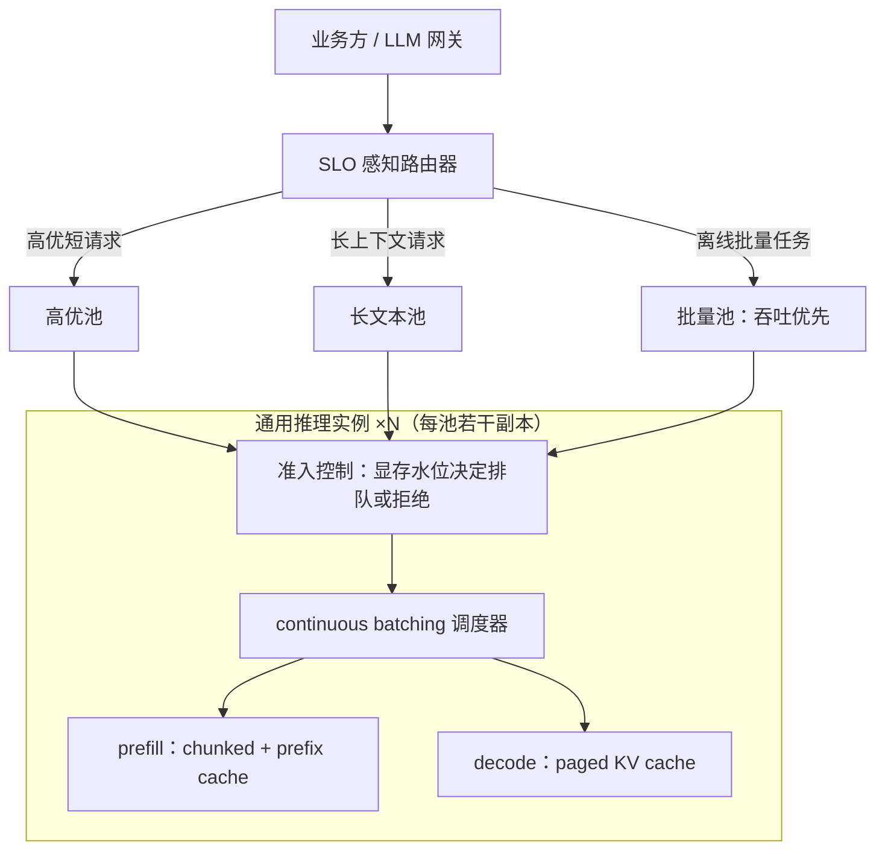

# LLM 推理服务平台

> 层级：① 推理与算力 ｜ 贯穿矛盾：成本 · 延迟

## 场景

公司自部署开源模型与微调模型，对内对外提供稳定、低延迟的推理服务，而 GPU 成本高昂、供给紧张。

## 核心矛盾

**GPU 利用率 vs 延迟与吞吐**——批越大越省卡，但排队延迟越高；这是一道持续调平衡的运营题，没有一次性答案。

## 追问链

- continuous batching 和静态 batching 的本质区别是什么，为什么它成了标配？
- 长上下文请求为什么会拖垮整个实例？（提示：KV cache 显存占用）
- 首 token 延迟（TTFT）和每 token 延迟（TPOT）分别由什么决定，优化手段有何不同？
- 为什么这类系统高并发下 P99 延迟远比均值难看？长尾从哪来？

## 推演

### 容量估算（先问这几个数）

- **假设 1：流量。**
  - 日均 2000 万次请求，峰均比 3。
  - 均值 QPS = 2×10^7 / 86400 ≈ 230；峰值 ≈ 700 QPS。

- **假设 2：请求形态。**
  - 平均输入 1000 token、平均输出 200 token。
  - 峰值输出吞吐 = 700 × 200 = 14 万 token/s；峰值输入吞吐 = 70 万 token/s。
  - 两个数差 3.5 倍：输入侧是算力问题，输出侧是显存带宽问题。这条不对称是后面所有架构决定的地基。

- **假设 3：单卡产出。**
  - 7B 模型 fp16，H800。decode 每步要读全部 14GB 权重；显存带宽 ≈ 3.35TB/s，取有效带宽 60%，单步 ≈ 7ms，batch=1 时单序列输出 ≈ 140 token/s。
  - 批处理让 N 条请求分摊一次权重读取，吞吐近似线性放大，直到 KV cache 读取占比上升为止。
  - 经验判断：7B 在 H800 上良好 batching 后单卡产出 2000~4000 token/s，取 3000 算账。

- **结论一：卡数。**
  - 需要卡数 = 14万 / 3000 ≈ 47 张，加 1.3 倍冗余与滚动升级余量 ≈ 60 张。
  - 一套中型 7B 自部署服务的量级起点是几十张卡，不是几台机器；后续所有容量讨论都以此为锚。

- **假设 4：KV cache 显存。**
  - 7B（32 层 × 32 头 × 128 维，fp16，无 GQA）每 token KV = 2×32×32×128×2B = 0.5MB；4K 上下文单请求 2GB。
  - 开 GQA（8 个 KV 头）后 0.125MB/token，4K 请求 0.5GB。
  - 80GB 显存扣掉 14GB 权重剩 66GB：MHA 只能同驻 33 条 4K 请求，GQA 能驻 130 条。GQA 在这里不是「优化项」，是并发准入的条件。

- **假设 5：prefill 算力。**
  - 单请求 prefill FLOPs ≈ 2 × 参数量 × token 数 = 2×7×10^9×1000 = 1.4×10^13。
  - H800 bf16 峰值约 990 TFLOPS，取 MFU 50%，单请求 prefill ≈ 28ms。
  - 线性外推：8K 输入 ≈ 0.23s，32K 输入 ≈ 0.9s。prefill 时长随输入线性涨，长输入开始挤压同实例所有 decode，这是引入 prefix caching 和 PD 分离的直接算力依据。

- **结论二：成本基准。**
  - H800 全成本假设 9 元/卡时（折旧 + 电力 + 机房），60 卡月成本 ≈ 39 万元。
  - 月输出 token = 均值 230 QPS × 200 × 2.6×10^6 s ≈ 1.2×10^11，折合每百万输出 token ≈ 3 元。
  - 这个数是判断「自部署 vs 调 API」的锚点，也是给每项优化定价的锚点：任何优化先换算成钱再排优先级。

### 架构推演（从朴素方案开始塌）

**朴素方案：FastAPI 包一层 transformers，单请求独占推理，一卡一进程。**

- 塌在哪：decode 每步只搬运 14GB 权重加 0.5MB KV，SM 大部分时间在等显存数据返回，batch=1 的算力利用率是个位数百分比。
- 按假设 3 的账：一张卡 batch=1 只产出 140 token/s，批处理后 3000+，相差 20 倍。
- 60 张卡按朴素方案跑，等效产出约 3 张卡。**第一个塌的不是延迟，是成本：95% 的现金在空转。**
- 且此时显存被单请求独占，显存利用率同样低——算力和显存两头都亏。

**演进一：静态 batching。** 凑满 32 条一起 decode，权重读取被 32 条分摊，吞吐上来了。

- 新塌点：批内所有请求被绑死到最长序列结束。LLM 输出长度方差极大（几十到几千 token），一条 3000 token 的输出拖着 31 条已完成的请求空转。
- 短请求还要先「凑批」等队友，TTFT 被抬高。
- 塌在延迟长尾：批完成时间由最长请求决定。假设输出均匀分布在 1~2000 token、批 32 条，批时长期望接近 1500 步而单请求均值只有 1000 步——批处理在这套负载下天然放大方差，P99 比 batch=1 还难看。

**演进二：continuous batching + paged KV cache。**

- 调度粒度从「批」降到「迭代」：每个 decode 步（毫秒级）都是决策点，完成的请求立刻退出、新请求随时插入，批内空转消失。
- KV cache 按页分配，消除显存的内部碎片与外部碎片，准入数从「按最大长度预留」变成「按实际用量」，同卡并发数立刻翻倍。
- 单卡产出回到假设 3 的 3000 token/s 量级，60 张卡的账成立。

**演进三：SLO 感知的池化与调度。**

- prefill（算力受限）与 decode（带宽受限）互相干扰：一条 8K 输入的 prefill 独占 GPU 约 0.23s，同实例所有在途 decode 集体停摆，TPOT 出现 200ms 级尖刺。
- chunked prefill：把长 prefill 切成小块穿插进 decode 步，尖刺摊平。
- prefix caching：系统 prompt、few-shot 前缀只算一次，多请求复用 KV，TTFT 与算力同时受益。
- admission control：显存水位决定准入，宁可排队也不挤压在途请求——队列是可预期的延迟，挤压是不可预期的尾延迟。
- 池间隔离：高优短请求、长上下文、离线批量分池，互不为队友买单，池间用 SLO 而不是公平来定义资源归属。

**终态架构：**

- 架构图中没有「做完即弃」的组件：路由器、准入控制、调度器都是持续调参的运营面。
- 批大小、显存水位、分池边界随流量分布漂移而漂移——这正是核心矛盾说「没有一次性答案」的工程含义：答案是一套运营机制，不是一张定稿架构图。
- 接入侧的限流、计费、多模型语义见 [LLM 网关](LLM网关.md)，本层只对卡内效率负责，边界在「请求进入实例」处。

### 关键决策论证

| # | 决策点 | 选项 A | 选项 B | 判据 | 结论 | 反转条件 |
|---|--------|--------|--------|------|------|----------|
| 1 | 推理引擎 | 基于 vLLM/SGLang 二开 | 自研引擎 | 团队规模、硬件适配、迭代速度 | **开源引擎 + 只在调度/准入层插件化自研**。paged KV、投机解码、量化 kernel 是多年打磨的细节，中小团队自研要 1~2 年且持续落后，把自研力气花在调度器和路由上 | 国产卡等引擎未适配的硬件，或结构非常规的自研模型 |
| 2 | prefill/decode 合还是分 | chunked prefill 合部署 | PD 分离双池 | 集群规模、上下文分布、卡间带宽 | **中小规模（<100 卡、上下文以 8K 以内为主）合部署**。分离要把 KV 跨实例传输：4K MHA 请求 2GB，RDMA 100GB/s 也要 20ms，规模不够时传输成本吃掉收益 | 长输入占比高（>20%），或集群大到 KV 传输可被拓扑优化吸收 |
| 3 | 量化策略 | fp16 | W8A8 / W4A16 | 每百万 token 成本 vs 评测掉点 | **W8A8 进生产默认，W4A16 只给批量池**。decode 访存受限（假设 3 的机制），权重减半吞吐近似翻倍，成本弹性远大于质量风险 | 金标评测掉点 >1pp 或线上质量投诉上升，回退 fp16 |
| 4 | 实例粒度 | 超大实例（几十卡一个） | 多副本小实例（8 卡以内） | 批效率 vs 故障半径与迭代速度 | **多副本小实例**。大实例批效率略高，但一次 HBM 故障或 OOM 波及全部在途请求，滚动升级窗口也长 | 模型大到单副本放不下，被迫大实例并追加更强容错投入 |

论证展开：

- 决策 2 的本质是「传输成本 vs 干扰成本」：合部署的干扰成本（prefill 冻结 decode）可用 chunked prefill 压到很低，而分离的 KV 传输成本是硬下限，所以小规模永远先合。
- 决策 3 的算式：W8A8 把权重从 14GB 降到 7GB，decode 单步读取减半 → 单步 ≈ 3.5ms → 吞吐近似翻倍；这是访存受限负载特有的「权重减半、吞吐翻倍」的线性红利。
- 决策 4 的本质是「批效率的边际收益 vs 故障半径的边际风险」：批效率在小实例间只差百分之十几（经验判断），而故障半径是线性放大的，期望损失算下来小实例赢。

### 追问应答

1. **continuous batching 和静态 batching 的本质区别是什么，为什么它成了标配？**
   - 区别在调度粒度：静态 batching 以「批」为原子单位，批内请求共生死；continuous batching 把每个 decode 迭代当调度点，完成即退、即到即入。
   - 成为标配的机制原因：LLM 输出长度方差大，静态批的空转比例 ≈ 1 − 批内平均长度/最长长度，分布越散越难看；而 decode 单步只有几毫秒，步级调度的检查开销可忽略。
   - 收益巨大、代价趋零，所以没有理由不用——这也是为什么所有主流引擎（vLLM/SGLang）都把它作为默认调度器，而非可选开关。
2. **长上下文请求为什么会拖垮整个实例？**
   - 两个机制叠加。其一显存挤兑：按假设 4，4K MHA 请求占 2GB KV，一条 32K 请求就是 16GB，等于几十条普通请求的准入额度被一人吃光，其他请求排队甚至无法准入。
   - 其二计算阻塞：8K 输入 prefill ≈ 0.23s，期间同实例全部 decode 停摆。
   - 前者压吞吐，后者抬所有人的 TPOT，合起来就是「一条请求拖垮一个实例」的完整路径——所以长上下文必须分池或限准入，不能靠「调度器聪明点」解决。
3. **TTFT 和 TPOT 分别由什么决定，优化手段有何不同？**
   - TTFT = 排队时间 + prefill 时间，主体是算力问题：优化靠 chunked prefill（不让长输入独占）、prefix caching（少算重复前缀）、准入控制（压排队）。
   - TPOT = 单步 decode 时间，主体是带宽问题：优化靠批处理分摊权重读取、权重量化、GQA 减 KV 读取、投机解码。
   - 一句话：TTFT 优化算力供给，TPOT 优化显存带宽；混在一起谈「延迟优化」就会开错药——给 TTFT 加卡和给 TPOT 降精度是两个不同的工程动作。
4. **为什么高并发下 P99 远比均值难看？长尾从哪来？**
   - 长尾三源：输出长度长尾让服务时长方差巨大，且批内最长者决定批完成时间；长 prefill 请求周期性冻结全实例 decode，制造 TPOT 尖刺；显存水位逼近上限时调度器开始抢占与换页，被抢占的请求重排。
   - 这三条在均值里互相抵消看不出来，在 P99 里全部叠乘。
   - 所以 SLO 必须按分位数定义（TTFT P99 与 TPOT P99 分开定），容量规划也按分位数流量而非均值——均值达标的系统 P99 崩掉，用户感知到的就是「这个 AI 忽快忽慢」。

### 常见误区

1. **「nvidia-smi 利用率 100% 就是不浪费」。**
   - util 只回答「采样瞬间有没有 kernel 在跑」；decode 型负载的 kernel 一直在跑，SM 在等显存数据，util 显示 90%+ 而实际算力利用率个位数。
   - 用它考核会得出「无需优化」的错误结论。正确度量是每百万 token 成本与 MFU，不是 util。
2. **「显存不够就把 KV cache 换出到 CPU 内存」。**
   - 换入一条 4K 请求的 2GB KV 走 PCIe（≈32GB/s）要 60ms+，直接打爆 50ms 量级的 TPOT 目标。
   - 机制：换出换来的是「多驻留几条请求」，付出的是「换入的硬延迟」，后者不可摊销。宁可 admission control 排队，也不要换入换出。
3. **「把 max_batch_size 调大就能省钱」。**
   - 批大到 KV 池放不下，调度器只能让请求排队或抢占在途请求，TTFT 与 P99 崩掉，省下的卡钱以体验事故的形式还回去。
   - 吞吐和延迟必须合成一个指标：SLO 约束下的 goodput（满足延迟目标的有效吞吐）。脱离 SLO 单谈吞吐是伪优化。
4. **「先上线，延迟后面再优化」。**
   - 这套系统的关键参数（批大小、准入水位、分池边界）全部依赖真实流量分布，离线压测的分布和线上不一致时结论全错。
   - 正确顺序是灰度放量、按分位数观测、小步调参——这也是推理平台与无状态微服务最不同的运营方式，参数是运营出来的，不是设计出来的。

---

[返回 AI 场景题地图](README.md)
