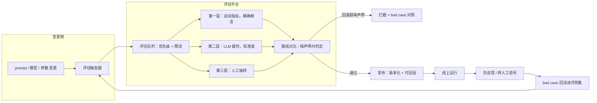

# LLM 效果评估与回归平台

> 层级：贯穿 · 质量与评估 ｜ 贯穿矛盾：质量

## 场景

公司多个 LLM 应用（客服、摘要、Copilot）每次换模型、改 prompt 都可能引发效果回退，需要统一的评估与发布门禁。

## 核心矛盾

**非确定性输出 vs 工程要求的可回归**——传统回归测试断言「输出等于期望」，这里只能断言「输出足够好」，而「足够好」本身要被工程化定义。

## 追问链

- LLM 当裁判靠谱吗，怎么校准？
- 评测集和数据集泄漏了怎么办？
- 线上效果和离线评分不一致怎么定位？

## 推演

先定性：这是 AI 版的「测试平台设计题」。传统测试平台的难点在覆盖（测什么）与速度（多快测完）；这道题的难点在「断言」本身——同一个输入，两次运行输出不同，连「正确」都是分布意义上的。所以整道题的推演主线只有一条：把「足够好」从主观感觉，变成可对比、可统计、可追责的工程定义。做不到这一步，评估平台建得再漂亮也只是个跑分脚本。

### 容量估算（先问这几个数）

五个关键假设，量级全靠算式推：

- **假设 1（变更频率）：** 公司 10 个 LLM 应用，每个应用平均每天产生 5 次候选变更（prompt 改动、模型切换、参数调整，含开发自测）→ 每天 50 次评估触发。
- **假设 2（评测集规模）：** 门禁用核心集 500 条，夜间全集 5000 条；每条评测 = 被测模型 1 次调用 + 裁判模型 1 次调用。
- **假设 3（单条 token）：** 被测输入 2k + 输出 1k；裁判输入（题面 + 评分标准 + 被测输出）4k + 输出 0.5k。合计约 7.5k token/条。

由此推出三个量级结论：

- **结论一（token 成本）：** 门禁评估 50 次 × 500 条 × 7.5k = 1.9 亿 token/天；夜间全集 10 应用 × 5000 条 × 7.5k = 3.75 亿 token/天。按混合单价 $1/M token，合计约 $560/天、$17k/月。评估本身就是「亿级 token/天」的常驻成本——评测集规模与触发频率直接乘进账单，「每次改一个标点都跑全集」不可行，分层评估是成本必然，不是品味选择。
- **结论二（并发形态）：** 门禁要求 15 分钟出结果 → 500 条 ÷ 900s ≈ 0.6 条/s，每条 2 次 LLM 调用，约 1.2 QPS。评估平台不是高 QPS 系统，是高波动系统——发布日几十个候选同时提交，排队与优先级是刚需，大集群不是。
- **假设 4（存储）：** 每条记录存题面、被测原始输出、裁判评分理由、各层分数，约 10KB → 门禁 + 夜间合计 750MB/天，年化约 0.3TB。存储可忽略，但**必须存被测原始输出与裁判理由**——否则裁判错了无法复盘、bad case 无法回流到 [数据飞轮与标注平台](数据飞轮与标注平台.md)。
- **假设 5（时效 vs 成本的换算）：** 全集单次约 $375、跑完约 2.5 小时；核心集单次约 $38、15 分钟内出结果。这两个数字后面所有「全量还是抽样」的争论都回到这里对账。
- **假设 6（突发形态）：** 发布日 70% 的评估集中在 2 小时窗口 → 35 次 × 500 条 × 2 次调用 ÷ 7200s ≈ 4.9 QPS 峰值，约为日均的 4 倍。基础设施按「队列削峰 + 优先级」设计（门禁评估插队、夜间全集让路），而不是按峰值常备算力。
- **假设 7（裁判校准成本）：** 每季度校准一次，每次 300 条人工双标、每条判定 2 分钟 → 约 20 人时/季度；通用校准集 10 个应用共享，业务特有桶各自补集。结论：校准是可控的「仪器年检」开销——拒绝校准省的是小钱，赔上的是整个门禁的可信度。

### 架构推演（从朴素方案开始塌）

**v0：评测脚本进 CI。** 最朴素的方案：每个应用仓库放一个 `evals/` 目录、一份手写题集（50 条 happy path）、一个 pytest 脚本；prompt 改动触发 CI，断言「平均分 ≥ 85」。

它在核心矛盾下依次塌掉，塌的顺序就是架构演进的顺序：

1. **先塌在断言的意义（阈值漂移）。** 输出非确定、题目有难度，分数天然波动；开发者看到新版 87 分低于线上 88 分，但人工看觉得新版更好，于是把阈值改成 87。三个月后阈值是 71，门禁形同虚设。机制：非确定性系统里绝对阈值没有语义——每一次「合理的手动下调」都是在训练整个团队绕过门禁。统计上必须先有「噪声带」概念：对同一版本重复评估 10 次，分数标准差可能就有 ±2 分，那么 87→88 根本不构成回退证据。
2. **再塌在题目分布（评测集腐烂）。** 手写 50 条 happy path 覆盖不了线上真实分布：假设线上 60% 的失败集中在「知识缺失 + 多轮上下文」类问题，题集里一条都没有。结果是门禁全绿、线上照样翻车——离线分数与线上效果脱钩，团队开始不信任评估（对应追问 3）。
3. **然后塌在裁判可信度。** 直接拿一个 LLM 打分、不校准：同一个答案换个措辞重问，分数从 3.2 跳到 4.5；裁判系统性偏爱长答案。人工抽 50 条对一下，一致率不到 60%——低于「抽查就能发现」的信任底线，门禁再一次被特批绕过。
4. **最后塌在工程流程。** 评估结果躺在 CI 日志里，与「线上跑的到底是哪个 prompt 版本」对不上号；出问题想回滚，发现 prompt 版本没有管理，改动散落在代码 diff 里，回滚靠人肉翻 git。

**演进到终态，每一步都是对上面某一个塌点的修复：**

**v1 评测集平台化。** 评测集从三个来源持续构建：线上 bad case 回流（保真实分布）、人工标注（保标准答案）、困难样本集（专打边界）。按应用分域、带版本号；分核心集（500 条，门禁用）与全集（5000 条，夜间回归用）。评测集本身有生命周期，要轮换（详见追问 2）。

**v2 基线化门禁。** 断言从「分数 ≥ 阈值」改为「候选 vs 当前线上基线」：同题集、同裁判、同参数下比相对差，分数差超过噪声带才判定回退/提升。噪声带由平台定期对基线版本重复评估测出。绝对阈值只保留给硬红线（合规类问题 0 容忍，见 [Prompt注入防御](Prompt注入防御.md) 的红线集）。

**v3 三层评估引擎。** 第一层自动指标：能精确判定的任务（分类、抽取、格式合规、SQL 可执行验证）用程序断言，零裁判成本、完全确定；第二层 LLM-as-judge：开放生成类用裁判模型打分，裁判与人工标注定期对齐（一致率 < 80% 触发重校准）；第三层人工抽样：每版抽 50-100 条人工复核，同时充当裁判校准的真值来源。三层是成本递增、确定性递减的序列，能上推一层就不落下层。

**v4 门禁产品化 + 闭环。** 发布卡片展示：分桶分数变化（不只平均分）、与基线的 bad case 对照、成本与延迟变化（换模型常常效果 +2、成本 ×5，见 [Token成本治理](Token成本治理.md)）、一键回滚。评估通过才允许上线新 prompt/新模型，任何线上版本可追溯到「哪次评估放行的」。发布后线上信号（负反馈、转人工）回流反哺评测集——评估平台与数据飞轮在这里闭环。

v0 的四个塌点与四个版本的对应关系：

| v0 塌点 | 塌的指标 | 修复版本 | 修复手段 |
| --- | --- | --- | --- |
| 阈值漂移 | 门禁拦截率趋近于零 | v2 | 相对基线 + 噪声带 |
| 评测集腐烂 | 离线全绿、线上翻车 | v1 | bad case 回流 + 版本化 + 轮换 |
| 裁判不可信 | 与人工一致率 < 60% | v3 | 三层评估 + 定期校准 |
| 流程断裂 | 回滚靠人肉翻 diff | v4 | 版本化 + 发布卡片 + 一键回滚 |

收拢一句：v1 修「题目从哪来」，v2 修「怎么断言」，v3 修「用什么测」，v4 修「怎么进流程」。次序不能乱——没有可信题集的基线是自欺，没有噪声带的对比是误拦，没有校准的裁判是摆设，没有版本化的门禁是纸面流程。

### 关键决策论证

**决策 1：门禁判据——绝对阈值 vs 相对基线。**

| | 绝对阈值 | 相对基线 + 噪声带 |
| --- | --- | --- |
| 非确定性下表现 | 阈值漂移，逐渐失效 | 稳定：比的是同一噪声过程下的差值 |
| 建设成本 | 几乎为零 | 基线版本管理 + 噪声带定期测量 |
| 误拦率 | 高（把噪声当回退） | 低，但依赖基线本身可信 |

**结论：相对基线为主，绝对阈值只守硬红线。** 判据：非确定性之下，「差值」的统计性质远优于「绝对值」——同一题集、同一裁判下，两版本共享同一批噪声源，差值的方差远小于单次绝对分。反转条件：任务是精确匹配类（分类、抽取、可执行验证），这类输出可以确定性断言，直接用绝对阈值，不要引入基线复杂度。

**决策 2：裁判模型——旗舰模型当裁判 vs 便宜模型 + 高比例人工。**

选项 A：每条都用与被测不同厂商的旗舰模型当裁判，一致率典型能到 80-90%（经验值），但裁判 token 约为被测的 1.5 倍，评估账单近翻倍；选项 B：小裁判 + 大人工抽样，成本降 5 倍，一致率掉到 70% 以下时门禁失真——而门禁失真的代价不是钱，是团队绕过流程。**结论：核心集用跨厂商、版本固定的强模型当裁判，先与人标对齐、再允许用于门禁。** 两条铁律：裁判与被测必须不同源（同源模型给自己的风格加分，是系统性偏置不是随机误差）；裁判版本变更视同「换测量仪器」，必须重新校准。反转条件：评估日 token 账单超过业务推理账单的 20% → 裁判降级为小模型，缺口用人工抽样补。

**决策 3：全量 vs 抽样——每次变更跑全集还是核心集。**

按假设 5 的换算：全集不漏但慢（2.5 小时）且贵（单次 $375），核心集快（15 分钟）但可能漏长尾回退。**结论：分层——门禁跑核心集（按意图类型分层抽样，保证每类都有代表），全集夜间自动回归；影响面大的变更（换底座模型）门禁也必须跑全集，并叠加线上灰度，见 [模型发布与灰度](模型发布与灰度.md)。** 判据是变更影响面：prompt 局部修改影响面小，核心集够；模型权重更换影响全局，抽样会漏。反转条件：bad case 回流显示核心集对某类问题的覆盖率不足 80% → 先扩核心集再谈抽样，否则门禁是在已知的盲区上做仪式。

**决策 4：评测集归属——平台统一 vs 应用团队自建。**

平台统一出题：标准一致、可横向比较，但平台不懂业务，出的题覆盖不了业务细节，应用团队不认账，最终演变成「平台自嗨集」。应用自建：贴业务，但格式混乱、质量参差、无法沉淀平台能力。**结论：平台管管道，团队管内容。** 平台统一负责回流管道、去重、版本化、轮换机制、一致率工具与安全合规红线集（百条级，任何变更必过，成本可忽略）；题面内容由应用团队 owner 制维护，每月负责新增与淘汰。机制理由：评测集是「业务知识」不是「基础设施」，知识无法被平台代管。无反转条件——红线集的强制权必须归平台，这一点不让步。

**决策 5：分数呈现——单一平均分 vs 分桶报告。**

**结论：必须分桶（意图类型 × 难度 × 语言），平均分只做汇总参考。** 机制：平均分掩盖结构性回退——一个整体 +1 分的版本完全可以在「拒答类」问题上 -15 分，而拒答恰恰是客服场景最贵的失败类型（合规风险，见 [AI客服系统](AI客服系统.md)）。门禁规则相应改为：任一关键桶回退超噪声带即拦截，整体平均只做参考。这是显示层决策，成本可忽略，没有理由不做，也没有反转条件。

### 追问应答

**1. LLM 当裁判靠谱吗，怎么校准？**

靠谱是有条件的：裁判的本质是一台「未校准的测量仪器」。校准三步：先建真值集（几百条人工双标注样本）；再测一致率，并且分桶测——对哪类问题系统性偏高/偏低、有没有长度偏置和同源偏袒；最后修（评分细则、few-shot 判例、换裁判模型），修完重新测。之后是持续监控：一致率低于 80% 就停用裁判做门禁。判据式回答：校准不是一次性动作，是像仪器年检一样的定期流程；「用什么模型当裁判」是次要问题，「裁判分数与人工判断的偏差被度量并收敛」才是主要问题。

**2. 评测集和数据集泄漏了怎么办？**

泄漏有两个方向，防法不同。评测集泄进训练数据（分数虚高、线上翻车）：评测集与训练数据物理隔离，定期用评测题面对训练语料做近似检索做污染检测。评测集被「为评测而优化」（prompt 针对题面堆规则，题内过题外崩）：核心集每季度轮换 30%，被淘汰题目转入全集继续观察；关键考点的题面做等价变体（同一考点换皮）防止题面记忆。检测信号：离线分数持续涨而线上负反馈不降——这个剪刀差就是泄漏或过拟合正在发生的直接证据。

**3. 线上效果和离线评分不一致怎么定位？**

按「分布差、时延差、定义差」三层排查。分布差：题集分布 ≠ 线上流量分布，用线上 bad case 回流持续校正题集，让题集趋近流量的无偏采样，并做分桶对比找「离线好线上差」集中的桶。时延差：评估时与线上高负载时模型行为不同（限流、降级路径、供应商波动），要对线上流量做影子评估而不是只在离线环境评。定义差：离线评的指标（语义相似、表达通顺）与用户感知的效果（问题解决没有）不是一回事——裁判说通顺、用户点踩「没解决」。定位手段是先分桶收敛范围，再人工看该桶样本，通常一轮就能分辨是题集缺口还是指标定义错了。

### 常见误区

**误区 1：「设准确率红线，低于 85% 不准上线」。** 长成的样子：门禁规则一条 `score >= 0.85`，随后每次「看起来还行但差一点」的版本都伴随一次阈值下调，半年后红线是 71。不行的机制：非确定性下分数波动 ±2 分是常态，绝对红线要么频繁误拦（噪声当回退），要么被下调到失去意义——两个结局都让团队学会绕过门禁，门禁从此只剩仪式价值。

**误区 2：「裁判模型越强越好，直接拿当前最强的模型当裁判」。** 长成的样子：每次旗舰模型发布就热切升级裁判，从不记录校准状态。不行的机制：未校准的裁判是系统性偏差的测量仪（长度偏置、同源偏袒、格式偏好），模型更强只是偏差可能更小，不等于无偏；而且裁判版本漂移会让相邻两次评估的分数不可比——仪器变了，读数失去纵向可比性。正确姿势是「校准过的、版本固定的、跨厂商的」裁判，不是「最新的」裁判。

**误区 3：「评估只评答案质量」。** 长成的样子：发布卡片上只有一个效果分，换模型的决策全靠这个分数。不行的机制：模型选型是效果/成本/延迟的联合决策——效果 +2%、成本 ×5、P95 +3s 的版本在效果分上是赢家，业务上是输家；而且成本与延迟是确定性指标，本可以精确断言却没评。效果分旁边必须有同一次评估产出的成本变化与延迟变化，这是同一次跑批顺手就能给的。

**误区 4：「评测集建好一次就长期不动」。** 长成的样子：题集 v1.0 用了一年，分数从 82 涨到 91，团队很高兴，线上负反馈率纹丝不动。不行的机制：prompt 和模型是在评测集的选择压力下演化的——静态题集下的分数上涨，三个月后大部分来自过拟合而非真实提升（Goodhart 定律：指标成为目标后就不再是好指标）。对策是把评测集当成有生命周期的资产：轮换、淘汰、由线上 bad case 回流持续补充，而不是一次性建成的纪念碑。

---

[返回 AI 场景题地图](README.md)
