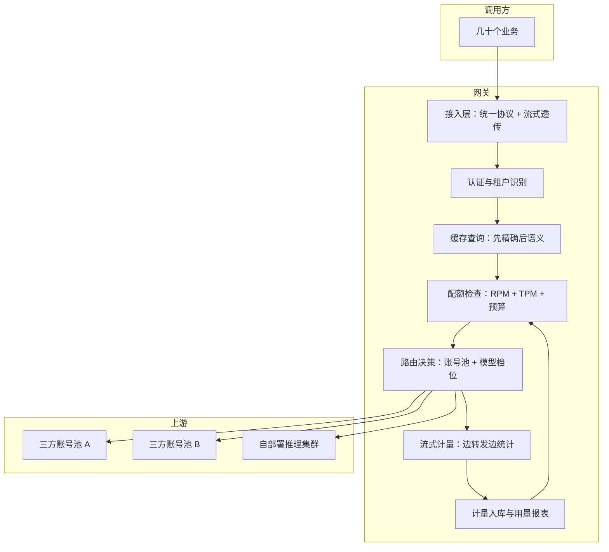

# LLM 网关

> 层级：② 接入与流量 ｜ 贯穿矛盾：成本 · 延迟

## 场景

公司几十个业务接大模型，模型既有三方 API 也有自部署，需要统一协议、计费与限流的接入层。

## 核心矛盾

**成本控制 vs 可用性与体验**——限流与预算熔断保护了钱包，但熔断的一瞬间业务正在等回复。

## 追问链

- 语义缓存的 key 怎么设计？
- 长文本请求怎么限流？（不能只算 QPS）
- 三方 API 限流了怎么整体调度？

## 推演

### 容量估算（先问这几个数）

先把「网关到底在搬运多大的量」算清楚，后面每个设计点都从这几个数推出来。

- **假设 1：50 个业务接入，日均合计 1000 万次调用。** 均值 QPS = 10^7 ÷ 86400 ≈ 116；对话类流量按时段集中，取峰值系数 10（经验判断）→ **峰值约 1200 QPS，按 1500 QPS 设计留余量**。
- **假设 2：单请求平均输入 2K token（含 RAG 上下文）、输出 500 token。** 输入远大于输出是 RAG 类业务的典型形态（经验判断）。
- **假设 3：其中约三成是多轮对话的后续轮次。** 后续轮次要携带全部历史，第 5 轮时输入可达 10K token——网关看到的输入不是均匀的 2K，而是 **2K 到 50K 的重尾分布**（形态是经验判断，具体分布必须按自家日志拟合）。追问 2 的「长文本限流」就是冲着这条重尾来的。
- **推导·流式并发连接数（Little's Law）**：并发连接 ≈ 峰值 QPS × 平均响应时长 = 1200 × 20s ≈ **2.4 万条并发流式连接，每条存活 20 秒**。这一条直接决定网关是 IO 密集的长连接服务，不是普通短连接代理。
- **推导·上游 token 吞吐**：峰值 1200 QPS × 500 token = **60 万输出 token/s**。三方单账号 TPM 有限——假设某旗舰账号限额 400 万 token/min ≈ 6.7 万 token/s，**单账号只扛得住峰值的 1/9**。多账号池 + 自部署分担不是优化项，是硬前提。
- **推导·自部署 GPU 张数**：假设自部署承担 40% 流量 → 输出 24 万 token/s；假设推理侧单卡（A100/H100 级）并发批处理下输出吞吐 3000 token/s（连续批处理后的实测典型量级，机制见 [LLM 推理服务平台](LLM推理服务平台.md)）→ 24万 ÷ 3000 ≈ **80 张卡**。
- **推导·月成本量级**：月 token = 10^7 × 30 × 2500 = 750B token。假设旗舰混合单价 ¥20/M token → 全旗舰 **1500 万/月**；轻量模型 ¥0.4/M → 30 万/月，差 50 倍。这就是「烧现金不是折旧」的数字含义，也是网关挂缓存与路由的动力：**按全旗舰口径，每优化 1% ≈ 15 万/月**。
- **推导·网关转发带宽（确认它不是瓶颈）**：60 万输出 token/s × 约 4 字节/token × 上下行双份 ≈ 5 MB/s 量级，千兆网卡绰绰有余。LLM 网关的瓶颈排序是：**上游配额池 > 并发连接维持 > token 计量精度 > 带宽**——和传统 API 网关（吞吐优先）的画像完全不同。
- **推导·日志存储**：计量元数据（租户、模型、token 数、状态码、时延）约 500B/条，3 亿条/月 ≈ **150 GB/月，全量可存且必须全量**——预算熔断与成本归因依赖逐条计量。请求正文约 10KB/条 → **3 TB/月 ≈ 36 TB/年**，按对象存储约 ¥0.1/GB/月（经验判断）折 300 元/月，纯存储完全存得起。但「存得起」不等于「值得存」：正文被检索的场景几乎只有排障与争议取证，且集中在异常请求（报错、超时、审核拦截）——正常请求正文全年被打开的次数趋近于零（经验判断），而要让 36 TB/年正文可检索，索引与查询成本远超存储本身；正文通常还有合规留存期（假设 180 天），到期必须删除。所以策略仍是**正文采样 + 异常请求全量 + 按留存期冷热分层滚动删除**，依据不是「存不起」，是「几乎不会被读 + 到期必须删」；且该结论对请求量线性敏感——业务再涨 10 倍就是 360 TB/年，全量策略的索引与维护成本同步放大 10 倍。
- **推导·限流桶参数**：TPM 桶容量 = 账号池总限额 × 0.8（防触顶系数，经验判断），QPS 桶容量 = 业务申报峰值 × 2（防死循环，留突发余量）。两者都是随上游额度变化的配置项，由配置中心下发，不写死在代码里。
- **推导·凭证规模**：50 业务 × 2 环境 × 3 上游 ≈ 300 组密钥——手工管理这个规模的轮换与泄漏应急已不可行，这就是「密钥托管在网关」从安全建议变成工程必然的数量级依据。
- **推导·敏感性**：以上全部结论对日均请求量线性敏感。业务涨 10 倍时，先破的是上游账号池（单账号 TPM 天花板，缺口 9 倍只能靠多账号 + 自部署补）和配额模型精度，最后才轮到网关转发——扩容规划按这个顺序排，不要先去扩网关。

结论：网关的容量问题首先是**长连接并发与上游配额池**问题。这几个数会反复出现在后面的架构推演里：2.4 万连接决定 IO 模型，6.7 万 token/s 决定账号池，36 TB/年正文决定日志策略。

### 架构推演（从朴素方案开始塌）

**v0：各业务直连，SDK 写在业务代码里。**

最朴素的方案，多数公司都从这里起步。它在三个地方塌，且塌的第一个不是性能：

1. **成本不可归因**：月底一张三方总账单，50 个业务谁烧的不知道。没有按租户的 token 计量，预算、归因、优化全部无从谈起——[Token 成本治理](Token成本治理.md)需要的第一手数据在这里就断了。
2. **故障半径共享**：三方账号是公司级共享的。任何一个业务写出死循环调用，就能把全公司账号的 TPM 打爆，另外 49 个业务集体 429。事故半径 = 全公司。
3. **协议锁死**：三方 A、三方 B、自部署 vLLM 的 API 与流式 chunk 格式各不相同，换模型 = 改业务代码；想灰度一个新模型要动几十个仓库。

**v1：统一网关收口——统一协议、密钥托管、流式透传。**

全部流量过网关，对外暴露一套 OpenAI 兼容协议，网关抹平各家 SSE 的 chunk 结构差异；密钥只存在网关，泄漏面从 50 个业务收敛到 1 个组件。这一步在三个点上塌：

- **流式长连接**：2.4 万并发连接 × 平均 20s 占用。同步「一请求一线程」模型仅线程栈就要几十 GB，加上高频上下文切换——网关必须事件驱动/异步 IO，把连接管理与转发计算解耦。
- **重试风暴**：上游按账号 TPM 限流，突发流量触发 429；业务 SDK 的默认重试（立刻重试 3 次）让请求量瞬间翻几倍，进一步耗尽配额——429 → 重试 → 更多 429 的正反馈。重试必须在网关出口侧收敛（指数退避 + 抖动 + 全局并发闸门），不能留给业务。
- **观测缺位**：没有按请求的时延分位与错误分布，三方偶发抖动（P99 从 2s 涨到 30s）业务无从定位，只能投诉到网关团队。可观测不是后期的锦上添花，是收口当天就要有的底座（见 [LLM 可观测与 Tracing](LLM可观测与Tracing.md)）。

**v2：加计量、配额与预算熔断。**

输入侧网关可直接分词精确计数；输出侧流式结束后读 usage 字段，缺失时按 chunk 累计估算兜底。配额做 RPM + TPM 双桶（为什么双桶见决策论证 3），预算按租户月度熔断。塌点立刻出现在核心矛盾上：**熔断的一瞬间业务正在等回复**——硬熔断 = 业务错误率尖刺 + 用户看到报错。所以熔断必须分级：

1. **软限**：接近阈值时排队、压缩 max_tokens、切换便宜模型——体验降级但不出错；
2. **硬熔**：只拒绝已超预算的租户自己的流量，且这是最后一档而不是第一档；
3. **核心业务白名单**：声明了关键级的流量不参与熔断，代价是白名单之外的租户更早触顶——这是显式交易，不是技术细节。

**v2 还有一个隐性塌点：断连传播与计量口径，两者都是体验与成本矛盾在协议层的投影。** 用户等不及关掉页面、客户端超时断开，上游却还在生成——钱照烧、token 照计。网关必须把客户端断开**传播到上游**（取消上游请求），并定死计费口径：生成即消费，断开不退款，但报表里单列。计量侧不能只信上游返回的 usage 字段——是否计入系统提示、工具定义、多轮历史重算，各家定义不一，跨厂商同一请求能差出 10% 上下（经验判断）。网关要么统一用自家分词器独立计量，要么在报表里显式标注口径来源，否则预算熔断的触发时机随模型选择漂移，租户会觉得预算「忽大忽小」。

**v3：终态——网关是四件事的合成体。**

注意两条链路位置：缓存命中发生在配额检查**之前**——没花出去的钱才是省下的钱；计量结果回流到配额检查——预算是动态状态不是静态配置。路由同时决定「走哪个上游账号池」与「走哪个模型档位」，后者展开见 [多模型路由与降级](多模型路由与降级.md)，语义缓存的正确性设计见 [语义缓存](语义缓存.md)。可观测层按租户出 token 用量、成功率、时延分位报表，是网关之外所有治理动作的数据源。

最后划一条边界：网关理解**传输语义**（token、流式、配额、模型标识），不理解**业务语义**（这是什么意图、答案对不对）——后者属于缓存与路由的领域。边界必须清晰，因为两边的变更频率差一个量级：业务语义周级迭代，传输语义季度级稳定；混在一起改，网关就成了全公司变更风险最大的单点。

### 关键决策论证

| # | 决策点 | 选项 A | 选项 B | 判据 | 结论 | 反转条件 |
|---|--------|--------|--------|------|------|----------|
| 1 | 自研 vs 开源 | 全自研网关 | 基于 LiteLLM / Higress AI 一类开源二开 | 差异化在哪 | **协议适配用现成，计量/配额/熔断自研**。协议适配是 commodity，开源已成熟；计量熔断与公司财务、租户体系深度耦合，外部组件接不上 | 团队 < 3 人且业务 < 5 个：直接用开源全套，先有再好 |
| 2 | 流式处理 | 边收边透传 | 缓冲齐全再转发 | 首字延迟 vs 可审核性 | **默认透传**。用户感知的是首 token 延迟（TTFT），缓冲会把亚秒级 TTFT 推到十几秒，交互场景体验塌方；计量可以边转发边做 | 内容安全要求「先审后发」的路径：缓冲或流式审核 + 可断流，作为路由维度的例外而非全局默认 |
| 3 | 限流维度 | 只按 QPS | QPS + TPM 双桶 | 稀缺资源是什么 | **双桶**。上游按 TPM 限流，token 才是稀缺资源：同样 10 QPS，2K 与 200K token 的请求对配额池的占用差 100 倍，纯 QPS 限流保护不了上游。QPS 桶保留，用于防死循环、防滥用 | 上游全是自部署且算力按并发数分配时，并发数才是对齐维度，TPM 退为记账口径 |
| 4 | 熔断粒度 | 全局统一熔断 | 租户熔断 + 白名单 | 事故半径 | **租户熔断为主 + 全局水位软降级**。全局硬熔断让未超支的业务陪葬；事故半径应与预算责任对齐。全局水位高时走软降级（切便宜模型）而不是拒绝 | 单一业务占 90% 流量时，租户熔断 ≈ 全局熔断，全局软降级通道要建得更实 |
| 5 | 正文日志 | 全量存 | 采样存 | 36 TB/年正文：检索边际价值 vs 合规留存期 | **元数据全量 + 正文按比例采样（如 1%）+ 异常请求（报错、超时、审核拦截）正文全量，按留存期冷热分层、到期删除**。排障与争议取证集中在异常样本，正常样本全年几乎无人检索，全量买到的是检索不到的沉睡数据 | 监管或安全审计要求全量留痕：按法规口径覆盖，成本显式进预算，而不是偷偷砍采样 |

决策 1 补一句：判断「哪些必须自研」看数据模型而不是代码量——计量熔断的核心数据（租户、预算、账期）与公司财务体系同构，用外部组件等于长期维护两套租户模型；协议适配的核心数据只有请求与响应本身，没有这种耦合。

决策 2 补一句：透传与计量的组合有个细节——输出 token 数在流式结束前不可精确得知，网关对上游的速率控制只能按「预扣 + 事后结算」的近似模型运行，误差由配额桶的容量冗余吸收，不要试图做到精确对账级别。

决策 3 补一句：双桶参数必须分开校准——QPS 桶按「防滥用」定（正常峰值 × 安全系数），TPM 桶按「上游配额」定（账号池总量 × 防触顶系数）。两桶共用一套参数是常见配错：QPS 桶定太紧，会先于预算把正常的长文本业务掐死。

决策 4 补一句：白名单的存在意味着预算体系必须承认「有人可以超」——超支部分按记账归属租户，事后追责或加钱，而不是事前一律掐断。熔断保护的金钱损失是线性的，核心链路被拒绝的业务损失可能是非线性的，这是分级熔断的全部理由。

### 追问应答

**1. 语义缓存的 key 怎么设计？**

分两层，先精确后语义。精确缓存 key = 归一化后的请求指纹：剥离时间戳等易变内容后的 prompt hash + 模型标识 + 采样参数 + prompt 模板版本——少一个版本位，模型升级后就吐旧答案。语义缓存只在精确未命中后接力，key 是「租户 + 意图簇 + query embedding」，靠阈值判定，正确性风险是另一道完整设计题，见 [语义缓存](语义缓存.md)。

排序不可颠倒：精确命中零风险，语义命中永远带概率，语义层的每一次命中都应该能回答「这个簇为什么允许直返」。

**2. 长文本请求怎么限流？（不能只算 QPS）**

先想清楚限的是什么：上游按 TPM 限流，2K token 与 200K token 的请求在配额池里占的资源差 100 倍，QPS 视角完全看不见这个差异。做法是令牌桶按**预估 token 数**预扣：输入在网关可直接分词统计，输出按请求的 max_tokens 预扣、流式结束后按实际 usage 结算退回差额；再设「单请求 token 上限」与「长请求并发上限」两个独立闸门，防止少数超长请求挤占整个池子。

预扣与结算的误差留在桶内冗余里消化，追求精确对账是过度设计——限流要的是稳定保护，不是财务精度。

**3. 三方 API 限流了怎么整体调度？**

把每个三方账号抽象成一个「配额池」，网关自己维护每个池的滑动窗口 token 余量——不要只依赖上游响应头，它只反映单账号视角。路由时在余量足够的池里按成本权重选择；429 或连续错误触发该池半开熔断 + 指数退避带抖动；池间能力等价时优先烧便宜的。

最关键的是**重试收敛**：重试统一由网关做（有预算、有退避、有全局并发上限），业务 SDK 一律禁止自动重试——两边都重试，重试次数相乘，429 风暴就是这么来的。

### 常见误区

- **「网关就是个反向代理，改个 URL 转发一下」**。长得像代理，塌在计量与流式：没有 token 级计量，月底无法归因成本，预算熔断无从谈起；按短连接思路做转发，2.4 万条 20 秒的长连接直接打满线程池。
  机制上为什么不行：网关的难点全在 LLM 特有的部分——流式、token 计量、配额池，这三个恰恰是反向代理没有的能力，所以「像」只停留在 URL 改写那一层。
- **「限流配 QPS 就够了，传统 API 都这么做」**。传统 API 的资源占用与请求数线性相关；LLM 的资源占用与 token 数线性相关、与请求数只弱相关。
  机制上为什么不行：QPS 桶在长文本场景既保护不了上游（配额按 TPM 扣），也限制不了滥用（死循环短请求照样烧钱）——两个保护目标都不在它的度量维度上。
- **「超预算就返回 429，简单直接」**。这是把熔断当第一档用：超支的金钱损失是线性可算的，而核心链路被拒绝造成的业务损失（交易失败、客诉）往往远大于省下的 token 钱。
  机制上为什么不行：熔断保护的两个东西量纲不同——省下的钱按 token 计价，拒绝的伤害按业务链路计价；所以必须先软后硬、先租户后全局。这正是核心矛盾「熔断的一瞬间业务正在等回复」的工程化回答。
- **「重试策略放业务 SDK 里，各业务自己看着办」**。把重试当业务私有逻辑是全局视角缺失。
  机制上为什么不行：N 个业务各自重试 3 次，配额池要承受最高 3N 倍流量，且互相不知道对方在重试，退避节奏还可能同步共振——重试必须上收到网关，带退避、抖动与全局闸门。

---

[返回 AI 场景题地图](README.md)
