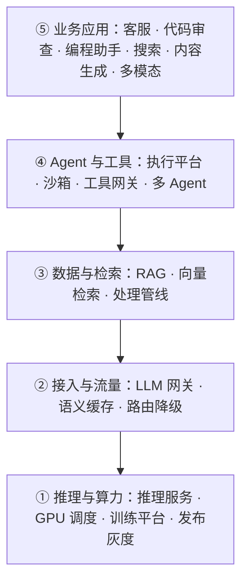

# AI 场景设计题 · 地图

> TL;DR：28 道 AI 时代特有的场景设计题，组织成一张两层结构的地图：**纵轴是五层建设栈**（推理算力 → 接入流量 → 数据检索 → Agent 工具 → 业务应用），**横轴是四条贯穿矛盾**（质量、成本、安全、延迟）。一题一文件，每题一份攻略级推演：容量估算（假设+算式）、架构塌陷演进、关键决策论证（含反转条件）、追问应答、常见误区。矛盾在，答案就不会过时——按核心矛盾练推演，别背答案。

## 为什么 AI 场景题值得单独一张地图

AI 成为系统组件后，四个工程维度同时变了：

| 维度 | 传统组件 | AI 组件 |
| ---- | -------- | ------- |
| 输出 | 确定性，可断言 | 非确定性，只能评估 |
| 成本 | 容量一次性投入 | 按 token 持续计费，随用量线性增长 |
| 质量 | 单测/集成测试可覆盖 | 幻觉无法穷举测试，只能抽样评估 |
| 安全 | 注入、越权 | 新增 prompt 注入、工具越权、数据外泄 |

这四行就是新题族的来源：每一行各自孕育一批传统题库（秒杀、短链、Feed 流）没覆盖过的矛盾。完整论证见 [后端 AI 场景设计题：题库与论证](../../articles/backend-ai-scenario-questions.md)。

## 地图怎么读：两根轴

- **纵轴：五层建设栈。** 自底向上回答「AI 系统由什么组成」。拿到一道题先定位它在哪一层，就知道了题的邻居、依赖和边界。
- **横轴：四条贯穿矛盾。** 每一层都会撞上这四类矛盾（质量、成本、安全、延迟）。答题时主动点破「这道题主要在考哪条矛盾」，是区分度所在。

四条贯穿矛盾：

| 贯穿矛盾 | 一句话 | 代表题 |
| -------- | ------ | ------ |
| 质量（非确定性与幻觉） | 输出不可断言，只能评估，坏一次的代价被工具放大 | [效果评估与回归平台](LLM效果评估与回归平台.md)、[语义缓存](语义缓存.md) |
| 成本（token 计费） | 成本随用量线性涨，烧的是现金而不是折旧 | [LLM 网关](LLM网关.md)、[Token 成本治理](Token成本治理.md) |
| 安全（注入与越权） | 不可信数据变成指令，工具权限是放大器 | [Prompt 注入防御](Prompt注入防御.md)、[企业数据防泄漏](企业数据防泄漏.md) |
| 延迟（交互体验） | 生成式响应又慢又长尾，体验型场景首当其冲 | [AI 编程助手](AI编程助手.md)、[实时多模态交互](实时多模态交互.md) |

## 题目总览

> 28 题全部为攻略级推演，五个小节固定：容量估算（假设 + 算式）、架构推演（从朴素方案开始塌）、关键决策论证（含反转条件）、追问应答（逐条）、常见误区。所有数字都是标注过的假设，欢迎用真实数据替换。

### ① 推理与算力 —— 把模型变成服务

| 题目 | 核心矛盾 | 贯穿矛盾 |
| ---- | -------- | -------- |
| [LLM 推理服务平台](LLM推理服务平台.md) | GPU 利用率 vs 延迟与吞吐 | 成本 · 延迟 |
| [GPU 算力调度平台](GPU算力调度平台.md) | 资源利用率 vs 公平与确定性 | 成本 |
| [模型训练微调平台](模型训练微调平台.md) | 实验自由度 vs 工程可复现 | 质量 · 成本 |
| [模型发布与灰度](模型发布与灰度.md) | 迭代速度 vs 效果稳定性 | 质量 · 安全 |

### ② 接入与流量 —— 把服务变成平台能力

| 题目 | 核心矛盾 | 贯穿矛盾 |
| ---- | -------- | -------- |
| [LLM 网关](LLM网关.md) | 成本控制 vs 可用性与体验 | 成本 · 延迟 |
| [语义缓存](语义缓存.md) | 命中率 vs 正确性：相似问题未必有相似答案 | 成本 · 质量 · 安全 |
| [多模型路由与降级](多模型路由与降级.md) | 单请求最优 vs 全局最优 | 成本 · 质量 |

### ③ 数据与检索 —— 把企业数据喂给模型

| 题目 | 核心矛盾 | 贯穿矛盾 |
| ---- | -------- | -------- |
| [企业知识库问答 RAG](企业知识库问答RAG.md) | 检索质量 vs 延迟与成本；幻觉控制 | 质量 · 安全 |
| [向量检索服务](向量检索服务.md) | 亿级规模 vs 延迟与内存成本 | 延迟 · 成本 |
| [非结构化数据处理管线](非结构化数据处理管线.md) | 数据新鲜度 vs 处理成本；解析质量决定检索上限 | 质量 · 成本 |

### ④ Agent 与工具 —— 让模型自主干活

| 题目 | 核心矛盾 | 贯穿矛盾 |
| ---- | -------- | -------- |
| [Agent 任务执行平台](Agent任务执行平台.md) | 自主性 vs 可控性 | 安全 · 质量 |
| [Agent 沙箱与代码执行](Agent沙箱与代码执行.md) | 能力开放 vs 安全隔离 | 安全 · 质量 |
| [工具网关与 MCP 平台](工具网关与MCP平台.md) | 工具生态繁荣 vs 治理可控 | 安全 |
| [多 Agent 协作系统](多Agent协作系统.md) | 分工的能力增益 vs 协作的误差放大 | 质量 · 成本 |

### ⑤ 业务应用 —— AI 变成产品

| 题目 | 核心矛盾 | 贯穿矛盾 |
| ---- | -------- | -------- |
| [AI 客服系统](AI客服系统.md) | 自主应答准确率 vs 人工兜底成本 | 质量 · 成本 |
| [AI 代码审查平台](AI代码审查平台.md) | 上下文规模 vs 审查质量与数据安全 | 质量 · 安全 |
| [AI 编程助手](AI编程助手.md) | 补全延迟 vs 生成质量 | 延迟 · 质量 · 安全 |
| [AI 搜索](AI搜索.md) | 语义召回的泛化 vs 精确匹配的确定 | 质量 · 延迟 |
| [内容生成平台](内容生成平台.md) | 生成自由度 vs 品牌与事实可控 | 质量 · 安全 |
| [实时多模态交互](实时多模态交互.md) | 实时性 vs 理解质量 | 延迟 · 成本 |

### 贯穿 · 质量与评估

| 题目 | 核心矛盾 | 贯穿矛盾 |
| ---- | -------- | -------- |
| [LLM 效果评估与回归平台](LLM效果评估与回归平台.md) | 非确定性输出 vs 工程要求的可回归 | 质量 |
| [数据飞轮与标注平台](数据飞轮与标注平台.md) | 数据量 vs 数据质量 | 质量 · 成本 |
| [LLM 可观测与 Tracing](LLM可观测与Tracing.md) | 全链路信息量 vs 成本与隐私 | 质量 · 成本 · 安全 |

### 贯穿 · 安全与合规

| 题目 | 核心矛盾 | 贯穿矛盾 |
| ---- | -------- | -------- |
| [Prompt 注入防御](Prompt注入防御.md) | 准确率/召回 vs 时延，且对手在演化 | 安全 · 延迟 |
| [企业数据防泄漏](企业数据防泄漏.md) | 用得爽 vs 管得住 | 安全 |
| [AIGC 内容合规审核](AIGC内容合规审核.md) | 审核准确率 vs 发布效率 | 安全 · 质量 |

### 贯穿 · 成本与效率

| 题目 | 核心矛盾 | 贯穿矛盾 |
| ---- | -------- | -------- |
| [Token 成本治理](Token成本治理.md) | 降本 vs 体验与效果 | 成本 · 质量 |
| [模型选型与级联](模型选型与级联.md) | 一次选型 vs 持续演化 | 成本 · 质量 |

## 推荐阅读路径

- **业务后端入门**（最先撞得上的 4 题）：[RAG](企业知识库问答RAG.md) → [LLM 网关](LLM网关.md) → [AI 客服](AI客服系统.md) → [效果评估平台](LLM效果评估与回归平台.md)
- **平台/基础设施方向**：[LLM 网关](LLM网关.md) → [向量检索](向量检索服务.md) → [推理服务](LLM推理服务平台.md) → [Token 成本治理](Token成本治理.md)
- **安全方向**：[Prompt 注入防御](Prompt注入防御.md) → [企业数据防泄漏](企业数据防泄漏.md) → [工具网关](工具网关与MCP平台.md) → [AIGC 合规审核](AIGC内容合规审核.md)
- **出题者**：每题的「核心矛盾」就是变体发生器——把约束改一档（数据量、延迟、合规），矛盾不变，新题就出来了

## 使用说明

- **怎么练**：先只看「场景 + 核心矛盾 + 追问链」，合上正文自己推演 20 分钟，再对照「推演」部分找盲区——直接读答案会退化成背诵（方法见[对比练习法](../../articles/场景设计题还有必要么.md)）
- **怎么维护**：题目文件是活文档——所有数字都是标注过的假设，欢迎用真实业务数据替换、补充线上案例；论证见[题库文章](../../articles/backend-ai-scenario-questions.md)
- **面试官视角**：追问链比题目本身更有区分度——题目筛掉背答案的人，追问链筛掉背推演模板的人

## 相关阅读

- [AI 编码时代，场景设计题还有必要吗？](../../articles/场景设计题还有必要么.md)：为什么背诵贬值、推演升值
- [后端 AI 场景设计题：题库与论证](../../articles/backend-ai-scenario-questions.md)：四维度论证 + 8 题完整推演
- [AI 工程模块知识地图](../../../ai/README.md)：RAG、Agent、推理与微调的概念体系
- [system-design 模块导读](../../README.md)：通用解题方法论与经典题清单
