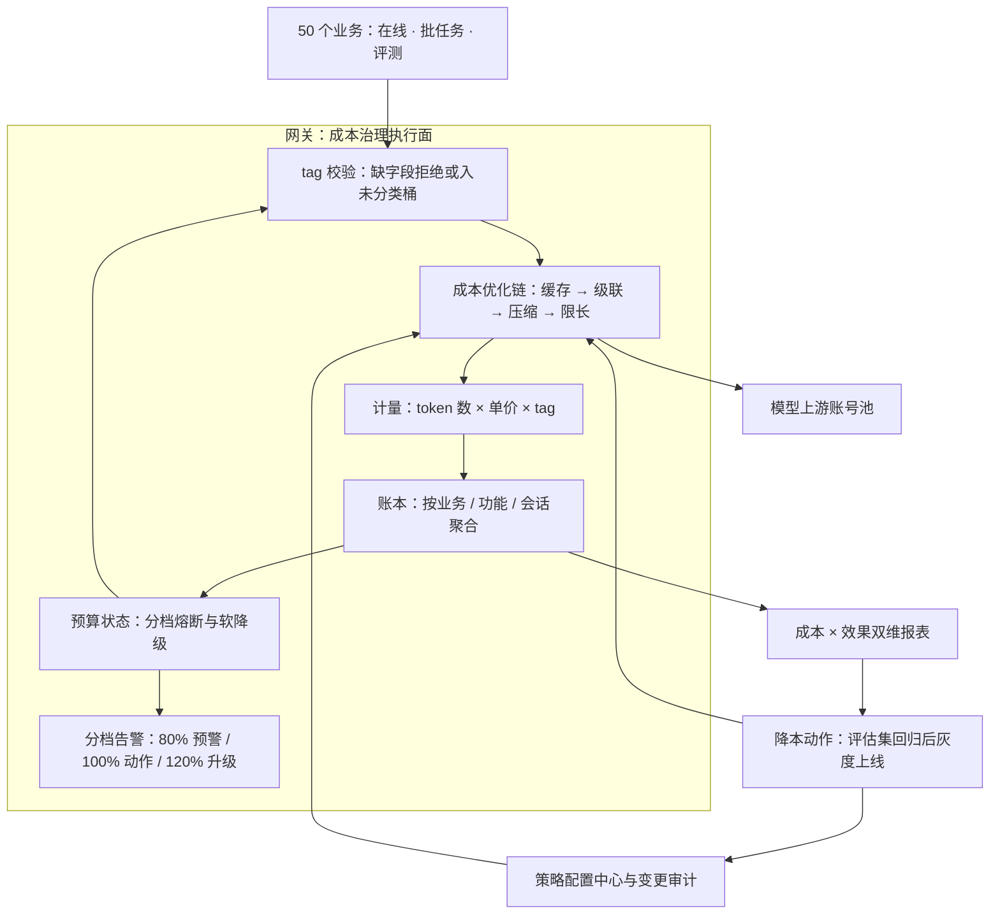

# Token 成本治理

> 层级：贯穿 · 成本与效率 ｜ 贯穿矛盾：成本 · 质量

## 场景

公司 AI 用量暴涨，月账单失控：几十个业务、多种模型、多类调用（推理、评测、微调、embedding）混在一张账单里，没人说得清钱花在哪。

## 核心矛盾

**降本 vs 体验与效果**——砍 token 立竿见影，效果回退却滞后显现；治理动作如果没有归因数据支撑，就是全公司一起盲砍。

## 追问链

- token 成本怎么归因到业务、功能、会话级？归因模型（tag 体系）谁定、怎么落地？
- 预算超了自动熔断还是只通知？熔断误伤线上业务怎么兜底？
- 系统提示词、多轮历史、检索上下文都在吃 token——哪些是可省的浪费，怎么自动识别？
- 降本抓手排序：缓存、小模型、上下文压缩、批处理、输出长度控制——不同业务场景优先级一样吗？

## 推演

### 容量估算（先问这几个数）

治理的第一步不是动作，是把「钱的问题」翻译成「数的问题」。下面按一个中等规模公司取数——数字是假设，算式通用，换数字不换结论。

- **假设 1：50 个业务，日均合计 1000 万次调用。** 均值 QPS = 10^7 ÷ 86400 ≈ 116，峰值按 10 倍集中系数 ≈ 1200 QPS。这个量级决定治理动作必须由网关统一执行：50 个业务各自改造的协同成本，大于任何单项动作的节省。
- **假设 2：单请求平均输入 2K + 输出 500 = 2500 token。** 月 token 量 = 10^7 × 30 × 2500 = **750B token/月**。全公司所有治理动作共享这一个基数。
- **推导·多轮会话的成本放大**：假设 30% 流量是多轮对话的后续轮、历史全量携带（口径与 [LLM 网关](LLM网关.md) 一致）——第 N 轮输入 ≈ N×2K，一个 5 轮会话累计 ≈ 2.5 + 4.5 + 6.5 + 8.5 + 10.5 = **32.5K token，约为单轮的 13 倍**。会话级归因因此不是锦上添花，是对话与 RAG 类业务看清真实单成本的唯一口径；追问 3 的「堆积」浪费就是这条曲线的代价。
- **假设 3：混合单价 ¥8/M token**（部分轻量 + 大量旗舰 + 输出溢价的加权中间值，经验判断；全旗舰口径 ¥20/M 时月账单 1500 万，是理论上限）。月账单 = 750,000M × ¥8 ≈ **¥600 万/月**。由此得到治理定价的第一公式：**每优化 1% = ¥6 万/月**——它给每个治理动作定了投入产出锚：一个月薪 3 万的工程师，全职省 5% 是正 ROI，省 0.5% 是负 ROI。
- **假设 4：输出 token 单价约为输入的 4 倍**（三方 API 通行定价结构，经验判断）。按 2K 输入 + 500 输出算：输出占 token 量 20%，占成本 = (500×4) ÷ (2000 + 500×4) = **50%**。「输出限长」因此是唯一零基建门槛的抓手——改一个参数，砍的是单价最贵的那一半。
- **假设 5：在线对话之外的调用（评测、微调、embedding、实验脚本）占账单 25%**（治理前审计的常见量级，经验判断）≈ **¥150 万/月**花在没人盯的批任务上。失控脚本的成本上限试探：100 QPS × 3K token × 一夜 8 小时 = 8.6B token ≈ **¥7 万/晚**，月底才在账单上显形——这一个数就论证了预算异常必须实时告警，不能等账期。
- **假设 6：FAQ 类业务占 20% 流量，其 query 重复度 40%**（经验判断，必须按自家日志拟合）→ 全局可缓存面 ≈ 8%，打满 = 省 ¥48 万/月。语义缓存每提升 1% 全局命中率 ≈ ¥6 万/月——这笔钱足够养专人把语义缓存的正确性设计做扎实（见 [语义缓存](语义缓存.md)）。
- **推导·批处理弹性上限**：三方批处理接口通常半价、时效 T+1（经验判断）→ 25% 非在线盘子的理论节省上限 = 150 万 × 50% = **¥75 万/月**，但只对时效不敏感的任务成立。这条给追问 4 的「抓手排序」里批处理定了界：收益大、场景窄。
- **推导·发现延迟的敞口**：50 业务 × 2 环境 ≈ 100 个预算桶；若月度结算才看账，一次失控的最大敞口 ≈ 整月白烧（¥600 万量级）；改成日级滚动外推（近 7 天日均 × 30），敞口压到 **1 天 ≈ ¥20 万**。告警时效每提升一个量级，敞口小一个量级——这是「实时告警 vs 月度账单」的全部数学。
- **推导·单价波动的预算噪音**：模型降价或汇率波动会让同量 token 的账单波动 ±20%（经验判断）= ±¥120 万/月，超过任何单一业务的正常月度波动——预算体系必须量价分离（「用量变化」与「单价变化」分开归因），否则熔断会被供应商降价误触发。
- **推导·输出限长的合理下限**：max_tokens 不是越低越好，低于任务合理下限会截断答案、制造新 badcase——合理区间由评估集标定（历史输出 P95 × 1.5），是「有依据的限长」，不是拍一个 256 了事。
- **推导·预算桶与组织对齐**：账本按请求级明细存，桶只是聚合视图，要同时支持「业务 × 环境」（预算归属）与「业务 × 功能」（降本责任）两个维度——只有前者时，「客服功能超支了」找不到该负责的人。
- **推导·告警通道容量**：100 桶 × 3 档动作 ≈ 300 条预算规则，外加逐桶的环比/同比异常检测——这个规模必须走规则引擎 + 配置中心下发，硬编码既不可维护也不可审计。
- **推导·tag 组合基数**：50 业务 × 10 功能 × 5 调用类型 × 3 环境 = 7500 个组合，按「组合 × 天」聚合的报表 = 22.5 万行/月，存储与查询都是零压力。**tag 体系的成本从来不在存储，在纪律**——没人填、填错、填不一致，才是归因的真正敌人。
- **推导·归因报表的查询模式**：报表的典型查询不是「全公司花了多少」（一行），是「业务 × 功能 × 调用类型 × 时间」的多维下钻——列存与预聚合按 tag 维度建，不要等第一条慢查询出现再补。
- **推导·敏感性**：以上全部结论对日均调用量线性敏感。用量涨 10 倍，「每 1% = ¥6 万」变成「每 1% = ¥60 万」——治理优先级只随用量上升，不存在「业务大了再治理」的路径，因为 tag 纪律与归因基建的补课成本同样随业务数上涨。
- **推导·计量数据量**：请求级计量元数据 500B × 3 亿条/月 ≈ 150GB/月，全量可存（正文日志的采样策略见 [LLM 网关](LLM网关.md)）。会话级归因靠 session_id 在账本里聚合，不需要额外存储，需要的是字段必填纪律。

结论：这个盘子里最贵的三个数——输出 token（占一半成本）、非在线调用（占四分之一账单）、重复流量（8% 可免费）。降本抓手的排序直接从这三个数读出，不需要专家意见。

### 架构推演（从朴素方案开始塌）

演进主线只有一条：先把「看不见的钱」变成「看得见的数」，再让每个降本动作自带效果对照，最后让闭环自己运转。每一版都先指出上一版塌在哪，再决定加什么。

**v0：各业务直连模型 API，财务月底拿到一张总价。**

最朴素也最普遍。它的塌点不在性能，在信息：50 个业务共享几个 API key，账单只有一行「¥600 万」，归因粒度 = 0。连锁后果是结构性的：没人敢砍（不知道砍谁）、没人能砍（调用逻辑散在几十个仓库）、砍了不知道效果（没有对照）。核心矛盾说的「全公司一起盲砍」在 v0 不是执行问题，是结构必然。

盲砍在 v0 的典型样子：有人拍板「把检索上下文 top-k 从 20 砍到 5」——token 立省，但检索质量塌、幻觉上升、人工接管率上涨，省下的 token 钱赔进人工成本，而且因为没有任何归因与评估数据，这笔账根本算不出来。「砍了不知道效果」不是态度问题，是没有数据结构。

**v1：统一网关收口 + 请求级强制 tag。**

全部流量过网关，每个请求强制携带 tag（业务、功能、调用类型、环境、session_id），网关记录 token 数 × 当次单价落账本。这一步塌在**tag 纪律**上：同一业务有人打 `customer-service`、有人打 `cs_bot`、有人不带——凡靠自觉的 tag 体系，未分类流量三个月涨到 30% 以上（经验判断）。所以纪律必须由机制保证：网关校验层把缺 tag / 非法 tag 的请求拒绝或归入「未分类」桶并告警，让不合规流量在报表里自己显形；未分类占比就是 tag 纪律的周度体检指标。tag schema 谁定也随之解决：**平台定必填字段与枚举值，业务只填值**——业务自治的 tag 无法跨业务比较，报表立刻退化为装饰。

tag 落地还有两条设计约束：**tag 是产品字段不是运维字段**——它要出现在财务报表与降本决策里，所以枚举必须封闭，新增枚举走平台审批，否则「其他」桶三个月后成为最大分类；**session_id 由业务生成但格式有规范**（前缀 = 业务标识），否则跨业务的会话聚合对不上。

**v2：账本之上加预算与分档熔断。**

归因粒度到了，预算才能从「公司总额」下钻到「业务 × 功能 × 环境」。策略分三档：无人值守批任务超 100% 自动熔断（损失随时间线性涨、无人能按暂停键）；在线业务只通知 + 软降级（切轻量、压 max_tokens、收紧缓存阈值）；测试环境直接断。一刀切熔断在这里塌：¥600 万盘子超支 10% = ¥60 万/月，而一次核心业务熔断引发的可用性事故，赔付与信任损失通常数倍于此且没有月度上限（经验判断）——两个量纲不同，不能用同一个动作处理。这正是核心矛盾「降本 vs 体验」在 v2 的具象化：熔断那一瞬间，业务正在等回复。

预算动作同样分档：80% 预警（通知 owner）、100% 触发该桶策略（批任务熔断 / 在线软降级）、120% 升级到平台负责人并冻结该业务新增接入；每一档都要有明确 owner 与解除流程。熔断解除本身必须是低摩擦操作（一键 + 审计）——误伤的自救速度决定业务损失，一个要走审批工单才能解除的熔断，等于把 ¥60 万/月的超支换成按小时计的停机。

**v3：把降本抓手做成网关内的「成本优化链」，每个动作带双指标闭环。**

缓存 → 级联路由 → 上下文压缩 → 输出限长，作为网关内可配置的策略链（不是业务代码里的私有 hack），每个请求记录走了哪条策略、节省了多少。这一步塌在**效果侧**：每个抓手都可能引入质量回退（语义缓存的误命中、级联的漏判、压缩丢上下文），而质量回退滞后显现——所以每个抓手上线路径必须是「评估集回归 → 灰度 → 全量」三步，与 [LLM 效果评估与回归平台](LLM效果评估与回归平台.md) 绑定。没有评估集对照的降本 = 无对照组实验：省了 30% 的钱，你无法区分「质量没变」和「质量塌了」。

优化链自身也要治理：所有抓手的开关与参数走配置中心 + 变更审计——降本动作自己就是成本事故的高发源，一次配错的 max_tokens 全局生效等于全公司统一砍输出，一次误开的压缩策略等于全公司统一丢上下文；变更记录也是事后归因（「这个月成本怎么突然降了 12%」）的唯一线索。

两条回路各有含义：POLICY → GW 说明预算是动态状态不是静态配置——熔断决策读实时账本，不读月度快照，否则失控脚本要烧一整晚（¥7 万）才撞上月度墙；REPORT → ACTION → CHAIN 说明治理是闭环不是运动——报表发现浪费，动作进优化链，节省与效果回流报表。网关本体设计见 [LLM 网关](LLM网关.md)；优化链里「级联路由」的完整设计是 [多模型路由与降级](多模型路由与降级.md) 的主题，「该用哪个便宜模型」这个前提问题在 [模型选型与级联](模型选型与级联.md)。

优化链还有一类反向失败模式要设计进去：**缓存雪崩**（缓存组件故障、全量回源，成本瞬时 +8% 且上游配额池被打爆）、**级联抖动**（judge 变慢导致失败路径堆积，P99 与成本同时恶化）、**压缩回归**（压缩模型自身升级引入质量漂移）。每个抓手都是新增依赖，都必须有「关闭即回原状」的开关——降本组件的可用性标准应当高于普通业务，因为它挂了是全公司一起多花钱。

### 关键决策论证

| # | 决策点 | 选项 A | 选项 B | 判据 | 结论 | 反转条件 |
|---|--------|--------|--------|------|------|----------|
| 1 | 归因数据源 | 业务埋点自主上报 | 网关旁路强制采集 | 数据可信度 vs 侵入性 | **网关采集为准，上报只做补充维度**。上报可漏、可漂移、可被「优化」掉；财务口径的数据源必须是业务绕不过的那一层——网关天然看到全部 token 与实际单价 | 存在绕网关的第三方直连或私有化部署：加出站代理收口，否则归因永远带盲区 |
| 2 | tag 治理权 | 业务自治 | 平台定 schema、业务填值 | 跨业务可比性 | **平台定 schema**。归因的价值在横向比较（哪个业务最贵、哪个功能 ROI 最低），自治 tag 让每列口径不同，比较失效。必填字段压到 5 个（业务/功能/调用类型/环境/session_id），扩展字段放开 | 只有一个业务用 LLM：没有比较对象，先记账，schema 治理推迟 |
| 3 | 预算超限动作 | 自动熔断 | 只通知 | 超支损失 vs 中断损失 | **按调用类型分档**：无人值守批任务自动熔断、在线业务软降级 + 通知、P0 核心只通知。批任务损失线性且无人看管；在线熔断把成本问题升级成可用性事故，量纲不同 | 现金是真硬约束（月初就烧穿）：核心业务也进降级序列，但须业务方显式签风险确认，且熔断可一键解除 + 全量审计 |
| 4 | 上下文治理 | 逐业务人工优化 prompt | 网关级系统手段（历史截断 / 压缩 / 检索 top-k 调优） | 可持续性 | **系统手段为主，人工为辅**。人工优化是一次性快照：模型换版、场景迭代、prompt 改一行，优化立刻过期；系统手段挂在请求路径上随流量自动生效，且可归因（每请求省多少有记录） | 单一场景贡献 50%+ 账单且 prompt 长期稳定：人工精调一次收益可观，值得做 |
| 5 | 降本验收标准 | 只看节省额 | 节省额 + 评估集回归双指标 | 降本的隐性负债 | **双指标强制**。每 1% 节省 = ¥6 万/月可算，质量回退的负债（客诉、人工兜底、信任）无上限且滞后出现；单指标验收等于把负债藏进下个季度。这是核心矛盾「效果回退滞后显现」的直接工程化 | 没有评估基建：先补评估集（每轮成本约 ¥2000，见 [模型选型与级联](模型选型与级联.md)），再启动降本 |

决策 1 补一句：网关采集 ≠ 网关理解——tag 的语义（什么是「功能」、粒度怎么划）由业务定义，网关只校验结构与枚举。语义归业务、结构归平台，这条边界不清时，两边都会指责对方的数据「不对」，归因争议最后会变成政治问题。

决策 2 补一句：schema 里要留「调用类型」这个看似多余的枚举——推理 / 评测 / 微调 / embedding 的成本结构完全不同（批处理折扣、单价量级、预算归属都不同），四类混在一个 token 数里，报表永远对不上业务方的直觉，归因也就失去了说服力。

决策 3 补一句：熔断策略本身也要灰度——新策略先对 10% 流量或非核心业务生效，观察一周再全量。熔断配置配错比不熔断更贵：一次误配能让全公司批任务同时停摆，而它防的损失本来就是线性可算的。

决策 4 补一句：系统手段也有盲区——网关能截断历史、能改 max_tokens，但读不懂「这段系统提示词已经过期三年」；定期的 prompt 卫生检查（谁 owner、上次审查时间、抽样消融验证）是人工手段里值得保留的部分，两者是分工不是替代。

决策 5 补一句：双指标报表的行粒度 = tag 粒度，即「业务 × 功能 × 优化策略」每行两列（节省额、评估分变化）。这要求评估集按功能维度切分——一套全公司统一大评估集回答不了「客服的压缩策略有没有伤质量」。

### 追问应答

**1. token 成本怎么归因到业务、功能、会话级？归因模型（tag 体系）谁定、怎么落地？**

请求级打 tag（业务、功能、调用类型、环境），会话级靠 session_id 在账本聚合，不要求每个中间件传会话上下文。谁定：平台定 schema（必填字段 + 枚举），业务只填值——归因的生命力在跨业务可比。怎么落地：靠网关校验层的「不可绕过」而不是文档约定，缺 tag 流量进「未分类」桶并在周报点名；未分类占比就是 tag 纪律的体检指标。

**2. 预算超了自动熔断还是只通知？熔断误伤线上业务怎么兜底？**

先分损失函数：无人值守批任务的超支随时间线性涨且没人能按暂停键，自动熔断是对的；在线业务熔断的瞬间用户正在等回复，拒绝的代价通常数倍于超支的 token 钱（经验判断），应软降级——切轻量模型、压输出、收紧缓存。兜底三件套：按业务分级（P0 通知 / P1 降级 / P2 断）、熔断策略本身灰度上线、P0 超支走记账追责而非事前掐断。最后一道保险是熔断可一键解除，且解除动作全量审计。

**3. 系统提示词、多轮历史、检索上下文都在吃 token——哪些是可省的浪费，怎么自动识别？**

三类浪费各有判据：**死重**（系统提示词里过期示例、重复 few-shot——A/B 消融后评估分不变的段落就是）；**堆积**（多轮历史全量携带，第 N 轮成本随 N 线性涨，而早期轮次对当前回答的边际贡献快速衰减——截断或摘要到最近 K 轮加关键信息保留）；**过检索**（top-k=20 而实际被引用的常只有 3-5 段——把 top-k 收到评估分不降的最小值）。自动识别的共同机制是统计归因：对同一功能采样日志，算每类 token 的边际贡献，而不是靠人读 prompt——人读覆盖不了每天几百万次调用。

**4. 降本抓手排序：缓存、小模型、上下文压缩、批处理、输出长度控制——不同业务场景优先级一样吗？**

不一样，排序变量是流量重复度、质量容忍度、延迟敏感度三个数。高重复度（FAQ、搜索）缓存优先——命中即免费且延迟更低，前提是能划定安全命中域（见 [语义缓存](语义缓存.md)）；质量敏感且流量异构（客服应答）输出限长 + 级联优先——直接砍单价最贵的 token 且有旗舰兜底；上下文重（RAG、长会话）压缩优先；批处理只对离线任务有意义，收益稳定（省一半但要等）。全场景通用的第一抓手是输出限长——唯一零基建、合理下限之上零质量风险的动作。缓存和级联谁先，取决于你流量重复度是 40% 还是 10%：这不是理念分歧，是自家日志的数字问题。

### 常见误区

- **「降本就是换小模型」**。具体样子：方案文档一句「统一切换到 XX-Lite，成本降 90%」。机制上为什么不行：模型能力差价在任务上不是均匀分布——简单任务差价小、边界任务差价大，而线上流量天然向边界任务集中（用户总在模型不确定时提问）；一刀切后 badcase 翻倍，人工兜底成本反超 token 节省。正确形态是级联（便宜先试、不达标升级，见 [多模型路由与降级](多模型路由与降级.md)），不是替换。
- **「预算超了就熔断，简单直接」**。具体样子：网关配置「月预算 100 万，超了返回 429」。机制上为什么不行：熔断把成本问题转换成可用性问题——省的钱按 token 计价是线性的，拒绝的伤害按业务链路计价可能是非线性的（一次 P0 事故的信任损失没有月度上限）。必须先软后硬、按业务分级，硬熔断只留给无人值守的批任务。
- **「先上降本手段，效果以后再说」**。具体样子：缓存和压缩上线，报表节省额很漂亮，两个月后客服 badcase 堆积才发现语义误命中。机制上为什么不行：质量回退滞后显现（核心矛盾原文），没有评估集对照的降本是无对照组实验——无法区分「省了 30%、质量没变」和「省了 30%、质量塌了」，而两者的业务价值完全不同。
- **「账单能对上号，治理就完成了」**。具体样子：归因报表上线、每个业务成本清清楚楚，团队宣布治理收官。机制上为什么不行：归因只把「盲砍」变成「明砍」；治理的完成态是每个降本决策带节省额 + 效果回归双指标闭环（架构推演 v3 的 REPORT → ACTION → CHAIN 回路）。只有账本没有优化链和回归验证，等于装了电表但不省电。

---

[返回 AI 场景题地图](README.md)
