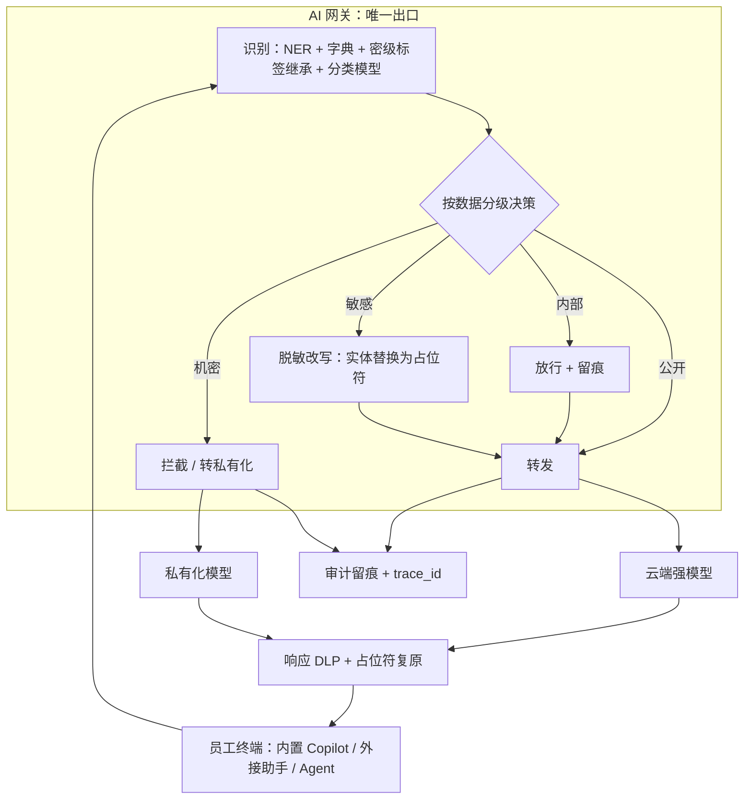

# 企业数据防泄漏

> 层级：贯穿 · 安全与合规 ｜ 贯穿矛盾：安全

## 场景

员工用 AI 工具（内置 Copilot、外接助手、Agent）处理内部数据，要防止敏感数据进 prompt、出模型、落日志、进训练集。

## 核心矛盾

**用得爽 vs 管得住**——拦得太死工具没人用，Shadow AI 就地生长；放开就是数据事故。泄漏面比传统 DLP 大一个量级，因为「数据」变成了「上下文」。

## 追问链

- 数据分级怎么落到 prompt 层面：传输前识别改写、终端侧管控，还是事后审计？各漏什么？
- 私有化部署是不是就安全了——日志、评测集、微调语料里的泄漏呢？
- 出网管控（DLP）和 AI 工具可用性怎么平衡？「脱敏后可用」的脱敏保真度怎么验收？
- 泄漏事件发生了，怎么审计追踪到人、到链路、到当时的 prompt？

## 推演

### 容量估算（先问这几个数）

- **假设 1：prompt 流量。** 公司 5000 人，30% 日活使用 AI 助手（1500 人），人均每天 40 次 prompt（Agent 场景一次任务会触发多次模型调用，按调用次数计），每次平均携带 2KB 上下文 → 1500 人 × 40 次/日 = 日均 6 万次 prompt、6 万 × 2KB = 120MB 原始流量；8 小时工作时间摊平（6 万 ÷ 28800 秒）≈ 2 QPS 均值，峰值按 20 倍 ≈ 40 QPS。**量级结论：网关侧实时检测毫无吞吐压力——这道题的难度根本不在 QPS，在策略覆盖率和误报率。**
- **假设 2：敏感命中量。** 假设 5% 的 prompt 含敏感实体（手机号、身份证、客户名单、密钥）→ 日均 3000 次命中，按每次 2 个实体算 6000 个识别事件。这是识别引擎的精度标尺：每 0.1 个百分点的误报率 = 每天 60 次错误改写。
- **假设 3：识别时延。** 正则 + 字典 + NER 组合单次 10~50ms；LLM 辅助识别单次 300ms+。同步链路预算 100ms（员工交互不能有感知延迟）→ **同步链路只能用传统识别栈，LLM 识别放异步旁路**——与注入检测同一结构，时延约束直接决定技术选型。
- **假设 4：审计存储。** 每次请求全量留痕（prompt + 响应 + 工具调用，均值 20KB），留存 180 天 → 6 万 × 20KB × 180 ≈ 216GB。存储量级可忽略，**真正的成本在访问控制**：审计库聚合了全公司喂给 AI 的内容，它本身就是最高敏感级资产，加密、分级授权、访问留痕一样不能少。
- **假设 5：误报的「爽」定价。** 假设自动改写误报率 1%，每天 600 次误改写，每次用户人工恢复 1 分钟 → 每天 10 小时组织级损耗。误报率每降 0.5 个百分点省 5 小时/天——「用得爽」不是口号，是可折算的人力成本，这条算式就是核心矛盾的定价。

量级结论：5000 人规模下，防泄漏系统的吞吐需求是个位数 QPS、存储百 GB 级——真正要投入的是策略引擎的准确率、分级体系的建设与审计的访问控制，没有一项是算力问题。

### 架构推演（从朴素方案开始塌）

**朴素方案 1：封禁外部 AI 工具 + 全员通知。**

塌在 Shadow AI，机制是禁令只消灭「看得见的用法」，不消灭需求：员工改用个人账号、手机流量、家用电脑继续用，工具照常提效、数据照常外流——企业从「可控的泄漏风险」变成「不可见的泄漏事实」，可见性归零。经验判断：禁令之后 Shadow AI 使用率不降反升是常态。这道题问的是「管得住」，禁令连「看得见」都做不到，第一个塌。

**朴素方案 2：全量走代理 + 关键词 DLP 命中即拦。**

塌在核心矛盾的正中央，两端各塌一次。可用性端：客服处理投诉必然带手机号、工程师贴代码必然带内部路径，命中即拦让工具在最需要它的场景不可用，用户被推回 Shadow AI——方案 1 的失败换了个姿势重演。准确性端：正则只能抓 PII 格式，抓不住语义级敏感——一份内部战略文档没有敏感词但密级是机密；多条非敏感数据的聚合推断（员工 ID、部门、薪资区间逐条不敏感，拼起来是薪酬表）更是完全失明。

**朴素方案 3：建统一 AI 网关，收敛所有 LLM 流量。**

方向正确——网关是 LLM 流量的天然收敛点，收敛才有可见性——但「只收敛不过滤」只是把 Shadow AI 换了个地方，还新建了一个全量敏感数据的汇聚点。完整演进分六步：

1. **出口收敛。** 网络层只放行网关出口（防火墙/DNS 策略），终端策略补内置 Copilot 这类不走企业网络的通道（桌面应用直连检测、个人 API key 检测）。
   - 收敛的目标是可见，不是拦截——先让所有流量出现在同一张图上
   - 内置 Copilot 检测里优先级最高的是「个人 API key 直连」——它绕过的不只是网关，还有公司账号体系，终端侧的 key 模式识别是最低成本的兜底
2. **网关内置识别与策略引擎。** 传输前识别（NER + 字典 + 源文档密级标签继承 + 内容分类模型），按数据分级执行策略。
   - 密级标签继承是最被低估的一环：prompt 里贴的内部文档自带企业文档系统打的密级标签，网关优先继承源标签而不是重新猜测——源头有业务上下文，网关没有，源头打标一次、处处继承，比网关端重新分类准确得多
   - 策略决策要输出结构化理由（命中规则/密级标签/分类分数）——黑盒决策无法复盘，这是审计追踪能落地的前提
3. **脱敏服务。** 实体替换为带类型与序号的占位符（张三 → [PERSON_1]，密钥 → [SECRET_1]），模型响应回流后复原。
   - 占位符保留类型信息是保语义的关键：模型需要知道「这是一个电话号码」才能正确完成任务，纯删除式脱敏会把任务一起脱残
4. **出模型侧管控。** 响应 DLP（检测模型把训练数据或他人会话数据带出来）、日志分级加密与 TTL、评测集与微调语料入库前过同一套识别引擎。
5. **审计与追踪。** 每请求分配 trace_id，串联 prompt 原文、识别结果、策略动作、模型响应、下游工具调用，支持按人、按数据级、按时间还原完整链路。
   - 留痕字段要包含「当时的模型与识别引擎版本」——事故复盘经常需要回答「防线当时是什么状态」
6. **分级混合路由。** 机密级只走私有化模型，公开/内部走云端强模型——用数据级决定模型放置，而不是一刀切。
   - 混合路由的判据写成配置而不是散在代码里——「哪级数据走哪个模型」是审计反复检查的对象，也是法规变更时唯一要改的地方

看图：「用得爽 vs 管得住」的解落在「脱敏改写」这条分支——它让敏感数据对任务可用（爽）同时对模型不可见（管住）；「拦截 / 转私有化」只留给脱敏后任务无法完成的机密。四条出策略节点的边对应四个数据级，所有路径汇入「审计留痕 + trace_id」——可见性是这套架构的地基，分级策略只是地基上的房子。

复原的顺序有一处容易做反的细节：模型响应先过响应 DLP，再做占位符复原。反过来会出两种事故——先复原再 DLP，等于把敏感数据放出去之后才检查；不复原直接返回，用户拿到一堆占位符没法用，工具体验报废。响应 DLP 查的是「模型输出里不该出现的他人数据」，复原还的是「用户自己本来就有的数据」，这个顺序是安全边界决定的，不是实现偏好。

**语料治理的三个落点值得单独说，因为它们全都不经过网关主链路：**

- **评测集**：从线上 prompt 抽样构建，抽样那一刻泄漏已定型——入库前必须过同一套识别分级引擎，且评测集的访问权限按机密数据管理
- **微调语料**：数据进权重后无法按条删除，「先训练、出事再下架模型」的代价是整个模型报废——语料审批是微调平台的前置门禁，不是事后补救
- **推理日志**：默认全量落盘是事故放大器——日志分级加密 + TTL + 按密级差异化留存，比「全留」和「不留」都更接近正确答案

**审计的另一半是异常模式检测，不是只存不用：** 离线跑行为基线——深夜批量 prompt、单会话超大上下文、高频命中竞品关键词、新账号短时间高敏感命中——这些模式单独看都不违规，组合起来是典型的数据搬运信号。审计数据的价值在查询与告警，沉睡的全量留痕只是合规成本。

最后一个容易忽略的结构性风险：网关是单点，它会成为「绕过动机」本身——网关故障时业务停摆，员工有最强的动机去找旁路。所以网关必须按可用性核心系统建设（多活、降级策略：故障时放行已知低风险类目而不是全断），且降级动作要留痕——否则每一次故障都是一次 Shadow AI 的招生宣传。

### 关键决策论证

| 决策点 | 选项 A | 选项 B | 判据 | 结论 | 何时反转 |
| ---- | ---- | ---- | ---- | ---- | ---- |
| 管控主干 | 终端侧管控（Agent + 剪贴板管控） | 网络出口收敛（网关为主干） | 网关覆盖所有走 HTTP 的工具且对用户零损耗；终端强但管不住个人设备、运维与体验成本高 | 网关为干，终端补内置 Copilot 的洞，审计做底座 | 全 SaaS 且网络不可管控 → 终端侧升主干 |
| 敏感数据处置 | 命中即拦 | 默认脱敏放行 | 客服/销售场景 prompt 天然含敏感数据，拦截 = 不可用 = Shadow AI 回归（假设 5 的误报定价同理） | B：只有脱敏后任务无法完成或机密级才拦 | 脱敏破坏任务语义（如代码补全且密钥嵌在代码里）→ 该场景走私有化或白名单 |
| 部署形态 | 全量私有化 | 分级混合路由 | 全量私有化 = GPU 重投入 + 小模型能力代差，工具变难用会把用户推回云端工具，Shadow AI 回归 | B：公开/内部走云端，敏感脱敏后走云端，机密走私有化 | 强监管行业（数据不出域是硬约束）或私有化模型能力已覆盖主流任务 |
| 语料治理 | 事后清洗 | 入库前过识别引擎（左移） | prompt 泄漏是一次性事件；语料泄漏是永久事件——评测集被反复导出共享，微调把数据烧进权重且无法按条删除 | B：左移为主，事后清洗兜底 | 无——已进权重的数据删不回来（机器遗忘至今不成熟，经验判断） |
| Shadow AI 的处理 | 发现即封号惩处 | 收编：给通道、给白名单、给自助申请流程 | 惩处训练的是「别被发现」，不是「别用」；收编把流量引回可见通道，才有管控的抓手 | B：收编为主，恶意窃取行为另按安全事件处理 | 无——封号是把这个用户推回更深的地下 |

表格里最锋利的是第四行的不对称：一次 prompt 泄漏影响一次会话，一条语料泄漏影响这份数据的整个生命周期——评测集会被导出、共享、二次加工，微调数据直接进入权重，事后无论多强的清洗都删不回来。这个不对称决定了治理必须左移到入库前，「评测集和微调语料走同一套识别分级引擎」应当是硬性纪律而不是最佳实践。

分级体系本身的建设最容易被当成文档工作跳过——没有分级就没有策略，策略引擎的所有分支都在等一份真实存在的密级定义。实践顺序：先给存量文档体系补密级标签（三档就够：公开/内部/机密），再建网关策略；顺序反了，网关只能输出「拦/不拦」的二值答案，核心矛盾无解。

### 追问应答

**1. 数据分级怎么落到 prompt 层面：传输前识别改写、终端侧管控，还是事后审计？各漏什么？**

三层不是三选一，是一个漏斗，关键是知道每层漏什么。传输前识别改写（网关）是主干：实时、可执行策略，漏的是非文本通道（图片、文件粘贴）和语义级敏感（聚合推断）；终端侧管控补内置 Copilot 与离线工具的洞，但管不住个人设备且体验代价最大；事后审计不阻止泄漏，只提供追责与异常模式发现，漏的是一切已发生的。结论：主干 + 补位 + 底座，每层明确自己的漏点，让下一层去补。

**2. 私有化部署是不是就安全了——日志、评测集、微调语料里的泄漏呢？**

私有化只解决「数据不出域」，解决不了「数据进模型后永久驻留」：私有化模型的推理日志同样落盘、评测集同样会被导出、微调语料把机密烧进权重——且权重里的数据无法按条删除（机器遗忘不成熟）。私有化要配同一条纪律：日志分级加密与 TTL、语料入库前过识别引擎、模型卡记录训练数据来源。经验判断：把私有化当「免检通道」是最常见的翻车姿势，审计部门抽查私有化环境的日志访问权限往往能直接发现问题。

**3. 出网管控（DLP）和 AI 工具可用性怎么平衡？「脱敏后可用」的脱敏保真度怎么验收？**

平衡的抓手是「默认脱敏放行」：只有脱敏后任务无法完成或机密级才拦，拦截永远是例外而不是策略。保真度验收要双向：正向——脱敏后任务完成率抽检，把脱敏 prompt 喂给模型对比业务效果是否达标；反向——对抗复原测试，用 LLM 依据上下文反推占位符原文，专抓「[PERSON_1] 是 CTO」这类残余线索。误报率直接折算成「爽」的代价（假设 5 的算式），误报治理和泄漏治理是同一个引擎的两面，不是两个团队的 KPI。

**4. 泄漏事件发生了，怎么审计追踪到人、到链路、到当时的 prompt？**

前提是事前设计，事后补不出来：网关给每次请求分配 trace_id，加密留存 prompt 原文、识别结果、策略动作、响应与工具调用。追踪路径：从泄漏物特征（如一段出现在外部的内部文档片段）检索 prompt 全量库 → 定位请求 → 还原「谁、在哪个工具、哪个会话、喂了什么、模型回了什么」。难点在 Agent 场景的链路扩散：数据会经工具再次流转出网关视野，trace_id 必须写进工具上下文跨工具传播，否则链路在第一个工具调用处断掉，只能追到「发给模型」追不到「发给了谁」。

### 常见误区

**误区一：「封了公网 AI 网站就安全了。」**

禁令消灭可见性、不消灭需求：Shadow AI 从企业视野里消失，数据照流，而且从此没有任何审计线索——比放开更糟，因为你连「哪里漏了」都不知道。正确目标是把流量收敛到可见通道并让通道好用，让「走网关」成为员工的最优选择而不是被迫的选择。

**误区二：「私有化 = 安全。」**

三个盲区：推理日志落盘、评测集导出、微调语料进权重——其中权重里的泄漏是永久性的、删不掉的。另外私有化小模型能力不足会把用户推回云端工具，Shadow AI 回归，管得住的代价变成管不住的现实。私有化是路由选项，不是免检标志。

**误区三：「DLP 关键词规则 = 数据分级。」**

正则只能抓 PII 格式（手机号、身份证），抓不住语义敏感：一份内部战略文档没有任何敏感词但密级是机密。分级的数据源必须前移到数据产生时——源文档的密级标签随内容一起进 prompt，网关做「标签继承 + 内容分类模型」双层判断，输出端正则只做兜底。用输出端关键词当分级，等于用最弱的信息做最强的决策。

**误区四：「审计日志谁都能查。」**

审计库聚合了全公司喂给 AI 的敏感内容，是整个体系里最高价值的攻击目标——防线本身成了新的泄漏点。访问审计库必须分级审批、留痕、默认最小可见，查一条日志的动作本身也要被审计。这是安全设计的自指原则：任何管控系统都要回答「谁来管控管控系统」。

---

[返回 AI 场景题地图](README.md)
