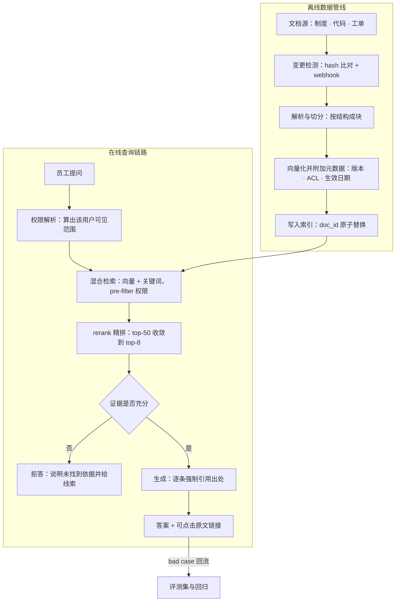

# 企业知识库问答 RAG

> 层级：③ 数据与检索 ｜ 贯穿矛盾：质量 · 安全

## 场景

员工用自然语言查公司内部文档（制度、代码、工单），要求答案有出处、权限可控。

## 核心矛盾

**检索质量 vs 延迟与成本；幻觉控制**——答错比不答更伤信任，而权限过滤让检索复杂度再上一档。

## 追问链

- 知识库每天更新，向量索引怎么保持新鲜？
- 检索不准，从切分/召回/排序哪个环节排查？
- 为什么不让大模型直接读全部文档？

## 推演

### 容量估算（先问这几个数）

先立假设、再写算式，量级对了结论就稳：

| # | 假设 | 算式与推论 |
| --- | --- | --- |
| 1 | 假设：50 万篇文档，平均 8000 token/篇；500 token/块，父子块冗余 25% | 40 亿 token ÷ 500 ≈ 800 万块 × 1.25 ≈ **1000 万向量块**——是「千万级」不是「亿级」，直接决定选型下限（索引层细节见 [向量检索服务](向量检索服务.md)） |
| 2 | 假设：embedding 1024 维，float32 存储 | 1000 万 × 1024 × 4B = 40GB 原始向量，HNSW 图结构与映射再 +50%（经验值）≈ **60GB/副本**——单机 128GB 内存可容 1-2 副本 |
| 3 | 假设：5000 名员工，10% 日活，人均 10 问/天，峰值系数 3 | 5000 问/天 ÷ (8×3600s) × 3 ≈ 0.5 QPS，按 **10 QPS** 冗余设计足够——检索并发完全不是瓶颈 |
| 4 | 假设：每请求 prompt 3000 token（系统提示 + 8 块 × 约 300）+ 输出 500 | 5000 问/天 × 3500 token = 1750 万 token/天；中档模型按 ¥0.008/千 token ≈ **¥140/天**，旗舰模型按 ¥0.06/千 token ≈ **¥1050/天**——生成成本敏感于「每请求塞几块」，不敏感于 QPS |
| 5 | 假设：每天 1% 文档变更（5000 篇 × 平均 8 块） | 4 万块/天 ÷ 100 块/秒（批量嵌入吞吐）≈ **7 分钟**跑完——新鲜度瓶颈不在嵌入，在「检测哪些文档变了」 |

这组数字给出的战略判断：企业 RAG 是一个**低 QPS、重数据、重评估**的系统。并发与算力预算宽松，人力应该砸在解析、切分、权限和评测上——给一个 0.5 QPS 的系统把检索调到 5ms，用户毫无感知。

敏感性检查——关键假设各涨一档，结论就变：文档量 ×10（500 万篇）时向量到亿级、单副本内存逼近 600GB，检索层选型立刻滑向 [向量检索服务](向量检索服务.md) 的分片与量化方案。日提问量 ×10（5 万问/天）时生成成本进入每天上万元区间，语义缓存（见 [语义缓存](语义缓存.md)）与「每请求塞几块」的治理才值得专门投入。假设不变时，不要为不存在的规模设计。

### 架构推演（从朴素方案开始塌）

**朴素方案**：文档目录 → 脚本切块 → 向量库 → top-10 检索 → 拼进 prompt → LLM 生成答案。

它会在三个地方依次塌掉，塌的顺序就是排期里最容易被忽略的顺序：

1. **先塌在权限，这是安全事故不是质量问题。** 向量库存的是全局块，检索时不知道提问者是谁：A 部门员工问「报销上限」，召回 B 部门的薪酬制度。机制：向量检索默认「先取近邻」，权限信息根本不在检索路径上；事后 post-filter 会让 top-10 被滤到只剩一两块（召回枯竭），不过滤就是直接越权。权限过滤必须前置进检索，这是一票否决项。
2. **再塌在信任，这是产品成立与否的问题。** 模型只给答案、不给出处。制度类答案员工要拿去执行，无法点回原文核实的答案等于谣言——被坑一次，用户就永久退回「问老员工」。机制：企业场景的信任路径是「可验证 → 可信赖 → 可依赖」，引用溯源不是体验优化，是产品成立的前提。
3. **后塌在召回，这是效果上限的问题。** 「差旅报销上限是多少元」这类精确条款查询，向量检索召回的是语义邻居（报销流程介绍），偏偏漏掉载有数字的那一条。机制：embedding 把 token 信息压缩进语义空间的方向，精确词项匹配不是它的强项。

演进路径与代价对账：

| 演进阶段 | 关键动作 | 修掉的塌点 | 新增代价 |
| --- | --- | --- | --- |
| V0 朴素 | 切块 → 向量检索 → 生成 | — | 三处塌点全在 |
| V1 | 权限 pre-filter + 引用溯源强制输出 | 塌点 1、2 | 索引元数据复杂度、输出 token 变长 |
| V2 | 混合检索 + rerank + 显式拒答 | 塌点 3 | 延迟 +100-200ms（经验值）、rerank 费用 |
| V3 | 评测集 + bad case 回流 + 增量更新 | 长期质量 | 专职运营人力 |

逐步演进后的终态架构：

对照三处塌点看终态：权限解析成为检索的**前置输入**（pre-filter，补塌点 1）；引用溯源成为**强制输出**（补塌点 2）；混合检索与 rerank 补上精确匹配和上下文质量（补塌点 3）。还有两个朴素方案视野外的环节：评测集与 bad case 回流是长期可运营的前提（见 [LLM 效果评估与回归平台](LLM效果评估与回归平台.md)）；检索内容本身也是潜在的注入源，模型拿到的是「不可信文档 + 可信指令」的混合体，防线见 [Prompt 注入防御](Prompt注入防御.md)。

延迟预算怎么分（端到端 P99 目标 3s，由生成首 token 决定）：权限解析 <10ms、混合检索 <50ms、rerank 50-200ms、生成首 token 占 2s 上下——检索段加起来不到生成段的零头。这决定了优化优先级：体验瓶颈永远在生成段，检索段「够准」比「够快」重要，为省 100ms 牺牲召回是负优化。

### 关键决策论证

**决策 1：权限过滤放在哪一层？**

| 方案 | 机制 | 失败模式 |
| --- | --- | --- |
| A. post-filter：检索后代码过滤 | 先取 top-k 再按权限丢弃 | 过滤后剩余块数随机，答案质量不可控地抖动 |
| B. pre-filter：ACL 进索引元数据，检索内过滤 | 检索只在「有权子空间」内找近邻 | 元数据配错时要么检索为空、要么漏权限 |
| C. per-user / per-dept 命名空间 | 物理隔离，各建各的索引 | 索引份数随组织规模膨胀，变更成本翻倍 |

**结论：默认 B，并把 A 降级为 B 的兜底校验（防元数据配错导致越权），A 不独立使用。** 判据：B 的失败模式是显式错误（检索为空，可告警），A 的失败模式是静默的质量塌方（剩几块算几块，不可发现）——显式错误优于静默错误。仅当权限模型极粗（只有部门级、文档与部门强绑定、组织规模小）时，C 的物理隔离才值得它多付的存储与更新成本。

**决策 2：混合检索的融合——RRF 还是加权分数？**

**结论：RRF（倒数排名融合）。** 判据：向量余弦分与 BM25 分量纲不可比，加权融合需要持续调参，且每次换 embedding 模型分数分布就变、权重作废；RRF 只用排名、对分数分布零假设。几乎没有反转条件——除非业务已有现成的分数归一化层，否则加权融合那点上限收益抵不过维护成本。

**决策 3：rerank 上不上？**

**结论：上，这是全链路性价比最高的一环。** 成本核算：50 块 × 300 token ≈ 1.5 万 token/次，中档 rerank 价格量级 ¥0.0008/千 token ≈ ¥0.012/次，5000 问/天 ≈ ¥60/天；延迟 P99 增加 50-200ms（经验判断）。换来的是「进 prompt 的 8 块从沾边变成对题」——上下文质量决定答案质量，因为生成模型无法凭空补全没被召回的证据。反转条件：QPS 冲到数百以上、或延迟预算收紧到 500ms 内，才需要降级 rerank（轻量模型、只对 top-20 精排）。

**决策 4：模型预算投在哪——更大的生成模型 vs 更好的检索？**

**结论：先投检索、rerank 与评测，生成模型中档起步。** 机制：幻觉的主因是证据缺失或证据噪声，旗舰模型在证据缺失时并不会显著更少幻觉，只是编得更流畅、更难被识破。只有当评测显示「正确证据就在 top-8 内、答案仍然错」的占比超过阈值时，升级生成模型才轮得到出场。

**决策 5：拒答策略——有问必答还是允许说不知道？**

**结论：证据充分才回答，不足则显式拒答并附最接近的文档链接。** 判据就写在核心矛盾里：答错比不答更伤信任。机制：拒答把错误的代价从「员工被误导执行」降级为「员工多花一次搜索」，期望损失低一个量级。反转条件：闲聊流量占比高的 To C 场景需要意图分流后再定拒答策略——企业制度问答场景不成立。

五个决策收拢成一条逻辑：能被机制论证的（权限层位、RRF、rerank、拒答）当场拍板，依赖数据分布的（生成模型选型）交给评测集裁决——这正是贯穿矛盾「输出非确定性只能评估」在架构决策上的投影。

### 追问应答

**1. 知识库每天更新，向量索引怎么保持新鲜？**

核心是「变更检测 + 文档级原子替换」两件事。变更检测用内容 hash 快照或源系统 webhook，绝不能依赖人肉触发；更新以 doc_id 为单位先删旧块再写新块（或按 version 双写后原子切换），保证同一文档的新旧块永不并存——新旧条款同时可召回，比检索不到更糟。全量重建保留为每周/每月的兜底，配合对账（索引块数 vs 源文档清单）揪出增量链路漏掉的文档。

对账频率跟着时效承诺走：制度类文档 T+1 可接受，工单类知识要求分钟级——把「新鲜度承诺」写成显式 SLO，增量链路的优先级才有依据。

**2. 检索不准，从切分/召回/排序哪个环节排查？**

先建评测集（问题 → 期望出处块），没有评测集的排查是玄学。然后在评测集上分层量三个指标：**索引覆盖率**——出处块是否存在于索引中，不存在则是解析、管线或权限配置问题；**召回命中率**——出处块是否进向量 top-50，不进则是切分碎裂或 embedding 语义问题；**精排位次**——进了 top-50 却不在 top-8，则是 rerank 问题。三个指标一一对应管线、召回、排序三段，哪个塌修哪段，避免「哪里都改一点」的盲调。

**3. 为什么不让大模型直接读全部文档？**

三笔账。算力账：40 亿 token 远超任何上下文窗口，即便 1M 窗口也要拼接数千次；成本账：输入按 token 计费、每问一次重复付全量，对照容量估算里 3500 token/问的水平，直接读全量贵数千倍；质量与安全账：长上下文存在注意力稀释（对中部内容召回下降），且**权限过滤无法在上下文层面实现**——内容塞进 prompt 的那一刻，越权已经发生。RAG 的本质是把检索做成可优化、可鉴权、可评估的独立工程环节，这也是 [向量检索服务](向量检索服务.md) 与 [非结构化数据处理管线](非结构化数据处理管线.md) 两题存在的理由。

### 常见误区

**误区 1：demo 效果好就直接上线。**
典型样子：用 10 篇干净、常被查询的文档做演示，「检索还挺准」，于是排期上线。为什么不行：demo 样本恰好避开了线上 bad case 的集中区——扫描件、过期版本、跨部门权限；没有评测集意味着此后每次换 embedding、调切分都是盲改，改好改坏无从判断，bad case 只能靠投诉发现。

**误区 2：把权限过滤写成检索后的 if 语句。**
典型样子：`results = vector_search(q, 50); results = filter_acl(results)`。为什么不行：机制上有两重失败——top-50 被滤穿后剩余块数随机，答案质量抖动；更隐蔽的是越权风险在旁路：post-filter 只保护 prompt，不保护检索中间产物（缓存、日志、trace），跨用户复用检索缓存就是泄密通道。正确位置是 pre-filter 进检索，旁路产物按用户隔离。

**误区 3：上下文塞得越多越保险。**
典型样子：top-20 全部拼进 prompt，「多给模型点信息总没坏处」。为什么不行：注意力稀释让中部块贡献骤降，噪声块会诱导模型把无关条款混进答案——幻觉率不降反升；token 成本还随块数线性涨（对照容量估算假设 4）。rerank 精选 top-5~8 是质量与成本的双赢点。

**误区 4：把 RAG 当「接个向量库」的三周项目。**
典型样子：排期表上只有向量库选型、embedding 接口、前端对话框三项。为什么不行：对照架构推演，检索只是工作量的小头，解析质量、权限模型、评测集、bad case 运营才是长期主体；缺了这四样，系统上线即巅峰，之后每次质量投诉都查无根因。

---

[返回 AI 场景题地图](README.md)
