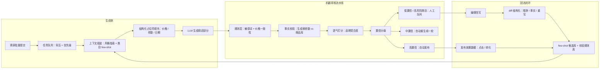

# 内容生成平台

> 层级：⑤ 业务应用 ｜ 贯穿矛盾：质量 · 安全

## 场景

营销文案、商品描述、文章摘要的批量生产平台：内容由 AI 生成、人工把关后发布，要求风格统一、事实正确、产能高。

## 核心矛盾

**生成自由度 vs 品牌与事实可控**——放开生成产能翻倍，翻车的也是内容；管得越死，AI 就退化成高级模板引擎。

## 追问链

- 批量生成怎么保证风格统一：prompt 模板、few-shot、还是微调？三条路的成本与上限差在哪？
- 事实性内容（参数、价格、日期）怎么保证不编——检索增强、生成后校验，还是结构化占位符？
- 审核是发布前全量过、还是抽样加规则兜底？误杀和漏放分别的代价怎么算？
- 人工编辑改写了 AI 的稿子，改写结果怎么回流成下次生成的参考？

## 推演

### 容量估算（先问这几个数）

- **假设 1（流量形态）**：平台服务 1000 家商家，每家日均 50 篇（商品描述 + 营销文案 + 摘要）→ 5 万篇/天。日均只有 0.6 QPS，但商家习惯早高峰一次性提交数百篇 → 瞬时峰值 50 QPS，**峰值/均值比约 80:1**。这一条直接判死刑同步 API：架构必须异步任务化。
- **假设 2（单篇 token 与成本）**：输入（prompt + 风格指南 + few-shot 范例 + 商品素材）约 3k token，输出约 800 token → 每天 1.5 亿输入 + 4 千万输出 token。假设输入 ¥4/M、输出 ¥16/M → 每天 ≈ ¥1240，**月 ≈ ¥3.7 万**。真正的杠杆不是模型单价，是迭代轮数：一篇平均「生成-评审-重写」3 轮，成本 ×3 → 11 万/月。把平均迭代从 3 轮压到 2 轮，省的钱比把模型换便宜一档还多。
- **假设 3（人审产能）**：一篇营销文案人工把关 2 分钟（含退回沟通），5 万篇/天 = 1670 人时/天 ≈ **209 个全职编辑**。假设编辑团队 20 人 → 人审上限约 4800 篇/天，覆盖率仅 10%。结论不是「招人」，是**全量人审在数学上不成立**，审核体系必须分层——这是算出来的，不是理念。
- **假设 4（风格三路的成本差）**：few-shot 每篇注入 2 个范例 × 500 token ≈ +1k 输入 token，叠加假设 2 上输入成本 +33%；微调的一次性投入按某商家 1 万条历史稿 × 2k token × 3 epoch ≈ 6 千万训练 token，外加**每次风格变更都要重训 + 全量回归评估**的工程周——变更频率才是微调的隐藏成本。
- **假设 5（质量基线）**：无约束生成的参数类幻觉率假设 5%（经验判断，随 prompt 质量波动）→ 5 万篇 × 5% = **2500 篇/天**带错误事实上线。这个数是人审体系必须接住的量，接不住就是事故池。
- **假设 6（版本留存）**：5 万篇/天 × 平均 1k 字 × 双版本（AI 原稿 + 编辑终稿）≈ 200MB/天纯文本，年 70GB——存储成本可忽略，但 schema 必须第一天就带「原稿/终稿/diff」三个字段。**双版本留存是追问第 4 条回流闭环的数据前提**：事后想补版本，回流能力等于从第一天起就是空的，这是这套系统最容易被跳过、又最难返工的一条。
- **假设 7（失败与重试的隐性成本）**：API 超时/限流率假设 2%，任务化后统一重试一次 → 额外 1000 篇/天重生成 ≈ ¥25/天，可忽略；但若无队列背压、靠客户端自发重试，重试风暴会把实际调用量放大 3-5 倍——**重试策略是成本项，不是可靠性细节**，放错位置的退避逻辑一个月能烧掉一台 GPU 的钱。

六个量级合起来的结论：生成侧的账单（假设 2/4/7）是线性的、可预算的；审核侧的缺口（假设 3/5）是结构性的、只能靠架构填。这个平台的设计重心不在「怎么把模型调得更会写」，在「怎么让 20 个编辑接得住 5 万篇」。

### 架构推演（从朴素方案开始塌）

**朴素方案**：商家提交 → 同步调 LLM → 返回稿子 → 编辑逐篇审 → 发布。

塌点：

1. **吞吐塌在同步等待**。800 token 生成 10-20s，一次提交 500 篇串行 ≈ 2 小时；并发提交撞 API 限流，429 重试风暴。峰值/均值 80:1 的流量形态下，同步调用是第一个死法——死的指标是任务完成时长（P90 从分钟级涨到小时级）。
2. **质量塌在裸 prompt**。1000 家商家共用一个模板 → 文风随商家素材漂移，风格统一无从谈起；价格、参数让模型自由写 → 按假设 5，每天 2500 篇带错误事实，20 个编辑肉眼根本扫不出来——人审对「看起来合理的事实错误」检出率极低（编辑不会逐个核对价格），而幻觉恰好集中在这类。
3. **产能塌在审核队列**。全量人审需要 209 人、实际 20 人 → 队列积压 10 倍，发布延迟 T+3，「产能高」这个需求第一个死。三个塌点是连乘的：生成越自由 → 错误越多 → 人审越堵 → 产能越低。

三个塌点连乘的教训：这个平台的核心流水线不是「生成」，是「生成 → 机审 → 分级 → 回流」的闭环——生成只是闭环里最容易被替换的一段，审核与回流才是产能和质量的承重墙。

**演进六步**：

1. **任务化**：提交返回任务 ID，生成进队列按优先级消费，商家侧轮询/回调。吞吐由队列背压控制，而不是靠客户端重试——削峰填谷是队列的本职。
2. **失败可见**：重试 3 次仍失败的任务进死信队列并回调商家——批量场景里「少生成 50 篇」如果静默，商家在发布环节才发现，信任损伤远大于一次生成失败本身。
3. **生成前组装**：结构化占位符先行——价格/参数/日期从商品库字段直接填进模板槽位，模型只生成叙述部分；风格注入用「蒸馏版风格指南（≤10 条可执行规则）+ 类目 few-shot 范例」，不塞品牌手册全文（机制见误区 1）。
4. **机器审核流水线**：规则层（敏感词、价格必须等于数据库值）→ 事实校验层（从生成稿抽取参数与库中逐项比对）→ 语气模型（品牌契合度打分）。按置信度分级：假设自动通过率 95% → 2500 篇/天进人工队列，刚好在 4800 篇上限内。**注意这个数字的张力**：如果自动通过率只有 85%，人审要接 7500 篇/天，超编——所以中置信稿件不该送人审，而是自动重生成一轮：重生成 5000 篇的成本 ≈ ¥125（按假设 2 单篇 ¥0.025），人审同量的工时成本 ≈ ¥5000-10000。**钱该花在多生成一轮上，不是多雇一个编辑上。**
5. **改写回流**：保留 AI 原稿与编辑终稿双版本，diff 结构化分类（措辞/事实/结构三类），措辞修改沉淀为类目 few-shot 候选，事实修正回流成校验规则（详见追问第 4 条）。
6. **变更管理**：prompt、few-shot 范例、风格规则都是这个系统的「代码」，每次变更必须跑固定回评集（按类目分层的 500 篇样本），采纳率与事实校验通过率不回退才放量。这类变更在这个平台的频率是按天计的——没有回评集的 prompt 变更等于闭眼发版，而它的「事故现场」是全商家批量文风漂移，发现时已经发了几万篇。

北极星指标选**编辑采纳率**（AI 稿原样或微改即发布的比例）：它同时度量风格契合与事实可靠，且不可被「多生成垃圾」刷高——每篇都计成本。

**终态架构**：

图外还有一件基础设施：**prompt 与范例的版本库**。生成质量回退时，第一问永远是「哪个版本变了」——prompt 模板、few-shot 范例、校验规则都要有版本号与生效范围（商家 × 类目），否则回流闭环会把「变好的改进」和「变坏的回归」混成一锅，评估归因无从下手。

### 关键决策论证

四个决策点共享同一个母判据：**误杀和漏放的代价不对称**——漏放是不可逆的品牌与法律事故，误杀是可量化的编辑工时；不对称的赌局，筹码押在防漏放上。

**决策 1：风格统一的三条路怎么选。**

| | prompt 模板 | few-shot | 微调 |
|---|---|---|---|
| 边际成本 | ≈ 0 | 输入 token +33%（算式见假设 4） | 一次性训练 + 每次变更重训与回归 |
| 一致性上限 | 同构不同味：所有商家一个味 | 范例覆盖内稳定，范例外漂移 | 风格内化进参数，上限最高 |
| 变更响应 | 改模板即时 | 改几行范例即时 | 重训 + 全量评估，按周计 |

**结论：默认 few-shot（规则 + 3 个范例），只有单商家月产量 >5000 篇且风格投诉集中时才为它微调。** 判据是变更成本：营销风格指南一年改几次，few-shot 即时生效，微调每次都是一个小项目——没有评估平台支撑的微调不可持续（评估闭环见 [LLM效果评估与回归平台](LLM效果评估与回归平台.md)）。**反转条件**：商家收敛为少数签了风格 SLA 的大客户、且风格半年不变，微调的摊薄才成立。

**决策 2：事实性内容怎么保证不编。**

**结论：结构化占位符为主，生成后校验兜底，RAG 只管长文叙述背景。** 三条路作用位置不同，不是互斥选项：RAG 在输入端给材料，但**给材料保证不了照抄**——LLM 的数字输出是从 token 分布采样的，不是从上下文复制，除非约束解码；校验在输出端抓错，能兜底但只能事后；占位符**绕开生成**——填充值来自商品库唯一可信源，错误来源从「模型 + 数据」收敛到「数据」，机制上归零。判据按字段分：价格/参数/日期这类「错一次就赔钱」的零容忍字段必须占位符；行业背景、使用场景这类叙述性内容交给 RAG；校验层全量跑做最后防线。**反转条件**：纯模板化描述（叙述占比趋近零）时，校验可简化为纯规则比对。

**决策 3：审核策略——全量机审分级 vs 抽样人审 + 规则兜底。**

误杀与漏放的代价不对称：误杀 = 一篇稿子多等几分钟编辑工时（¥1-2，可量化）；漏放 = 错误价格上线下单纠纷，单次信任/法律成本远超一万次误杀（经验判断，不可量化但不可逆）。**结论：全量过机器审核流水线，人审只接管低置信与高风险类目；抽样的位置放在「监督机审本身」（每周抽 5% 机审通过稿人工复核，校准机审质量），而不是「替代机审」。** 纯抽样 10% 意味着 90% 内容无审上线，按假设 5 每天漏放 2250 篇——漏放的池子直接由幻觉率决定，这不是阈值问题，是覆盖率问题。**反转条件**：某类目机审通过率连续稳定 >99% 且风险等级低（如轻量摘要），可对该类目降为纯机审。

**决策 4：改写回流——全自动 diff 回流 vs 人工标注回流。**

全人工标注质量最高，但编辑每篇已花 2 分钟，再标 1 分钟 = 产能再砍三分之一；全自动会把「删掉重写」也当风格信号回流——重写意味着方向错误，把它当范例等于教模型学错误方向。**结论：自动 diff + 规则分类 + 跨编辑共识过滤**——同一类目下多个编辑都做出的同类修改才进 few-shot 候选库，单编辑偏好不得污染全局；事实修正直接回流为校验规则（机器可执行，不需要模型学习）。**反转条件**：没有编辑团队的全自动平台，回流退化为「发布后效果数据回流」——点击/转化好的稿子当范例，此时回流信号从「编辑偏好」变成「市场验证」，粒度更粗但更客观。

### 追问应答

**1. 批量生成怎么保证风格统一：三条路的成本与上限差在哪？**

成本见容量假设 4 的算式：模板零边际但上限是「一个平台一种味」，差异化无从谈起；few-shot 每篇 +1k token（输入成本 +33%），上限是「范例覆盖的语式内稳定，范例外漂移」，可用「检索最相似范例动态注入」扩大覆盖；微调上限最高（风格进了参数），但每次品牌手册变更 = 重训 + 回归评估，团队没有评估闭环时会被拖死。结论：平台默认 few-shot，微调只留给头部大客户，模板负责骨架结构（标题、段落、字数），三层叠加而非三选一。

**2. 事实性内容怎么保证不编？**

机制上三层纵深：占位符**绕开生成**（价格/参数/日期从商品库填充，机制上零错，管零容忍字段）；生成后校验**抓错误**（抽取生成稿中的事实与库中比对，全量跑，管漏网的）；RAG **给材料**（只用于叙述性背景，不承担数字正确性——模型从分布采样数字，检索对了也可能写错）。判据一句话：**字段错了会不会赔钱——会就占位符，不会才允许模型写**。

**3. 审核全量过还是抽样加规则兜底？误杀和漏放的代价怎么算？**

先用产能算式否掉全量人审（需要 209 人、只有 20 人），再用漏放池子否掉纯抽样（10% 抽样 = 每天约 2250 篇无审上线）。所以是全量机审 + 分级人审 + 抽样监督机审。误杀的代价可量化（编辑工时、发布延迟），漏放的代价不可逆（错误价格的法律与信任成本）——不对称性决定机审阈值偏严，但「严」由机器的置信度分级承担，不由人海承担；中置信稿件的正确出口是自动重生成（¥125/天）而不是人审（¥5000+/天），算式见架构推演第 3 步。

**4. 人工编辑改写了 AI 的稿子，改写结果怎么回流？**

工程前提是**双版本留存**：AI 原稿与编辑终稿一起存，否则回流无从谈起。diff 按三类分流：措辞修改（换词、调语序）回流为类目 few-shot 候选，经跨编辑共识确认后生效；事实修正回流为校验规则（这类错误下次直接由规则层拦截，不指望模型「学会」）；整段重写/拒稿不回流内容，记为负信号进评估集。关键设计是准入门槛——单编辑偏好不能直接进范例库，否则风格库随强势编辑漂移且无法归因。编辑的每次修改都是免费的强标注，但**免费标注也需要质检管道**。

### 常见误区

**误区 1：把品牌手册全文塞进 system prompt。** 典型样子：3 万字品牌指南整段贴进去，以为「给得越全越好」。不行机制：无效 token 稀释注意力，指令遵循率随无关内容长度下降（lost-in-the-middle），且按假设 2 的算式每篇输入成本 ×10；正解是人工蒸馏成 ≤10 条可执行规则 + 3 个范例，全文手册留给微调训练语料或检索。

**误区 2：幻觉靠编辑肉眼兜底。** 典型样子：生成端不做任何约束，流程图上画一个「人工审核」框就认为闭环了。不行机制：假设 3 已证明全量人审需要 209 人不存在；更隐蔽的是人审对「看起来合理的事实错误」检出率极低——编辑扫的是文风不是对账，而幻觉恰好集中在「合理但错误的价格/参数」上。兜底必须自动化：价格一致性是规则可判的，根本不该消耗人力。

**误区 3：编辑改过的稿子直接滚动进 few-shot。** 典型样子：每天把最新改写稿自动加入范例库，「越改越准」。不行机制：「删掉重写」是负样本，回流它等于把错误方向当范例教给模型；且没有共识门槛时，范例库被单个强势编辑带偏，风格漂移且无法归因。回流管道必须有分类（措辞/事实/重写）和准入（跨编辑共识 + 采纳率验证）。

**误区 4：所有内容类型共用一个 prompt 模板。** 典型样子：营销文案、商品描述、摘要共用一套 system prompt，只换主题词和素材。不行机制：三类内容的正确性结构不同——营销是风格导向（可自由发挥的空间大）、描述是事实导向（数字零容忍）、摘要是忠实导向（不可引入外部信息）；共用模板逼着校验层按最严标准一刀切，误杀率上升，且三类内容的幻觉率混进同一个池子，永远无法归因到具体模板——排查问题时连「是哪类内容坏了」都要先猜。

---

[返回 AI 场景题地图](README.md)
