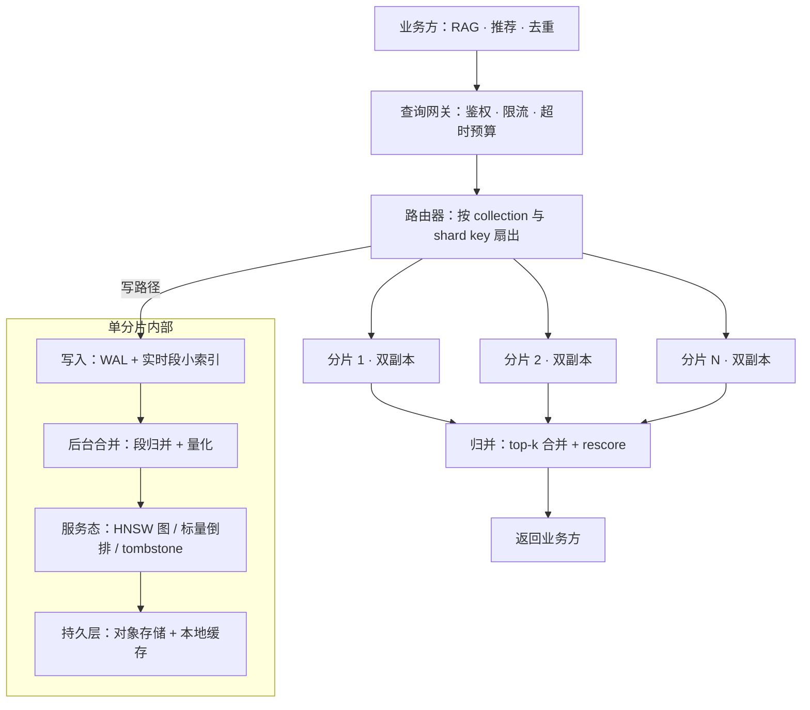

# 向量检索服务

> 层级：③ 数据与检索 ｜ 贯穿矛盾：延迟 · 成本

## 场景

作为公司级平台能力，支撑亿级向量、毫秒级延迟，供 RAG、推荐、去重等多业务共用。

## 核心矛盾

**亿级规模 vs 延迟与内存成本**——精确检索不可行，近似检索就要在召回率和资源之间做选择。

## 追问链

- 亿级向量带标量过滤，为什么性能会塌？怎么救？
- 索引内存爆了怎么办？
- 为什么不用数据库的 B+ 树做向量检索？

## 推演

### 容量估算（先问这几个数）

先立假设再算账——这道题的每一笔账都指向同一个词：内存。

| # | 假设 | 算式与推论 |
| --- | --- | --- |
| 1 | 假设：10 亿（1e9）向量，768 维，float32 | 1e9 × 768 × 4B ≈ **3TB** 原始向量——单机内存（128-512GB 档）装不下，分片或压缩必选其一，这是本题第一道分岔 |
| 2 | 假设：HNSW 图，M=16（0 层出边 32） | 每向量约 32 条边 × 4B ≈ 128B，加 id 映射与层级指针，图结构合计约为原始向量的 +50%（经验值）→ float32 + HNSW ≈ **4.5TB**，需约 30 台 128GB 分片，不现实 |
| 3 | 假设：SQ8 标量量化（每维 1B） | 768B/向量 ≈ 0.25× → 768GB；PQ（96 子空间 × 1B）≈ 96B/向量 → **96GB**——SQ8 后 2-3 台分片可扛，PQ 后单台可扛亿级 |
| 4 | 假设：平台峰值 5000 QPS，P99 < 50ms | 3 分片并行，单分片内存 HNSW 查询 P99 < 5ms（经验值），扇出归并网络 +5-10ms → 全链路 P99 ≈ 20ms，余量充足——**延迟预算宽松，内存成本才是主矛盾** |
| 5 | 假设：日增 500 万向量（推荐场景实时行为） | 平均 58 写 QPS、峰值按 10 倍 580 QPS——写入吞吐不是瓶颈，但 HNSW 频繁插入会劣化图质量，需要段管理与定期合并 |

量级结论：10 亿 float32 是「集群问题」，10 亿 PQ 化是「单机问题」，而延迟从头到尾都不是最难的部分。工程重心应压在「怎么用可接受的召回损失换内存」上，而不是压在查询路径微优化上。

### 架构推演（从朴素方案开始塌）

**朴素方案**：单实例 pgvector（或单机 faiss 进程），所有业务共用一个索引，全量塞进去。

它的塌点是连环的：

1. **第一塌：容量。** 对照假设 1-2：float32 + HNSW ≈ 4.5TB 内存，任何单机装不下；退一步放磁盘，HNSW 图遍历是随机跳访问，磁盘随机读会把 P99 从 5ms 恶化到数百 ms——量级直接击穿 SLO。塌在内存容量上，朴素方案就地死亡。
2. **第二塌：多业务隔离。** RAG 要按权限过滤，推荐要按时间窗过滤，去重要全量无过滤——共享一个索引意味着任何一个业务的过滤字段变化都牵动全局索引结构。机制：混合查询的执行计划与索引形态强耦合，多业务共享必须引入 collection 级隔离。
3. **第三塌：可用性与写放大。** 单实例无副本，重启即不可用；持续写入导致索引段碎片化、图质量随时间劣化——「昨天还准，今天召回落了」这类事故的根因常常是没有段合并机制。

逐步演进：

1. **压缩先行**：float32 → SQ8（4 倍压缩，召回损失用评测集验证），内存从 4.5TB 量级降到 1TB 量级；仍不够再上 PQ。
2. **分片 + 副本**：按向量 id hash 分 3-8 片，每片双副本；查询扇出、归并 top-k。归并要求各分片使用同一距离度量与同一量化配置，否则分数不可比。
3. **段管理与增量写入**：写入先进实时段（小 HNSW，可变），后台合并成不可变大段；删除打 tombstone，合并时物理清除——这直接对应追问 2 里「隐性内存」的来源。
4. **混合查询分档**：按过滤选择性路由（详见决策 3），结构性高选择性字段上提为 partition key。
5. **冷热分层**：热数据内存 HNSW，冷数据磁盘索引（DiskANN 路线），P99 分级 SLO——推荐场景「最近 7 天热、更早冷」是典型形状。

终态架构：

这张图里最值得强调的是「单分片内部」那条线：实时段保证写入低延迟可见，后台合并控制图质量与量化收益，tombstone 让删除可追溯——三者缺一，「亿级 + 持续更新」就不可运营。它的上游（向量与元数据从哪来）见 [非结构化数据处理管线](非结构化数据处理管线.md)，典型查询方（权限过滤与引用溯源怎么用检索）见 [企业知识库问答 RAG](企业知识库问答RAG.md)。

### 关键决策论证

**决策 1：选型——pgvector、ES 插件、还是专用向量库？**

| 选项 | 适用判据 | 主要代价 |
| --- | --- | --- |
| pgvector | 千万级以内；向量与业务表同库、要事务与 join；团队已有 PG 运维 | 亿级构建时长与内存不可行；纵向扩展上限低 |
| ES 插件 | 已有 ES 集群，需要全文 + 向量一体化 | 向量性能弱于专用库，JVM 堆模型吃内存 |
| 专用库（Milvus / Qdrant 等） | 亿级规模；多业务多租户；需要独立扩缩容 | 新增一套运维栈；选型迁移成本高 |

**结论：题面是「公司级平台、亿级」——答案是专用库。** 但论证的价值在反转条件：单一业务、千万级以内、需要与业务数据强 join 时，pgvector 是更优解，此时上专用库属于过度设计。经验判断：向量规模每上一个量级，选型结论大概率反转一次。

**决策 2：索引结构——HNSW 还是 IVF 系？**

**结论：内存预算买得起就 HNSW（配 SQ8 找平衡点），买不起才 IVF-PQ + rescore。** 判据是内存。机制上 HNSW 快的原因：可导航小世界图的贪心遍历，跳数近似 O(log N)，长短程边混合让任意起点都能快速逼近目标；IVF 依赖质心分桶，桶边界两侧的近邻必丢其一，nprobe 调大则计算量线性涨。反转条件：写入吞吐极高且要求实时可见（HNSW 并发插入退化）、或 QPS 低到可以接受 IVF 用延迟换内存。

**决策 3：标量过滤范式——post-filter、pre-filter 还是分区？**

| 范式 | 机制 | 适用区间（保留率 = 过滤后剩余比例） |
| --- | --- | --- |
| post-filter | 先 ANN 取 top-k，后过滤 | 保留率 >10% 时可用；低于此 top-k 被滤穿 |
| pre-filter（filtered HNSW） | 过滤 id 集参与图遍历 | 保留率中等最优；保留率过低时子图不连通，召回崩 |
| 精确子集暴扫 | 标量倒排取 id 集，集合内暴力算距离 | 保留率 <0.1% 反而最快——10 万 id × 768 维 ≈ 毫秒级 |
| partition key | 结构性过滤字段（如 tenant_id）上提为分区，先裁剪分区再检索 | 字段基数有限且业务语义稳定时 |

**结论：平台层必须做「按选择性自适应路由」，不能押注单一范式。** 机制：过滤的本质是改变了「在哪个集合上做 ANN」，集合大小决定最优方法——没有一种范式通吃所有保留率。这正是追问 1 的完整答案。

**决策 4：内存方案——降维、量化、分片还是上磁盘？**

| 手段 | 内存变化 | 代价 |
| --- | --- | --- |
| SQ8 量化 | ÷4 | 召回损失 1-3 个点（经验值，必须用评测集验证） |
| matryoshka 降维 768→512 | 再 ÷1.5 | 需模型原生支持或重新嵌入 |
| PQ + float32 rescore | ÷30 | 召回损失大，rescore 补偿，延迟 +10-30ms |
| 分片横扩 | 线性加机器 | 成本与运维复杂度线性涨 |
| 磁盘索引（DiskANN 路线） | 内存 ÷10 | P99 恶化到几十 ms，只适合冷数据 |

**结论：按「改造深度」升序使用：先 SQ8，再降维，最后才分片加机器或磁盘分层。** 反转条件：评测显示 SQ8 召回损失不可接受时，直接跳到 PQ + rescore 或回到 float32 分片，不要在 SQ8 上反复挣扎。

**决策 5：自建平台还是买云托管？**

**结论：内网数据不出域的合规要求通常一票否决云托管；可出域时按运维人力算账——有专人养平台就自建，没有就买。** 这是经验判断：向量平台最大的隐性成本不是软件，是段合并调优、容量巡检、坏副本切换这类全天候值守。

### 追问应答

**1. 亿级向量带标量过滤，为什么性能会塌？怎么救？**

塌有两种机制。post-filter 路线：过滤选择性高（保留率 <10%，经验值）时 top-k 被滤穿，返回又少又不相关；pre-filter 路线：被过滤节点占多数时，图遍历的候选边大面积失效，子图不连通，贪心遍历无路可走，召回崩塌。救法按保留率分档路由（见决策 3 的表）：保留率高走 filtered HNSW；保留率极低改「标量倒排取 id 集 → 集合内精确暴扫」，此时暴扫成本可控且结果精确；结构性字段上提为 partition，从查询形态上消灭混合过滤。

**2. 索引内存爆了怎么办？**

按改造深度递进四步：SQ8 量化（÷4，改造最浅）；matryoshka 降维（再 ÷1.5，需重新嵌入）；PQ + rescore（÷30，召回用评测兜底）；分片横扩或磁盘分层（成本换容量）。动手前先查隐性内存：tombstone 未物理清理、段合并期的双份索引、图结构与 id 映射——实际占用常比「维数 × 4B × 条数」高 50% 以上；先看账单再买机器，很多「内存爆了」其实是「合并没做完」。

**3. 为什么不用数据库的 B+ 树做向量检索？**

B+ 树的查询语义是「一维全序键上的等值/范围扫描」，而最近邻的谓词是「768 维空间里距离最小」，两者不可通约。机制（维度灾难）：把 768 维压到任何一维排序，单维投影的排序与真实欧氏距离排序的秩相关随维度上升而衰减——近邻信息在一维化时就丢光了。HNSW/IVF 的本质是放弃全序、利用空间结构（图连通性、聚类质心）把最近邻查找降到近似 O(log N)。B+ 树在向量系统里的真正位置是标量过滤的倒排/有序索引——它是混合查询的配角，不是主角。

### 常见误区

**误区 1：用精确检索的直觉验收 ANN——「召回 99% 不够，能到 100% 吗」。**
典型样子：拿暴力扫描结果当金标准，要求 recall@10 = 100%。为什么不行：top-10 尾部的向量距离差常常小于 1%，第 10 名与第 11 名在业务上无差别，而 100% 召回的代价是对全量暴扫；正确验收是在业务评测集（RAG 答案命中率、推荐转化）上验证端到端不回退。

**误区 2：只按「维数 × 4B × 条数」规划内存。**
典型样子：算出 3TB、买 3TB 内存，上线后 OOM。为什么不行：图结构 +50%、id 映射、tombstone、合并期双段——峰值占用是稳态的 2-3 倍；容量规划必须按峰值与合并窗口算，不按理论稳态算。

**误区 3：把过滤当应用层后处理。**
典型样子：SDK 拿回 top-100 后在业务代码里按时间、权限各自过滤。为什么不行：一是 top-k 滤穿导致结果枯竭，二是每个业务各自实现一份过滤语义，平台无法统一优化与审计——过滤语义必须收进平台查询接口（见决策 3）。

**误区 4：平台第一天就做通用查询语言。**
典型样子：设计支持任意布尔组合、聚合、排序的 SQL 方言。为什么不行：组合谓词让执行计划空间爆炸，决策 3 的选择性自适应路由根本无法落地；平台 80% 的价值在「写得进、查得出、容量与召回可观测」，先做窄 API，等真实需求倒逼再扩。

---

[返回 AI 场景题地图](README.md)
