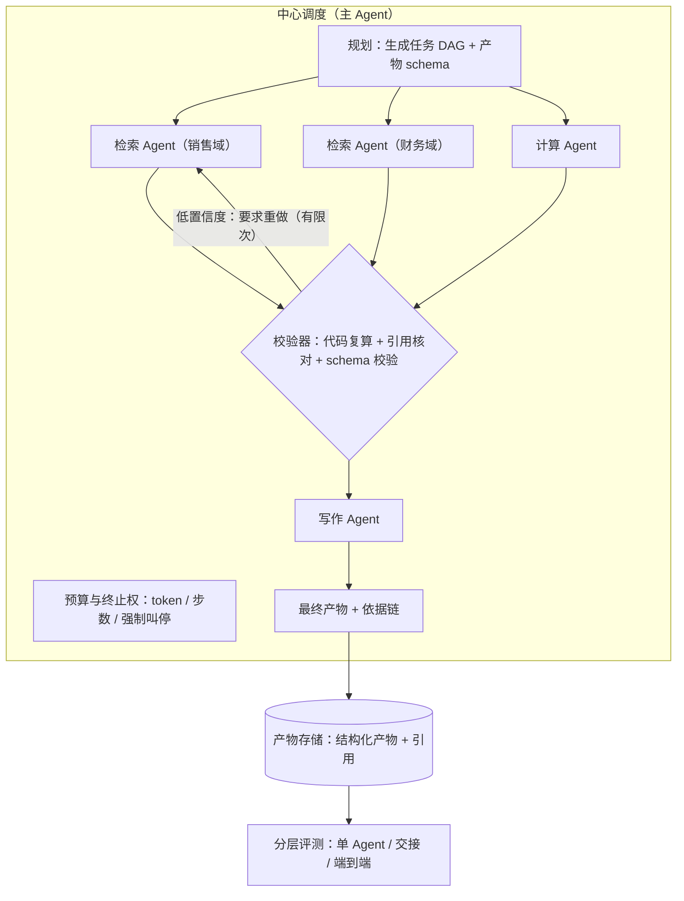

# 多 Agent 协作系统

> 层级：④ Agent 与工具 ｜ 贯穿矛盾：质量 · 成本

## 场景

复杂任务（比如季度经营分析）单个 Agent 搞不定：要拆给规划、检索、计算、写作等多个角色 Agent 协作完成，像一支虚拟团队。

## 核心矛盾

**分工的能力增益 vs 协作的误差放大**——每个环节都「大概对」，串起来却可能整体错：多一步就多一次幻觉机会，多一次交接就多一次信息损耗。

## 追问链

- 编排用中心调度（主 Agent 派活）还是 Agent 间自由通信？两种模式的失败形态分别是什么？
- 上下文怎么在 Agent 间传递：全量共享、结构化交接、还是摘要传递？各自丢什么信息？
- 某个子 Agent 输出有错，错误怎么隔离，不传染给下游？（对比：微服务里的故障隔离）
- 多 Agent 系统怎么整体评估？单 Agent 各自达标不等于协作结果达标——评测单元怎么定？

## 推演

### 容量估算（先问这几个数）

多 Agent 系统的账要算三本：token、误差、时间。三个都是乘法系统，这是本题所有结论的数字基础。

- 假设一（协作税）：季度经营分析拆 6 个角色（规划、3 个数据域检索、计算、写作），每角色 5-10 步 → 全任务 40-60 次 LLM 调用；每次输入平均 8k token（角色上下文 + 交接内容）、输出 1k → 单任务约 40-50 万 token。对比单 Agent 完成同任务的约 5 万 token，**协作税 8-10 倍**。结论：拆分必须有架构收益（权限隔离、上下文隔离、真并行）来支付这笔税。
- 假设二（误差相乘）：设结构化交接的关键信息保真度约 0.9、摘要交接约 0.7（经验判断的量级示意，用于说明机制而非精确测量）；经过两跳交接，全链路保真度 0.9² ≈ 81% vs 0.7² ≈ 49%。机制：**误差不是相加，是相乘**——这直接推出「交接设计」比「单环节质量」更重要。
- 假设三（延迟）：6 角色 × 5 步 × 每步 10-20s，全串行 = 10-15 分钟；若 DAG 并发上限 3，关键路径 5 步 ≈ 2-3 分钟。结论：墙钟时间由关键路径决定，调度必须按依赖图（DAG），不能写成顺序链。
- 假设四（成本与失控上限）：20 个分析任务/天 × 45 万 token ≈ 900 万 token/天，混合单价 $3/1M ≈ $27/天——量级可承受；但没有任务级预算时，「Agent 互相评审挑错」的循环可以让单任务 token 翻 5 倍以上（互审每轮 +N 万 token 且无自然终止点）。结论：预算约束不是优化项，是防止协作退化为成本黑洞的护栏。
- 假设五（评估成本）：端到端评测一条 case 要跑全流程 ≈ 45 万 token ≈ $1.4/条；100 条 case 一轮回归 ≈ $140 + 1-2 小时。结论：整体评测贵且慢，决定了评测必须分层、集要小而精——不能把端到端回归挂在每次提交上。

三本账（token、误差、时间）合起来的结论：**多 Agent 的设计空间由三个乘法主导——token 是乘法（每角色全量上下文）、误差是乘法（交接保真度相乘）、时间是乘法（关键路径串行）**；所有架构选择本质上是在这三张乘法表上做减法。

### 架构推演（从朴素方案开始塌）

朴素方案一句话：自由协作——一群 Agent 在共享消息板（群聊）里自由讨论，谁都能发言、都能拉别人进任务，讨论到「大家觉得差不多了」为止。

动手设计前先校正一个前提：**分工的能力增益不是「人多力量大」**。真实增益来自三个机制（经验归纳）：上下文隔离——每个角色的上下文更干净，检索 Agent 不必背着写作的几万 token 历史；真并行——独立子任务同时跑，墙钟时间除以并发度；权限边界——不同数据域不同权限，这同时是合规要求。凡是不属于这三个机制的拆分，收益都存疑：先看机制，再看组织架构图。

**第一塌：塌在收敛性，指标是成本无上限。** LLM 的默认行为是「回应」，回应生成回应；群聊里没有外部终止器，「礼貌地永不结束」是常态——互相补充、互相肯定，轮次无上限。机制：终止条件只能来自系统（预算、轮次上限），不能来自参与者的自我感觉（非确定性输出不能当终止条件，与 [Agent任务执行平台](Agent任务执行平台.md) 的循环问题是同一个机制）。

**第二塌：塌在错误的信任增强，指标是错误存活率。** 检索 Agent 幻觉出一个不存在的指标 → 群聊里被计算 Agent 引用 → 计算结果再被写作 Agent 引用——每被引用一次，错误就多一层「既有结论」的外衣。机制：上下文中已存在的陈述会系统性提高模型对它的采信度，所以**错误不是线性传播，是获得信任增强**；下游越是「认真负责」地基于上下文工作，错误传播得越深。这是多 Agent 与单 Agent 的本质差异：单 Agent 的幻觉至少不会被另一个「背书」。

**第三塌：塌在不可调试，指标是定位时间。** 出错后翻遍群聊历史也说不清哪个环节引入的——没有结构化交接记录，错误归因从「查状态机」退化成「读十万字聊天记录」。多 Agent 系统的调试成本主要花在归因上，朴素方案把归因通道堵死了。

三次塌有一个共同根源：**把「协作」当成了对话，而不是数据流**。对话没有 schema、没有终止器、没有信任衰减标记；数据流有 schema（交接契约）、有预算（终止器）、有置信度（信任标记）。终态架构的全部设计，就是把对话改造成数据流。

三次塌逼出终态，演进步骤如下：

1. **中心调度（Orchestrator-Worker）**：主 Agent 生成任务 DAG（节点 = 角色 + 产物 schema），按依赖调度 worker；worker 只与主 Agent 交接，不互聊。失败形态从「不收敛 + 信任增强」收窄为「主 Agent 单点规划错误」——单点、可定位、可终止、可回放。worker 之间不直连还有一条安全理由：权限按「主 Agent → worker」单向授予，杜绝 worker 互相拉活造成的权限旁路。
2. **交接契约**：Agent 间不传对话，传结构化产物，最小字段集：结论（conclusion）、依据与引用（evidence，指向可核验的来源）、置信度（confidence，含理由）、已知不确定性（caveats）。写作 Agent 收到的不是「检索结果摘要」，而是这个结构——下游据此决定采信还是质疑。契约本身也要有测试：每个 worker 用固定输入做产物回归，schema 变更走版本号——否则契约会漂移，而漂移的契约比没有契约更危险（下游以为有保证，实际没有）。
3. **确定性校验器卡关键节点**：计算 Agent 的结果由代码复算（LLM 不做算术的最终裁决者），引用做存在性检查（引文是否真实存在于检索结果），摘要与原文做覆盖度抽检——能用代码验证的绝不信任模型自审。
4. **错误隔离**：交接产物带置信度与依据链，下游对低置信度输入可要求重做（次数有限）或降级输出（明确标注不确定性）；DAG 天然隔离——子任务失败只熔断所在分支，不阻塞无关分支。任务级 token/步数预算，主 Agent 拥有强制终止权；预算做分配式而不是一刀切：主 Agent 按节点类型预估分配（检索类便宜、计算类贵），超支的分支先被砍——预算是调度信号，不只是熔断线。
5. **分层评测**（见追问四）：单 Agent 层、交接层、端到端三层各设评测单元，端到端集小而精。

主 Agent 自己也会上下文爆炸：它若把所有 worker 的原文产物都拉进上下文，40-60 步的产物足够撑爆窗口。规则：主 Agent 只持有产物的结构化摘要与引用，需要细节时按引用取——「结构化交接」对编排者本人的意义就在这里：按契约消费产物，而不是泡在全文里。

与微服务故障隔离的对照放在这里说最合适：微服务隔离的是**故障**（实例挂了不拖垮别人），手段是熔断、降级、舱壁；多 Agent 隔离的是**错误语义**（错了不让它变得可信），手段是置信度标记、确定性校验、污染标注。两者只共享「舱壁」（DAG 分支隔离）这一招——因为故障是二元的（挂/没挂），错误是连续的（错多少、多可信）。

评测的执行节奏与成本预算对齐：

- 每次提交：单 Agent 层 + 交接层（便宜，秒到分钟级）；
- 每次发布前：端到端 golden set（约 $140/轮、1-2 小时，见假设五）；
- 每周：线上抽样人评——对齐模型漂移与数据分布漂移，这是三个层次里唯一能发现「世界变了」的层。

最后一条全局经验（经验判断）：多 Agent 系统的复杂度预算应该花在「交接与校验」上，而不是「角色数量」上——角色从 3 个加到 6 个，增益边际递减；交接从「摘要」升到「结构化契约」，每个下游都受益。

### 关键决策论证

#### 决策 1：编排模式——中心调度，还是 Agent 间自由通信？

| | 中心调度 | 自由通信 |
| --- | --- | --- |
| 失败形态 | 主 Agent 单点规划错误（DAG 错则全盘错） | 不收敛（成本无上限）+ 错误信任增强（幻觉被背书） |
| 可控性 | 预算、终止、回放、归因都有落点 | 终止靠自觉，归因靠读聊天记录 |
| 成本控制 | 任务级预算自然生效 | 无终止器，成本无上限 |
| 多样性 | 受限于主 Agent 的规划视野 | 多视角碰撞，可能有规划外的涌现 |

**结论：生产系统默认中心调度**。判据：在 token 按量计费的体系里，「不收敛」不是风格问题是事故；且中心调度的失败（规划错误）是单点可修的，自由协作的失败（信任增强）是弥散难修的。判别一个任务属于哪种形态的快速测试：看「终止」写在谁的代码里——终止在系统里是中心调度，终止在参与者的自我感觉里是自由协作。反转条件：探索型任务（头脑风暴、多视角辩论）、有人在场可随时叫停时，自由协作的多样性优势成立。

#### 决策 2：上下文传递——全量共享、结构化交接、还是摘要？

**结论：结构化交接为默认（结论/依据/置信度/引用四件套），主 Agent 可视需要附受控摘要**。判据是三者的丢失模式：全量共享不丢信息，但把噪声与错误一同放大（注意力稀释 + 幻觉获得信任增强）；摘要丢失机制细节（计算假设、口径、过滤条件），下游可能基于被压缩歪的前提做计算；结构化交接丢掉的是「会话语气」，保住的是可验证的核心。直觉版：交接的是「结论 + 证据」，不是「聊天记录」——聊天记录属于会话，产物属于系统。四件套字段按角色增减：检索类加「检索时间窗」（数据新鲜度声明），计算类加「计算口径」（复算时对齐）——契约是活的模板，不是死的表单（经验判断）。反转条件：子任务强耦合、下游确实需要完整背景时（如写作需要全部检索引文），对**该局部**放开全量共享，但错误标注（置信度）必须随行。

#### 决策 3：质量把关——Agent 互审，还是确定性校验器？

**结论：关键节点用确定性校验器（代码复算、引用核对、schema 校验），LLM 互审只做辅助**。判据：LLM 审 LLM 擅长抓表面一致性（格式、流畅度），不擅长抓事实错误——「审稿人模型」和「作者模型」共享同样的知识盲区，甚至会对上下文里的既有结论（包括错的）一并采信；而计算结果代码复算的错误捕获率接近 100%，成本接近零。确定性校验器还有一个隐藏优势：引用存在性检查、代码复算、schema 校验都是与具体任务无关的通用组件，一次建设全系统受益——这是「每个任务定制评审 prompt」做不到的。反转条件：任务没有确定性校验手段（如文案风格评判）时，退化为 LLM 互审 + 置信度标注，同时把互审轮次锁死（≤2 轮）防成本黑洞。

#### 决策 4：评测单元——只测端到端，还是分层评测？

**结论：分层**——单 Agent 层（标准输入 → 输出质量）、交接层（产物 schema 符合率、依据可核验率）、端到端层（最终产物评分，golden set 50-100 条）。判据：端到端每条 $1.4、1-2 小时一轮（假设五），又贵又只知「错了」不知「哪错了」；分层把回归定位从小时级降到分钟级，且交接层指标（误差相乘的发生地）是端到端分数的先行指标。各层通过线分开定：交接层要求 100%（schema 是硬约束），端到端层用相对基线（不低于上一版本 -2%），不混用一套标准。反转条件：全流程 <5 步的简单系统，只做端到端即可。

#### 决策 5：要不要拆多 Agent——单 Agent + 工具，还是多角色协作？

**结论：默认单 Agent + 工具，拆多 Agent 必须有架构性理由**——权限边界不同（子任务要不同的数据权限）、上下文窗口装不下（检索结果必须隔离在外部 Agent）、真并行（多数据域同时检索）。实操判断：子任务需要的数据权限与主流程不同（如要读 HR 薪酬数据）时，隔离不是选项而是合规要求——此时多 Agent 不是优化，是准入条件。判据：协作税 8-10 倍 token（假设一）+ 误差相乘（假设二）+ 延迟变长（假设三），没有对应收益时是纯负资产。反转条件：任务满足任一架构性理由时拆，且拆完立即面对本题其余四个决策。这是经验判断加上明确机制：拆分的动机应该是架构约束，不是「分工听起来专业」。

### 追问应答

**1. 中心调度还是自由通信？失败形态分别是什么？**

中心调度的失败形态是**单点规划错误**：主 Agent 拆错了 DAG，全盘皆错——但边界清晰、可终止、可回放、可归因。自由通信的失败形态是**不收敛**（无外部终止器，成本无上限）加**错误的信任增强**（幻觉被下游引用背书，越传越像真的）。结论：生产系统用中心调度，把「规划错误」这个剩余风险用 DAG 评审和任务级预算兜住；自由协作留给有人在场的研究探索场景。

**2. 上下文怎么在 Agent 间传递？各自丢什么？**

全量共享什么都不丢，但代价是噪声与错误一起放大——下游注意力被无关内容稀释，且错误陈述在共享上下文里获得「既有结论」的信任增强。摘要传递丢的是机制细节：计算假设、统计口径、检索过滤条件，下游可能在被压缩歪的前提下计算。结构化交接（结论/依据/置信度/引用）丢的是会话语气，保住可验证核心。默认结构化，局部需要背景时附受控摘要；契约漂移用产物回归测试兜住（见架构推演第二条）。

**3. 子 Agent 输出有错，怎么隔离不传染？**

三件事：交接产物带置信度与依据链，让下游**能感知**风险（低置信度触发重做或降级，重做次数有限）；关键节点用确定性校验器**拦截**（代码复算、引用存在性检查——不信任模型自审）；DAG 结构**隔离**，子任务失败只熔断所在分支。对比微服务：微服务隔离的是「故障」（挂了不拖垮别人），这里隔离的是「错误语义」（错了不让它变得可信）——所以除了熔断，还要「标记污染」：错误产物一旦进入下游上下文，就要带着低置信度标签同行，而不是洗白成正常输入。另一个对照差异：微服务靠重试恢复，这里重试要谨慎——重跑一个有副作用的子任务（如「生成并发送报告」）会重复副作用，重做前先检查产物幂等性。

**4. 多 Agent 系统怎么整体评估？评测单元怎么定？**

分层定评测单元：单 Agent 层测「标准输入下输出质量」（单元测试）；交接层测「产物 schema 符合率、依据可核验率」（集成测试，误差相乘的发生地）；端到端层测「最终产物评分」（golden set 50-100 条，发布前跑）。golden set 的选题来自两类：历史事故的复现场景（防复发）+ 业务方指定的核心决策场景（保关键路径）。机制依据：单 Agent 各自达标 ≠ 整体达标——各环节 0.9 的保真度经两跳交接只剩 81%（假设二），短板永远在交接处；而端到端每条 $1.4 的成本（假设五）决定了它只能做小而精的发布门禁，不能做日常回归。整体评估的平台化方案见 [LLM效果评估与回归平台](LLM效果评估与回归平台.md)。

### 常见误区

- **误区一：「多 Agent 一定比单 Agent 强，先拆五个角色再说。」** 错误答案的样子：拿到任务先画组织架构图。机制：协作税（token 8-10 倍、误差相乘、关键路径变长）在没有架构收益（权限隔离/上下文隔离/真并行）时是纯负资产；拆分必须有架构性理由。自查问题：这个角色如果不用 LLM、用一段确定性代码或一条 SQL 能不能做？能，就不该是 Agent。
- **误区二：「让 Agent 互相评审，质量就有保障了。」** 机制：LLM 审 LLM 只能抓表面一致性——审稿模型会连上下文里的错误结论一并采信；且互审轮次无上限时就是成本黑洞（假设四：单任务 token 翻 5 倍）。正确形态：确定性校验器 + 互审锁死 ≤2 轮 + 预算熔断。
- **误区三：「共享一个超长上下文，信息不丢最好。」** 错误答案的样子：所有 Agent 读同一份十几万字的群聊记录。机制：注意力稀释让长上下文中的关键约束被稀释，错误陈述获得信任增强——「信息不丢」的代价是「错误也不丢，还会升值」；「信息全」和「听得进」在注意力机制下是对抗的。
- **误区四：「端到端结果好就行，中间环节不用管。」** 机制：端到端回归只知「错了」不知「哪错了」，定位成本以小时计；且中间环节（交接保真度）的漂移会在下一个数据分布上突然爆雷——交接层指标是先行指标，跳过它等于没有预警。

---

[返回 AI 场景题地图](README.md)
