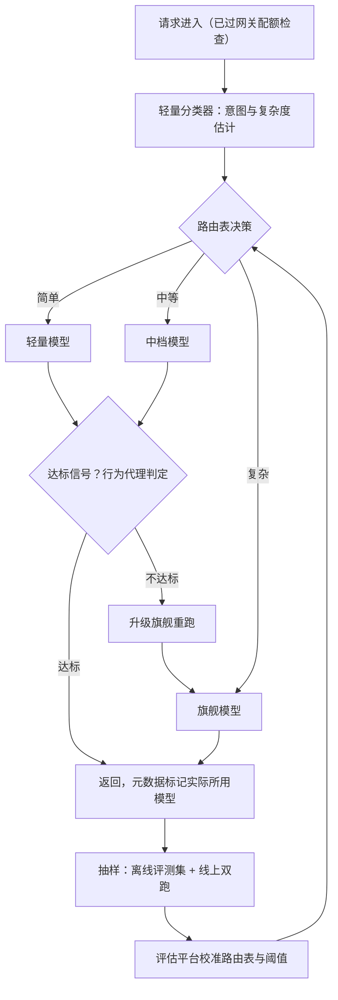

# 多模型路由与降级

> 层级：② 接入与流量 ｜ 贯穿矛盾：成本 · 质量

## 场景

业务可用的模型有一堆：贵而强的旗舰模型、便宜够用的轻量模型、自部署的兜底模型。希望每个请求自动走「最合适」的模型，整体成本最低、效果达标。

## 核心矛盾

**单请求最优 vs 全局最优**——按能力路由，贵模型顶在最前面；按成本路由，效果悄悄下滑。全局最优要求知道「每个请求需要多强的模型」，而这恰恰最难判断。

## 追问链

- 路由依据用什么：请求内容的实时分类，还是业务方打标？两套的维护成本差在哪？
- 「效果达标」怎么度量？没有可比较的效果基线，路由策略就是盲调
- 降级链上一环挂了切到下一环，效果损失谁兜底？业务方要不要提前知情？
- 级联模式（小模型先行、置信度低再升级大模型）什么时候划算？「置信度」怎么定义？

## 推演

### 容量估算（先问这几个数）

路由是拿「分类器的钱和延迟」换「模型档位差价」的生意，先把生意的两边都算出来。

- **假设 1：沿用 [LLM 网关](LLM网关.md) 的量级——日均 1000 万请求，月 750B token，单请求 2K 输入 + 500 输出。** 模型池三档：旗舰 API 混合单价 ¥20/M token、轻量 API ¥0.4/M、自部署 8B 边际成本近 0（卡是沉没成本，摊销折合约 ¥0.1/M）。
- **假设 2：能力分布——60% 请求轻量模型效果达标、30% 需中档（假设 ¥4/M）、10% 必须旗舰。** 这个分布必须来自历史日志抽样 + 人工标注（比如抽 1000 条），是路由的开工前提，不是拍脑袋的参数。
- **假设 3：其中约三成是多轮对话的后续轮次，输入呈重尾分布（同 [LLM 网关](LLM网关.md) 的假设 3）。** 这对路由是个好消息：输入长度本身就是难度先验——长输入大概率是复杂任务（经验判断），分类特征里别忘了带它。
- **推导·成本区间**：全旗舰 = 750B × ¥20/M = **1500 万/月**；全轻量 = 30 万/月；按分布路由的混合单价 = 0.6×0.4 + 0.3×4 + 0.1×20 = **¥3.44/M → 约 258 万/月**。路由把成本压掉 83%——这是「全局最优」的收益量级，值得建一个专门的分类器。
- **推导·中档档位值多少钱**：若模型池只有两档（60% 轻量 + 40% 旗舰）：0.6×0.4 + 0.4×20 = ¥8.24/M → **618 万/月**，比三档方案的 258 万贵一倍以上。**补齐中档档位本身就是路由收益的一部分**——选型时别只盯着旗舰和最便宜的。
- **推导·分类器的账**：假设分类用轻量模型、每次 200 token → 单请求分类成本 ≈ 0.00008 元，相对每请求最大约 0.05 元的档位差价（2500 token × (¥20−¥0.4)/M ≈ 0.049 元）可忽略——不到节省额的 0.2%；主要代价是**延迟 +100-300ms**（多一次串行调用）。结论：分类器要小、要快，结果要缓存（相同 prompt 前缀复用路由结果），延迟敏感路径要预留旁路。
- **推导·路由错误的隐性税**：假设路由错误率 10%（该走旗舰的被派给轻量）且级联能检测并升级重跑：期望单价 = 0.9×3.44 + 0.1×(3.44+20) ≈ **¥5.44/M，成本优势从 83% 缩到 73%**（1 − 5.44/20 ≈ 0.73；月成本从 258 万涨到约 408 万）。若级联检测不了，那 10% 不是成本税而是**质量塌方**——两种形态，后者更危险，因为不可见。
- **推导·级联的容量放大**：级联升级率按 15% 估（1 − p·q 的量级），峰值期同一请求先轻量后旗舰**双份吞吐**，升级部分额外 +0.15 × 1200 × 500 = 9 万输出 token/s 要由旗舰池承接——级联的容量规划必须按双份峰值做，否则升级链本身就是过载点。
- **推导·评估闭环的成本**：线上双跑按 1% 流量抽双档：300 万请求/月 × 双档各跑一次（旗舰 ≈ 0.05 元 + 轻量 ≈ 0.001 元/请求，按 2500 token 折算）≈ **15 万/月——双跑不免费**，抽样比例是预算决策，不是技术参数。离线评测集假设 500 条、每月 10 次路由变更全量跑 = 5000 次调用，钱可忽略，**贵的是人工**：评测集构建与持续校准需要业务专家参与，这才是基线建设的真实成本。
- **推导·自部署兜底容量**：自部署 8B 池按网关题推算约 80 张卡、峰值输出 24 万 token/s。降级链最后一环的容量必须按「上游全挂时的接流量」规划，否则降级链最后一环自己过载，等于没有降级。

结论：路由的收益是百万/月量级，成本主要是延迟与不可见的质量风险。所有设计围绕一句话：**先让「效果达标」变得可度量，路由才有资格从盲调变成工程**。把这组数字带进架构推演——v0 塌在 1500 万/月，v1 塌在激励结构，v2 塌在不可见，每一步塌的具体指标都不同，终态方案就是把三个塌点逐一封住。

### 架构推演（从朴素方案开始塌）

**v0：全部走旗舰。**

朴素方案的合理性是「一定不出质量问题」。塌点只有一个但足够致命：**1500 万/月烧现金**，且其中约六成请求（假设 2）用 1/50 的价格就能达到同样效果。成本是线性可算的，这个方案在财务模型上不成立，不需要讨论。

**v1：业务方打标——每个业务声明自己用哪一档。**

零分类成本，一行配置搞定。塌在两个机制上：

1. **责任不对称**：选旗舰，贵的是公司的钱（成本外部化）；选轻量，砸的是业务自己的质量 KPI（风险内部化）。理性业务方全部选旗舰——打标体系在激励上自动失效，最后退化回 v0。这不是业务方不配合，是制度设计的必然结果。
2. **粒度太粗**：同一业务内请求难度方差巨大。客服场景里大量寒暄与少量疑难工单共用一个标签，按业务一档，要么整体浪费、要么整体塌质量。

v1 还有一个常被当成交替方案的变体：「打标 + 关键词规则升级」的半自动态。它缓解了部分粗粒度问题，但关键词规则是人工维护的长尾黑洞——覆盖不住的表达永远在新增，本质上还是打标的维护成本问题换了形态，不如直接走到 v2 的分类器干净。

**v2：实时分类路由——轻量分类器估复杂度，查路由表派单。**

按请求内容路由，粒度到请求级。塌在两个新问题上：

1. **「效果达标」不可见**：LLM 输出非确定性，轻量模型悄悄把某个意图簇的质量拖垮，没有任何告警——因为路由错误是**分布性**的（某类请求系统性降级），不是随机抖动，不建评估基线根本发现不了，直到客诉出现。这就是「没建评估就上路由」的后果具象化：路由策略成了盲调。
2. **分类器成为新故障点**：分类器挂了，全量请求走哪？量化 fail-open 的两个方向：假设故障持续 10 分钟、峰值 1200 QPS 全量从轻量切旗舰，10 分钟多烧的钱 = 1200 × 600 × 2500 × (20−0.4)/10^6 ≈ **3.5 万元**；反向切轻量则省钱但质量风险未知。默认方向应该是旗舰（保质量）还是轻量（保钱包），必须按业务签过字的优先级定，不能由路由器实现者拍脑袋——fail-open 策略是路由器自己引入的单点，必须显式定义。

**v3：终态——路由器 + 级联 + 评估闭环。**

三个闭环缺一不可：**路由前**分类器给出档位（便宜、快）；**路由中**级联兜住分类错误（轻量先跑，行为代理判定不达标就升级，见追问 4）；**路由后**评估平台持续校准路由表（离线评测集回归 + 线上抽样双跑，机制见 [LLM 效果评估与回归平台](LLM效果评估与回归平台.md)）。业务方的角色从「选模型」退到「声明边界」：哪些场景禁止降档、最低可接受哪一档——路由器在边界内自由优化。

先分清两个最容易混淆的机制：**级联是成本维度**（先便宜后贵，由质量信号触发升级），**降级链是可用性维度**（上游故障时切换，由健康检查触发）——方向相反、触发条件不同、监控指标不同，把两者混为一谈的方案，故障演练时一定露馅。另外，路由表本身的变更是高危操作：按意图簇存档位与阈值，变更走灰度（先 5% 流量观察错误率与成本曲线再放量），每次变更自动挂评测集回归——路由器改错一行的爆炸半径是全网请求，它值得被当作一个持续发布的服务对待，而不是一份配置文件。降级链（可用性视角）与上游账号池调度由 [LLM 网关](LLM网关.md) 承接，成本核算口径见 [Token 成本治理](Token成本治理.md)。

**路由器自己的监控同样是终态的一部分**：各意图簇的流量分布（漂移的最早信号）、分类器延迟分位、升级率（突增 = 分布漂移或判定信号失效）、双跑一致率。其中升级率是最灵敏的哨兵——它涨了，通常是上游模型换代或业务流量变了，会先于任何质量报表报警。

回看三个塌点的归属，就能看出终态不是功能堆叠：v0 的成本塌点由档位差价封住，v1 的激励塌点由「平台承担路由、业务只声明边界」封住，v2 的不可见塌点由评估闭环封住——每个塌点都有一个对应的机制，缺一个就退回上一版的问题。

### 关键决策论证

五个决策点。每个都给反转条件——反转条件比结论更重要，约束一变结论就变；表格之外的补充说明放表后。

| # | 决策点 | 选项 A | 选项 B | 判据 | 结论 | 反转条件 |
|---|--------|--------|--------|------|------|----------|
| 1 | 路由依据 | 业务方打标 | 实时分类（混合制） | 维护成本与责任结构 | **混合制：业务方声明「不可降级边界」，边界内分类器实时路由**。打标维护成本随业务数线性涨、随模型能力漂移过时（新轻量版超过旧旗舰，标签全要重审），且责任不对称导致集体选贵；分类器是固定成本、可自动化迭代 | 日请求 < 10 万：分类器建设与运维投入不回本，打标足够 |
| 2 | 效果基线 | 先上路由后补评估 | 先建基线再上路由 | 能否发现分布性质量下滑 | **先建基线**。路由错误的形态是「某个意图簇系统性变差」，无基线 = 不可见 = 盲调；基线三层：固定离线评测集（每次路由变更必跑）+ 线上 1% 双跑抽样 + 业务弱信号（重试率、转人工率、采纳率） | 无——这是前置条件不是选项。真要说反转：模型池只有一档时本题不存在 |
| 3 | 降级链策略 | 静默降级，保可用性 | 显式降级：预声明 + 响应打标 + 可拒降 | 事故归因与业务知情权 | **显式降级**。业务方拿到轻量输出当旗舰质量做决策，是静默降级的标准事故路径；必须预声明降级链与最差档位、响应元数据打标（used_model 字段）、核心业务可配置「拒绝降级，fail fast」 | 业务方全部选择 fail fast 且上游长期不稳：说明降级链档位差过大，该补中间档位而不是继续默认静默 |
| 4 | 级联模式 | 旗舰直出 | 小模型先行 + 低置信升级 | 期望成本算式（见追问 4） | **小模型正确率 p=85%、升级判定准确率 q=80%、小模型成本 1/20 时，期望成本 ≈ 0.37C，省 63%——划算**；升级判定不可靠（q 低）或难任务占比高（p 低）时不划算，级联变双倍调用 | p·q 掉到 0.5 以下（自设门槛：期望节省不足一半，门槛来源见追问 4）：退回按类静态路由。数学净亏线在 p·q < 0.05，但 q 持续衰减、标定有滞后，不等走到净亏线才撤 |
| 5 | 路由器自身选型 | 用旗舰模型当路由裁判 | 小模型 + 规则混合路由 | 路由成本与依赖方向 | **便宜且独立**。用旗舰给每个请求做路由决策：路由成本可能吃掉节省（旗舰单价下判断本身按 token 计费，且判断延迟 1-2s）；更致命的是循环依赖——旗舰挂了路由器跟着挂，降级链在最需要它的时候失效 | 无：路由器必须永远比它调度的最贵模型便宜一个量级，且不依赖被调度对象 |

决策 2 补一句：三层基线的优先级不是并列的——离线评测集是回归底线（每次变更必跑），线上双跑是标定手段（量化降档的真实损失），业务弱信号是监控哨兵（发现评测集没覆盖的回归）。只有弱信号没有评测集，等于用客诉当回归测试。

决策 4 补一句：算式里最脆弱的参数是 q（升级判定准确率），且它随时间衰减——判定信号（一致性投票、可执行校验）在模型升级后行为会变。q 必须靠线上双跑数据持续重标定，只标定一次的 q 是这个算式里最大的隐藏风险。

决策 1 补一句：边界声明的落地形态是接入协议里的三元组——意图范围、最低档位、是否允许降级。业务声明是路由表的输入之一，享受灰度与评测的一等公民待遇，而不是散落在各业务配置文件里的魔法字符串。

决策 3 补一句：used_model 打标要进下游能看到的协议层（响应元数据），不能只写网关日志——下游的评估管线、训练数据管线依赖它做档位隔离，日志里的字段下游看不见。

决策 5 补一句：独立部署还有一层含义：路由器的故障域与模型上游隔离——分类器挂了走 fail-open，旗舰挂了路由器还活着。两者不同时挂，「降级」这个词才有意义。

### 追问应答

**1. 路由依据用实时分类还是业务方打标？维护成本差在哪？**

打标的成本是**线性且人工的**：随业务数增长、随模型能力漂移过时（每隔几个月模型格局一变，所有标签要重审），且责任不对称让业务方天然保守选贵。分类的成本是**固定且机器的**：一次建设持续摊薄，但要付每请求 100-300ms 延迟和分类错误率。

结论是混合制：业务方声明「哪些场景绝不能降档」这个边界（信息只有业务方知道），边界内交给分类器实时路由（优化只有平台能自动化）。

**2. 「效果达标」怎么度量？**

分三层，缺一不可。离线评测集：按意图簇固定一批基准题，任何路由策略变更必跑，防分布性回归；线上双跑：约 1% 流量同时发两档模型，用评估模型或人工比对质量——这是唯一能量化「降档真实损失」的手段；业务弱信号：采纳率、重试率、转人工率作为持续监控的代理指标。

共同点：都是**抽样评估**而不是断言——非确定性输出决定了只能用统计手段近似「达标」，题干说「没有可比较基线的路由是盲调」，指的就是跳过这三层直接调路由参数。

**3. 降级链效果损失谁兜底？业务方要不要提前知情？**

效果损失无法「兜底」，只能「显式交易」——这是立场：降级本质是可用性换质量的交易，交易必须双方知情。三个机制：降级链与最差档位预先写入业务方的接入协议；降级发生的响应必须打标（元数据返回 used_model，监控把降级流量单独出报表）；核心业务可配置拒绝降级（宁可失败不降质）。

业务方必须提前知情——静默降级等于让业务拿轻量输出当旗舰质量做下游决策，事故复盘时才发现链路里换过模型，是这类系统最典型的事故报告。

**4. 级联什么时候划算？「置信度」怎么定义？**

算式：小模型成本 c = C/20（C 为旗舰单请求成本），小模型正确率 p，升级判定准确率 q，则期望成本 ≈ c + (1 − p·q) × C。代入 p=0.85、q=0.8：0.05C + 0.32C = 0.37C，省 63%，划算。两条线要分开：**数学净亏线是 p·q < 0.05**——此时 c + (1−p·q)×C > C，级联比旗舰直出还贵；**工程撤退线设在 p·q < 0.5**（即决策 4 的反转条件），门槛来源有二：q 靠线上双跑重标定且持续衰减，测得 0.5 时真实值可能已在 0.3–0.4，从 0.5 到 0.05 的十倍区间就是安全边际；p·q 走低还伴随漏放率 (1−p)(1−q) 上升（q 从 0.8 跌到 0.59 时 p·q 恰好过 0.5，漏放率从 3% 翻倍到约 6%），质量损失不进成本算式，等不起。

「置信度」不要用模型自报（「我很确定」与真实正确率弱相关，对齐训练让模型倾向自信，机制上不可信），要用行为代理：分类任务取多次采样的多数投票一致性、生成任务用 logprob 阈值或可执行性校验（代码能编译、SQL 能执行）、关键场景加外部验证器。代理信号也要进评估闭环持续校准 q，不是定好就不动。

### 常见误区

- **「用最强的模型给每个请求当路由裁判，判断最准」**。它的具体样子：路由器和业务请求用同一个旗舰模型，每个请求先花一次旗舰调用做判断。
  为什么不行：旗舰单价下路由判断本身按 token 计费，加上 1-2 秒判断延迟，路由成本可能吃掉档位差价的节省；更致命的是循环依赖——旗舰故障时路由器同时失能，降级链在最需要的时候失效。路由器必须比它调度的最贵模型便宜一个量级，且部署独立。
- **「让业务方打个标，路由就一劳永逸了」**。它的具体样子：一张业务名到模型档位的映射表，年初中评一次。
  为什么不行：责任不对称（成本外部化、风险内部化）导致集体选旗舰，体系自动失效；业务粒度掩盖请求级难度方差；模型能力漂移让标签周期性报废。打标只能承担「边界声明」这一小部分，不能承担路由本身。
- **「置信度就让模型自己输出个 confidence 字段」**。它的具体样子：prompt 里加一句「请同时输出你的确定程度」，拿这个数当升级信号。
  为什么不行：模型自报置信度与实际正确率弱相关——对齐训练（RLHF 类目标）让模型系统性倾向自信表达，「我确定」更多反映语气风格而非概率校准。要用行为代理：一致性采样投票、可执行性验证、外部校验器，并用线上双跑数据持续校准代理信号本身的准确率。
- **「降级链是容灾细节，实现时顺手配上就行，不用业务参与」**。它的具体样子：网关里一个 try-catch 式的 fallback 列表，业务方在接入文档里都看不到它的存在。
  为什么不行：静默降级让业务在不知情下拿降档输出做下游决策——数据管线里混入不同档位的输出，下游评估、训练、报表全部被污染且难以归因。降级链必须在接入协议里预声明、响应里打标、监控里单独出报表。

---

[返回 AI 场景题地图](README.md)
