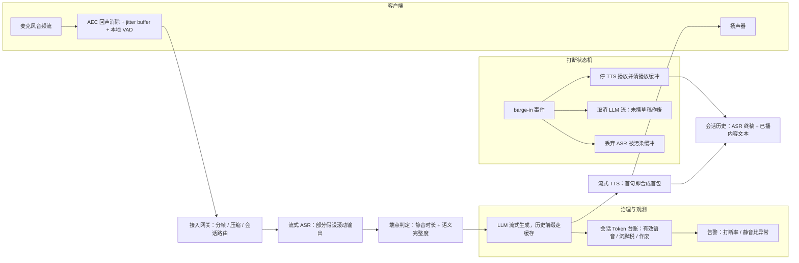

# 实时多模态交互

> 层级：⑤ 业务应用 ｜ 贯穿矛盾：延迟 · 成本

## 场景

语音客服、会议字幕、视频理解类应用：音频/视频流实时进出，对话往返延迟要求亚秒级，用户像在和人说话。

## 核心矛盾

**实时性 vs 理解质量**——流式切片省了延迟，但切断了语义；攒够了再说，交互感就没了。打断（barge-in）是常态而不是异常。

## 追问链

- 断句检测（VAD）策略怎么影响回答质量？「等用户说完」的判定本身就是个预测问题
- 用户打断了上一轮回答，会话状态怎么处理：丢弃、融合，还是让模型接着新指令走？
- 多模态 token 的计费和限流与纯文本差在哪？音视频流怎么计量？
- 网络抖动时怎么兜底：本地缓存、降质回答，还是道歉重试？

## 推演

### 容量估算（先问这几个数）

- **假设 1（传输层）**：峰值 1 万路并发语音会话（大型客服中心）。每路 16kHz × 16bit = 32KB/s 上行裸音频 → 1 万路 = 320MB/s ≈ 2.6Gbps；Opus 压缩到 24kbps 后 ≈ 240Mbps。压缩与分帧（100-300ms/帧）在接入层必做——**实时语音的第一层不是模型，是传输**，这一条在架构上决定了必须先有流式接入网关才有后面的一切。
- **假设 2（token 消耗形态）**：厂商折算 1 秒音频 ≈ 32 token（各家 25-50 不等，内部治理要统一折算口径）。典型会话 8 轮、用户每轮说 10s、AI 每轮说 15s → 音频输入 (10+15) × 8 = 200s × 32 = 6400 token + 输出文本约 500 token。1 万路并发、会话均长 10 分钟 → 每小时 6 万会话 → **每小时 ≈ 4 亿 token**。量级结论：单会话 token 是文本对话（约 2k）的 3 倍以上，且**沉默与背景音也在折算 token**——静音 1 分钟 ≈ 2000 token 白烧，这笔「沉默税」是实时多模态成本治理的第一目标。
- **假设 3（延迟预算拆账）**：「像和人说话」需要端到端响应 <1s（经验判断：电话交互超过 1s，用户开始说「喂？」）。拆账：VAD 判停（尾静音 300-500ms）+ ASR 尾部 finalized + LLM 首 token（≈300ms）+ TTS 首包（≈150ms）+ 网络 RTT（≈100ms）≈ **950ms，预算基本用满**。结论：任何一段攒批（ASR 等整句、LLM 非流式、TTS 等整段）直接爆表，全链路流式化不是优化项是生存条件。
- **假设 4（打断频率）**：假设 20-30% 的轮次伴随打断（人际对话常态，经验判断）→ 打断是主路径不是异常分支。成本含义：1 万路 × 20% 打断 × 被浪费的剩余生成（约一半输出 token）≈ **10% 的生成算力纯浪费**——不做出取消机制的架构，先崩在账单上，再崩在体验上。
- **假设 5（视频场景的计量放大）**：会议字幕若叠加屏幕共享的视频理解，1 fps × 每帧约 1000 token（视觉编码）→ 单路 1000 token/s，是纯语音（32 token/s）的 30 倍。视频场景里 token 主导项从音频换成视觉帧，**限流与计费维度必须从「路数」换成「帧率」**，并默认开启关键帧抽稀（每 2-3 秒 1 帧）——否则成本结构直接不成立，这比任何模型优化都更早杀死项目。
- **假设 6（自部署段的 GPU 底盘）**：流式 ASR/TTS 用小模型自部署，假设单张推理卡稳定承载 200 路流式会话（经验判断，取决于模型尺寸与批处理策略）→ 1 万路峰值需要 ASR 50 张 + TTS 50 张，加 20% 热备 ≈ **120 张推理卡**；而 LLM 段若走托管 API，烧的是 token 账单不是折旧——这道题里「折旧成本」和「现金成本」同时存在，账要分开算。

五个量级合起来的结论：这道题的成本单位是「路 × 秒 × token」三元乘积，延迟预算是「一段不可压缩的感知底线 + 三段可流式化的处理时间」——后面所有架构动作，都是在乘积里砍因子、在预算里消除串行。

### 架构推演（从朴素方案开始塌）

**朴素方案**：客户端录音 → 攒成一段 → 整段 ASR → LLM 一次性生成 → TTS 整段合成播放。

塌点：

1. **延迟塌（塌在串行结构，不是单组件慢）**。等尾静音 500ms + ASR 整段 + LLM 非流式全量生成（500 token 约 10-20s）+ TTS 整段合成 → 用户说完到听见回答 5s+，是假设 3 预算的 5 倍。每段都「等上一段全部完成」，延迟是加法叠加。
2. **打断塌（塌在状态污染 + 白烧算力）**。TTS 在播、用户插话：没有回声消除，麦克风把 TTS 自己的声音收进 ASR，AI 的话被当用户的话 → 会话被自己污染；没有取消机制，被打断的回答继续生成完——按假设 4，约 10% 算力在生成注定作废的 token。
3. **状态塌（塌在成本曲线）**。每轮全量重放历史，且音频历史随会话变长撑爆上下文窗口——8 轮会话第 8 轮的输入是前面所有轮音频之和，成本随轮次近似平方增长。

三个塌点共享一个根源：**把「请求-响应」的心智模型带进了「流」的世界**。流式系统里没有「一次调用」，只有持续增量的处理段；打断不是异常事件，是流天然拥有的「改道」能力。下面的演进全部围绕这个心智转换。

**演进六步**：

1. **全链路流式化**：分帧上行 → 流式 ASR 滚动输出部分假设 → 端点判定 → LLM 流式生成 → TTS 收到首句即合成首包。四段流水线重叠，端到端从 5s+ 压进 1s 预算——每段都只处理「增量」。流式化的**增量粒度**要选对：音频 100-300ms 一帧、ASR 按词滚动、LLM 按 token 流、TTS 按句合成——每段的粒度决定它的首包延迟，一段选错（如 TTS 按段落合成）其他段全白流。
2. **回声消除 + 打断状态机**：客户端 AEC（回声消除）打底；服务端 barge-in 事件总线，打断发生时三件事**同时**做：停 TTS 播放并清空播放缓冲（缓冲里还有 200-500ms 音频在出声）、取消 LLM 流（abort，未播草稿作废）、丢弃 ASR 被污染的缓冲。三处缺一，下一轮的历史里就混着 AI 自己的话。
3. **会话状态以 ASR 终稿文本为唯一事实源**：音频不回放历史；AI 已说出口的部分以文本进历史（用户听到了，模型必须知道自己在被否定什么）；未播草稿丢弃。历史作为稳定前缀命中 prompt cache，把平方增长的重复输入变成增量输入。
4. **传输兜底分层**：按生成成本从零到高排序降级（详见决策 5），抖动兜底优先花在传输层。
5. **会话亲和 + 分段可观测**：网关按会话 ID 把同一会话路由到固定推理实例，让第 3 步的前缀缓存真正命中——跨实例轮询会把缓存命中率打穿，省下的钱又从路由层漏回去。同时四段（VAD/ASR/LLM/TTS）分段埋点 P50/P99 时延，加上打断率、有效语音率两个运营指标：决策 5 的降级顺序和「为什么不能只优化 LLM 首 token」都要靠这套分段数据才有依据。
6. **端到端与管道的混合位**：管道为主，但特定高情绪价值环节（道歉、安抚）可路由到端到端语音模型——按「句」路由而不是按「会话」路由，既保住管道的可控面，又吃到端到端的自然度。这是决策 1 的工程化表达：不是二选一，是路由表。

**终态架构**：

图外还有两件基础设施：**会话级 Token 台账**——每路会话实时累计「音频输入 / 生成输出 / 被打断作废」三类 token，沉默税和打断浪费要能按会话看见才谈得上治理；**打断率看板**——打断率突然上升通常意味着 TTS 话术变长了（比如某次 prompt 调整），它是比用户投诉早一周的预警信号。

### 关键决策论证

五个决策点背后是同一个母题：**延迟是体验的刚约束，成本是商业的刚约束，质量只能在两条约束的夹缝里优化**——凡是「先保质量再说」的方案，在这道题里都是没算过账的方案。

**决策 1：管道式（ASR → LLM → TTS）vs 端到端语音到语音模型。**

| | 管道式 | 端到端语音模型 |
|---|---|---|
| 延迟下限 | 三段叠加，压到 800ms-1s | 更低（无段间等待） |
| 可控性 | 每段可独立降级/审计/换供应商，业务约束在 LLM 段注入 | 中间无文本轨迹，出错无法定位到段 |
| 成本 | ASR/TTS 可用小模型自部署，结构透明 | 模型大、按流计费，透明度低 |

**结论：当前生产主流选管道式。** 判据是可控性与可运维性：客服场景要追责、要注入话术边界与工具调用、要分段埋点，端到端模型的「黑盒中间态」是硬伤；延迟差距（几百 ms）用全链路流式可以追平到预算内。**反转条件**：端到端模型支持工具调用与可审计文本轨迹、成本降到管道 2 倍以内时，体验优先的场景（陪聊、口语陪练）先切。

**决策 2：VAD——固定静音阈值 vs 预测式端点检测。**

固定阈值有机制性两难：静音 300ms 判停 → 用户的思考停顿被抢答；调到 1200ms → 每轮延迟 +1.2s，直接击穿假设 3 的预算。**单信号无解，这是调参调不出来的**。**结论：双信号——静音时长 + 语义完整度**（小模型判「这句话说完了吗」：「帮我查一下——」后面还有，不抢答），把「用户说完了吗」从阈值问题变成预测问题。**反转条件**：封闭指令集场景（车载「播放音乐」「打开空调」），语义空间小到可以用规则枚举，固定阈值 + 规则就够，加模型反而引入误判面。

**决策 3：打断后的会话状态——丢弃 / 融合 / 接着走。**

丢弃的机制问题：打断常常是否定（「不对，我说的是……」），被否定的上一轮若从历史消失，模型失去否定对象，会重复刚被拒绝的回答。全量融合（把打断前后揉成一条）则让模型分不清哪句在回答什么。**结论：默认「让模型接着新指令走」——AI 已说出口的内容以文本进历史，未播草稿丢弃，打断事件记入会话元数据**（打断位置与频率是体验信号：打断率高说明回答太长）。可选在下一轮 system 注记「上一轮回答被打断于 X 处」。**反转条件**：强引导场景（教学纠音）里被中断的解释本身是教学内容，需要显式融合策略。

**决策 4：计费与限流——按请求 token vs 按连接时长。**

**结论：对上游只能按厂商 token 折算计费（现实约束，不可选），内部治理必须双指标：并发连接数 + 有效语音时长。** 机制：文本接口的限流维度是 QPS，实时语音的限流维度是**并发路数 × 每路 token 速率**——1 万路连接比 1 万 QPS 更贴近成本结构；沉默税（假设 2）要求把有效语音时长显性化为治理指标：静音超阈值客户端降采样，持续静音超 2 分钟主动挂断，一分钟省 2000 token。**反转条件**：自部署推理后按 GPU 秒计费，「沉默烧算力」的机制不变，语音时长维度仍要保留——反转的只是计量单位，不是治理逻辑。

**决策 5：网络抖动兜底——本地缓存 / 降质回答 / 道歉重试。**

**结论：按生成成本从零到高排序降级**：客户端 jitter buffer + PLC（丢包补偿，纯传输层，零生成成本）→ 降 TTS 码率与音质 → 切小模型 → 最后才是道歉重试。道歉重试排最后因为它本身就是一次完整生成，且在已经卡顿的链路上再插入一轮等待，打断感更强。原则一句话：**抖动的兜底预算优先花在传输层**。客户端本地 VAD 保底：弱网时至少不上行杂音白烧 token。**反转条件**：专有线路的会议系统（网络质量可控），兜底预算全部投给质量而非传输。

### 追问应答

**1. 断句检测（VAD）策略怎么影响回答质量？**

VAD 是延迟与质量的交换点，且它的错误是**上游错误**——ASR 和 LLM 无法纠正一个「没等用户说完就开始回答」。判停太快抢答思考停顿，回答与后半句冲突，用户被迫重复；太慢每轮延迟直接超预算。所以判定要加第二信号：语义完整度（「帮我查一下——」不算完），把「用户说完了吗」当成预测问题来建模，而不是当成阈值参数来调——这是追问里「本身就是个预测问题」的准确含义。

**2. 用户打断了上一轮回答，会话状态怎么处理？**

三段处理：AI 已说出口的内容用户听到了，必须以文本进历史（否则模型不知道自己在被否定什么，会重复刚被拒绝的回答）；未播的草稿 token 丢弃；新指令直接接续生成，不做复杂融合。同时把打断事件记入会话元数据——打断的位置和频率是回答质量的外部信号（打断多 = 回答啰嗦或不贴题），要进入效果评估（见 [LLM效果评估与回归平台](LLM效果评估与回归平台.md)）而不是被当成异常吞掉。

**3. 多模态 token 的计费和限流与纯文本差在哪？**

机制差异在时间维度：文本按请求计，音视频按流**持续**计——沉默、背景音、咳嗽都在折算 token（沉默税，算式见假设 2）。限流维度从 QPS 变成并发连接数 × 每路 token 速率；计量必须以网关侧统一折算口径为准（各厂商每秒音频折 25-50 token 不等），否则上游账单和内部预算永远对不上。治理抓手是有效语音时长：静音降采样、超时挂断、回答长度控制——文本场景省 token 靠缩短 prompt，这里省 token 靠压缩「在线时间」。

**4. 网络抖动时怎么兜底？**

分四层，按生成成本从零到高：jitter buffer + PLC（传输层，零生成成本）→ 降 TTS 码率 → 切小模型 → 道歉重试（最后手段——它本身是一次新的生成，且在卡顿链路上再加一轮等待）。客户端本地 VAD 保证弱网时不把无效杂音上行烧 token。原则：兜底预算优先花在传输层，因为传输层手段不消耗推理算力；道歉重试同时恶化延迟和成本，只在会话即将失败时使用。

### 常见误区

**误区 1：调大 VAD 静音阈值解决抢答。** 典型样子：500ms 调到 1500ms，「不抢答了」。不行机制：阈值直接加在每一轮的往返延迟上，按假设 3 的拆账，端到端预算立刻爆；抢答的根因是「单信号判定」——静音既可能是说完也可能是停顿，正解是加语义完整度第二信号，不是调参。调参只是把延迟塌换成体验塌。

**误区 2：打断就是 cancel 掉 LLM 请求。** 典型样子：收到 barge-in 事件只 abort 上游生成，认为打断处理完毕。不行机制：TTS 播放缓冲里还有 200-500ms 音频在出声，ASR 还在把这段声音转成文本写进历史——下一轮模型看到的历史里混着「自己被打断时说的话」，状态污染。正确做法是三处一起清：播放缓冲、生成流、ASR 缓冲。

**误区 3：延迟优化只盯 LLM 首 token。** 典型样子：汇报只有「LLM TTFT 从 500ms 优化到 200ms」。不行机制：预算拆账里 LLM 首包只占约 300ms，VAD 尾静音、TTS 首包、网络 RTT 占大头——单点最优不等于全链路达标，必须四段分段埋点、看端到端分布；LLM 优化到 0 的收益上限也只有 300ms，而 VAD 策略错一次浪费的是 500ms 起步。

**误区 4：把音频历史整个存进上下文。** 典型样子：每轮把全部历史音频重放给端到端或 ASR 模型，「保留原始信息总没错」。不行机制：成本随轮次平方增长、上下文窗口快速耗尽，而音频历史对下一轮回答的增益远低于 ASR 终稿文本——状态的事实源应该是文本，原始音频按需（例如争议回查）从对象存储取。

---

[返回 AI 场景题地图](README.md)
