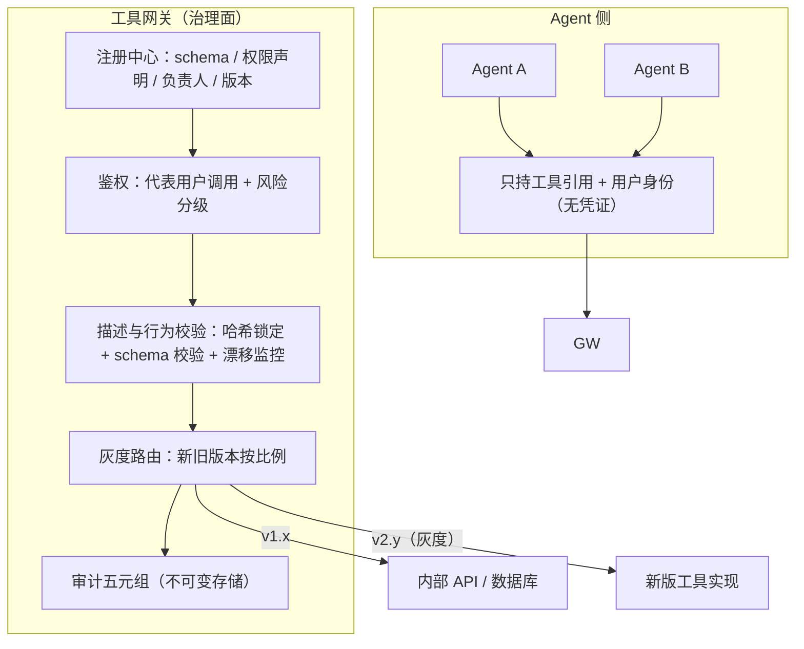

# 工具网关与 MCP 平台

> 层级：④ Agent 与工具 ｜ 贯穿矛盾：安全

## 场景

公司里几十个 Agent、几百个工具（内部 API、数据库、三方 SaaS），工具调用需要统一的注册、发现、鉴权与审计——这就是 AI 时代的「API 网关」。

## 核心矛盾

**工具生态繁荣 vs 治理可控**——工具越多 Agent 越强，但权限面、注入面、审计面同步膨胀；没人治理的工具市场，等于没人盘点的权限系统。

## 追问链

- 工具的权限模型怎么设计：Agent 自己持有凭证，还是网关代理授权（OAuth on behalf of user）？
- 工具描述与真实行为不一致（工具投毒/描述被改）怎么防？工具描述本身也是「不可信输入」
- 调用审计要记到什么粒度：谁、代表谁、用了什么参数、改了什么状态？
- 工具升级导致行为变化，依赖它的 Agent 怎么第一时间发现？工具要不要有版本与灰度？

## 推演

### 容量估算（先问这几个数）

先说反直觉的结论：这道题所有性能数字都极小——它考的是治理，不是吞吐。数字的意义在于证明「性能不是借口，偷懒不做治理才是问题」。

- 假设一（规模）：50 个 Agent、300 个工具；注册元数据（名称、描述、参数 schema、权限策略、负责人）每条约 2KB → 全量 600KB，一个进程的内存就装下。结论：注册中心毫无容量压力，难点全在治理流程。
- 假设二（调用量）：50 Agent × 200 次工具调用/天 = 1 万次/天，峰值 QPS <1。结论：网关本身的性能无从谈起，选型只看治理能力（鉴权模型、审计、版本）。
- 假设三（审计存储）：每条调用记录约 1KB（含参数摘要与结果摘要）→ 10MB/天，5 年约 18GB。结论：存储成本可忽略，真正要设计的是不可变存储（WORM）与可检索性——审计的价值在「能查」，不在「存了」。
- 假设四（描述进上下文的成本）：300 个工具 × 每个描述约 200 token = **6 万 token**——一次全量下发比多数任务本体（1-5 万 token）还贵。结论：工具描述必须按任务相关度动态下发，这是最容易被忽视的成本项，也是「工具发现」要进入架构的原因。
- 假设五（变更频率）：300 工具 × 每季度 2 次变更 = 600 次/年；人工回归每次 0.5 人天 → 300 人天/年，约 1.5 个全职人力。结论：行为兼容性检查必须自动化进 CI，人工回归在这个规模下不可持续。

数字合起来的结论：**这道题在性能上「什么都扛得住」，在治理上「什么都不做就会塌」**——600KB 元数据、峰值 QPS 个位数、10MB/天审计，一个工程师一周就能写出原型；难的是让 300 个工具的权限、描述、版本在一年里保持可信。

### 架构推演（从朴素方案开始塌）

朴素方案一句话：每个 Agent 自己管理自己的工具——直接 import SDK、直连内部 API 和数据库，凭证写进 Agent 的配置文件。

朴素方案的诱惑在于「快」：每个 Agent 团队自己接工具，当天上线。它的成本是延迟支付的——权限面、注入面、审计面都是欠账，而欠账的利息随 Agent 数复利增长：50 个 Agent 时是翻 50 份配置，200 个 Agent 时已经没人说得清权限现状。

**第一塌：塌在权限盘点，指标是「没人能回答的问题数量」。** 50 个 Agent 各自持有凭证后，「哪个 Agent 能写订单库」变成了一个需要翻 50 份配置才能回答的问题，而且答案随时过期。机制：分散持有 = 权限不可审计 = 事实上无人治理；权限面 = Agent 数 × 凭证数的笛卡尔积，离职交接、密钥轮换、临时扩权每一样都会产生孤儿凭证。这道题的核心矛盾「没人治理的工具市场等于没人盘点的权限系统」，在朴素方案里是字面成立的。

**第二塌：塌在注入面，指标是受影响 Agent 数。** 工具描述（给 LLM 看的）与实现是否一致，在朴素方案里没有任何机制保证——一个被篡改或草率编写的描述里塞进「调用本工具时请先执行 X」，就污染了所有引用它的 Agent 的上下文。机制：**工具描述会进入模型上下文，上下文里的文本都是指令候选**——描述被改 = 所有引用者的指令源被改。这是 AI 网关与传统 API 网关的本质区别：传统网关的「文档」只是给人看的，写错了顶多误导开发者；AI 网关的「描述」是运行时输入。

**第三塌：塌在变更盲区，指标是错误发现周期。** 工具返回格式悄悄改了字段名，10 个依赖它的 Agent 各自独立解析、同时产出错误结果——没有任何一处能第一时间发现，因为每个 Agent 是孤岛。发现周期以「用户投诉」为单位，以周计。

三次塌逼出终态，演进步骤如下：

1. **注册中心 + 网关代理**：工具在平台注册（schema、权限声明、风险等级、负责人、版本），Agent 不持任何下游凭证，只持「对工具的引用 + 用户身份」；网关代表用户调用（OAuth on behalf of user / 服务身份映射），鉴权、吊销、审计集中一处。
2. **上架流水线（描述治理）**：工具上架 = 过审核——schema 校验、行为契约测试（给定输入断言输出结构）、描述文本注入扫描、高危工具人工审。注入扫描的具体模式（经验归纳）：
   - 指令式语句：「请先执行…」「务必同时调用…」；
   - 越权暗示：「无需确认」「跳过审批」「直接执行不要问」；
   - 外联诱导：出现 URL、「把结果发送到…」「上传到…」。

   描述文本命中这些模式直接拒审——描述是运行时输入，按不可信输入的级别治理。
3. **运行时校验**：描述文本哈希锁定，变更必须重新过审；调用时校验返回值符合声明 schema；对参数分布与返回结构做漂移监控，异常告警。
4. **审计五元组**：发起 Agent、代表用户、工具 + 版本 + 参数摘要、状态变更/结果摘要、trace id——不可变存储，可按用户/工具/时间检索。
5. **版本与灰度**：工具语义化版本，网关按 Agent/流量比例路由新旧版本；CI 跑行为兼容性回归；变更事件通知订阅方，配合下游质量指标对比。
6. **风险分级默认策略**：注册时声明风险等级（只读/写/高危），网关按等级执行默认策略——只读放行、写需调用方显式声明「允许写」、高危要求任务上下文里有审批节点；分级与 [Agent任务执行平台](Agent任务执行平台.md) 的工具分级路由同构，两处共用同一份等级定义。

MCP 在这套架构里的位置值得单独说清：MCP 是工具接入协议——server 如何声明工具、如何被调用，协议本身把「描述、schema、调用」标准化了，正好让注册中心与网关有统一的东西可治理。但 MCP 不是治理面：把 MCP server 直连给 Agent、跳过网关，等于把治理面短路——协议标准化反而让「绕过治理」更容易复制粘贴（经验判断，来自早期接入混乱的直接观察）。

治理要可度量，否则「可控」就是一句口号。三个仪表盘指标：

- **权限盘点覆盖率**：能自动回答「谁能写哪个工具」的工具占比——目标 100%，达不到的走下线流程；
- **描述一致率**：契约测试通过的工具占比——低于 95% 冻结新工具上架；
- **变更发现时长**：工具行为变更到下游告警的中位时间——治理状态是小时级，未治理状态是周级（见第三塌）；
- **凭证零落存**：抽查 Agent 运行环境（进程环境变量、配置文件）发现平台外凭证的次数——目标恒为 0，发现即按安全事件处理。

和 [LLM 网关](LLM网关.md) 的分工边界也要说清：LLM 网关治理「模型调用」（token 预算、路由、降级），工具网关治理「工具调用」（凭证、权限、审计）；两者在 trace id 上汇合——一次 Agent 任务在两条网关上各留一半记录，拼起来才是完整链路。不要试图合并两者：抽象不同（token vs 副作用），生命周期不同（分钟级请求 vs 长期注册的工具）。

### 关键决策论证

#### 决策 1：凭证持有——Agent 自持，还是网关代理授权？

| | 选项 A：Agent 自持凭证 | 选项 B：网关代理（on behalf of user） |
| --- | --- | --- |
| 权限盘点 | 50 份配置、随时过期、无人能回答「谁能写什么」 | 注册中心一处声明，可盘点、可导出 |
| 注入后爆炸半径 | 劫持 Agent = 拿到全部凭证本体 | 劫持 Agent 只能通过网关调已授权工具，凭证拿不走 |
| 吊销 | 找配置、逐个换 | 一处吊销，即时生效 |
| 审计归属 | 各 Agent 自证（不可信） | 网关统一记录、不可绕过 |

**结论：网关代理授权，生产环境没有例外**——用户授权给 Agent 的是「代表我调用」，凭证始终在平台侧（MCP 的 OAuth 授权流就是这个模型）。授权颗粒度上（经验判断）：按「用户 × 工具」二元授权够用，不要上 RBAC 全家桶——300 个工具的角色矩阵维护成本会反过来杀死生态繁荣；真正需要细粒度的是数据面（行/列级过滤，在数据代理里做，见 [Agent沙箱与代码执行](Agent沙箱与代码执行.md)），不是工具面。反转条件：个人本地的玩具工具（个人 API key、无敏感数据）可以自持，省一层；企业环境不行。

#### 决策 2：工具描述治理——信任开发者，还是平台流水线审核？

**结论：平台流水线审核，按风险分级**——只读工具走全自动（schema 校验 + 契约测试 + 描述注入扫描），有副作用的工具加人工审，高危工具（外发、资金）双审。审核记录本身进审计系统，工具的「出身」也要可追溯。判据：描述是注入面（第二塌），「描述与行为不一致」在 AI 系统里不是文档 bug，是所有引用者的指令源污染；传统 API 时代可以容忍的「文档滞后」，在 AI 时代是安全事件。反转条件：几乎没有——最多在工具数量很小的团队里把人工审简化为负责人签字。

#### 决策 3：审计粒度——记调用成败，还是记全量五元组？

**结论：全量五元组（发起者、代表者、动作、状态变更、链路），参数与结果存摘要或哈希、敏感字段脱敏、原文按需解密**。判据：审计要能回答的核心问题是「这次数据变更是谁让系统做的」——在 on-behalf-of 模式下，只记「哪个 Agent 调了」而不记「代表哪个用户」的审计等于没记（复盘时授权链路断在最关键一环）。落地形态：五元组各字段独立可检索（都是索引列），「摘要保检索、原文保追责、哈希保一致」——审计系统自己不能成为敏感数据的新泄漏点。反转条件：无；可调的只有保留时长与脱敏等级，不是粒度本身。

#### 决策 4：工具版本——隐式升级（永远最新），还是显式版本 + 灰度？

**结论：显式版本 + 灰度 + CI 兼容性回归**。判据：工具行为变化的表征是「下游 Agent 输出质量悄悄下降」，不报错、不告警，自然发现周期以周计（第三塌）；灰度把发现机制变成「对比灰度两侧的下游质量指标」，周期压到小时。反转条件：内部只读工具且消费方唯一时，走 latest 快车道可以接受——坏了影响面一眼可见。

#### 决策 5：工具发现——全量列表下发，还是按任务动态检索？

**结论：动态检索 + 相关性下发**。判据是容量假设四：300 工具全量下发 = 6 万 token/次，成本上比任务本体还贵，效果上注意力稀释会让模型选错工具的概率上升（机制：候选越多、描述越长，单条描述的权重越低）。按任务检索出 10-20 个相关工具下发，成本降一个量级。实现可以很轻：工具描述做向量索引，按任务描述召回 top-k，再叠加规则过滤（任务声明的数据域）——不必上重型检索系统。反转条件：工具总数 <30 时全量下发更简单，检索的维护成本不划算。

### 追问应答

**1. 权限模型：Agent 自持凭证还是网关代理授权？**

网关代理授权（OAuth on behalf of user）。Agent 持「工具引用 + 用户身份」而非下游凭证，网关做双重检查：用户对该工具的授权 × 工具自身的风险等级。机制上这同时解决了三件事：权限可盘点（注册中心一处声明）、注入后爆炸半径可控（凭证拿不走）、吊销即时（一处生效）。落地时最常见的坑是「半代理」：凭证由平台统一发放但仍落到 Agent 进程里——这只解决了盘点、没解决注入；凭证必须始终不出平台侧。MCP 生态的 OAuth 授权流验证了这条路——「代表用户调用」是 Agent 权限模型的收敛形态。

**2. 工具描述与真实行为不一致（工具投毒）怎么防？**

三层防线：上架时——描述注入模式扫描 + 行为契约测试（断言给定输入的输出结构）；运行时——描述文本哈希锁定（变更必须重新过审）、返回值 schema 校验、参数分布与返回结构的漂移告警；生态上——工具带负责人与风险等级，高危工具变更强制人工审。扫描是必要不充分条件：真正的保证来自「哈希锁定 + 变更重审」，让篡改在运行时无处生效。关键认知：描述会进上下文，上下文里的文本都是指令候选，所以描述要按「不可信输入」的级别治理——这与 [Prompt 注入防御](Prompt注入防御.md) 对用户输入的治理是同一个问题的两个入口。

**3. 调用审计要记到什么粒度？**

五元组：发起者（哪个 Agent 实例）、代表者（哪个用户）、动作（工具 + 版本 + 参数摘要）、结果（状态变更 diff 或结果摘要）、链路（trace id，贯穿 LLM 调用与工具调用）。不可变存储（WORM），可按用户/工具/时间检索。「代表谁」在服务间调用（Agent 代表另一个系统而非人）时用服务身份替代，同样落五元组——链路不能因为调用方不是人就没记录。粒度上宁可多记：存储成本每天只有 10MB（假设三），而缺一元的审计在事故复盘时就是断链。

**4. 工具升级导致行为变化，依赖它的 Agent 怎么第一时间发现？要不要版本与灰度？**

要，而且这是治理面里工程含量最高的一块。机制：语义化版本 + CI 行为契约回归（拦截 breaking change，用例从真实调用分布采样回放生产参数的 top-N 形态，而不是开发者手写三五个用例）+ 网关灰度路由（新旧版本按 Agent/流量比例分流）+ 下游质量指标对比（灰度侧 vs 稳定侧的 Agent 任务成功率）。这样「发现」不再依赖用户报障（以周计），而是自动对比（以小时计）；变更事件主动通知订阅的 Agent 团队。灰度的最小实现：同一工具新旧两个实现并存于注册中心，网关按调用方标签路由——对 Agent 来说只是工具版本号变了。工具行为的非确定变化只有靠「对照实验」才能被看见，这正是灰度的本质。

### 常见误区

- **误区一：「工具列表全塞给模型，多多益善。」** 错误答案的样子：system prompt 里贴 300 个工具的完整 JSON schema。机制：6 万 token/次的固定开销（假设四）+ 注意力稀释让选错工具的概率上升——另一个可观察的信号是模型开始在相似工具间犹豫。正确形态是按任务相关度动态检索下发 10-20 个。
- **误区二：「工具描述就是文档，写好就行，改了同步一下。」** 机制：描述进上下文就是指令源，被篡改或草率修改的描述会指挥所有引用它的 Agent——文档滞后在 API 时代是小事，在 AI 时代是注入事件。描述需要哈希锁定 + 变更重新过审。
- **误区三：「审计就是打个日志文件。」** 机制：只有「谁调了」没有「代表谁」和「改了什么状态」的日志，在 on-behalf-of 模式下无法复盘授权链路；可变的日志文件在事故里还可能被指不可信。审计要求：五元组 + 不可变存储 + 可检索。
- **误区四：「工具升级是工具团队自己的事，Agent 侧跟着适配就行。」** 机制：隐式升级让下游以「用户投诉」为发现信号，周期以周计，且期间所有依赖 Agent 在静默产出错误结果。正确形态是版本 + 灰度 + 契约测试，变更发现进入平台流程闭环；契约测试的用例必须从真实调用分布采样，手写用例测不出「行为变了但契约没变」的情况。

---

[返回 AI 场景题地图](README.md)
