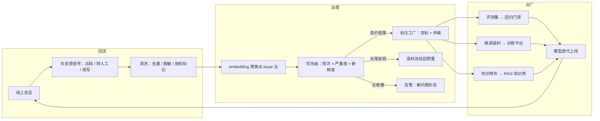

# 数据飞轮与标注平台

> 层级：贯穿 · 质量与评估 ｜ 贯穿矛盾：质量 · 成本

## 场景

线上 bad case、用户反馈（点赞/点踩/改写）、人工修正都在持续产生数据，要把它们变成评测集和微调语料，形成「用了变好、好了更被用」的飞轮。

## 核心矛盾

**数据量 vs 数据质量**——回流得越快越脏，标得越准越贵越慢；飞轮转速的上限卡在数据治理，而不是模型。

## 追问链

- bad case 怎么自动聚类？谁决定哪些值得进评测集、哪些只进语料池？
- 标注一致性怎么保证：两个人对同一 case 判断不同，听谁的？
- 用户数据用于训练的合规边界（隐私、授权、用途限定）怎么落进管线？
- 评测集过拟合了怎么发现、怎么轮换？「为评测而优化」是不是也在发生？

## 推演

这道题的陷阱是把「飞轮」理解成管道问题——接上回流、自动进训练、模型自然越来越强。核心矛盾已经给出了反驳：转速的上限卡在数据治理。飞轮每转一圈都要过四道闸：**授权**（这批数据能不能用）、**质量**（值不值得人看）、**归因**（该拿它修什么）、**过拟合**（用了会不会把系统越练越窄）。推演主线就是把这四道闸工程化——任何一道闸缺失，飞轮转得越快，出事越快。

### 容量估算（先问这几个数）

- **假设 1（回流源头量）：** 日活会话 100 万，会话级负反馈信号（点踩、转人工、用户改写）率 2% → 每天 2 万条含负反馈的原始会话进入回流管道。
- **假设 2（单条体积）：** 平均 5 轮对话、每轮输入 + 输出 2KB → 20KB/条 → 原始回流 2 万 × 20KB = 400MB/天，年化约 150GB。结论：存储是毛毛雨——飞轮的瓶颈从来不是「存不下」，是「看不完、标不起、不敢用」。
- **假设 3（清洗与分诊漏斗）：** 去重（同一问题被多人点踩算一个 issue）、脱敏、可机器自动归因的直接分流（如明确的检索失败），剩 50% 即 1 万条；embedding 聚类后「值得人工标注」的高价值簇样本占 10% → 每天 1000 条进标注队列。聚类的价值就在这个 20 倍压缩：把「看不完的 2 万」变成「标得起的 1 千」。
- **假设 4（标注产能与成本）：** 复杂对话标注每条 2-3 分钟（判因 + 写期望答案 + 打标签），一人一天 200 条 → 1000 条/天需要 5 个全职标注员；人均月成本按 1.5 万元（含管理与质检）→ 月标注成本约 7.5 万元。结论：**标注人力是飞轮最贵的部件，且成本线性于队列长度**——一切降低队列长度的手段（聚类压缩、模型预标、只标分歧样本）都是直接省钱。
- **假设 5（产出物规模）：** 评测集每月精标新增 1000 条（含淘汰轮换），年化 1.2 万条；微调语料池假设 50 万条 × 20KB ≈ 10GB。结论：产出物存储同样可忽略，真正要管理的是每条数据的元数据——来源、授权标记、标注版本、已用于哪个模型批次。**元数据才是资产，正文只是载货。**
- **假设 6（正样本回流）：** 为保持分布无偏，正常会话按 1% 随机回流 → 1 万条/天，直接进语料池、不进标注队列。结论：正样本回流几乎零标注成本（无需人工判好坏），与负样本同量级的量却常被忘做——它的缺失会让整个飞轮失去分母（见误区 2）。
- **假设 7（语料池攒量阈值）：** 假设微调一个类目至少需要 5000 条有效样本才值得启动一次训练 → 长尾簇以每天几百条的速度攒量，一个新类目从发现到可训练要 2-4 周。结论：飞轮对「新问题」的响应下限由数据积累速度决定，不是训练速度——这反过来论证了知识修补路径的优先性：补文档当天生效，微调下周才排上队。

### 架构推演（从朴素方案开始塌）

**v0：一张共享表格。** 运营把点踩的会话手工复制进表格，周会过一遍，分给工程去修。这是很多团队的真实起点，起点本身没错——但它随规模塌掉：

1. **先塌在覆盖率与幸存者偏差。** 每天 2 万条负反馈，人工看 50 条，覆盖率 0.25%。人只看到「最吵的」：投诉声音最大的用户类型占满视野，而静默流失的问题（用户点踩后直接走，再也不来）完全不可见。机制：人工抽样不是无偏采样，是按嗓门加权的采样。三个月后修好的是「最会投诉的 5 类问题」，整体效果曲线纹丝不动。
2. **再塌在合规不可追溯。** 表格里的数据没有授权记录。三个月后想拿这批数据微调，法务问「用户同意会话数据被用于训练吗」——答不上来，整批作废，前面几个月的积累清零（对应追问 3）。
3. **最后塌在闭环断裂。** 标注完的 case 没有自动通道进评测集：修好的问题没有留下回归题，三个月后同样的 bad case 原样复发。飞轮只有「流进」没有「沉淀」，转一万圈也不产生复利。
4. **同时塌在信号单一。** 只有负反馈、没有正样本对照，算不出「问题解决率」——你不知道点踩的 2 万条对应的问题总量是多少。没有分母的飞轮只能盲目转：任何「改进」都无法证伪，团队只能靠感觉判断飞轮是不是真的在转。

**演进到终态：**

**v1 自动回流管道。** 网关/SDK 埋点把负反馈事件（会话原文 + 反馈信号 + 用户/渠道元数据）打进事件流；清洗层做去重、PII 脱敏、格式校验，并在**入口就打上授权标记**——无授权标记的数据物理上进不了数据湖。存储按应用分域，边界与 [企业数据防泄漏](企业数据防泄漏.md) 一致。

**v2 聚类分诊。** 清洗后的 case 做 embedding + 密度聚类，产出 issue 云；每簇算优先级分：频次 × 严重度 × 新鲜度。路由规则：高频高严重簇 → 标注队列；低频长尾 → 语料池挂起攒量；全新簇（历史未见类别）→ 告警，可能是新问题形态或线上事故的第一信号。「谁决定进哪里」：规则先自动路由，规则置信度低的进人工分诊会裁决，裁决结果反哺规则——让「决定」本身也进入飞轮（详见追问 1）。

聚类的两个工程细节常被忽略：一是先按应用分域再聚——跨应用聚出来的簇没有治理意义，修也没人认领；二是簇标签自动生成（代表样本 + 簇内高频特征），人工只做确认不做起名——起名是治理流程里最容易被拖延的一步，自动化掉它簇才转得动。

**v3 标注工厂。** 四件套：任务分发（按类目路由到有业务上下文的标注员）、判例库（标注规范不是一段话，是持续积累的判例集，见误区 3）、双标与仲裁（见追问 2）、一致性度量（Kappa 按批次监控，低于阈值回炉）。标注结果分三个出口出厂：带标签的评测题进 [LLM效果评估与回归平台](LLM效果评估与回归平台.md) 的门禁集；微调语料进 [模型训练微调平台](模型训练微调平台.md)；知识修补进 RAG 知识库——相当比例的 bad case 正解是补文档而不是改模型（见决策 4）。

质检再加三道：批次 Kappa 监控是事中；每周回溯抽检上周已入库标注的 5% 是事后；错误标注的召回流程是兜底——发现错误标注入库时，要能定位它影响了哪些批次、哪些评测题、哪些训练批次并撤下。没有召回流程的标注质检只是心理安慰。

**v4 飞轮仪表盘。** 度量飞轮本身而非只度量模型：各环节转化率（回流→清洗→入标→入库→被使用）、评测集对线上 bad case 的覆盖率（新出现的 bad case 有多少能在现有题集里找到同类题——覆盖率持续走低说明题集在腐烂）、数据血缘（哪批数据进了哪个模型版本，出问题可撤）。仪表盘的目的是防止飞轮退化成「数据垃圾填埋场」：只进不出、标完没人用、标完没人信。

三个红线指标单独盯：**入库使用率**（标完的数据有多少真的被评测集或训练用上，低于 50% 说明在白烧标注费）；**队列积压**（标注队列存量超过 3 天就告警——bad case 的标注价值随时间衰减，三个月后标完的题已经不代表线上的问题）；**覆盖率**（如上，它直接连着评估平台的可信度）。

飞轮转速可以写成一个乘法公式：**有效产出 = 回流量 × 清洗存活率 × 可标注率 × 标注产能 ÷ 队列积压 × 入库使用率**。容量估算的七个数字各落在一个乘子上；所有治理动作（聚类压缩、预标分流、授权前置）都是在松某个乘子。v0 的表格方案不是转速慢，是「可标注率」这个乘子接近零——断了的轮子转不出复利。

### 关键决策论证

**决策 1：聚类粒度——纯语义聚类 vs 预定义类目。**

纯语义聚类（无监督）能发现没见过的新问题，但簇不稳定、难路由、周报没法统计；预定义类目（有监督）稳定可统计，但发现不了新形态——去年没有的问题今年依然「不存在」。**结论：两层叠加——预定义类目做主路由与周期统计，语义聚类做增量发现，新簇稳定出现两周后升级为新类目。** 判据是团队规模与 case 量：平台团队 10 人以上、日 case 千条以上，值得建两层；3 人小团队、日 case 量低于 500 条，直接人工过清单加一个类目字段——聚类是过度工程，聚完还是得人看。

还要预置类目的退化路径：某个类目下簇的数量爆炸（类目失去解释力）时，要允许类目合并与退役——类目表本身也是轮换的，与评测集轮换同构；把类目当成一次性设计的静态表，半年后它自己会变成新的「预定义类目陷阱」。

**决策 2：标注模式——纯人工 vs 模型预标 + 人工复核。**

纯人工每条 2-3 分钟，成本最高、质量最稳；模型预标 + 人工只看分歧，假设预标与人工一致率 85-90%，只需复核 10-15% 的分歧样本加抽检，成本降到三成左右——但预标模型的偏置会传染给整个数据集。

| | 纯人工 | 预标 + 复核 |
| --- | --- | --- |
| 单条成本 | 2-3 分钟 | 约三成 |
| 质量风险 | 低 | 预标偏置传染，需持续监控一致率 |
| 适用 | 新类目、评测门禁题 | 成熟类目（一致率 ≥ 90%） |

**结论：按类目分级。成熟类目（预标一致率 ≥ 90% 且连续两个批次稳定）用预标 + 复核；新类目、以及所有要进评测门禁的题，必须纯人工。** 判据就一个数字：该类目预标与人工一致率。反转条件：一致率跌破 90%（比如预标模型升级导致行为漂移）→ 该类目自动降回纯人工，直到重新达标。

**决策 3：一致性仲裁——听资历深的 vs 听多数 vs 专职仲裁员。**

两人判断冲突时：听资历深的，快但把单人偏置变成团队标准；三人标注听多数，质量好但成本 ×1.5；专职仲裁员，质量最好又多一道流程。**结论：按分歧类型分层处理。** 客观题（是否含 PII、分类是否正确）以判例库为准——判例库没有的，本次分歧写成新判例，规范靠仲裁长身体；主观题（回答质量分档）三人标注 + 多数决，标注员定期互换抽检防止各自为政。机制认识：分歧不是麻烦，是标注规范的 bug report——一致率低的批次说明规范有歧义，先修规范再继续标，而不是让仲裁员把歧义压下去（详见追问 2）。

**反转条件（两条，改的是各层执行强度，不是「分层」本身）：** 一、多数决的成立前提是凑得齐三个独立判断——可并行标注的人员不足 3 人时多数决不可行，反转到「双标 + 资深仲裁兜底」，该类目标记为「规范未收敛」，暂不产出评测门禁题；二、若某类主观题连续四个批次双标一致率 ≥ 0.9、且事后抽检错误率 ≤ 2%，三人多数决的成本（×1.5）不再值得，反转降级为「双标 + 抽检」，多数决只留给新类目与门禁题。客观题靠判例库这条路径在任何团队规模下都成立，没有反转。

**决策 4：bad case 修复路径——微调 vs 改 prompt vs 补知识。**

**结论：归因优先，路径按「知识 > prompt > 微调」排序。** 机制：检索没找到 → 补文档，当天生效、效果可验证；prompt 缺约束 → 改规则，次日生效、全局可控；模型能力/风格缺陷 → 进微调语料，周期以周计且有全局回归风险。前两条便宜、快、可逆；微调贵、慢、有副作用，是最后手段不是第一反应。落地方式：给每条标注 case 加「归因」字段——检索失败 / prompt 缺陷 / 模型能力 / 产品预期错位。最后一类要单独警惕：用户误解产品、模型其实正确拒绝的 case，进训练集是毒药（见误区 1）。归因分布本身就是月报：若 60% 的 bad case 归因是知识缺失，优先去修数据处理管线（见 [非结构化数据处理管线](非结构化数据处理管线.md)），根本轮不到微调。

**反转条件（两个触发器，一个按簇、一个按全局）：** 按簇——同一簇 case 补知识与改 prompt 各一轮之后，线上复现率仍在修复前的 80% 以上，说明要么归因错了、要么三条路都治不了，该簇升级为微调候选（阈值是经验值，关键事实是「两轮便宜手段无效」）；按全局——月度归因分布里「模型能力」占比超过 40%，说明根子在基座选型，继续微调是在错误地基上加层，反转到「评估换更强基座模型」，微调整体降为辅助手段。排序是优先级排序，不是唯一路径——触发器必须写进月报自动监控，而不是等有人吵起来才想起。

**决策 5：授权管理——入口强制 vs 后补授权。**

**结论：授权是数据的属性，不是流程的后补。** 管线入口强制：无授权标记的数据进不了湖；授权记三元组（哪个用户、哪种用途范围、哪个版本的政策）。机制：入库后再补授权无法兑现删除权——日志副本、索引、下游训练产物在补授权之前已经留痕，用户行使删除权时收不回来。授权粒度（会话级 opt-out vs 用途级 opt-in）是产品与法务的联合决策；工程上的要求是两种粒度都必须在入口可实现，并且训练任务发起时校验「语料的用途授权 ⊇ 本次用途」，不满足则该批数据对本次任务不可见。

**反转条件（粒度维度，有明确触发器）：** 数据源全部来自内部测试——员工账号、无真实外部用户——时，用户级三元组是空转，粒度反转降为「批次级用途声明 + 政策版本号」；接通真实用户流量的第一天必须恢复用户级粒度，这条退化路径只对内部环境开放。主结论「入口强制」本身没有反转条件，但这是论证出来的不可反转，不是绕过问题：删除权机制决定了后补授权在物理上收不回已留痕的日志副本、索引与训练产物，不存在让「先入库后补授权」成立的条件——能反转的只有粒度，能成立的只有入口。

### 追问应答

**1. bad case 怎么自动聚类？谁决定哪些值得进评测集、哪些只进语料池？**

聚类：清洗后的 case 做 embedding，用密度聚类（HDBSCAN 类，不预设簇数）产出 issue 云，每簇取 1-3 条代表样本供人工快速过目。分流判据是两类产出物的性质不同：**评测集要「代表性 + 判别力」**——每簇取代表样本、且能写出明确期望答案的才进评测集（写不出期望答案的题进门禁是灾难，见 [LLM效果评估与回归平台](LLM效果评估与回归平台.md)）；**语料池要「覆盖度」**——簇内全量脱敏后进池攒量，量到阈值再统一标注。决定权分层：规则自动路由（频次、严重度、可标注性），规则置信度低的进人工分诊，分诊裁决反哺规则。

**2. 标注一致性怎么保证：两个人对同一 case 判断不同，听谁的？**

先度量再仲裁：规范稳定期抽样 20-30% 双标，Kappa 低于 0.7 的批次先停标、先修规范——多数分歧的根源是规范歧义而不是标注员水平，这个判断顺序不能反。仲裁规则按分歧类型分层：客观题以判例库为准，判例库没有的当场写成新判例；主观题三人标注多数决。立场：不要追求 100% 一致——主观题天然存在不可消除的分歧带，把一致率从 0.85 硬推到 0.95 的成本远高于把残余不确定性显式建模（分档时允许「相邻档」并记分歧带宽度）。听谁的最终答案是：听修好的规范，而不是听任何一个人。

**3. 用户数据用于训练的合规边界（隐私、授权、用途限定）怎么落进管线？**

落点在入口不在出口：数据入库必须带授权三元组（用户、用途范围、政策版本），无标记不进湖；训练任务发起时校验用途授权的包含关系，不满足则该批数据对本次任务不可见。隐私上，PII 脱敏在清洗层完成，脱敏前的原文加密分存（与 [LLM可观测与Tracing](LLM可观测与Tracing.md) 的原文分存同构），热库里的永远是脱敏版本。最硬的一条要提前跟法务对齐：训练数据的血缘（哪批数据进了哪个模型版本）必须记录，但训完的权重无法精确删除——业界做法是血缘记录 + 影响评估 + 必要时重训。不要在产品设计里许诺做不到的「精确删除」，这是合规上最容易被审计戳穿的一句空话。

**4. 评测集过拟合了怎么发现、怎么轮换？「为评测而优化」是不是也在发生？**

发现靠两个信号：一是剪刀差——离线分数持续上涨而线上负反馈率不降，这是过拟合最直接的证据；二是探针集——保留一批从不参与优化回路、只做盲测的隐藏题，隐藏集与工作集分数的差距拉大即过拟合。轮换：核心集每季度换 30%，淘汰题转全集继续观察；新题由 bad case 回流持续补充——飞轮和评估平台是共生关系，飞轮断了，题集就开始腐烂。「为评测而优化」是否在发生——在，且无法根除：只要存在优化目标就有 Goodhart 效应。工程对策不是消灭它，而是钝化它：题集轮换 + 考点等价变体（换皮不换骨）+ 永远保留盲测隐藏集，让「针对题面优化」的收益持续衰减。

### 常见误区

**误区 1：「负反馈数据直接进微调集，越多越好」。** 长成的样子：把所有点踩会话脱敏后整批丢进语料池开训。不行的机制：负反馈里混着大量「产品预期错位」的 case——用户问了产品本不该支持的事、模型正确拒绝、用户点踩。这类数据不剔除，微调等于训练模型迎合错误预期；另外点踩样本的「期望答案」若只是标注员自拟的，模型学到的是标注员风格而非正确性。归因字段（决策 4）就是这道闸。

**误区 2：「只回流 bad case」。** 长成的样子：评测集全是难题，语料池全是失败样本。不行的机制：评测集没有正样本分布，无法度量「普通问题有没有被改坏」——每次迭代只盯难题的分数，简单题悄悄回退三个月没人知道；微调语料全是负样本则让模型只见过「怎么失败」、没有成功对照，分布本身就是偏的。对策：正常会话按 1% 比例随机回流，维持回流数据的分布无偏。

**误区 3：「标注规范写一段话发给标注员」。** 长成的样子：一页文档写着「判断回答是否准确、是否有帮助」，双标 Kappa 长期 0.5 以下，标注员互相不服，仲裁员疲于奔命。不行的机制：自然语言里「准确」「有帮助」没有共享定义，每个人按自己的直觉判——措辞再精准也压不住歧义。规范必须长成判例库：每条规则挂 3-5 个正反判例，每次仲裁产生的新判例入库，规范靠判例积累收敛，不靠措辞打磨。

**误区 4：「用点踩率当模型质量的唯一北极星」。** 长成的样子：周报只报点踩率，模型迭代以「点踩率下降」为目标函数。不行的机制：点踩率混杂了用户期望管理（同等质量下话术承诺越高、点踩越多）、流量分布漂移（新渠道进来新用户群）、产品改动（按钮位置变化影响点击），它是产品指标不是模型指标。要用转人工率、复问率、会话放弃率交叉验证，且归因到具体模型版本之后再下结论——否则团队会为了一个产品数字去「优化」模型。

---

[返回 AI 场景题地图](README.md)
