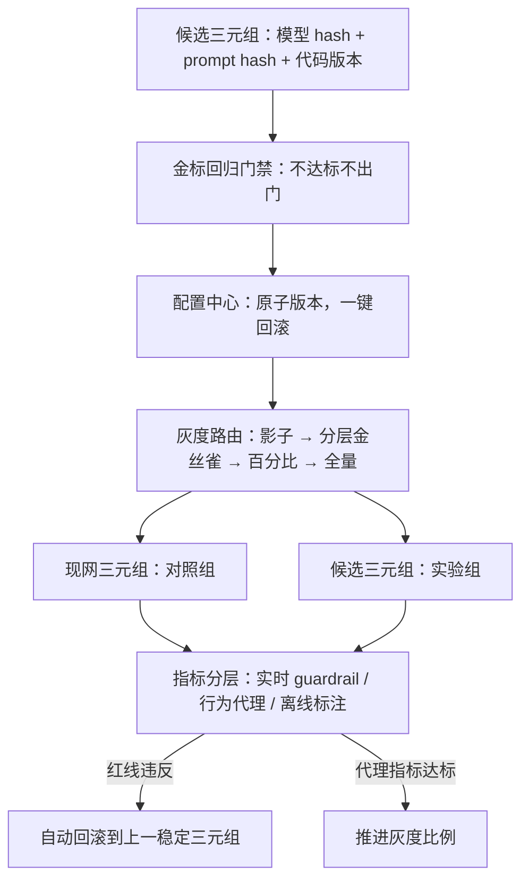

# 模型发布与灰度

> 层级：① 推理与算力 ｜ 贯穿矛盾：质量 · 安全

## 场景

模型权重、prompt、业务代码三者持续迭代上线，效果回归风险高，出了问题要能快速回滚。

## 核心矛盾

**迭代速度 vs 效果稳定性**——模型不是代码：灰度期间看的不再是 QPS 和错误率，而是效果类指标，而效果指标往往要离线算。

## 追问链

- 模型版本、prompt 版本、业务代码版本三者怎么组合管理？回滚「模型」到底回滚的是什么？
- 灰度看什么指标？人工标注类指标实时算不出来怎么办？
- A/B 两组自动指标显著、但业务大盘不动，信哪个？反过来呢？
- 新模型上线后某类 long-tail 请求效果悄悄变差，怎么第一时间发现？

## 推演

### 容量估算（先问这几个数）

- **假设 1：迭代节奏与组合爆炸。**
  - 模型 3 个候选/周、prompt 每天改 5 版（≈35/周）、业务代码 20 次/周。
  - 若三者各自独立发布、互相耦合验证，周组合数 = 3 × 35 × 20 = 2100——逐一验证不可能。
  - **结论：发布单元必须收敛为「原子三元组」，且 prompt 改动走轻量回归、模型改动走重灰度，用分级发布对冲组合爆炸。**

- **假设 2：灰度流量与统计功效。**
  - 日均 100 万请求，灰度 5% = 5 万/天。
  - 核心指标采纳率基线 60%，要检出 +2pp 的提升，单组所需样本 n ≈ (1.96 + 0.84)² × 0.6 × 0.4 / 0.02² ≈ 7.84 × 0.24 / 0.0004 ≈ 4700 条——一天灰度流量绰绰有余。
  - 但若判据换成人工标注好评率，标注吞吐假设 300 条/天，则需要 16 天，且标注本身有延迟和偏差。
  - **结论：实时判据只能用自动代理指标，人工标注注定是离线校准角色。**

- **假设 3：回归评测成本。**
  - 金标集 2000 条 × 平均 2500 token（输入 2000 + 输出 500）= 5×10^6 token/轮。
  - 3 个候选 × 每天 2 轮 = 3×10^7 token/天；按 7B 自部署的产出折算，不过 1~2 张卡的量级（见 [LLM推理服务平台](LLM推理服务平台.md) 的成本基准）。
  - **评测门禁可以高频跑，不必省——「每候选必测」的纪律比评测本身贵不了多少。**

- **假设 4：回滚时间预算。**
  - 全量 100 万请求/天 ≈ 12 QPS。
  - 自动链路：指标报警 5 分钟 + 自动回滚 2 分钟 ≈ 10 分钟止血，受影响请求 ≈ 12 × 600 ≈ 7000 条。
  - 人工链路（拉群、定位、拍板）经验判断平均 2 小时 → ≈ 8.6 万条。
  - 差一个数量级——这是「红线指标自动回滚」存在的算术理由。

### 架构推演（从朴素方案开始塌）

**朴素方案：新模型文件替换旧文件 + 重启服务，出问题再换回来。**

- 塌点一是组合耦合：新业务代码按新 prompt 约定的 JSON 输出格式解析，此时单独「回滚模型」，旧模型输出纯文本，解析全线报错——回滚产生了比不回滚更烂的状态。
- 根因：模型、prompt、代码之间存在隐式契约，单边回滚必然破坏契约。
- 塌点二是效果盲飞：某次 prompt 改动让拒答率从 2% 涨到 20%，系统层面一切正常（没有 error、没有超时），没有任何指标报警，直到 3 小时后客服工单堆积才知道。
- **第一个塌点证明回滚对象错了，第二个塌点证明观测对象错了**——后续所有演进都在修这两个对象。

**演进一：蓝绿双池 + 流量开关。**

- 新旧三元组同时在线，一键切换；回滚从「重装」变成「切流」，止血能力有了。
- 新缺口：切多少、何时切、何时推进仍靠胆量——没有数据支撑，灰度比例是拍脑袋的。

**演进二：三元组版本化 + 灰度路由。**

- (model@hash, prompt@hash, code@version) 作为原子发布单元写入配置中心。
- 任何一元变更都生成新组合并自动跑金标回归，不达标不出门。
- 网关按百分比与维度路由，两个版本同时接流量——灰度从此有对照组、有门禁。

**演进三：自动化灰度闭环。**

- 发布变成状态机流水线：影子流量（请求发往新版本但结果不返回用户，验证性能与格式）→ 分层金丝雀（长尾场景、高价值客户单独分层）→ 百分比递增 → 全量。
- 实时 guardrail 指标（秒到分钟）：错误率、格式错误率、拒答率、延迟、安全拦截率——违反红线即自动回滚（假设 4 的算术）。
- 行为代理指标（分钟到小时）：采纳率、复制率、编辑距离——做推进判据。
- 离线标注（天）：好评率、bad case 归因——校准代理指标与真实效果的相关性。
- 效果评估平台的机制见 [LLM效果评估与回归平台](LLM效果评估与回归平台.md)，本层消费其结论，不重复建设。

**终态架构：**

- 终态里「回滚」是一个查询动作（配置中心指回上一稳定版本）而不是一个部署动作。
- 这依赖两个前置：三元组始终原子共存；上一稳定版本始终保有完整可运行的三元组副本（热备成本约一倍推理资源，对照假设 4 的事故成本，划算）。
- 发布流程的本质是把「迭代速度」约束在「每一步都可逆」的轨道上——速度与稳定不是对赌关系，是先决条件关系。

### 关键决策论证

| # | 决策点 | 选项 A | 选项 B | 判据 | 结论 | 反转条件 |
|---|--------|--------|--------|------|------|----------|
| 1 | 发布单元 | 只管理模型版本 | 三元组原子管理（模型+prompt+代码） | 元素间是否存在隐式契约 | **三元组原子化**。模型-prompt-代码之间有输出格式与解析的隐式契约，拆开发布就是把契约风险留给运行时（朴素方案的第一塌点） | 架构上已把模型输出约束为稳定结构化协议（如固定 schema 的中间表示），契约显式化后可拆分 |
| 2 | 灰度分流 | 纯随机百分比 | 按维度分层（场景/语言/客户） | 长尾流量占比与统计可见性 | **分层优先**。长尾场景占 1% 流量时，5% 随机灰度里只剩 0.05%，任何统计检验都看不见它的退化；分层金丝雀让每层有足够样本（假设 2 的功效算式按层重算） | 场景分布极度均匀、无独立长尾时，随机百分比足够 |
| 3 | 上线判据 | 金标集门禁 | 线上 A/B 最终判据 | 各自测不出什么 | **两者分工：金标集做门禁防大倒退，A/B 做最终判据**。金标集测不出分布漂移与真实目标，A/B 测不出罕见事件与 long-tail 分层；互为盲区所以要都用 | 安全类 rare 事件只能靠专项红线评测集覆盖，不指望 A/B 的样本量 |
| 4 | 回滚自动化程度 | 全人工决策 | 红线指标自动回滚 | 指标是否可实时算且阈值可靠 | **红线指标（错误率/拒答率/安全拦截率）自动回滚，效果类指标人工决策**。人工链路多损失一个数量级的请求（假设 4） | 指标噪声大时，加持续性条件（连续 N 个窗口超标才触发）防误杀，而不是退回全人工 |

论证展开：

- 决策 3 的盲区机制：金标集是「我们想得到的问题」的抽样，A/B 是「真实流量的目标」的观测。前者快但封闭（测不出没写进集子的回归），后者真但慢且对 rare 事件无功效（样本量算式在那里）。
- 把两者当成二选一，等于自愿选择一个盲区。正确姿势是金标集挡住「明显倒退」让灰度更快，A/B 兜住「金标集没想到的」让决策更真。
- 决策 2 的算式复用：假设 2 的功效公式按层重算——长尾层只有 5 万 × 1% = 500 条/天灰度流量时，可检出的最小提升会从 +2pp 恶化到 +9pp 以上，统计上等于失明，这就是必须分层的算术依据。

### 追问应答

1. **三个版本怎么组合管理？回滚「模型」到底回滚的是什么？**
   - 发布单元 = 原子三元组，存配置中心并版本化；任何一元变更都生成新组合并触发轻量回归。
   - 「回滚模型」的真实含义是：回滚到上一个通过金标回归 + 灰度验证的完整三元组，不是换回旧权重文件。
   - 因为 prompt 与代码对输出格式的假设是和旧模型绑定的，单换权重就复现朴素方案的第一塌点——比不回滚更糟。
2. **灰度看什么指标？人工标注类指标实时算不出来怎么办？**
   - 分三层：实时 guardrail（秒到分钟：错误率、格式错误率、拒答率、延迟、安全拦截率）；近线行为代理（分钟到小时：采纳率、复制率、编辑距离）；离线标注（天：好评率、bad case 归因）。
   - 标注算不进实时链路，就让代理指标顶上——代价是必须定期用标注数据校验代理与真值的相关性。
   - 相关系数掉下来就换代理；没有校验的代理指标是没人看过的仪表盘，看起来在监控，实际在装饰。
3. **A/B 自动指标显著但业务大盘不动，信哪个？反过来呢？**
   - 先查代理指标有效性：评测集是否泄漏、新模型是否学会了「讨好指标」（格式迎合、用拒答换准确率）。
   - 大盘不动说明业务真值没变，代理指标与业务脱钩，此时信大盘、修指标。
   - 反过来（大盘动了、A/B 不显著）：先算最小可检测效应——流量不足时大盘波动可能来自其他变量（运营活动、季节性），未必是新模型。
   - 判据：大盘是业务真值，但下结论前先归因，两边都不盲信。
4. **long-tail 请求效果悄悄变差，怎么第一时间发现？**
   - 机制：随机百分比灰度会把 1% 的长尾稀释到统计不可见（决策 2 的算式）。
   - 对策三件：请求打维度标签（场景、语言、长度分桶），每层独立基线与 guardrail 阈值；样本不足的层自动降级为人工抽样巡检并亮黄灯，而不是假装可见；金标集按层配额，保证每层有已知 case 进回归。
   - 发现速度由「分层」决定，不由「监控更勤」决定——不分层，监控看一百遍也看不见那 0.05%。

### 常见误区

1. **「模型上线看错误率和 QPS 就够了」。**
   - 错误率只捕捉异常路径，不捕捉「正常地错」——模型流畅地输出错误答案时，所有传统 SLO 灯全绿，系统看起来完全健康。
   - 机制：质量类故障不在 error path 里，而在「成功响应」的语义里，必须靠效果指标观测。
2. **「回滚就是换回旧模型文件」。**
   - 三元组耦合错配后，回滚单边比不回滚更糟（旧模型输出对新代码的解析格式直接报错）。
   - 回滚必须是原子三元组级别的切流，且上一稳定版本要一直热备着——热备成本（一倍推理资源）与事故成本（假设 4 的 8.6 万条请求）不成比例。
3. **「A/B 显著就全量放量」。**
   - 代理指标可以被模型「针对优化」：格式迎合让解析成功率上升但内容质量下降，拒答率下降让「成功率」变好但胡说变多。
   - 没有离线标注校准的代理指标，会系统性奖励过拟合指标的行为——指标显著只说明「指标动了」，不说明「效果好了」。
4. **「评测集越大越保险」。**
   - 10 万条随手爬取、无分层的评测集，长尾层被噪声淹没，门禁变成抽奖；2000 条按场景分层配额的金标集（假设 3）反而有效得多。
   - 评测集的价值在分层覆盖与标注质量，不在条数——条数只决定门禁的灵敏度下限，分层决定它看得见哪里。

---

[返回 AI 场景题地图](README.md)
