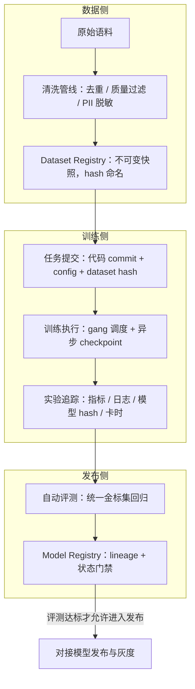

# 模型训练微调平台

> 层级：① 推理与算力 ｜ 贯穿矛盾：质量 · 成本

## 场景

算法团队要基于业务数据持续微调模型，数据团队要清洗与构建语料，需要一个平台统一承接训练任务、数据版本与实验管理。

## 核心矛盾

**实验自由度 vs 工程可复现**——调参要灵活快速，生产模型要可追溯、可复跑、可回滚。

## 追问链

- 几千张卡的训练跑到一半一张卡挂了，怎么做到不从头发？（提示：checkpoint 频率与存储带宽的权衡）
- 实验跑了几百个，怎么决定哪个该上线？实验追踪要记什么？
- 训练数据版本和模型版本怎么绑定？「这个模型是用哪份数据训的」要能 30 秒内回答
- SFT、LoRA、全量微调的算力账分别怎么算？什么场景下微调不如 RAG？

## 推演

### 容量估算（先问这几个数）

- **假设 1：实验吞吐需求。**
  - 算法 50 人，人均每周 10 次实验，平均 8 卡 × 2 小时 → 8000 卡时/周 ≈ 48 卡常驻等效。
  - 比卡数更重要的是等待时间：提交到开跑每多等 1 小时，50 人 × 每天阻塞 1 小时 ≈ 每周 250 人时被浪费。
  - 经验判断：等待超过 30 分钟，算法同学就开始绕过平台手工抢卡，平台随即失守。实验队列的排队时间本身就是平台核心指标。

- **假设 2：微调算力账（6ND 公式：FLOPs ≈ 6 × 参数量 × token 数）。**
  - 13B 模型全量微调 1B token ≈ 6 × 13×10^9 × 10^9 = 7.8×10^19 FLOPs。
  - 128 张 H800，假设 MFU 40%（128 × 989×10^12 × 0.4 ≈ 5.1×10^16 FLOPS/s），理论 ≈ 26 分钟。
  - 计入数据加载、评估、重启损耗，实际 1~2 小时（经验判断：实际开销常为理论值的 2~4 倍）。这是「全量」的账。

- **结论一：LoRA 与全量的差距。**
  - LoRA 冻结主干、只训低秩增量（通常 <1% 参数），省掉的是梯度和优化器状态的显存与通信（13B 的 AdamW 状态就要 200GB 级）。
  - 前向反向仍要过全模型，所以不是「省 99% 计算」，而是省显存换来更大 batch 与更高 MFU。
  - 经验判断：同数据量 LoRA 卡时约为全量的 1/5~1/10，且单卡即可跑小实验——10 倍量级差距决定了「LoRA 默认、全量审批」的平台策略。

- **假设 3：checkpoint 体量与频率。**
  - 13B 全量完整恢复点 ≈ 235GB（权重 fp16 26GB + AdamW fp32 状态 208GB）。
  - 每 500 步（约 30 分钟）异步存一次：先写本地 NVMe，后台聚合上传对象存储。
  - 若同步写共享存储（假设聚合带宽 100GB/s），纯 IO 2.4s + barrier，30 分钟频率开销 <5% 可接受；5 分钟频率必须异步。

- **假设 4：数据规模。**
  - SFT 语料 10 万条指令对 × 平均 2000 token ≈ 2×10^8 token，Parquet 落盘 GB 量级。
  - 清洗管线读原始语料 100GB → 去重与质量过滤后剩 30GB（淘汰 70% 是常态，经验判断）。
  - 存储成本可忽略，关键从来不是容量，是版本不可变。

### 架构推演（从朴素方案开始塌）

**朴素方案：算法同学 SSH 上机器，conda 环境 + 本地数据目录 + nohup 起训练。**

- 第一个塌点很快出现：两人在同一台 8 卡机上各跑一个 8 卡任务，OOM 或慢到不可用——抢卡问题，是显性的、可修复的。
- 第二个塌点更致命且不可逆：「上周那个评测 0.87 的模型是怎么跑出来的？」没人答得出。
- 数据被清洗脚本原地覆盖；git 里只有代码没有超参与随机种子；日志在 /tmp 里被清了。
- **这不是丢一次实验，是丢掉全部历史实验的可信度**——从这一刻起，「这个模型比那个好」的任何判断都失去依据，核心矛盾中「可复现」一端整体塌方。

**演进一：任务化。**

- 统一提交系统 + 容器镜像 + gang 调度队列（调度机制见 [GPU算力调度平台](GPU算力调度平台.md)），数据与产物上共享存储。
- 解决抢卡与环境污染，但实验元数据仍散落在各自的 log 文件里，「怎么跑出来的」还是靠人肉考古。

**演进二：实验追踪与配置即代码。**

- 每次实验强制记录五元组：输入（代码 commit、数据 hash、config 快照）、过程（loss 曲线、资源用量）、输出（模型产物 hash）、评测（金标集分数）、成本（卡时）。
- 平台拒绝提交「无版本」任务——没有 dataset hash 和 commit 的任务直接拒绝受理。
- 自由度没有被收走，只是被强制带上了账本：想怎么调参都行，账必须记。

**演进三：数据-模型血缘闭环。**

- 数据管线产出不可变 dataset 快照（内容 hash 命名，只增不改）。
- 训练任务引用 dataset hash + code commit + config，模型注册进 registry 并带完整 lineage。
- 上线前自动跑统一金标评测，registry 中「评测达标」是进入发布的前置状态。
- 平台的价值不在让单个实验更快，而在让「哪个模型可信」存在唯一事实来源。

**终态架构：**

- 血缘闭环里没有任何「人工导出」环节：dataset hash 到 model hash 的每条边都是系统自动记录的外键。
- 30 秒回答「哪份数据训的」不是靠纪律，是靠这些外键可查询——可复现性的本质是数据结构问题，不是流程自觉问题。
- 发布侧的下游机制见 [模型发布与灰度](模型发布与灰度.md)，两个平台的接口就是 Model Registry 的状态字段。

### 关键决策论证

| # | 决策点 | 选项 A | 选项 B | 判据 | 结论 | 反转条件 |
|---|--------|--------|--------|------|------|----------|
| 1 | 默认微调方式 | LoRA 优先 | 全量微调优先 | 算力账（10 倍差）、数据量、分布差异 | **LoRA 默认，全量需审批走大任务队列**。LoRA 卡时 1/5~1/10，且多 adapter 可共享同一基座 serving，迭代快 10 倍的团队在实验数量上碾压 | 领域语言/结构大改，或 SFT 数据 >50 万条且 LoRA 扫参不收敛 |
| 2 | 数据版本机制 | 不可变快照 + hash | 可变目录 + 时间戳 | 复现是否依赖考古 | **强制 immutable snapshot**。可变目录一旦被原地修改，历史模型全部失去解释（朴素方案的第二塌点）；快照让「复现」变成查表 | 5 人以下极小团队用 git LFS 凑合可以，但边界要事先讲清 |
| 3 | 实验追踪 | 自建记录系统 | MLflow/W&B 类开源 | 开发成本 vs 定制需求 | **用现成开源**。自建 3 个月大约只能做到开源方案的 60%，而算法同学早已会用开源工具；平台工程力应花在血缘闭环和评测门禁这些开源不覆盖的部分 | 数据不能出内网且开源方案无私有化部署授权 |
| 4 | checkpoint 策略 | 同步低频 | 异步高频（本地 NVMe → 对象存储分层） | 期望损失 × 卡时单价 vs 开销 | **异步高频**。30 分钟频率故障期望损失 128 卡 × 15 分钟 ≈ 32 卡时；同步写盘的 barrier 在千卡规模会放大慢节点拖尾，频率越高拖尾越重 | 存储带宽紧张到异步上传堆积时，退回低频同步 + 延长快照间隔 |

论证展开：

- 决策 1 的机制：LoRA 的真正杠杆不是省 FLOPs（前向反向仍过全模型），而是省显存与通信——单卡可跑意味着实验从「排队等 8 卡」变成「随手可跑」，实验吞吐的提升是数量级而非百分比。微调平台的第一指标是实验吞吐（假设 1），所以这个决策直接决定平台成败。
- 决策 2 的机制：hash 命名的快照让「复现」从考古（翻聊天记录、翻日志、拼凑命令行）变成一次数据库查询；且快照只增不改，旧模型的引用永远有效。存储代价是 GB 级（假设 4），远小于信任代价。
- 决策 4 的算式：期望损失 = 故障间隔内未存档进度 × 卡时单价；30 分钟频率下期望损失 32 卡时/次故障，而异步 checkpoint 的额外开销 <1%——期望损失与开销差两个数量级，结论明确。

### 追问应答

1. **几千张卡的训练跑到一半挂了一张卡，怎么不从头发？**
   - 靠「checkpoint 频率 × 存储带宽」的权衡设计：期望损失 = 平均故障间隔内未存档的进度 × 卡时单价，checkpoint 开销 = 频率 × 单次写盘时间。
   - 30 分钟异步频率下（假设 3），损失 15 分钟 × 1024 卡 ≈ 256 卡时，占数周任务的千分之一量级。
   - 配套还有两件事：快速重调度（预占备用卡、拓扑感知重启），和确定性恢复（数据位置、RNG 状态、optimizer 状态必须与权重一起存，否则续训曲线和原曲线对不上）。
2. **实验跑了几百个，怎么决定哪个该上线？实验追踪要记什么？**
   - 记五元组：输入（code commit / dataset hash / config）、过程（loss 与资源曲线）、输出（模型 hash）、评测（同一金标集分数）、成本（卡时）。
   - 决策规则：同金标集上稳定超基线（多 seed 复验）才进候选，再由人工看 bad case 定夺。
   - 要防两个坑：评测集泄漏让分数虚高，cherry-picking 只报好 seed——所以追踪系统必须记录全部 seed 的结果，而不是作者挑过的。
3. **数据版本和模型版本怎么绑定？**
   - dataset hash 是训练任务的必填外键（不填不受理），模型 registry 记录 lineage：model hash → 训练任务 → dataset hash → 快照内容。
   - 「30 秒回答」靠的是数据库主键链查询，不是翻聊天记录——这条链上任何一环是人工维护的文档，30 秒就变成 3 天。
   - 绑定还隐含一个义务：快照只增不改，旧快照永久可读，否则外键指向一具尸体。
4. **SFT、LoRA、全量微调的算力账？什么场景微调不如 RAG？**
   - 算力账用 6ND（假设 2、结论一）：全量 13B × 1B token ≈ 7.8×10^19 FLOPs；LoRA 省的是梯度和优化器显存与通信，卡时约全量 1/5~1/10。
   - 微调不如 RAG 的三个场景：知识频繁更新（微调改变分布与风格，不是可靠的事实存储，更新知识要重训而 RAG 换文档即可）；需要溯源引用（RAG 天然带出处，微调的「知识」无法定位到条目）；数据量太小（<1000 条时微调过拟合风险大于收益）。
   - 判据一句话：改「会不会说」用微调，改「知道什么」用 RAG——RAG 的机制与取舍见 [企业知识库问答 RAG](企业知识库问答RAG.md)。

### 常见误区

1. **「loss 降了就是模型变好了」。**
   - SFT 的训练 loss 与下游业务效果经常脱节：loss 下降可能只是背下了训练集。
   - 机制：训练目标（next token prediction）≠ 业务目标（回答正确且有用），两者只在数据质量极好时近似一致。
   - 上线判据必须是金标集 + 人工抽检，loss 只用来发现训练事故（发散、断崖）。
2. **「评测集顺便从训练数据里划一点出来就行」。**
   - 金标集与训练集同源时分数虚高，线上即塌——这是几百个实验里「0.87 选手上线变 0.6」的头号原因。
   - 机制：模型在「见过的数据」上的表现不构成对「未见数据」的估计。
   - 金标集要物理隔离、只增不改、定期换血。
3. **「清洗脚本改了直接重跑覆盖数据目录」。**
   - 原地覆盖破坏血缘：上周的模型指向的 dataset hash 不存在了，可复现性永久损失。
   - 脚本本身也要版本化，每次产出新快照而不是覆盖旧快照——存储成本是 GB 级（假设 4），远小于一次「无法解释线上模型」的信任成本。
4. **「LoRA rank 越大效果越好」。**
   - 经验判断：rank 8~32 在多数 SFT 任务上已饱和，rank 拉到 256 的训练成本与显存线性上涨，小数据上还放大过拟合。
   - 正确做法是先扫小 rank 建立基线，加 rank 前先看金标集是否有可复现的提升——参数量不是效果，是成本。

---

[返回 AI 场景题地图](README.md)
