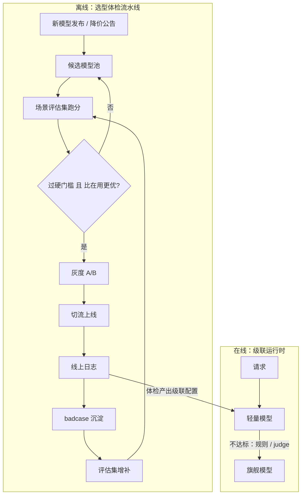

# 模型选型与级联

> 层级：贯穿 · 成本与效率 ｜ 贯穿矛盾：成本 · 质量

## 场景

每个新场景都要回答「用哪个模型」：旗舰、轻量、自部署、微调，选错要么贵十倍，要么根本不可用。而且榜单每月都在变。

## 核心矛盾

**一次选型 vs 持续演化**——模型每月变强变便宜，选型结论快速过期；选型从「一次性决策」退化成「持续性流程」，需要的基建完全不同。

## 追问链

- 选型评估集怎么建才能代表你的真实场景？（榜单分高 ≠ 你的场景好用）
- 能力都够的条件下，什么时候选便宜的？「够用」怎么量化成门槛？
- 级联架构（便宜模型先行、不达标升级）的「不达标」怎么定义？误判升级和漏判降级哪个代价大？
- 模型迭代后要不要重新选型？怎么系统性地发现「该换了」而不是靠事故？

## 推演

### 容量估算（先问这几个数）

这题的容量估算对象不是流量，是两笔账：**评估基建的规模**与**级联的经济账**。数字是假设，算式通用。

- **假设 1：20 个 AI 场景、候选模型池 10 个**（3 旗舰 API、4 轻量 API、2 自部署、1 微调版），评估集每场景 500 条。全量体检一轮 = 20 × 10 × 500 = 10 万次调用 × 2.5K token = 2.5 亿 token，混合 ¥8/M ≈ **¥2000/轮**。结论先行：**评估的钱可以忽略，拦住大多数团队的是评估基建不是评估成本**——这是「一次选型 vs 持续演化」的第一个数字注脚：每轮只值 2000 块的事不发生，唯一原因是没有可复用的评估管线。
- **推导·评估集自身是一份小数据资产**：20 场景 × 500 条 × 2KB ≈ 20MB——存储忽略不计，工程量全在「分层抽样、badcase 回流、去重清洗」的管线上。评估集是小数据、大工程，这也是它没法靠一次性运动建好、必须做成常态管线的原因。
- **假设 2：轻量与旗舰价差 50 倍**（¥0.4/M vs ¥20/M，主流 API 定价结构同量级，经验判断）。级联经济账以「全旗舰 = 100 单位/请求」计：理想级联（70% 流量被轻量解决、零误判）= 0.7×2 + 0.3×100 = **31 单位，省 69%**。
- **假设 3：级联误判率 10%**（轻量扛不住但被放行，需升级重试）= 0.7×(2 + 0.1×100) + 0.3×100 = **38 单位，省 62%**。误判 10% 只把节省从 69% 侵蚀到 62%——**级联的经济性对误判升级相当鲁棒**（重试只多付一次轻量钱加一次旗舰钱）；真正不可逆的是漏判降级（该升没升）直接产出 badcase，那不是成本问题，是质量事故。这个不对称决定后面阈值偏置的结论。
- **推导·判定器开销**：若用 judge 模型判「不达标」且 judge 与轻量同价（2 单位/次），每请求固定 +2 单位（31 → 33），侵蚀远小于误判重试（+7）；但若 judge 用旗舰（100 单位/次），判定成本直接吞掉全部级联收益——**judge 必须用便宜模型**，这条从算式直接推出，不用讨论。
- **推导·级联的延迟代价**：失败路径 = 轻量全程 + 判定 + 旗舰全程串行——假设轻量 3s、judge 2s、旗舰 15s（量级为经验判断），误判请求的延迟逼近 20s：**P50 变好（七成请求走轻量更快）、P99 变差**是级联的典型延迟签名，监控要分开看两个分位，只看均值会得出「级联让延迟变好」的错误结论。
- **假设 4：「够用」门槛的统计可分性**。500 条评估集估计 2% badcase 率，95% 置信区间 = 1.96 × sqrt(0.02 × 0.98 ÷ 500) ≈ **±1.2%**——只能区分 2% 与 5% 这种台阶，区分不了 2% 与 3%。把区间压到 ±0.5%，样本量按平方反比涨：(1.2 ÷ 0.5)² ≈ 6 倍 → **约 3000 条**。所以门槛必须设成有统计可分性的台阶（≤2%、≤5%），写「badcase ≤ 2.3%」是假精度。
- **假设 5：自部署盈亏平衡点**。8 卡推理集群全含月成本 ¥12 万（单卡 ¥1.5 万，含机房与运维摊销），对照轻量 API ¥0.4/M → 打平 token 量 = 12 万 ÷ 0.4 元/M = **300B token/月 ≈ 日均 100 亿 token**。参照全公司盘子约 750B token/月（口径见 [Token 成本治理](Token成本治理.md)）：单一业务要摸到平衡点，得吃掉全公司近一半调用量。**自部署是「规模化 + 合规 + 版本稳定」三条件题，不是省钱技巧**。
- **推导·记分卡的体量**：10 候选 × 20 场景 = 200 行 × 3 列指标，就是一张表——选型演化流程的全部产出物是这张不断刷新的表；「基建重」重在管线与纪律，不在数据量。
- **推导·体检频率上限**：主流模型月级发新版本，但单个场景「在用 vs 池内最优」的差距按季度漂移才有统计意义（经验判断）——体检按季度全量、新模型进池即跑增量即可；追着每月榜单刷新，边际收益趋零而评估噪音不变。

结论：这题最反直觉的两个数——体检一轮只值 ¥2000（选型该做成常态流程）、自部署平衡点 300B token/月（默认 API）。选型会上争得面红耳赤的双方，多半没算过这两个数。

### 架构推演（从朴素方案开始塌）

**v0：读榜单 + 拍板，模型名写死在代码里。**

最朴素也最普遍。它在两处塌，第一处不在模型：

1. **榜单 ≠ 你的场景**。榜单度量通用能力的均值，你的场景是长尾分布：榜单冠军在你们的领域术语、中文语气、输出格式约束上可能排不进前五（机制：榜单任务分布与你的流量分布错位，且头部模型对公开基准存在训练污染，分数虚高）。塌的具体指标：上线后 badcase 率 8%，远超预期的 2%。
2. **选型结论锁死在代码里**。换模型 = 改业务代码发版，一次 A/B 的工程成本高于忍受劣化，于是没人换；三个月后模型降价或升级，「当初的最优」悄悄变成「次优 + 贵 10 倍」，而没有任何信号能发现这件事。

拍板的隐性成本常被漏算：模型名写死在业务代码里之后，「换模型」从一个配置变更退化成跨几十个仓库的发布工程——这正是后来所有业务宁可忍受次优也不肯换的机制性原因。成本不是选错那天付的，是每次想改的时候付的。

**v1：评估集先行——没有评估集就没有选型资格。**

把「哪个模型好」改写成「在**我们的评估集**上哪个模型好」。评估集三个来源：线上日志分层抽样（按功能与难度分层，不是均匀抽，保证长尾不丢）、历史 badcase 全量沉淀（唯一自动对齐「你会在哪出错」的来源）、人工构造边界用例（占比 ≤20%）。这一步塌在**评估集自身的腐化**：模型换版后难度分布失真、badcase 没有回流机制、500 条样本 ±1.2% 的置信区间撑不起精细比较（假设 4）。对策：评估集按季度用线上流量分布做对照重采样，badcase 持续增补——这个飞轮与 [数据飞轮与标注平台](数据飞轮与标注平台.md) 同构。

分层抽样还有一个反直觉要求：**按「出错频率」加权，而不是按「流量频率」**——头部简单 query 谁都对，区分度全在长尾；均匀抽样会让评估集被「人人都会的题」稀释，500 条里有效分母可能只剩百条，真实置信区间比 ±1.2% 还要宽。

**v2：候选池 + 定期体检 + 门槛制决策。**

固定 5-10 个候选模型出记分卡（质量分 × 单价 × P99 延迟三列），每季度全量体检、新模型进池即跑同集对比。决策形式从「综合打分拍板」改成**硬门槛制**：质量下限、延迟上限、合规要求是各自独立的否决项，先淘汰；达标池内按成本与延迟排序。这一步塌在**更新纪律**：没有 owner 和触发机制的体检表，三个月后必然停更——所以体检要挂在新模型发布事件上自动触发，不挂在季度会议的记性上。

记分卡的「质量分」必须按场景分列，不能汇总成总分：同一个模型在客服场景达标、在代码审查场景不达标是常态；跨场景汇总分会同时造成「误杀」（漏掉某场景可用的便宜模型）和「误放」（放进整体均值好但你的场景差的模型），两种错都比多维护一列数据贵。

**v3：级联路由——把选型从开发期挪到运行期。**

轻量模型先行，规则或 judge 判定不达标升级旗舰。级联的本质是承认「一次选型」无法拟合流量的异质性：同一场景内约七成请求是简单查询、三成是边界 case，用同一个模型服务，要么为三成付十成的旗舰钱，要么让三成承受 badcase。级联把这部分选择移到运行时，每个请求自选档位（路由细节见 [多模型路由与降级](多模型路由与降级.md)）。这一步塌在**判定器自身的可靠性**：judge 也是 LLM，其判断是概率性输出，会引入二阶幻觉与同源偏差；规则判不出开放式回答的质量。对策：判定优先用可机械验证的信号（结构化输出可解析、检索引用存在、格式合规、敏感词命中），验证不了的维度才交给 judge，且 judge 用异族模型、误判率定期人工标定。

级联在优化链里的位置也有讲究：它应发生在缓存未命中之后（缓存命中根本不进级联，省的是全额），压缩发生在进轻量模型之前（压的是两侧模型的输入成本）——抓手叠加次序错了，节省会互相吃掉，这也是成本治理要把抓手做成「链」而不是孤立开关的原因（链条整体设计见 [Token 成本治理](Token成本治理.md)）。

**v4：演化闭环——「该换了」由报表发现，不靠事故。**

记分卡常设一列「在用 vs 池内最优」的差距，差距越阈（质量持平但便宜 2 倍，或同价质量高 5%）自动生成迁移建议单，走灰度 A/B 后切流。至此「选型」从一次性会议变成流水线：

一个刻意的设计：离线流水线的输出（各模型的达标结论）就是在线级联的配置来源——级联里「轻量用哪个、旗舰用哪个」不该是拍板常量，而是体检流水线的产物；两者共享同一份评估集，评估集是整个体系的度量衡。成本侧的配套抓手（缓存、压缩、限长）见 [Token 成本治理](Token成本治理.md)；自部署的推理容量与 GPU 账见 [LLM 推理服务平台](LLM推理服务平台.md)。

迁移建议单要带证据链而非只有结论：评估集哪一版、分数差多少、置信区间多少、灰度计划是什么——没有证据链的建议单会被业务方当成平台 KPI 驱动的折腾，拒绝执行是理性反应；证据链也是「选型是流程不是权力」在协作层面的落地。

### 关键决策论证

| # | 决策点 | 选项 A | 选项 B | 判据 | 结论 | 反转条件 |
|---|--------|--------|--------|------|------|----------|
| 1 | 选型依据 | 公开榜单 | 自建场景评估集 | 任务分布匹配度 | **自建评估集是唯一决策依据，榜单只用来缩候选池**（从上百缩到 10 个进池）。榜单是通用均值且可能被训练污染，与你的流量分布错位 | 场景与某公开基准几乎同分布（如纯代码生成）：可借基准省一部分工作，但 badcase 沉淀仍须自建 |
| 2 | 决策形式 | 综合加权分 | 硬门槛 + 达标池内排序 | 指标可否互相补偿 | **硬门槛制**。综合分把「质量差 5% 便宜 90%」和「质量差 50% 便宜 90%」折成同一个数；质量下限、延迟上限、合规是独立否决项，不可补偿。达标池内只按成本与延迟排 | 探索型场景（无明确质量底线的内部工具）：可暂用综合分，但底线迟早要补 |
| 3 | 级联阈值偏置 | 宁可误升 | 宁可漏降 | 误判代价的可预算性 | **向误判升级偏置**。误判升级多付的钱有上限且可预算（假设 3：误判 10% 只侵蚀 7 个点节省）；漏判降级产出 badcase，代价无上限且坏例不可枚举（非确定性输出只能抽样发现） | 预算见底的硬约束期：反向偏置，但须业务方显式签风险确认并留一键回滚 |
| 4 | 「不达标」判定器 | judge 模型自评 | 可机械验证信号优先 | 判定器自身的可靠性 | **机械验证优先，judge 兜底**。judge 也是概率性输出，有二阶幻觉与同源偏差，每次调用还烧钱加延迟；能解析、能校验、能查引用的维度零成本零风险。judge 只判无法规则化的维度，且异族模型 + 定期人工标定误判率 | 输出天然开放式（自由文本质量、语气）：规则化不可行，judge 是唯一选项，接受其误判率并持续校准 |
| 5 | 自部署 vs API | 自部署 | API | TCO 与三条件 | **默认 API，三条件全满足才启动自部署**：月 token 过平衡点（假设 5：≈300B，单一业务几乎摸不到）、合规强制数据不出域、模型版本稳定（自部署吃不到上游迭代红利）。TCO 含运维人力与折旧，不只是卡价 | 合规硬约束直接推翻 API 选项——此时争的不再是省不省，而是能不能 |

决策 1 补一句：「榜单缩池、评估集定案」还有一层实操含义——新模型太多时，看榜单决定「谁值得进池」，进池后的一切结论只认自家评估集；两步都存在，但决策权只在第二步。

决策 2 补一句：门槛数值从 badcase 的业务代价反推，不从感觉定——客服答错一次的成本是人工接管约 ¥2，容忍线可放到 5%；法律或医疗场景答错一次是合规事故，容忍线趋近 0 且关键错误类型（幻觉、越权）要求为零。

决策 3 补一句：两个误判率都可测——用评估集给判定器标工作点，误判升级率与漏判降级率并排摆在阈值旁边，「偏多少」从理念之争变成查表。

决策 4 补一句：判定器本身也要进评估体系——用人工标注的「该升 / 不该升」金标集定期测判定器的误判率；没有金标的判定器等于未校准的传感器，它的漂移会直接变成级联的成本漂移与质量漂移。

决策 5 补一句：微调自部署常被当第四条路（把旗舰能力蒸馏进小模型），成立前提是「任务窄且稳定 + 流量大」：标注与训练是固定成本，基座每次升级要重训；任务一漂移，蒸馏模型在分布外输入上的退化只能抽样发现，回归风险高于级联。先级联后微调，微调是最后一步（训练侧配套见 [模型训练微调平台](模型训练微调平台.md)）。

### 追问应答

**1. 选型评估集怎么建才能代表你的真实场景？（榜单分高 ≠ 你的场景好用）**

三个来源加权：线上日志分层抽样（按功能、难度分层而非均匀抽，保证长尾不丢）、历史 badcase 全量沉淀（唯一自动对齐「你会在哪出错」的来源）、人工构造边界用例占比 ≤20%。验收标准是「评估集分布 ≈ 线上流量分布」，每季度对照一次，偏了就重采样。反模式是拿通用榜单题当评估集——那测的是模型的通用能力，不是你的场景。

**2. 能力都够的条件下，什么时候选便宜的？「够用」怎么量化成门槛？**

「够用」= 评估集上 badcase 率不超过该场景容忍线，容忍线由单次错误的业务代价反推：错误代价高的场景（合规、资金）容忍线趋零且关键错误类型必须为零；错误代价低的场景（内部工具、草稿生成）可放到 5% 以上。量化成硬台阶（≤2%、≤5%），台阶间距要大于评估集的置信区间（假设 4：500 条样本撑不起 1% 级分辨）。达标池内谁便宜选谁——不为质量冗余付钱，冗余由级联的旗舰兜底更划算。

**3. 级联架构的「不达标」怎么定义？误判升级和漏判降级哪个代价大？**

按可验证性分层定义：能机械验证的维度（JSON 可解析、引用存在、格式合规、敏感词命中）用规则；验证不了的（开放式回答质量）用 judge，且 judge 与被评模型异族、误判率定期人工标定。代价不对称是明确的：漏判降级大——误判升级只多付一次轻量加一次旗舰的钱（可预算，假设 3 算过侵蚀 7 个点），漏判降级直接产出 badcase，代价无上限。所以阈值向「宁可误升」偏，偏多少由评估集标出的两个误判率决定，不是理念问题。

**4. 模型迭代后要不要重新选型？怎么系统性地发现「该换了」而不是靠事故？**

要，但形态不是重做选型，是跑体检流水线：候选池每季度全量、新模型进池即跑同集对比、记分卡常设「在用 vs 池内最优」差距列，越阈自动生成迁移建议单走灰度。系统性发现靠三个机制：体检挂在新模型发布事件上自动触发（不靠季度会议记性）、badcase 持续回流评估集（保证体检测的是当前会出错的方向）、迁移决策留 A/B 对照数据。靠事故发现「该换了」是反模式——事故本身说明评估集没覆盖那个退化方向，先补评估集再谈换模型。

### 常见误区

- **「榜单跑分选型」**。具体样子：选型报告第一页是 leaderboard 截图，结论「选综合分第一的」。机制上为什么不行：榜单是跨任务平均分，平均掩盖任务级方差——你的场景恰是它的弱项时，榜单第一在你这排第五；且头部模型对公开基准存在训练污染，分数本身虚高。榜单的合法用途只有一个：把上百个候选缩到 10 个进池。
- **「所有场景都该上级联」**。具体样子：方案写「为省钱，全部业务轻量先行 + judge 判定升级」。机制上为什么不行：级联有固定成本——judge 调用烧钱加延迟、失败路径串行两次推理把 P99 推高、判定器需要持续标定。小流量场景算不过账：日均 1 万次 × 2.5K token × 30 天 = 0.9B token/月，全旗舰口径约 ¥1.8 万/月，按假设 3 级联省 62% ≈ **¥1.1 万/月**——不够半个工程师做判定器标定维护的成本。
- **「选型 = 一次技术评审会的决议」**。具体样子：文档归档「评审会决议：采用 X 模型」，此后两年不再提起。机制上为什么不行：模型市场月级演化，选型结论半衰期只有几个月；一次性决策没有重评机制等于默认持续劣化。正确形态是把选型做成流水线（评估基建 + 定期体检 + 灰度迁移），评审决议只是流水线的某次输出。
- **「微调小模型 = 一劳永逸的省钱」**。具体样子：「把旗舰蒸馏进 7B 自部署，成本降 100 倍」。机制上为什么不行：标注、训练、每次基座升级重训都是固定成本，只有任务窄且稳定、流量大才摊得薄；蒸馏模型在分布外输入上的退化是黑盒，非确定性输出意味着回归只能抽样发现——任务一漂移，省下的推理钱赔进 badcase 处理。先级联、后微调，微调是流量与任务都稳定后的最后一步。

---

[返回 AI 场景题地图](README.md)
