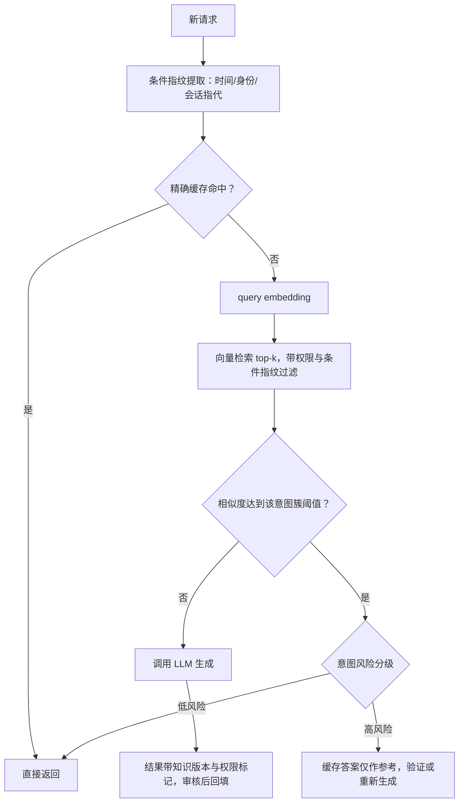

# 语义缓存

> 层级：② 接入与流量 ｜ 贯穿矛盾：成本 · 质量 · 安全

## 场景

客服、知识库等场景存在大量相似问题，每次都打大模型又贵又慢，想把已有答案缓存复用：新问题来了先找「语义上最接近」的历史问答。

## 核心矛盾

**命中率 vs 正确性**——「相似的问题」不一定有「相似的答案」，缓存命中一次错误答案，比不缓存更糟。

## 追问链

- 相似度阈值定多少？定高了命中率低，定低了错误命中，这个阈值谁说了算、怎么验证？
- 「北京天气怎么样」和「昨天北京天气怎么样」embedding 很近，答案完全不同——时间、身份、前提这类条件变化，缓存怎么识别？
- 用户 A 的答案里带着 A 的私有数据，语义缓存把答案给了权限不同的用户 B，怎么办？
- 缓存失效策略和知识库更新怎么联动？知识改了，旧答案还在缓存里怎么办？

## 推演

### 容量估算（先问这几个数）

语义缓存的第一道题不是架构，是**这个场景值不值得做**——重复度是收益的天花板，先用数字把账算出来。

- **假设 1：客服/知识库场景日均 100 万请求，历史问答一年积累 1 亿条候选。** 高频客服问题集中在少量意图上（经验判断：头部 20% 意图覆盖 60-80% 流量），这是重复度假设的来源。
- **假设 2：embedding 1536 维 float32，每条 6KB。** 1 亿条 → 600 GB 原始向量；HNSW 图索引内存约为向量的 1.5-2 倍 → **约 1 TB 内存，单机临界**。要么 int8 量化（约 150 GB，召回率损失在 1% 量级，经验判断），要么按租户/意图分片。
- **推导·写入速率**：假设命中率 30%，未命中的 70 万条/天全部回填 → **2100 万条/月，一年 2.5 亿条**。不设淘汰的库一年膨胀 2.5 倍，淘汰和降维必须从第一天设计进去，不是后补的运维活。
- **推导·收益（成本侧）**：命中一次省一次 LLM 调用（沿用 [LLM 网关](LLM网关.md) 的 2500 token/请求）。月命中 = 3000 万 × 30% = 900 万次 → 22.5B token，按 ¥4/M ≈ **9 万元/月**。同口径下全量不走缓存的成本约 30 万/月，缓存砍掉三成——**高重复场景值回票价**。
- **推导·收益（延迟侧）**：缓存路径 = embedding 计算（10-30ms）+ 向量检索（10-50ms）+ 阈值判定（<5ms），**百毫秒内返回**；直连 LLM 首字延迟（TTFT）通常 1-5s。语义缓存首先是一道延迟题，其次才是成本题——这也是它挂在接入层（作为 [LLM 网关](LLM网关.md) 的组件）而不是业务层的原因。
- **推导·敏感性**：收益对命中率线性：命中率 30% → 20%，月收益 9 万 → 6 万。而离线模拟的命中率只能测上界（历史 query 两两相似度会高估真实命中场景）——**收益预期打七折再做决策，先小流量实测**。
- **推导·查询侧开销**：峰值 200 QPS ×（embedding 20ms + 检索 30ms）≈ 10 个并发执行槽，向量检索在吞吐上毫无压力——**语义缓存的全部复杂度在正确性，不在性能**，这决定了工程投入的分配方向。
- **推导·embedding 计算成本**：query 向量化用自部署小模型，单条 20ms、成本近零，相比省下的 1-5s 生成延迟可忽略——缓存路径的延迟收益约为直连的一个数量级，且方差小得多（生成延迟是重尾，检索延迟不是）。
- **推导·反面**：若场景是长尾自然语言（编程助手、开放式问答），命中率可能低于 5%，月收益不足 1.5 万，而每次错误命中都是一次潜在事故。**重复度低于 5% 的场景，正确决策是不做**——上线前用历史日志抽样两两算相似度，离线模拟命中率，先验证再动工。

结论：语义缓存的账是「命中率 × 单次成本」对赌「错误命中事故成本 + 存储/检索成本」。前半段能算，后半段算不出来——所以所有架构决策都往「把错误命中压到趋近零」的方向倾斜：同样的模糊地带，**宁可漏命中（回退 LLM，只多花钱），不可错命中（返回错误答案，出事故）**。

### 架构推演（从朴素方案开始塌）

**v0：Redis 精确缓存，prompt 哈希做 key。**

塌得最快。精确缓存假设「相同输入 → 相同输出」，但自然语言里「相同输入」几乎不存在：「怎么退货」「退货流程是什么」「我想退货怎么弄」三个 hash 完全不同，命中率（经验判断）不到 5%，收益覆盖不了维护成本。机制：hash 精确匹配的是字节，用户表达的是意图——两者之间隔着整个自然语言的多样性。

**但 v0 值得留一个遗迹**：精确缓存不要删——它降级为语义缓存的前置层（零风险命中先走它），也是语义缓存整条链路故障时的兜底路径。后续架构里它一直在，只是换了位置。

**v1：全局语义缓存——embedding + 向量库 top-1 + 统一阈值 0.9。**

把 query 向量化，检索最相近的历史问答，相似度超 0.9 直接返回。一步到位？塌在三处：

1. **阈值一刀切失效**：不同意图簇在向量空间密度不同——寒暄类问题挤成一团，金额、订单类问题彼此稀疏。同一个 0.9，在寒暄簇命中率虚高（互为近似），在金额簇错误命中成灾。塌的指标是**命中错误率**，而它恰恰是最贵的指标。
2. **语境盲区**：「北京天气怎么样」和「昨天北京天气怎么样」embedding 距离极近——差异只有两个字，而 embedding 编码的是文本分布相似度，不编码时间、身份、指代这类**语境变量**。答案完全不同的两条 query，在向量空间里几乎是同一个点。同类反例：「怎么开通」与「怎么注销」向量很近、答案相反。
3. **权限后门**：用户 A 的答案含私有数据，用户 B 相似提问直接命中 → 数据外泄。缓存成了绕过 ACL 的后门，而且是系统默认开启的那种。

**v2：结构化条件指纹 + 权限过滤 + 版本化失效。**

三个塌点逐一补：

- 从 query **显式抽取**易变条件（时间槽、用户/租户、地域、会话指代、单号）作为结构化指纹参与 key 或过滤条件——不指望 embedding 自己区分它们，因为机制上它区分不了；
- 缓存条目带「可见权限集合」「来源文档引用」「知识版本 + TTL」，检索时先按权限 filter 再算相似度（顺序不能反，见误区 3）；
- 阈值按意图簇分别校准，不再全局一个数。

指纹抽取本身用规则（时间词、单号正则）加轻量模型，它自己也有错误率——**指纹提取失败时宁可放弃缓存直接回退 LLM，不能带着不完整指纹去命中**。仍然塌在：语境变量枚举不完。「我如何退这单」里的「这单」依赖会话上下文，「它多少钱」里的「它」依赖上一轮，指纹永远有漏网之鱼。

**v3：终态——语义缓存从「答案替身」降格为「路由建议」。**

承认一个机制性事实：无法证明「相似 → 等价」，就只能按**风险分级**决定缓存答案的用途。

低风险意图（寒暄、通用知识、品牌 FAQ）直接返回缓存答案，吃满收益；高风险意图（资金、订单操作、医疗法律）命中后只把缓存答案当参考，走生成或验证路径，收益打折但错误命中趋近零。回填侧同理：高风险意图的答案可以缓存（供参考），但永远不作为直返候选。

**分级之后，观测指标也要跟着分。** 缓存不只要报总命中率，要报四件事：命中率（钱）、错误命中率（事故，靠命中样本抽检估计）、按意图簇的分布（哪个簇在漏、哪个簇在错）、节省的 token 与延迟分布（对账给 [Token 成本治理](Token成本治理.md)）。只监控总命中率等于蒙眼开车——总指标健康，资金簇可能已经在漏。

**v3 还要补两块最容易被漏的能力。** 一是**回填防护**：未命中路径生成的答案要经过与直返候选同等强度的审核才能回填——错误答案一旦入库，会被后续所有相似 query 反复消费，「一次生成、N 次泄漏」，缓存的放大效应对错误同样生效。二是**冷启动预热**：把历史日志聚类出的头部意图，在低峰期离线批量预生成、灌入缓存，上线第一天就有 30% 量级的命中率，而不是从零等自然积累；预热答案同样走版本化与失效链路，不是一次性脚本。另外记住一个维护事件：**embedding 模型升级 = 全库向量重算 + 索引重建**（新旧模型的向量空间不可比），一年一次的停机级维护要提前排期，别等升级当天才发现。

### 关键决策论证

| # | 决策点 | 选项 A | 选项 B | 判据 | 结论 | 反转条件 |
|---|--------|--------|--------|------|------|----------|
| 1 | 阈值策略 | 全局统一阈值 | 按意图簇校准 | 意图密度是否均匀 | **按意图簇校准**。意图密度不均是常态：统一阈值在寒暄簇浪费命中率、在资金簇制造事故。校准方法：每簇采样「应命中/不应命中」标注对，画 precision-recall 曲线，阈值定在错误命中代价可接受的召回点 | 意图极少且同质（几百条封闭 FAQ）：全局阈值 + 月度人工抽检够用，校准体系是过度工程 |
| 2 | 命中后直返 vs 验证 | 直接返回缓存答案 | 验证/重生成后返回 | 错误命中期望代价 vs 验证成本 | **按意图风险分档**。错误命中期望代价 = P(错误命中) × 事故成本；验证成本约为生成成本的 10-30%（小模型或检索核对）。资金/医疗/法务类事故成本无上限 → 永不直返；寒暄/静态知识 → 直返 | 直返错误率能压到 10^-4 以下且事故成本低（纯品牌话术类）：全量直返，验证通道下线 |
| 3 | 权限过滤位置 | 检索前 filter | 检索后逐条筛 | top-k 名额 + 数据边界 | **检索前 filter**。后筛有两个机制性失败：top-k 名额有限，无权条目占坑导致该命中的没命中（命中率塌）；且在多租户部署下，A 的数据已被检索出边界，筛掉只是补救不是防护 | 无多租户、无 ACL 的单权限场景，此决策不存在 |
| 4 | 失效策略 | 纯 TTL | 知识版本联动 + TTL 兜底 | 答案是否可溯源 | **双轨**。可溯源答案（生成时引用了文档 ID）：文档更新事件 → 按引用反查缓存条目 → 定向失效；不可溯源答案（模型综合生成）：短 TTL 兜底。纯 TTL 的问题：知识频繁更新时，错误答案在 TTL 窗口内持续输出 | 知识库近乎不变的静态 FAQ：长 TTL 即可，联动链路是多余的 |
| 5 | 做不做语义缓存 | 先上线再观察 | 先离线模拟再决策 | 重复度 | **先模拟**。上线前用历史日志抽样两两算相似度，估计命中率上限；低于 5% 不做——省下的工程投入就是收益 | 场景全新、无历史日志可模拟：小流量灰度 + 命中率与错误率双指标观察期，且默认全量走验证路径 |

决策 2 补一句：验证路径的工程形态不止一种——可以用小模型对照知识库核对缓存答案（省 70-80% 成本），也可以「缓存答案 + 实时引用拼接」让模型只做确认，后者改动更小。选哪种取决于该簇答案的可验证结构：事实类答案容易核对；建议类答案（「建议您……」）没有核对标准，只能重生成。

决策 4 补一句：定向失效的反向索引（「缓存条目 → 来源文档 ID」）是这套方案里最容易被省掉、也最不能省的部分——它决定知识变更能否分钟级生效。省掉它，失效就退化为全量清空，命中率清零重建，等于每次知识更新都白养一周缓存。

决策 1 补一句：标注对的来源就是历史日志——「应命中」取同意图簇的真实重复 query，「不应命中」优先取相似度落在边界带（阈值 ±0.05 附近）但答案不同的样本。边界带样本比随机样本值钱得多，因为阈值只活在边界上，边界外的样本对校准没有信息量。

决策 3 补一句：权限过滤下推需要向量索引支持「先 filter 后 ANN」的混合检索，主流向量库都已支持；自建索引时这也是必选项——把它当可选项的设计，在第一次多租户审计时就会被打回。

### 追问应答

**1. 相似度阈值定多少？谁说了算、怎么验证？**

阈值不是一个数，是一条 precision-recall 曲线上的一个选择点：先用标注对（应命中/不应命中的 query 对）把曲线画出来，再由错误命中的事故代价决定往召回端还是精度端压。谁说了算——错误命中由谁买单谁就有否决权：资金类意图的业务 owner 否决权高于内容类，因为漏命中的代价是「多花一次 token 钱」，错误命中的代价是「事故」。

验证靠持续回归：上线后对命中样本按比例抽检人工复核，错误率超线自动收紧阈值或回退直返——阈值是活的配置，不是一次性评审的产物。

**2. 时间、身份、前提这类条件变化，缓存怎么识别？**

机制上先承认：embedding 区分不了它们——「昨天/今天」只差两个字，向量几乎相同，靠相似度阈值解决等于用骰子做闸门。正确做法是把易变条件从语义空间**剥离成结构化指纹**：时间槽（按业务敏感度取小时/天粒度）、用户身份与权限组、地域、会话内指代（单号、「这单」），指纹参与 key 或作为检索前置过滤。

关键边界：**指纹提取不到的语境敏感类意图，默认不进缓存**——白名单制，而不是指望指纹黑名单把所有情况枚举完。

**3. 用户 A 的答案带私有数据，给了权限不同的用户 B，怎么办？**

缓存条目必须携带「答案可见的最小权限集合」（来源文档 ACL 的交集），检索时按查询者权限前置过滤。更根本的一层：私有数据不进缓存——答案模板化，只缓存公共骨架（「退款将在 3-5 个工作日到账」），个性化部分（订单号、金额）实时填充，这类条目天然可跨用户共享。

机制上要认清：缓存泄漏是静默的，不会有任何报错暴露它，所以策略必须默认拒绝、显式共享——与「数据默认可见」的直觉相反。

**4. 缓存失效和知识库更新怎么联动？**

双轨制：生成答案时记录引用的文档 ID，知识库变更事件按引用反查受影响的缓存条目做定向失效——这一轨覆盖「可溯源」答案；模型综合生成、无法归因到具体文档的答案，用短 TTL（小时级，按知识更新频率定）兜底。联动的局限要说破：LLM 答案不一定源自可追溯文档，「知识改了但缓存不知道」在不可溯源轨上永远存在。

TTL 长度就是「错误答案最长存活时间」的显式选择，应该按业务能容忍的事故窗口来定，而不是拍一个 24 小时。

### 常见误区

- **「阈值统一 0.9，定期调一调就行」**。它的具体样子：一个全局常量，靠运维经验偶尔调整，调整依据是「最近有没有出事」。
  为什么不行：错误命中的分布极不均匀——寒暄簇怎么调都安全，资金簇怎么调都可能出事，统一阈值把「不同意图的错误代价不同」这个事实抹掉了，调参永远在两个簇之间拆东墙补西墙。必须按簇校准，高风险簇的阈值由其业务 owner 的风险偏好压低。
- **「embedding 相似就等于答案相同」**。它的具体样子：用 top-1 相似度直接决定返回，不看答案对 query 的依赖结构。
  为什么不行：机制反例一堆——「怎么开通」和「怎么注销」向量很近、答案相反；「北京天气」和「昨天北京天气」答案不同；「退这单」在不同会话里指不同订单。embedding 度量的是文本分布距离，不是答案等价性，混淆这两者，整个缓存的地基就是错的。
- **「先检索 top-k，取回来再按权限过滤」**。它的具体样子：向量检索不带过滤条件，应用层拿到 top-k 后逐条检查 ACL。
  为什么不行：top-k 名额被无权条目占满，有权命中的条目根本没进候选（命中率无声塌掉）；多租户部署下 A 的数据已经出了存储边界，事后筛掉只是补救。过滤必须下推到向量检索层，检索前生效。
- **「命中率是主指标，越高越好」**。它的具体样子：周报里只看命中率曲线，涨了就庆祝。
  为什么不行：主指标是错误命中率——命中一次省几毛钱，错误命中一次的代价（资金事故、合规处罚、品牌损伤）比一百次命中省的钱都多。正确姿势是「在错误命中率硬上限约束下最大化命中率」，两个指标拆开各设红线，而不是合成一个「缓存效率」的模糊分数。

---

[返回 AI 场景题地图](README.md)
