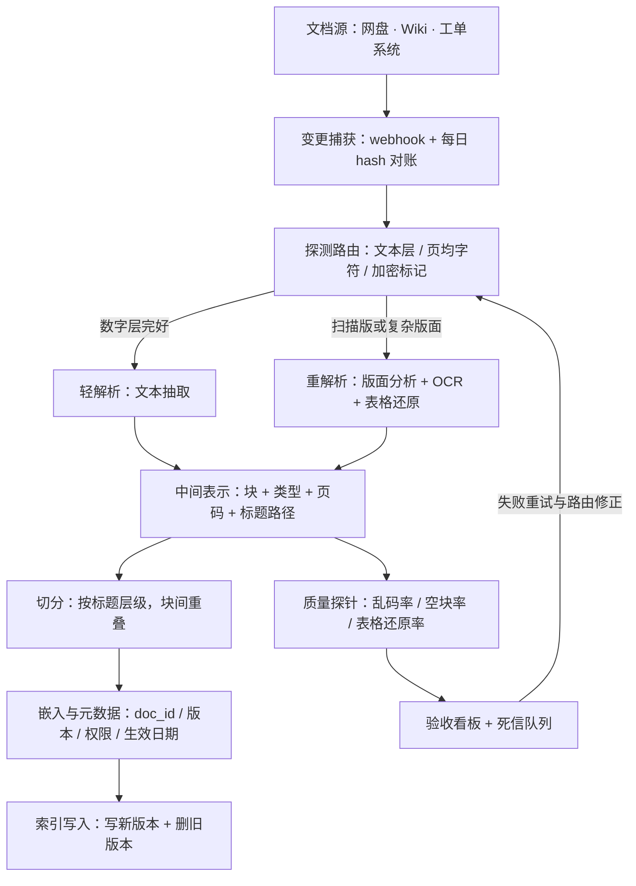

# 非结构化数据处理管线

> 层级：③ 数据与检索 ｜ 贯穿矛盾：质量 · 成本

## 场景

公司沉淀了海量文档——PDF、PPT、网页、工单、表格，要把它们变成能被检索、能喂给模型的知识资产，持续不断地产出向量与索引。

## 核心矛盾

**数据新鲜度 vs 处理成本**——全量重刷贵且慢，增量更新怕漏；而解析与切分质量直接决定下游检索上限，管线里最便宜的一步（切分）常常是最致命的一步。

## 追问链

- PDF 里的表格、图片、页眉页脚，怎么变成可检索的知识？解析质量差，下游再强也救不回来——解析质量怎么量化验收？
- 切分策略（按结构、按语义、固定窗口）对召回率影响有多大？怎么用评测集量化，而不是拍脑袋？
- 文档删除或改版后，旧向量怎么清理？「删干净了吗」怎么验证？
- 同一制度散落三个版本、互相矛盾，知识合并与冲突消解怎么做？

## 推演

### 容量估算（先问这几个数）

先立假设再算账——这道题的成本结构会推翻多数人的直觉：

| # | 假设 | 算式与推论 |
| --- | --- | --- |
| 1 | 假设：存量 100 万文档，平均 20 页（PDF/PPT/网页混合） | ≈ **2000 万页**——存量处理是一次性成本，决定首刷预算 |
| 2 | 假设：轻解析（文本抽取）10 页/秒/核；重解析（版面分析 + OCR + 表格还原）1 页/秒/GPU | 全量重解析：2000 万页 ÷ 1 页/秒 ≈ **231 GPU·天** ≈ 8 张卡跑一个月——「全量深度解析」不现实，必须分层路由 |
| 3 | 假设：日变更 0.5%（5000 篇 ≈ 10 万页），其中 20% 需要重解析 | 2 万页/天 ÷ 1 页/秒 ≈ **5.5 GPU·小时/天**——1 张卡常驻有余；分层让增量成本比全量低约两个数量级 |
| 4 | 假设：切分后 20 块/文档（20 页 × 每页 500 token ÷ 500 token/块） | 2000 万块；批量嵌入 1000 块/秒 → 全量重嵌 ≈ **5.5 小时**——嵌入比解析便宜两个数量级，成本大头在解析不在向量化 |
| 5 | 假设：块文本 + 元数据 1KB，向量 768 维 float32 3KB | 2000 万 × 4KB ≈ **80GB**——存储是整条管线最便宜的一环 |

成本结构的结论：**解析算力 >> 人工验收工时 >> 嵌入 >> 存储**。省钱要省在「解析分层」与「抽样验收」上；反过来，质量风险也集中在解析——它是管线里唯一「错了不会报错」的环节。

敏感性检查——假设各涨一档，结论就变：复杂文档占比 ×2（扫描件、财务报表多）时重解析预算翻倍，「探测路由」从优化项变成生死线；新鲜度要求从 T+1 收紧到分钟级时，变更捕获必须走 CDC / webhook 级别，对账兜底降频为每周。首刷预算的量级也解释了为什么多数团队第一次做知识库都死在「全量解析遥遥无期」上。

### 架构推演（从朴素方案开始塌）

**朴素方案**：一个脚本遍历文档目录 → 全部丢给解析库 → 固定窗口切块 → 嵌入 → 写入索引。

它在四个地方依次塌掉：

1. **塌在全量与新鲜度。** 100 万文档全量重刷按假设 2 需要数百 GPU·天，而文档每天在改——刷完即过期，永远追不上变更。机制：批处理周期大于数据变更周期时，新鲜度在数学上就不可能达标，必须转事件驱动增量。
2. **塌在解析一锅炖。** 扫描版 PDF 走文本抽取得到空串或乱码，直接进索引，下游检索命中垃圾。机制：解析器失败不抛异常，只产出「看起来像文本的噪声」——这是管线里最阴险的失败模式，静默污染下游。
3. **塌在失败静默。** 解析失败重试 3 次后丢弃，没人知道 15% 的文档根本没进索引，于是「检索效果莫名的差」成为永久悬案。机制：没有死信与覆盖率度量，系统的真实服务面（多少文档可被检索）就是未知数。
4. **塌在删改不清理。** 改版直接追加新向量，旧版本还在索引里，模型同时拿到新旧制度。机制：append-only 的索引在「文档会改版」的现实下必然产出矛盾证据，而矛盾证据会让幻觉率上升而不是下降。

演进路径与代价对账：

| 演进阶段 | 关键动作 | 修掉的塌点 | 新增代价 |
| --- | --- | --- | --- |
| V0 朴素 | 全量脚本一把梭 | — | 四处塌点全在 |
| V1 | 变更捕获，转事件驱动增量 | 塌点 1 | webhook 消费与对账 job 的运维 |
| V2 | 探测路由 + 解析分层 | 塌点 2 | 路由误判需要重试回流 |
| V3 | 死信队列 + 覆盖率看板 | 塌点 3 | 看板与告警的建设人力 |
| V4 | 版本化写入与删除 | 塌点 4 | 索引侧版本管理复杂度 |

逐步演进后的终态管线：

对照四处塌点：变更捕获让批处理转事件驱动（塌点 1）；探测路由让解析分层、扫描件不再一锅炖（塌点 2）；死信队列与验收看板把「没进索引的文档」变成一等公民（塌点 3）；版本化写入与删除让改版不产生双版本并存（塌点 4）。质量探针构成闭环——这不是可选的「监控」，是管线对「解析质量决定检索上限」这一核心矛盾的正面回答。

这张图里最重要的接口是「结构化中间表示」那一条线：解析、切分、嵌入、索引四段各自独立演进、独立重放、独立验收，靠中间表示解耦。没有中间表示的管线，每次换解析器或调切分都要从文档源全量重跑——对照容量估算，那就是再烧数百 GPU·天；有中间表示，重跑的只是便宜的下游两段。

### 关键决策论证

**决策 1：解析技术栈——开源管线自建还是多模态大模型直读？**

| 选项 | 机制 | 成本量级 |
| --- | --- | --- |
| A. 开源管线自建（版面检测 + OCR + 表格还原） | 单页 GPU 成本极低，可审计可调优，数据不出域 | 按假设 2-3：全量数百 GPU·天，增量一张卡常驻 |
| B. 多模态大模型直读（每页发图给 VLM） | 质量上限高、零管线工程，但按 token 持续烧钱 | 2000 万页 × 每页千级视觉 token，比 GPU 管线高一个数量级以上（经验判断） |

**结论：存量与高频变更走自建管线，VLM 只用于「管线置信度低时的二次仲裁」与低频新增的复杂文档。** 反转条件：数据允许出域、文档总量小于 10 万页、团队没有 GPU 与解析工程人力——此时全走 VLM 的总成本（金钱 + 时间）反而更低。

**决策 2：切分策略——固定窗口、按结构还是语义切分？**

**结论：按结构为主、固定窗口兜底、语义切分只给高价值语料。** 判据：切分的第一质量指标是「答案是否完整落在同一个块内」——跨块的答案在 top-k 里只出现半截，rerank 与大模型都只是在碎片上猜，这是机制不是偏好。按结构切分直接保住条款、小节的完整性；语义切分要为每个文档算相邻句 embedding 距离，成本高且切点不稳定（经验判断）。反转条件：语料本身无结构（聊天记录、日志），结构切分退化为窗口切分，语义切分的收益随之上升。

**决策 3：变更检测——webhook、hash 快照还是定期全量扫描？**

**结论：webhook 为主 + 每日 hash 对账兜底，两者缺一不可。** 机制：webhook 会丢（源系统漏发、消费端失败、历史数据没有事件），纯定期扫描的新鲜度被扫描周期锁死且对存储系统有读放大；hash 对账是唯一能**证明「没漏」**的手段——新鲜度指标必须可对账，否则「增量更新怕漏」就永远停留在怕。

反转与退化条件，按源系统能力分三档：其一，**源系统封闭**（采购的第三方工单/ERP，既无 webhook 也不可改造）——「webhook 为主」不成立，主通道退化为定时增量拉取（按源的修改时间或修订号拉变更清单）+ 每日 hash 对账，新鲜度上限被对账周期锁死，这是必须显式写进方案的降级而非静默缺陷。其二，**语料小且变更稀疏**（如总量 1 万篇以内、日变更近零的存档型知识库）——webhook 的接入与运维成本换不回收益，按假设 2 折算 1 万页轻解析分钟级完成，低频全量扫描即可全覆盖，「两者缺一不可」退化为「扫描一种就够」。其三，**源系统有可信修订号或变更序号**——对账从全量 hash 退化为比对序号清单，读放大降一个数量级。三档里唯一不可反转的是底线本身：对账手段可以换形态，但「没漏」必须可证明，不能撤。

**决策 4：多版本冲突在哪一层消解？**

| 层 | 手段 | 局限 |
| --- | --- | --- |
| 管线层 | 版本号 / 生效日期 / 废止状态做成必填元数据，缺元数据不准入索引 | 只能防「带标入库」，防不了历史脏数据 |
| 检索层 | 制度类查询默认只召回「生效中」版本，历史版本显式降权 | 依赖管线层元数据正确 |
| 生成层 | prompt 声明多版本处理规则，引用必须带版本与日期 | 只能补救，不能根治 |

**结论：三层都要，但地基是管线层。** 机制：没有生效日期与版本元数据，检索层无从过滤、生成层无从声明——把「哪个版本有效」交给模型现场推理，是把工程问题错当智能问题，必然偶发答错。

反转与退化条件：地基的位置取决于「元数据由谁保证」，不是拍脑袋定的。若文档源本身是权威系统（法务/制度平台导出时已带生效日期、废止状态，字段由发布工作流强制保证）——管线层的「生产元数据」职责退化为「校验透传」：只做准入校验，缺字段拒收、与源声明不一致即告警，地基上移到源系统，三层结构不变但管线层变薄。反过来，若源系统的元数据靠人工填写、错漏常见——管线层不仅不能退化，还要加一道从正文抽取生效日期做交叉校验的工序，人工核对进入验收工时预算（对照容量估算的成本排序）。唯一不可反转的底线：元数据必须在进索引前解决——无论地基在源系统还是在管线层，都不能下移到生成层靠模型现场判断，那是必错的选择，没有条件可谈。

四个决策收拢成一条逻辑：让贵的能力只花在贵的文档上——探测路由决定谁走重解析，分层决定算力花在哪，三层消解决定人工裁决花在哪；把钱花对地方，就是「数据新鲜度 vs 处理成本」这道矛盾的解法本身。

### 追问应答

**1. PDF 的表格、图片、页眉页脚怎么处理？解析质量怎么量化验收？**

页眉页脚、页码靠版面分析按区域剥离；表格还原为 Markdown/HTML 结构并绑定所属标题——行列关系本身就是语义，拍平成文本流等于销毁信息；图片关联 caption，必要时用 VLM 生成描述文本一并入索引。验收分三层：自动探针全量跑（乱码字符占比、空页率、每页字符密度分布）；元素级抽样人工核（每批抽固定页数，核对表格行列数与标题层级还原率）；端到端对比（解析变更前后跑 RAG 评测集看答案命中率，见 [企业知识库问答 RAG](企业知识库问答RAG.md)）——只有第三层能回答「解析改进值不值这个钱」。

**2. 切分策略怎么用评测集量化？**

先建「切分评测集」：标注一批问题及答案所在的完整语义单元（条款、小节）。然后量三个指标：**单元命中率**——答案语义单元是否完整落入单个块，直接度量切分本身；**检索命中率**——该块能否进 top-k，度量切分与 embedding 的配合；**端到端答案准确率**——最终裁决。对比策略时三者同看。经验判断：结构化文档（制度、合同）按结构切分在单元命中率上通常显著优于固定窗口，但最终以端到端指标为准，防止局部指标与目标脱节。

**3. 旧向量怎么清理？「删干净了吗」怎么验证？**

结构上以 doc_id + version 为主键：改版写入新 version 后按 doc_id 删旧 version，删除先打 tombstone、合并时物理清理（呼应 [向量检索服务](向量检索服务.md) 的段管理）。验证靠对账 job：索引侧按 doc_id 聚合出版本清单，与源侧有效文档清单做 diff，揪出「幽灵向量」（源已删除或版本已过期但索引仍在）；再对幽灵向量做反向检索抽检，确认用户检索不可达。对账证明结构干净，抽检证明链路干净，两者缺一不可——删除链路的失败几乎总是静默的。

**4. 同一制度三个版本互相矛盾，怎么合并与消解？**

先定位根因：不是模型不行，是三个版本同时可召回且无时效元数据。按决策 4 的三层处理：管线层把版本号、生效日期、废止状态设为索引准入的必填项；检索层对制度类查询默认过滤「生效中」、历史版本显式降权；生成层要求引用带文档版本与日期，多版本同时被召回时明确声明以哪个为准。本质是元数据工程与准入校验——「知识合并」的正确产出不是把三个版本合成一段新文本，而是让系统始终知道哪个版本现在有效。

### 常见误区

**误区 1：解析质量「抽几页肉眼看没乱码」就算验收。**
典型样子：随机打开几个 PDF，看转换出的文本通顺，就宣布解析合格。为什么不行：解析误差是长尾分布——少数复杂表格、扫描件贡献了绝大多数检索 bad case，随机抽样恰好避开长尾；必须有自动探针全量扫 + 定向抽最复杂样张，长尾质量靠定向抽样而非随机抽样。

**误区 2：把切分参数当调参玄学，换了就上。**
典型样子：「试试 chunk_size 512 和 overlap 50」，不跑评测直接发布。为什么不行：切分决定「答案完整性」这个不可再生的性质——碎了之后 rerank 与大模型都只是在碎片上猜；任何切分变更必须过单元命中率与端到端双评测，否则调的不是参数是运气。

**误区 3：索引当 append-only 日志，只增不删。**
典型样子：改版文档直接追加新向量，旧的留着「以备回溯」。为什么不行：新旧版本同时可召回，模型拿到矛盾证据后幻觉率上升而非下降；且「自信地答了已废止条款」比「检索不到」更伤信任——这正是 [企业知识库问答 RAG](企业知识库问答RAG.md) 核心矛盾的机制。

**误区 4：失败静默重试后放弃，死信只写日志。**
典型样子：解析失败重试 3 次，log 一行 error，任务标记完成。为什么不行：覆盖率 silent 下降，检索质量劣化永远查无根因；必须把死信做成队列 + 看板，「有多少文档没进索引」必须是一个随时可回答的数字，而不是事故后的考古发现。

---

[返回 AI 场景题地图](README.md)
